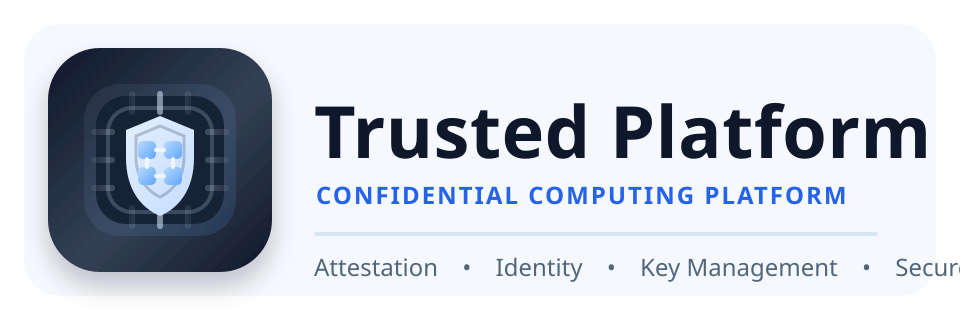

## Overview

The `Trusted Platform` is _platform software_ and tooling with a "batteries included" approach to building trusted, confidential computing platforms and networks.

The `Trusted Platform` uses a [Trusted Platform Module (TPM)](https://en.wikipedia.org/wiki/Trusted_Platform_Module), [Secure Boot](https://en.wikipedia.org/wiki/UEFI), and a provided [Certificate Authority](https://en.wikipedia.org/wiki/Certificate_authority) to establish a Platform Root of Trust for Storage & Reporting, perform Local and [Remote Attestation](https://tpm2-software.github.io/tpm2-tss/getting-started/2019/12/18/Remote-Attestation.html), encryption, signing, x509 certificate management, data integrity, intrusion detection, licensing, device provisioning and more.

This software is intended for use by OEM device manufacturers, enterprise administrators, platform administrators and end users, as `Platform Software`, described by the [Trusted Computing Group](https://trustedcomputinggroup.org/), the consortium focused on building specs, use cases, and frameworks for building Trusted Computing platforms.

This software may be used as a program, toolkit, and/or library for building custom platforms and services based on Trusted, Confidential Computing technologies.


## Features

Key capabilities include:

- **Certificate Authority** - Full X.509 PKI with ACME server/client, CRL management, and cross-signing
- **Key Management** - PKCS #8, PKCS #11, TPM 2.0 and Cloud KMS/HSM key storage
- **TPM 2.0** - Hardware-backed security with attestation, sealing, and device identity
- **Web Services** - HTTP/1-3, TLS 1.3, REST API, WebAuthn/FIDO2, and OAuth2/OIDC/JWT authentication
- **SDN Controller** - OVS/OpenFlow with 802.1X certificate-based network access
- **DNS Server** - Authoritative DNS with auto-configured DNSSEC and DANE
- **Compute Orchestration** - QEMU/KVM VMs with automatic vTPM provisioning
- **Multi-Tenancy** - Per-tenant network isolation with VLAN enforcement
- **Secure Boot** - UEFI Secure Boot with custom key enrollment and binary signing

### Planned Capabilities

These are designed but not yet implemented. They are documented here so the design is discoverable, not because the code ships today:

- **DHT Network** (roadmap) - Decentralized operations with cryptocurrency and content sharing. The design lives in [docs/dht/](docs/dht/); there is no `pkg/dht`. The only P2P code today is libp2p peer discovery in `pkg/sdn/gateway/p2p/`, compiled only under the `platform_p2p` build tag.
- **Firmware Support** (roadmap) - AVR, Raspberry Pi, and Android with secure OTA updates. See [docs/firmware/](docs/firmware/) and [ROADMAP.md](ROADMAP.md); it is at Phase 0 - Planned. There is no `pkg/firmware`.

For what is complete and what remains, see [ROADMAP.md](ROADMAP.md).

Feature documentation is in [docs/](docs/README.md).


## Multi-Protocol API

All platform services are exposed via multiple protocols for seamless integration across different clients and use cases:

| Protocol | Transport | Port | Use Case |
|----------|-----------|------|----------|
| REST | HTTPS | 8443 | Web clients, external systems |
| gRPC | TCP | 10443 | High-performance service-to-service |
| QUIC | UDP | 9444 | Low-latency, mobile clients |
| MCP | HTTP | 9445 | AI/LLM tool integration |
| Unix | Socket | /run/platformd.sock | Local IPC, CLI |

These are the defaults of `platformd serve`, overridable with `--rest-port`, `--grpc-port`, `--quic-port`, and `--mcp-port`. REST, gRPC, and QUIC bind `0.0.0.0`; MCP binds `127.0.0.1` only.

Each protocol provides full feature parity with the others, allowing you to choose the best fit for your integration. The platform daemon starts all protocol servers automatically based on your configuration.


## Use Cases

- Private / Public / Hybrid Cloud Service Providers
- OEM Device Manufacturing & Provisioning
- Automated Device Fleet Management
- DevOps Automation Platform
- Enterprise Network Management
- Mobile Device Management
- PKI-as-a-Service
- WebAuthN / FIDO2 Integration
- Single Sign-On & MFA
- Secure Key, Password & Secret Store
- Digital Rights Management


## Documentation

For detailed documentation on architecture and components, see:

- [Documentation Hub](docs/README.md) - Complete documentation index
- [Architecture](docs/architecture/) - System design and security model
- [Roadmap](ROADMAP.md) - Complete vs remaining to the release candidate


## Build

The included [Makefile](Makefile) provides automated builds on 64-bit x86 Debian based operating systems.

    # Initialize the build environment
    make init

    # Build platform binaries and web ui
    make build build-public-html

    # Build static binaries and web ui
    make build-static build-public-html

    # Build platform binaries, docker images, and ISOs
    make release-local

    # Cut an internal alpha from main: signed, annotated vX.Y.Z-alpha and
    # sdk/go/vX.Y.Z-alpha tags (docs/sdk/engineering.md §1)
    make release-alpha VERSION=v0.2.0-alpha

#### Core Dependencies

* [Linux](https://www.debian.org/)
* [Make](https://www.gnu.org/software/make/)
* [Golang](https://go.dev/)
* [Trusted Platform Module](https://trustedcomputinggroup.org/resource/trusted-platform-module-tpm-summary/)
* [Docker](https://www.docker.com/get-started/)
* [Buildkit](https://docs.docker.com/build/buildkit/)

#### Optional dependencies:

* [SoftHSM](https://www.opendnssec.org/softhsm/)
* [NitroKey](https://www.nitrokey.com/products/nitrokeys)
* [YubiKey](https://www.yubico.com/)
* [YubiHSM](https://www.yubico.com/products/hardware-security-module/)
* Other PKCS #11 HSM

> For FIPS compliance, a FIPS certified token is required.

Supported Operating Systems:

* [Debian](https://www.debian.org/)
* [Alpine](https://www.alpinelinux.org/)
* more to come ...

## Install

The easiest way to install the Trusted Platform is to use the ISO installer or docker container, as they include the platform software with automation capabilities that facilitate the installation and configuration for custom secure boot key enrollment, binary signing, TPM 2.0, LUKS full disk encryption, and support tooling.

See the [Reference Architecture](docs/architecture/reference.md) for details on the various components and how they're configured.

#### Configuration

Copy a [config file](configs/platform/) to `./config.yaml` (where you will run the `platformd` binary). Edit the configuration file according to your environment and requirements.

The development and example attestation configs use a TPM simulator which is reset every time the platform starts. Be sure to set the simulator to false in the platform configuration file to start using your real TPM device.

#### Quick Start

Generate a configuration and start the platform:

```bash
# Generate config and initialize the platform
./platformd config gen --init --domain=example.test --platform-dir trusted-data

# Start the platform daemon (all protocol servers auto-start)
sudo ./platformd serve --config config.yaml

# Use the CLI to manage the platform
platformctl daemon status
platformctl ca info
platformctl tpm info

# Browse REST API documentation
xdg-open https://localhost:8443/swagger/
```

Alternatively, use an existing configuration:

```bash
cp configs/platform/config.prod.yaml config.yaml
sudo ./platformd serve --config config.yaml
```


## SDK Integration

Use the Go SDK to integrate platform services into your applications:

```go
import platform "github.com/jeremyhahn/go-trusted-platform/sdk/go"

// Connect via Unix socket for local IPC
client, err := platform.NewClient("unix:///run/platformd.sock")
if err != nil {
    return err
}

// Or connect via REST, gRPC, QUIC, or other protocols
// client, err := platform.NewClient("https://localhost:8443")

// Interact with platform services
status, err := client.Daemon.Status(ctx)
if err != nil {
    return err
}
```

For detailed SDK documentation, see [docs/sdk/](docs/sdk/architecture.md).


## Algorithm Safety

Selecting secure encryption and hash function algorithms, padding schemes, and cipher suites are critical to the final security posture of an application. Be sure to check out the [Safe Curves](https://safecurves.cr.yp.to/) website for the latest updates on EC algorithms.

For general guidance:
- **EdDSA Curve25519** provides the best security by modern standards
- **RSA (PSS)** with 4096-bit keys is recommended for TPM 2.0 (which doesn't support Curve25519)
- The [NitroKey 3](https://www.nitrokey.com/products/nitrokeys) provides RSA 4096-bit and EC keys including Curve25519

Note that many low cost HSMs don't offer RSA 4096-bit keys or Curve25519. Check your HSM documentation closely prior to purchase.


## Vulnerabilities

The following critical vulnerabilities have been discovered in TPM 2.0:

* [CVE-2023-1017](https://cve.mitre.org/cgi-bin/cvename.cgi?name=CVE-2023-1017)
* [CVE-2023-1018](https://cve.mitre.org/cgi-bin/cvename.cgi?name=CVE-2023-1018)

For a detailed description, see [this article](https://blog.quarkslab.com/vulnerabilities-in-the-tpm-20-reference-implementation-code.html).


## Sponsors

|  |  |
| ------- | ----- |
| | Thanks for 3 NitroKey HSM 2 devices to assist in PKCS #11 & Raft development! |


## Support

A [Discord server](https://discord.gg/TuJex32b) has been created for community support.

Please consider supporting this project for ongoing success and sustainability. I'm a passionate open source contributor making a professional living creating free, secure, scalable, robust, enterprise grade, distributed systems and cloud native solutions.

I'm also available for international consulting opportunities. Please let me know how I can assist you or your organization in achieving your desired security posture and technology goals.

https://github.com/sponsors/jeremyhahn

https://www.linkedin.com/in/jeremyhahn
