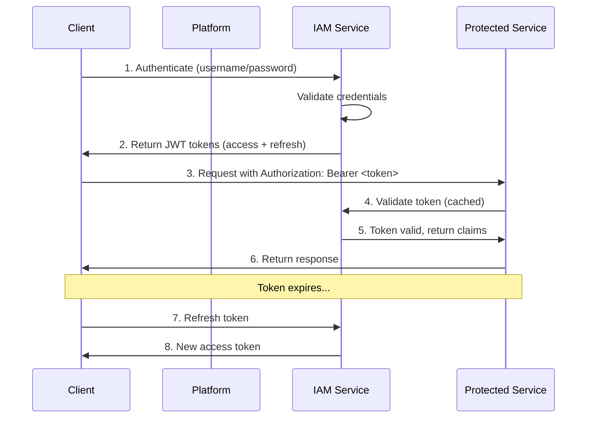
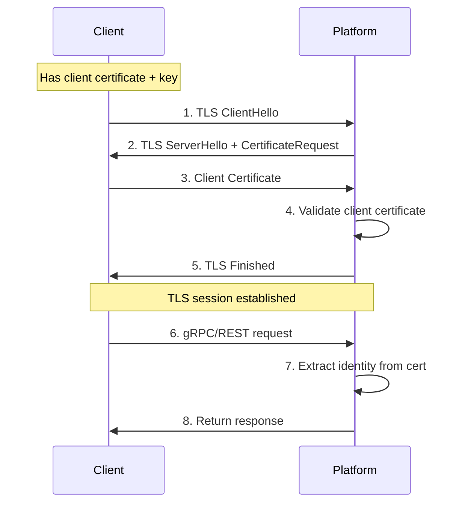
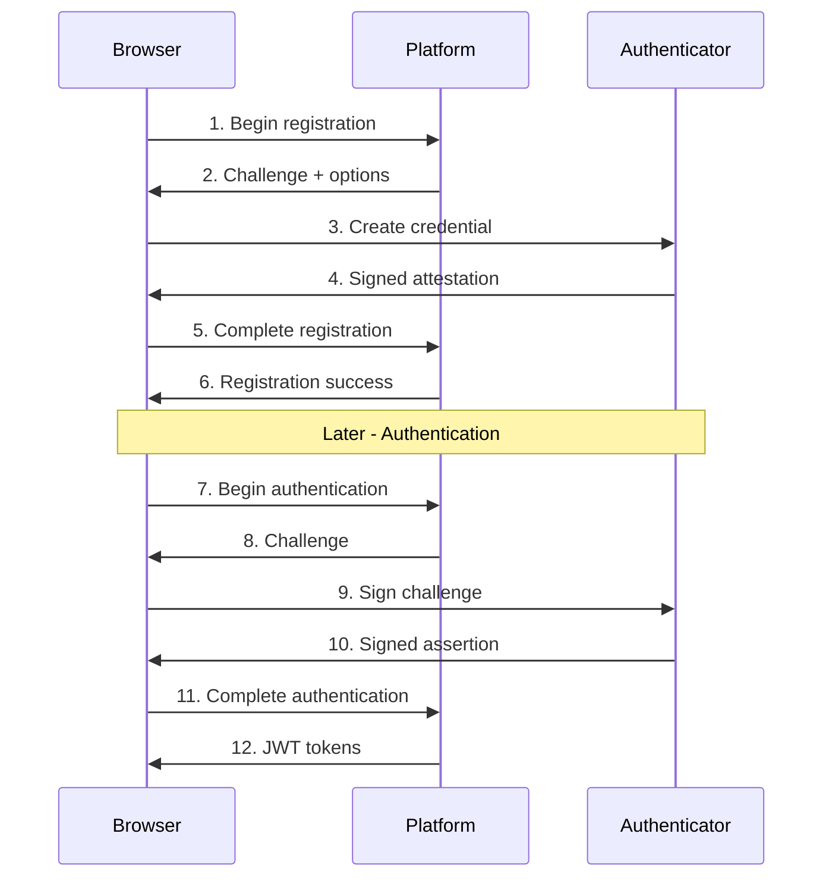
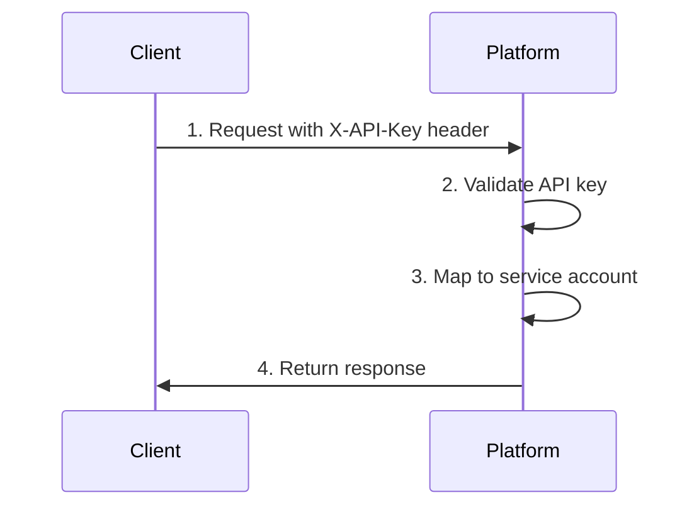
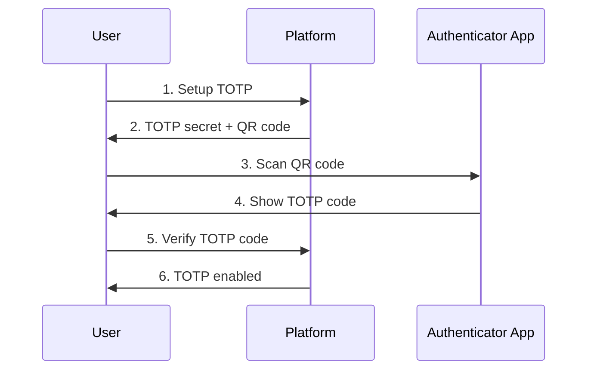

# Authentication Flows

> **Status: ARCHIVE — historical record. Do NOT build from this document.**
> Last verified: 2026-10-13 · Replaced by [daemon/api.md](../../daemon/api.md) and each feature's `api.md`.

This document describes the authentication mechanisms supported by the Trusted Platform SDKs.

## Overview

The platform supports two primary authentication methods:

| Method | Use Case | Protocol Support |
|--------|----------|------------------|
| Token (JWT) | API clients, Web apps | All protocols |
| mTLS | Service-to-service, High security | gRPC, REST, QUIC |

## Token-Based Authentication

### Flow Diagram



### Step 1: Initial Authentication

```go
// Go SDK
auth, err := client.IAM().Authenticate(ctx, &platformv1.AuthenticateRequest{
    Username: "admin",
    Password: "secure-password",
})
if err != nil {
    log.Fatal(err)
}

accessToken := auth.AccessToken
refreshToken := auth.RefreshToken
expiresAt := auth.ExpiresAt
```

```typescript
// JavaScript SDK
const auth = await client.iam.authenticate({
  username: 'admin',
  password: 'secure-password',
});

if (auth.data) {
  const { accessToken, refreshToken, expiresAt } = auth.data;
}
```

### Step 2: Using the Token

```go
// Go SDK - Add to context metadata
import "google.golang.org/grpc/metadata"

ctx := metadata.AppendToOutgoingContext(ctx,
    "authorization", "Bearer "+accessToken,
)

// Make authenticated request
cert, err := client.CA().Issue(ctx, request)
```

```typescript
// JavaScript SDK - Use interceptor
import { createAuthInterceptor } from 'trusted-platform-sdk';

client.addRequestInterceptor(
  createAuthInterceptor(() => accessToken)
);

// Requests now include Authorization header
const cert = await client.ca.issueCertificate(request);
```

### Step 3: Token Refresh

```go
// Go SDK
refreshed, err := client.IAM().RefreshToken(ctx, &platformv1.RefreshTokenRequest{
    RefreshToken: refreshToken,
})
if err != nil {
    // Refresh failed - re-authenticate
    auth, err = client.IAM().Authenticate(ctx, authRequest)
}
accessToken = refreshed.AccessToken
```

```typescript
// JavaScript SDK with automatic refresh
let tokens = { accessToken: '', refreshToken: '', expiresAt: 0 };

async function getValidToken(): Promise<string> {
  // Check if token is expired (with 60s buffer)
  if (Date.now() >= tokens.expiresAt - 60000) {
    const response = await client.iam.refreshToken({
      refreshToken: tokens.refreshToken,
    });
    if (response.data) {
      tokens = {
        accessToken: response.data.accessToken,
        refreshToken: response.data.refreshToken,
        expiresAt: Date.now() + response.data.expiresIn * 1000,
      };
    }
  }
  return tokens.accessToken;
}

client.addRequestInterceptor(createAuthInterceptor(getValidToken));
```

### JWT Token Structure

```json
{
  "header": {
    "alg": "RS256",
    "typ": "JWT",
    "kid": "key-id-123"
  },
  "payload": {
    "sub": "user-123",
    "iss": "https://platform.example.com",
    "aud": ["platform-api"],
    "exp": 1705752000,
    "iat": 1705748400,
    "nbf": 1705748400,
    "tenant_id": "default",
    "roles": ["admin", "operator"],
    "permissions": ["certificates:*", "devices:read"]
  }
}
```

## mTLS Authentication

### Flow Diagram



### Client Certificate Setup

```go
// Go SDK - mTLS configuration
// Load client certificate
cert, err := tls.LoadX509KeyPair("client.crt", "client.key")
if err != nil {
    log.Fatal(err)
}

// Load CA certificate for server verification
caCert, err := os.ReadFile("ca.crt")
if err != nil {
    log.Fatal(err)
}
certPool := x509.NewCertPool()
certPool.AppendCertsFromPEM(caCert)

// Configure mTLS
tlsConfig := &tls.Config{
    Certificates: []tls.Certificate{cert},
    RootCAs:      certPool,
    MinVersion:   tls.VersionTLS13,
}

// Create client with mTLS
client, err := platform.NewClient(ctx,
    platform.WithGRPCAddr("platform.example.com:10443"),
    platform.WithTLSConfig(tlsConfig),
)
```

### Server Certificate Validation

The client validates the server certificate:

1. Certificate chain is valid
2. Certificate is not expired
3. Certificate is issued by trusted CA
4. Server name matches certificate SAN/CN

### Client Certificate Requirements

| Field | Requirement |
|-------|-------------|
| Key Usage | Digital Signature, Key Encipherment |
| Extended Key Usage | Client Authentication |
| Subject | Identifies the client/service |
| SAN | Optional DNS/URI identifiers |
| Validity | Must be current |
| Issuer | Must be trusted by platform CA |

### Certificate Subject Mapping

The platform extracts identity from the client certificate:

```
Subject: CN=service-name,O=org,OU=team
    -> user_id: service-name
    -> tenant_id: org
    -> metadata: { team: "team" }
```

## WebAuthn Integration

For web applications requiring strong authentication:



### WebAuthn Registration

```typescript
// JavaScript SDK
const registration = await client.iam.beginWebAuthnRegistration({
  username: 'user@example.com',
});

// Browser creates credential
const credential = await navigator.credentials.create({
  publicKey: registration.data.options,
});

// Complete registration
await client.iam.completeWebAuthnRegistration({
  credential: credential,
  sessionId: registration.data.sessionId,
});
```

### WebAuthn Authentication

```typescript
// Begin authentication
const authStart = await client.iam.beginWebAuthnAuthentication({
  username: 'user@example.com',
});

// Browser signs challenge
const assertion = await navigator.credentials.get({
  publicKey: authStart.data.options,
});

// Complete authentication
const tokens = await client.iam.completeWebAuthnAuthentication({
  assertion: assertion,
  sessionId: authStart.data.sessionId,
});
```

## API Key Authentication

For service accounts and automation:



### Using API Keys

```bash
# REST API
curl -X GET https://platform.example.com:8443/api/v1/ca/info \
  -H "X-API-Key: pk_live_abc123..."
```

```go
// Go SDK - Add API key to metadata
ctx := metadata.AppendToOutgoingContext(ctx,
    "x-api-key", "pk_live_abc123...",
)
```

```typescript
// JavaScript SDK
const client = new PlatformClient({
  baseUrl: 'https://platform.example.com',
  headers: {
    'X-API-Key': 'pk_live_abc123...',
  },
});
```

### API Key Management

```go
// Create API key
key, err := client.IAM().CreateAPIKey(ctx, &platformv1.CreateAPIKeyRequest{
    Name:        "automation-key",
    Permissions: []string{"certificates:read", "devices:read"},
    ExpiresAt:   time.Now().Add(365 * 24 * time.Hour),
})

// List API keys
keys, err := client.IAM().GetAPIKeys(ctx, &platformv1.GetAPIKeysRequest{})

// Revoke API key
_, err = client.IAM().RevokeAPIKey(ctx, &platformv1.RevokeAPIKeyRequest{
    KeyId: key.Id,
})
```

## Multi-Factor Authentication

### TOTP Setup



```go
// Setup TOTP
setup, err := client.IAM().SetupTOTP(ctx, &platformv1.SetupTOTPRequest{
    UserId: userId,
})
// Display setup.QrCodeUrl to user

// Verify TOTP to complete setup
_, err = client.IAM().VerifyTOTP(ctx, &platformv1.VerifyTOTPRequest{
    UserId: userId,
    Code:   "123456",
})
```

### Authentication with TOTP

```go
// First factor: password
auth, err := client.IAM().Authenticate(ctx, &platformv1.AuthenticateRequest{
    Username: "admin",
    Password: "password",
})

if auth.RequiresMfa {
    // Second factor: TOTP
    auth, err = client.IAM().VerifyTOTP(ctx, &platformv1.VerifyTOTPRequest{
        SessionId: auth.MfaSessionId,
        Code:      "123456",
    })
}

// Now have valid tokens
accessToken := auth.AccessToken
```

## Session Management

### Active Sessions

```go
// List active sessions
sessions, err := client.IAM().ListActiveSessions(ctx, &platformv1.ListActiveSessionsRequest{
    UserId: userId,
})

for _, session := range sessions.Sessions {
    log.Printf("Session: %s, Created: %s, IP: %s",
        session.Id, session.CreatedAt, session.IpAddress)
}
```

### Session Revocation

```go
// Revoke specific session
_, err := client.IAM().RevokeSession(ctx, &platformv1.RevokeSessionRequest{
    SessionId: sessionId,
})

// Revoke all sessions (logout everywhere)
_, err = client.IAM().RevokeAllSessions(ctx, &platformv1.RevokeAllSessionsRequest{
    UserId: userId,
})
```

## Best Practices

1. **Use mTLS for service-to-service**: Strongest authentication
2. **Implement token refresh**: Don't let tokens expire mid-operation
3. **Store tokens securely**: Use secure storage, never log tokens
4. **Use short-lived tokens**: 15-60 minutes for access tokens
5. **Implement MFA**: Require for privileged operations
6. **Rotate API keys**: Periodic rotation reduces risk
7. **Monitor sessions**: Alert on unusual session activity
8. **Use least privilege**: Grant minimum required permissions
