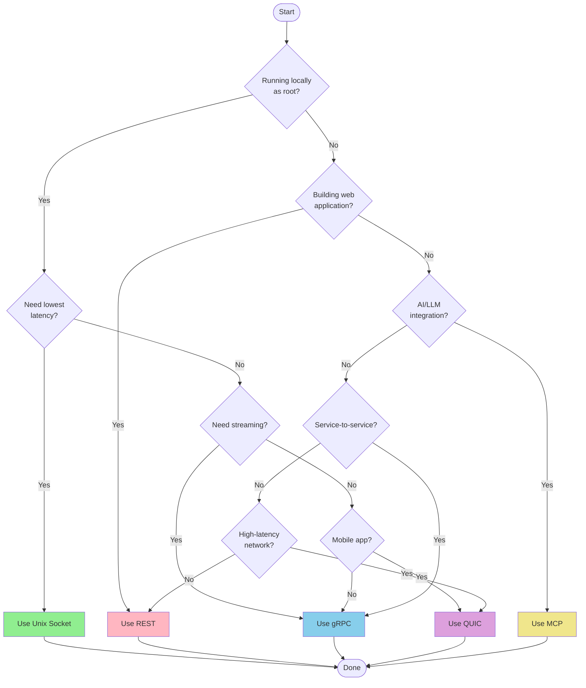

# Protocol Selection Guide

> **Status: ARCHIVE — historical record. Do NOT build from this document.**
> Last verified: 2026-10-13 · Replaced by [daemon/api.md](../../daemon/api.md) and each feature's `api.md`.

This guide helps you choose the right protocol for your use case and configure the SDK appropriately.

## Decision Flowchart



## Use Case Matrix

| Use Case | Recommended | Alternative | Avoid |
|----------|-------------|-------------|-------|
| CLI tools | Unix | gRPC | REST |
| System services | Unix | gRPC | MCP |
| Web dashboard | REST | - | Unix |
| React app | REST | - | Unix |
| Microservices | gRPC | QUIC | MCP |
| Mobile app | QUIC | REST | Unix |
| AI assistant | MCP | REST | Unix |
| High-throughput | gRPC | Unix | MCP |
| Streaming logs | gRPC | QUIC | REST |
| Firewall-restricted | REST | gRPC | QUIC |
| Connection migration | QUIC | - | Others |

## Protocol Comparison Summary

```
                Performance               Compatibility           Features
        +-------------------------+  +------------------------+  +------------------------+
        | Latency   | Throughput  |  | Browser | Firewall    |  | Streaming | mTLS      |
+-------+-----------+-------------+  +---------+-------------+  +-----------+-----------+
| Unix  | Lowest    | Highest     |  | No      | N/A         |  | Yes       | No        |
| gRPC  | Low       | High        |  | No*     | Usually OK  |  | Yes       | Yes       |
| REST  | Medium    | Medium      |  | Yes     | Always OK   |  | No        | Yes       |
| QUIC  | Low       | High        |  | No      | Sometimes   |  | Yes       | Yes       |
| MCP   | Medium    | Low         |  | Yes     | Always OK   |  | Limited   | Optional  |
+-------+-----------+-------------+  +---------+-------------+  +-----------+-----------+

* gRPC-Web enables browser support with a proxy
```

## Fallback Behavior

The Go SDK supports automatic protocol fallback:

```go
// Configure multiple protocols with priority
client, err := platform.NewClient(ctx,
    platform.WithUnixSocket("/run/platformd.sock"),  // Try first (if root)
    platform.WithGRPCAddr("platform.example.com:10443"),  // Try second
    platform.WithRESTAddr("platform.example.com:8443"),   // Try third
)

// Check which protocol was used
log.Printf("Connected via: %s", client.Protocol())
```

### Fallback Order

Default order (when no preference set):

1. **Unix Socket** - If running as root and socket exists
2. **gRPC** - If address configured
3. **REST** - If address configured
4. **QUIC** - If address configured
5. **MCP** - If address configured

### Custom Priority

```go
// Prefer gRPC, fall back to REST
client, err := platform.NewClient(ctx,
    platform.WithGRPCAddr("platform.example.com:10443"),
    platform.WithRESTAddr("platform.example.com:8443"),
    platform.WithPreferredProtocol(platform.ProtocolGRPC),
)
```

### Force Single Protocol

```go
// Only use gRPC - fail if unavailable
client, err := platform.NewClient(ctx,
    platform.WithGRPCAddr("platform.example.com:10443"),
    platform.WithOnlyProtocol(platform.ProtocolGRPC),
)
```

## Environment-Specific Recommendations

### Development Environment

```go
// Local development - Unix socket for speed
client, err := platform.NewClient(ctx,
    platform.WithUnixSocket("/run/platformd.sock"),
    platform.WithOnlyProtocol(platform.ProtocolUnix),
)

// Or with TLS-secured gRPC for debugging
client, err := platform.NewClient(ctx,
    platform.WithGRPCAddr("localhost:10443"),
    platform.WithTLSConfig(&tls.Config{
        MinVersion: tls.VersionTLS13,
        RootCAs:    loadCACertPool("/path/to/ca.crt"),
    }),
)
```

### Production Environment

```go
// Production - gRPC with TLS
client, err := platform.NewClient(ctx,
    platform.WithGRPCAddr("platform.internal:10443"),
    platform.WithTLSConfig(&tls.Config{
        MinVersion: tls.VersionTLS13,
        RootCAs:    certPool,
    }),
    platform.WithTimeout(10*time.Second),
)
```

### Multi-Region Deployment

```go
// Multi-region with fallback
client, err := platform.NewClient(ctx,
    platform.WithGRPCAddr("platform-us-east.example.com:10443"),
    platform.WithGRPCAddr("platform-us-west.example.com:10443"),
    platform.WithTLSConfig(tlsConfig),
)
```

### Mobile Application

```typescript
// Mobile - QUIC for connection migration
const client = new PlatformClient({
  quicUrl: 'platform.example.com:9444',
  protocol: 'quic',
});
```

### Web Application

```typescript
// Web - REST for browser compatibility
const client = new PlatformClient({
  baseUrl: 'https://api.example.com',
  credentials: 'include',
});
```

## Firewall Considerations

### Port Requirements

| Protocol | Port | Direction | Notes |
|----------|------|-----------|-------|
| gRPC | 10443/TCP | Outbound | Usually allowed |
| REST | 8443/TCP | Outbound | Always allowed |
| QUIC | 9444/UDP | Outbound | Often blocked |
| MCP | 9445/TCP | Outbound | Usually allowed |

### Restricted Networks

When UDP is blocked (common in corporate networks):

```go
// Avoid QUIC in restricted environments
client, err := platform.NewClient(ctx,
    platform.WithGRPCAddr("platform.example.com:10443"),
    platform.WithRESTAddr("platform.example.com:8443"),
    // Do NOT configure QUIC
)
```

### Proxy Support

REST works through HTTP proxies:

```go
// Configure proxy for REST
proxyURL, _ := url.Parse("http://proxy.internal:8080")
transport := &http.Transport{
    Proxy: http.ProxyURL(proxyURL),
}

client, err := platform.NewClient(ctx,
    platform.WithRESTAddr("platform.example.com:8443"),
    platform.WithOnlyProtocol(platform.ProtocolREST),
    // Custom transport configuration needed at lower level
)
```

## Performance Tuning

### Low Latency Requirements

```go
// Minimize latency
client, err := platform.NewClient(ctx,
    // Prefer protocols with lowest latency
    platform.WithUnixSocket("/run/platformd.sock"),
    platform.WithQUICAddr("platform.example.com:9444"),
    platform.WithGRPCAddr("platform.example.com:10443"),
    // Short timeout for fast failure
    platform.WithTimeout(2*time.Second),
)
```

### High Throughput Requirements

```go
// Maximize throughput
client, err := platform.NewClient(ctx,
    platform.WithGRPCAddr("platform.example.com:10443"),
    // Increase message size for bulk operations
    platform.WithMaxMessageSize(16*1024*1024),
    // Longer timeout for large transfers
    platform.WithTimeout(60*time.Second),
)
```

### Connection Pooling

```go
// gRPC handles multiplexing automatically
// For REST, the HTTP client pools connections
// For QUIC, streams are multiplexed over one connection
```

## Best Practices

### 1. Always Configure Fallback

```go
// Don't rely on a single protocol
client, err := platform.NewClient(ctx,
    platform.WithGRPCAddr("platform.example.com:10443"),
    platform.WithRESTAddr("platform.example.com:8443"),
)
```

### 2. Use Appropriate Timeouts

```go
// Different timeouts for different operations
shortOpts := platform.NewOptions(
    platform.WithTimeout(5*time.Second),  // Fast operations
)

longOpts := platform.NewOptions(
    platform.WithTimeout(60*time.Second),  // Bulk operations
)
```

### 3. Monitor Protocol Usage

```go
// Log which protocol is being used
client, err := platform.NewClient(ctx, opts...)
if err == nil {
    metrics.RecordProtocol(client.Protocol())
    log.Printf("Connected via %s", client.Protocol())
}
```

### 4. Handle Failures Gracefully

```go
client, err := platform.Connect(ctx, opts)
if err != nil {
    var unavailable platform.ErrDaemonUnavailable
    if errors.As(err, &unavailable) {
        // All protocols failed
        log.Printf("Tried protocols: %v", unavailable.Attempted)
        log.Printf("Last error: %v", unavailable.LastErr)
    }
}
```

### 5. Test All Configured Protocols

```go
// In tests, verify all protocols work
func TestProtocols(t *testing.T) {
    protocols := []platform.Protocol{
        platform.ProtocolGRPC,
        platform.ProtocolREST,
    }

    for _, proto := range protocols {
        t.Run(proto.String(), func(t *testing.T) {
            client, err := platform.NewClient(ctx,
                platform.WithGRPCAddr(grpcAddr),
                platform.WithRESTAddr(restAddr),
                platform.WithOnlyProtocol(proto),
            )
            require.NoError(t, err)
            defer client.Close()

            err = client.Ping(ctx)
            assert.NoError(t, err)
        })
    }
}
```

## Summary Decision Table

| Scenario | Protocol | Reason |
|----------|----------|--------|
| systemd service on same host | Unix | Fastest, no network |
| Kubernetes sidecar | Unix | Same pod, low latency |
| Backend microservice | gRPC | Strong typing, streaming |
| React dashboard | REST | Browser native |
| Mobile iOS/Android | QUIC | Connection migration |
| Claude/GPT integration | MCP | Tool discovery |
| IoT device | QUIC | Low bandwidth |
| Legacy system integration | REST | Universal support |
| Real-time monitoring | gRPC | Bidirectional streaming |
| Batch processing | gRPC | High throughput |
