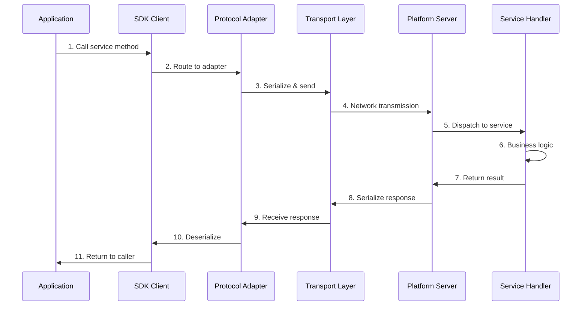
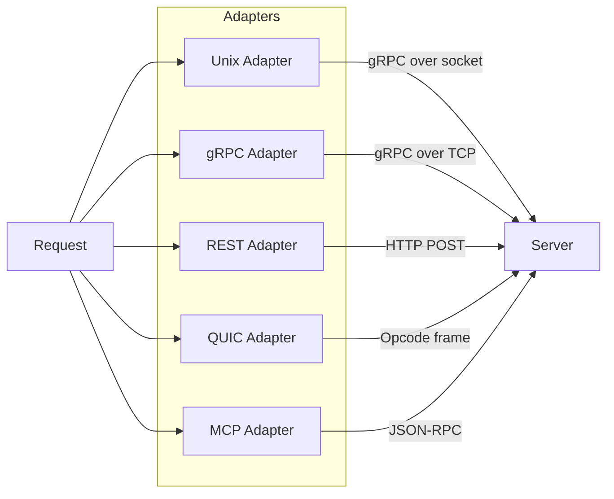
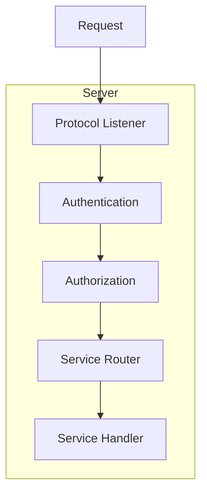
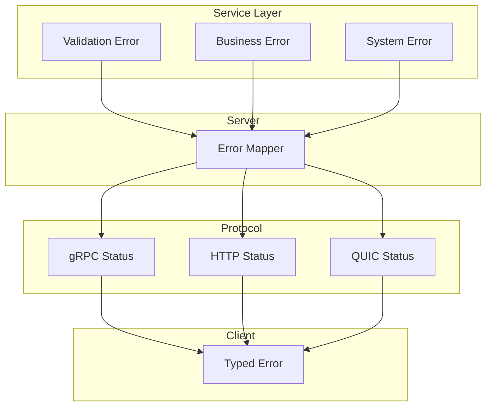
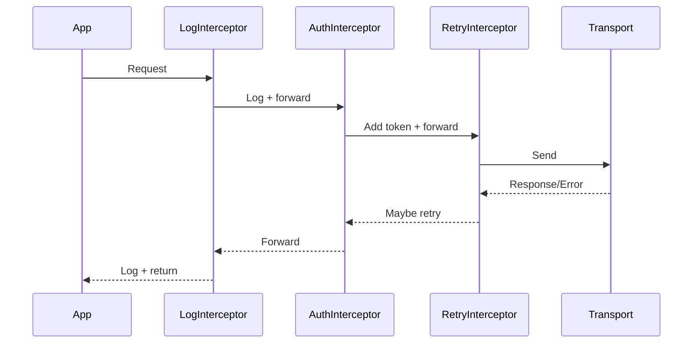
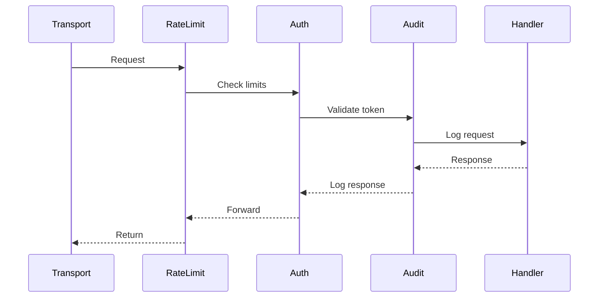

# Request Lifecycle

This document describes the complete lifecycle of a request from client to server and back, including protocol-specific handling.

## Overview



## Detailed Request Flow

### Phase 1: Client Invocation

```go
// Application code
cert, err := client.CA().Issue(ctx, &platformv1.IssueCertificateRequest{
    CommonName: "server.example.com",
    ValidDays:  365,
})
```

The SDK client receives the call and performs:

1. **Context propagation**: Deadline, cancellation, metadata
2. **Request validation**: Basic field validation
3. **Service selection**: Route to correct service client

### Phase 2: Protocol Adapter Processing

The adapter transforms the request for the specific protocol:



#### gRPC Adapter

```go
// Direct pass-through - native gRPC
func (a *Adapter) Connection() grpc.ClientConnInterface {
    return a.conn
}
```

#### REST Adapter

```go
// Translate gRPC method to REST
func (c *restClientConn) Invoke(ctx context.Context, method string, args, reply interface{}, opts ...grpc.CallOption) error {
    path, httpMethod := mapGRPCMethodToREST(method)
    return c.adapter.DoRequest(ctx, httpMethod, path, args, reply)
}

// /platformv1.CAService/Issue -> POST /api/v1/ca/certificates
```

#### QUIC Adapter

```go
// Translate to opcode-based protocol
func (c *quicClientConn) Invoke(ctx context.Context, method string, args, reply interface{}, opts ...grpc.CallOption) error {
    opcode := grpcMethodToOpcodeMap[method]
    return c.adapter.client.Send(ctx, opcode, args, reply)
}

// /platformv1.CAService/Issue -> opcode 0x11 (OpCAIssue)
```

#### MCP Adapter

```go
// Translate to JSON-RPC tool call
func (c *mcpClientConn) Invoke(ctx context.Context, method string, args, reply interface{}, opts ...grpc.CallOption) error {
    toolName := grpcMethodToMCPToolMap[method]
    arguments, _ := structToMap(args)
    result, err := c.adapter.client.CallTool(ctx, toolName, arguments)
    return mapToStruct(result, reply)
}

// /platformv1.CAService/Issue -> tool "ca.issue"
```

### Phase 3: Network Transmission

Each protocol serializes and transmits differently:

| Protocol | Serialization | Transport | Encryption |
|----------|---------------|-----------|------------|
| Unix | Protobuf | Unix socket | None (kernel) |
| gRPC | Protobuf | TCP/TLS 1.3 | TLS |
| REST | JSON | HTTP/TLS 1.3 | TLS |
| QUIC | Protobuf | UDP/TLS 1.3 | TLS |
| MCP | JSON | HTTP/TLS 1.3 | TLS |

### Phase 4: Server Reception



#### Authentication Check

```go
// Server-side authentication
func (s *Server) authenticate(ctx context.Context) (*Claims, error) {
    // Check for token in metadata/headers
    token := extractToken(ctx)
    if token != "" {
        return s.validateJWT(token)
    }

    // Check for mTLS client certificate
    if cert := extractClientCert(ctx); cert != nil {
        return s.validateCertificate(cert)
    }

    // Check for API key
    if apiKey := extractAPIKey(ctx); apiKey != "" {
        return s.validateAPIKey(apiKey)
    }

    return nil, ErrUnauthenticated
}
```

#### Authorization Check

```go
// ABAC-based authorization
func (s *Server) authorize(ctx context.Context, claims *Claims, action, resource string) error {
    // Build policy context
    policyCtx := &PolicyContext{
        Subject:  claims.Subject,
        TenantID: claims.TenantID,
        Roles:    claims.Roles,
        Action:   action,
        Resource: resource,
    }

    // Evaluate against policies
    return s.policyEngine.Evaluate(policyCtx)
}
```

### Phase 5: Service Handler Execution

```go
// Service implementation
func (s *CAService) Issue(ctx context.Context, req *platformv1.IssueCertificateRequest) (*platformv1.IssueCertificateResponse, error) {
    // 1. Validate request
    if err := s.validateRequest(req); err != nil {
        return nil, status.Error(codes.InvalidArgument, err.Error())
    }

    // 2. Business logic
    cert, err := s.ca.IssueCertificate(ctx, &ca.CertificateRequest{
        CommonName:   req.CommonName,
        Organization: req.Organization,
        DNSNames:     req.DnsNames,
        ValidDays:    int(req.ValidDays),
    })
    if err != nil {
        return nil, s.translateError(err)
    }

    // 3. Build response
    return &platformv1.IssueCertificateResponse{
        Serial:      cert.Serial,
        Subject:     cert.Subject,
        Certificate: cert.PEM,
        NotBefore:   timestamppb.New(cert.NotBefore),
        NotAfter:    timestamppb.New(cert.NotAfter),
    }, nil
}
```

### Phase 6: Response Transmission

The response follows the reverse path:

1. **Service handler** returns response or error
2. **Server** serializes response for protocol
3. **Network** transmits response
4. **Adapter** receives and deserializes
5. **SDK** returns to application

## Error Propagation



### Error Translation

| Internal Error | gRPC Code | HTTP Status | QUIC Status |
|----------------|-----------|-------------|-------------|
| Validation error | InvalidArgument | 400 | 0x09 |
| Not found | NotFound | 404 | 0x02 |
| Already exists | AlreadyExists | 409 | 0x06 |
| Permission denied | PermissionDenied | 403 | 0x07 |
| Unauthenticated | Unauthenticated | 401 | 0x03 |
| Internal error | Internal | 500 | 0x04 |

## Interceptors and Middleware

### Client-Side Interceptors



### Server-Side Middleware



## Request Context

The context carries important information through the request lifecycle:

```go
// Context contents
type RequestContext struct {
    // Deadline
    Deadline time.Time

    // Cancellation
    Done <-chan struct{}

    // Request ID for tracing
    RequestID string

    // Authentication claims
    Claims *Claims

    // Tenant context
    TenantID string

    // Trace span
    Span trace.Span
}
```

### Context Propagation

```go
// Client adds metadata
ctx := metadata.AppendToOutgoingContext(ctx,
    "x-request-id", requestID,
    "x-tenant-id", tenantID,
)

// Server extracts metadata
md, ok := metadata.FromIncomingContext(ctx)
if ok {
    requestID := md.Get("x-request-id")[0]
    tenantID := md.Get("x-tenant-id")[0]
}
```

## Timing Breakdown

Typical request timing (gRPC, remote):

```
+------------------+--------+
| Phase            | Time   |
+------------------+--------+
| SDK overhead     | 0.1ms  |
| Serialization    | 0.2ms  |
| Network RTT      | 2-20ms |
| TLS overhead     | 0.5ms  |
| Server routing   | 0.1ms  |
| Auth/AuthZ       | 0.5ms  |
| Handler          | 1-50ms |
| Response serial  | 0.2ms  |
| Network RTT      | 2-20ms |
+------------------+--------+
| Total            | 6-92ms |
+------------------+--------+
```

## Complete Example

```go
// Traced request with full lifecycle visibility
func issueCertificateWithTrace(ctx context.Context, client platform.Client, cn string) (*Certificate, error) {
    // Start trace span
    ctx, span := tracer.Start(ctx, "IssueCertificate")
    defer span.End()

    // Add request ID
    requestID := uuid.New().String()
    ctx = metadata.AppendToOutgoingContext(ctx, "x-request-id", requestID)

    log.Printf("[%s] Starting certificate issuance for %s", requestID, cn)

    // Make request
    start := time.Now()
    resp, err := client.CA().Issue(ctx, &platformv1.IssueCertificateRequest{
        CommonName: cn,
        ValidDays:  365,
    })
    duration := time.Since(start)

    // Handle error
    if err != nil {
        span.RecordError(err)
        log.Printf("[%s] Failed after %v: %v", requestID, duration, err)
        return nil, err
    }

    log.Printf("[%s] Completed in %v: serial=%s", requestID, duration, resp.Serial)

    return &Certificate{
        Serial:  resp.Serial,
        Subject: resp.Subject,
        PEM:     resp.Certificate,
    }, nil
}
```
