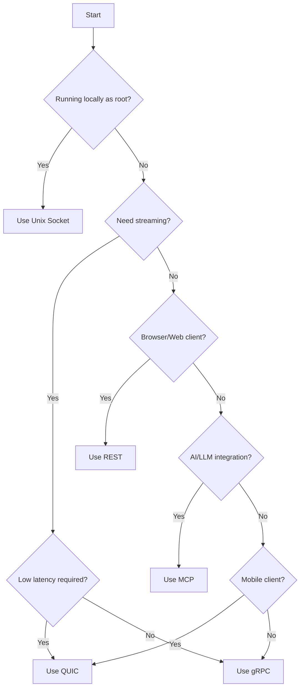

# Multi-Protocol Architecture

> **Status: ARCHIVE — historical record. Do NOT build from this document.**
> Last verified: 2026-10-13 · Replaced by [daemon/api.md](../../daemon/api.md) and each feature's `api.md`.

The Trusted Platform daemon exposes all services via five protocols, providing maximum interoperability for different use cases and environments.

## Protocol Comparison

| Protocol | Transport | Port | Latency | Streaming | Use Case |
|----------|-----------|------|---------|-----------|----------|
| Unix Socket | Local IPC | `/run/platformd.sock` | Lowest | Yes | CLI, local tools |
| gRPC | TCP (TLS) | 10443 | Low | Yes | Service-to-service |
| REST | HTTP/HTTPS | 8443 | Medium | No | Web clients, external |
| QUIC | UDP (TLS 1.3) | 9444 | Low | Yes | Mobile, low-latency |
| MCP | stdio/HTTPS | 9445 | Medium | Limited | AI/LLM integration |

## When to Use Each Protocol

### Unix Socket

**Best for:**
- Command-line tools (platformctl)
- Local administrative scripts
- System services on the same host
- Highest performance requirements

**Characteristics:**
- Lowest latency (no network stack)
- No TLS overhead (kernel-mediated security)
- Requires root privileges
- Local host only

```bash
# Example: CLI using Unix socket (the default local context dials /run/platformd.sock)
platformctl ca info
```

### gRPC

**Best for:**
- Microservice communication
- High-throughput operations
- Streaming data (logs, events)
- Strong typing requirements

**Characteristics:**
- Binary protocol (efficient)
- Bidirectional streaming
- Strong type safety via Protocol Buffers
- Connection multiplexing
- Native load balancing support

```go
// Example: Go client using gRPC
client, _ := platform.NewClient(ctx,
    platform.WithGRPCAddr("platform:10443"),
    platform.WithOnlyProtocol(platform.ProtocolGRPC),
)
```

### REST

**Best for:**
- Web browsers
- External integrations
- Third-party API consumers
- Simple request/response patterns

**Characteristics:**
- Universal compatibility
- Human-readable JSON
- Standard HTTP tooling
- Easy debugging
- Caching support

```bash
# Example: curl using REST
curl -X POST https://platform.example.com:8443/api/v1/ca/certificates \
  -H "Authorization: Bearer $TOKEN" \
  -H "Content-Type: application/json" \
  -d '{"commonName": "server.example.com"}'
```

### QUIC

**Best for:**
- Mobile applications
- High-latency networks
- Connection migration
- UDP-friendly environments

**Characteristics:**
- Built on UDP (faster handshakes)
- TLS 1.3 mandatory
- 0-RTT connection resumption
- Connection migration (network changes)
- Head-of-line blocking prevention

```go
// Example: Go client using QUIC
client, _ := platform.NewClient(ctx,
    platform.WithQUICAddr("platform:9444"),
    platform.WithOnlyProtocol(platform.ProtocolQUIC),
)
```

### MCP (Model Context Protocol)

**Best for:**
- AI/LLM integration
- Claude, GPT tool calls
- Automated reasoning systems
- Natural language interfaces

**Characteristics:**
- JSON-RPC 2.0 format
- Tool-based invocation
- Designed for AI assistants
- Resource discovery
- Prompt integration

```json
// Example: MCP tool call
{
  "jsonrpc": "2.0",
  "method": "tools/call",
  "params": {
    "name": "ca.issue",
    "arguments": {
      "commonName": "server.example.com",
      "validDays": 365
    }
  },
  "id": 1
}
```

## Feature Parity

All protocols provide access to the same underlying services with feature parity:

| Service | Unix | gRPC | REST | QUIC | MCP |
|---------|------|------|------|------|-----|
| Platform Daemon | Yes | Yes | Yes | Yes | Yes |
| CA Service | Yes | Yes | Yes | Yes | Yes |
| TPM Service | Yes | Yes | Yes | Yes | Yes |
| vTPM Service | Yes | Yes | Yes | Yes | Yes |
| IAM Service | Yes | Yes | Yes | Yes | Yes |
| KMS Service | Yes | Yes | Yes | Yes | Yes |
| Device Service | Yes | Yes | Yes | Yes | Yes |
| Attestation | Yes | Yes | Yes | Yes | Yes |
| IDevID Service | Yes | Yes | Yes | Yes | Yes |
| Tenant Service | Yes | Yes | Yes | Yes | Yes |
| SDN Service | Yes | Yes | Yes | Yes | Yes |
| DNS Service | Yes | Yes | Yes | Yes | Yes |
| PXE Service | Yes | Yes | Yes | Yes | Yes |
| Compute Service | Yes | Yes | Yes | Yes | Yes |

**Note:** Streaming operations are only available via gRPC and QUIC protocols.

## Performance Characteristics

### Latency (Single Request)

```
Unix Socket:  ~0.1ms   [========                      ] Fastest
gRPC:         ~1-2ms   [============                  ] Fast
QUIC:         ~2-3ms   [==============                ] Fast
REST:         ~3-5ms   [==================            ] Medium
MCP:          ~5-10ms  [========================      ] Medium
```

### Throughput (Requests/Second)

| Protocol | Single Connection | Multiplexed |
|----------|-------------------|-------------|
| Unix Socket | ~50,000 | N/A |
| gRPC | ~30,000 | ~100,000 |
| QUIC | ~25,000 | ~80,000 |
| REST | ~10,000 | ~20,000 |
| MCP | ~5,000 | ~10,000 |

### Connection Overhead

| Protocol | Handshake | Resumption |
|----------|-----------|------------|
| Unix Socket | 0 RTT | N/A |
| gRPC (TLS 1.3) | 1 RTT | 0 RTT |
| REST (TLS 1.3) | 1 RTT | 0 RTT |
| QUIC | 1 RTT | 0 RTT |
| MCP | 1-2 RTT | 1 RTT |

## Security Considerations

### TLS Requirements

| Protocol | TLS Version | Certificate Required | mTLS Support |
|----------|-------------|---------------------|--------------|
| Unix Socket | N/A | No | N/A |
| gRPC | TLS 1.3 | Server | Yes |
| REST | TLS 1.3 | Server | Yes |
| QUIC | TLS 1.3 | Server | Yes |
| MCP | TLS 1.3 | Server | Yes |

### Authentication Methods

| Protocol | Token (JWT) | mTLS | API Key | Cookie |
|----------|-------------|------|---------|--------|
| Unix Socket | Yes | No | Yes | No |
| gRPC | Yes | Yes | Yes | No |
| REST | Yes | Yes | Yes | Yes |
| QUIC | Yes | Yes | Yes | No |
| MCP | Yes | No | Yes | No |

### Network Security

```
+------------------+     +------------------+     +------------------+
|    Client        |     |    Firewall      |     |    Platform      |
|                  |     |                  |     |    Daemon        |
|  Unix Socket ----+---->|  (localhost)     |---->|  :sock           |
|  gRPC ------TCP--+---->|  :10443 TLS     |---->|  :10443          |
|  REST -----HTTPS-+---->|  :8443 TLS      |---->|  :8443           |
|  QUIC ------UDP--+---->|  :9444 DTLS     |---->|  :9444           |
|  MCP ------HTTPS-+---->|  :9445 TLS      |---->|  :9445           |
+------------------+     +------------------+     +------------------+
```

## Port Assignments

| Protocol | Default Port | Environment Variable |
|----------|--------------|---------------------|
| gRPC | 10443 | `PLATFORM_GRPC_PORT` |
| REST | 8443 | `PLATFORM_REST_PORT` |
| QUIC | 9444 | `PLATFORM_QUIC_PORT` |
| MCP | 9445 | `PLATFORM_MCP_PORT` |
| Unix Socket | `/run/platformd.sock` | `PLATFORM_SOCKET_PATH` |

## Protocol Selection Flowchart



## Best Practices

1. **Use Unix Socket for CLI tools** - Lowest latency, highest throughput
2. **Use gRPC for services** - Strong typing, streaming, efficient
3. **Use REST for external APIs** - Universal compatibility
4. **Use QUIC for mobile** - Connection migration, low latency
5. **Use MCP for AI** - Tool discovery, natural language

### Connection Pooling

- gRPC: Use connection pooling with 1 connection per service
- REST: Use HTTP/2 with keep-alive
- QUIC: Leverage built-in multiplexing
- MCP: Persistent connections when possible

### Retry Strategies

| Protocol | Recommended Retry | Backoff |
|----------|-------------------|---------|
| Unix Socket | 3 retries | Linear |
| gRPC | 5 retries | Exponential |
| REST | 3 retries | Exponential |
| QUIC | 5 retries | Exponential |
| MCP | 3 retries | Linear |
