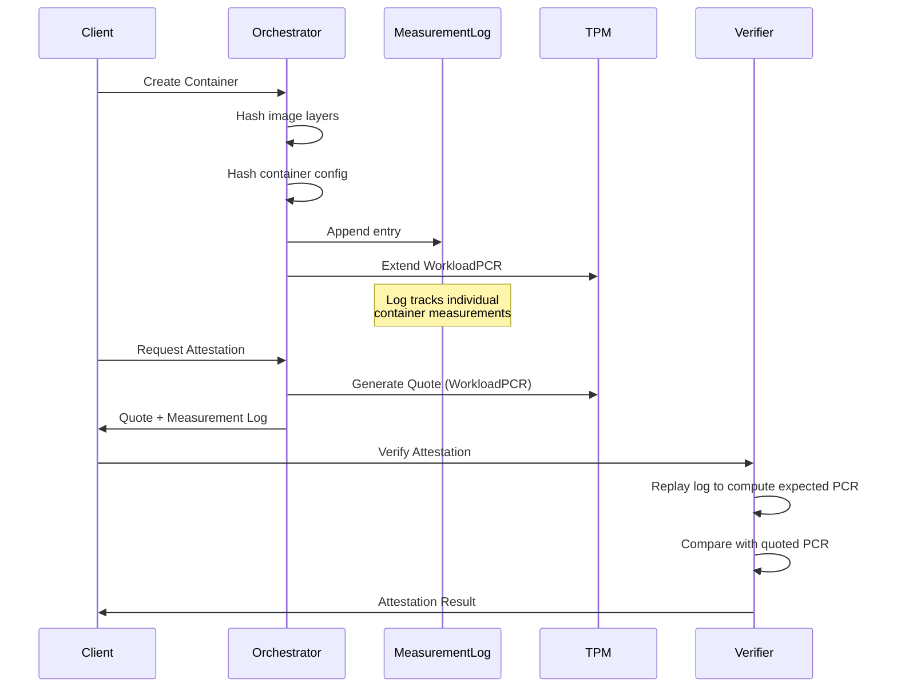

# Workload Attestation

Workload attestation tracks containers and virtual machines through WorkloadPCR extensions, creating a tamper-evident chain of all workloads running on a host.

> **Note:** WorkloadPCR refers to the configurable PCR index used for workload measurements. The default is PCR 14, but this can be configured via `attestation.workload.pcr` in the platform configuration or overridden per-device in the Device Profile.

## Overview

The workload attestation system extends the platform's hardware root of trust to encompass dynamic workloads. Each time a container starts or a VM boots, the platform extends WorkloadPCR with a measurement of the workload's identity. This creates an ordered, tamper-evident log that can be verified by remote attestation.

Package: `pkg/attestation/workload/`

## Key Types

### WorkloadType

Identifies the type of workload being measured.

```go
type WorkloadType string

const (
    WorkloadTypeContainer WorkloadType = "container"
    WorkloadTypeVM        WorkloadType = "vm"
)
```

### WorkloadMeasurement

Represents data to be measured into WorkloadPCR.

```go
type WorkloadMeasurement struct {
    WorkloadType WorkloadType  // Type of workload (container, vm)
    WorkloadID   string        // Unique identifier (container ID, VM UUID)
    ImageDigest  string        // Cryptographic digest of image/disk
}
```

### ChainEntry

Represents a single entry in the workload chain.

```go
type ChainEntry struct {
    Index          uint64        // Sequence number in the chain
    Timestamp      time.Time     // When the measurement was taken
    WorkloadType   WorkloadType  // Type of workload
    WorkloadID     string        // Unique identifier
    ImageDigest    string        // Image/disk digest
    Digest         []byte        // Computed measurement digest
    PCRValue       []byte        // PCR value after extension
    HashAlgorithm  string        // Hash algorithm used
}
```

## Interfaces

### ChainManager

Manages the workload attestation chain.

```go
type ChainManager interface {
    // Initialize sets up the chain manager with configuration.
    Initialize(ctx context.Context, config *config.WorkloadConfig) error

    // ExtendPCR extends WorkloadPCR with a workload measurement.
    ExtendPCR(ctx context.Context, measurement *WorkloadMeasurement) (*ChainEntry, error)

    // GetChain returns all entries in the current chain.
    GetChain() []*ChainEntry

    // VerifyChain verifies the chain matches the current PCR value.
    VerifyChain(ctx context.Context) (bool, error)

    // ReadPCR reads the current WorkloadPCR value.
    ReadPCR(ctx context.Context) ([]byte, error)

    // Close releases resources.
    Close() error
}
```

### LifecycleHook

Provides hooks for workload lifecycle events.

```go
type LifecycleHook interface {
    // OnWorkloadStart is called when a workload starts.
    OnWorkloadStart(ctx context.Context, wt WorkloadType, id, imageDigest string) error

    // OnWorkloadStop is called when a workload stops.
    OnWorkloadStop(ctx context.Context, wt WorkloadType, id string) error
}
```

## Usage

### Basic Chain Management

```go
import (
    "github.com/jeremyhahn/go-trusted-platform/pkg/attestation/workload"
    "github.com/jeremyhahn/go-trusted-platform/pkg/config"
)

// Create chain manager
cm := workload.NewChainManager(
    workload.WithTPMDevice(tpmDevice),
    workload.WithLogger(logger),
)

// Initialize
cfg := &config.WorkloadConfig{
    Enabled: true,
    PCR:     14,
    PCRBank: "sha256",
}
if err := cm.Initialize(ctx, cfg); err != nil {
    log.Fatal(err)
}
defer cm.Close()

// Extend PCR with container measurement
measurement := &workload.WorkloadMeasurement{
    WorkloadType: workload.WorkloadTypeContainer,
    WorkloadID:   "abc123",
    ImageDigest:  "sha256:def456...",
}
entry, err := cm.ExtendPCR(ctx, measurement)
if err != nil {
    log.Fatal(err)
}

fmt.Printf("Extended WorkloadPCR, new value: %x\n", entry.PCRValue)
```

### Lifecycle Management

```go
import "github.com/jeremyhahn/go-trusted-platform/pkg/attestation/workload"

// Create lifecycle manager
lm, err := workload.NewLifecycleManager(
    chainManager,
    &config.WorkloadConfig{Enabled: true, PCR: 14},
    workload.WithLifecycleLogger(logger),
)
if err != nil {
    log.Fatal(err)
}
defer lm.Close()

// Handle container start
err = lm.OnWorkloadStart(ctx,
    workload.WorkloadTypeContainer,
    "container-xyz",
    "sha256:abc123...",
)

// Check active workloads
active := lm.GetActiveWorkloads()
fmt.Printf("Active workloads: %d\n", len(active))

// Handle container stop
err = lm.OnWorkloadStop(ctx,
    workload.WorkloadTypeContainer,
    "container-xyz",
)

// Get event history
history := lm.GetEventHistory()
for _, event := range history {
    fmt.Printf("%s: %s %s\n", event.Type, event.WorkloadType, event.WorkloadID)
}
```

### Chain Verification

```go
// Verify chain integrity
valid, err := cm.VerifyChain(ctx)
if err != nil {
    log.Fatal(err)
}

if valid {
    fmt.Println("Chain verified successfully")
} else {
    fmt.Println("Chain verification failed - possible tampering")
}

// Get current chain
chain := cm.GetChain()
for _, entry := range chain {
    fmt.Printf("[%d] %s: %s (digest: %x)\n",
        entry.Index,
        entry.WorkloadType,
        entry.WorkloadID,
        entry.Digest,
    )
}
```

## WorkloadPCR Extension Formula

When a workload starts, the measurement digest is computed as:

```
digest = SHA256(workload_type || workload_id || image_digest)
```

The PCR is then extended:

```
PCR[14]_new = SHA256(PCR[14]_current || digest)
```

## Chain Growth Example

```
Initial State (boot):
  PCR[14] = 0x0000...0000 (all zeros)

Extension 1 (Container A starts):
  digest_1 = SHA256("container" || "container-a" || "sha256:abc...")
  PCR[14] = SHA256(PCR[14] || digest_1)
         = 0x3a7b...c4e2

Extension 2 (VM B starts):
  digest_2 = SHA256("vm" || "vm-b" || "sha256:def...")
  PCR[14] = SHA256(PCR[14] || digest_2)
         = 0x8f12...9d3a

Extension 3 (Container C starts):
  digest_3 = SHA256("container" || "container-c" || "sha256:ghi...")
  PCR[14] = SHA256(PCR[14] || digest_3)
         = 0x2c5e...a1b7
```

## Chain Properties

| Property | Description |
|----------|-------------|
| Order-dependent | Same workloads in different order produce different PCR values |
| Tamper-evident | Cannot remove or reorder entries without detection |
| Verifiable | Can replay the chain to verify the current PCR value |
| Auditable | Provides complete history of workload lifecycle events |

## Configuration

### WorkloadConfig

```go
type WorkloadConfig struct {
    Enabled           bool   // Enable workload attestation
    PCR               int    // PCR to use (default: 14)
    PCRBank           string // PCR bank (sha256, sha384)
    IncludeImageDigest   bool // Include image digest in measurement
    IncludeContainerID   bool // Include container ID in measurement
    IncludeWorkloadType  bool // Include workload type in measurement
}
```

### YAML Configuration

```yaml
attestation:
  workload:
    enabled: true
    pcr: 14
    pcr-bank: sha256
    include-image-digest: true
    include-container-id: true
    include-workload-type: true
```

## Error Types

| Error | Description |
|-------|-------------|
| `ErrChainNotInitialized` | Chain manager not initialized |
| `ErrLifecycleNotInitialized` | Lifecycle manager not initialized |
| `ErrPCRExtendFailed` | TPM PCR extend operation failed |
| `ErrChainVerificationFailed` | Chain does not match current PCR |
| `ErrInvalidConfig` | Invalid configuration |
| `ErrContextCanceled` | Operation canceled via context |

## Container Workload Attestation

Container attestation uses an event-log approach where WorkloadPCR holds an aggregate measurement and a measurement log tracks individual containers.

### MeasurementLog Structure

The measurement log tracks per-container measurements for attestation verification.

```go
type MeasurementLog struct {
    Entries []MeasurementEntry
}

type MeasurementEntry struct {
    ContainerID    string              // Unique container identifier
    Timestamp      time.Time           // When the measurement was recorded
    EventType      MeasurementEventType // CREATE, START, STOP, REMOVE
    ImageDigest    []byte              // SHA-256 of container image
    ConfigDigest   []byte              // SHA-256 of container config
    CumulativeHash []byte              // Hash extended to WorkloadPCR
}
```

### MeasurementEntry Event Types

| Event Type | Constant | Description |
|------------|----------|-------------|
| CREATE | `EventContainerCreate` | Container created with image/config hashes |
| START | `EventContainerStart` | Container execution started |
| STOP | `EventContainerStop` | Container execution stopped |
| REMOVE | `EventContainerRemove` | Container removed from system |

```go
type MeasurementEventType int

const (
    EventContainerCreate MeasurementEventType = iota
    EventContainerStart
    EventContainerStop
    EventContainerRemove
)
```

### Container Attestation Flow



### Attestation Flow Details

**1. Container Create:**

```
a. Hash image layers -> imageDigest
b. Hash container config (env, mounts, caps) -> configDigest
c. Compute entryHash = SHA256(containerID || imageDigest || configDigest)
d. Extend WorkloadPCR with entryHash
e. Append entry to measurement log
```

**2. Container Start/Stop/Remove:**

```
a. Record event in measurement log
b. Extend WorkloadPCR with event hash
```

**3. Remote Attestation:**

```
a. Generate TPM quote over WorkloadPCR
b. Provide measurement log to verifier
c. Verifier replays log to compute expected WorkloadPCR value
d. Compare computed value with quoted value
e. Individual container measurements extracted from log
```

### Verification Implementation

```go
// VerifyAttestation verifies a container's attestation by replaying the log
func (o *Orchestrator) VerifyAttestation(ctx context.Context, containerID string,
    quote *tpm.Quote, log *MeasurementLog) (*AttestationResult, error) {

    // 1. Replay log to compute expected WorkloadPCR
    expectedPCR := computeExpectedPCR(log)

    // 2. Verify quote signature with AIK
    if err := o.tpm.VerifyQuote(quote); err != nil {
        return nil, err
    }

    // 3. Compare PCR values
    if !bytes.Equal(expectedPCR, quote.PCRs[14]) {
        return nil, ErrPCRMismatch
    }

    // 4. Extract individual container measurement from log
    entry := log.FindEntry(containerID)
    return &AttestationResult{
        ContainerID:  containerID,
        ImageDigest:  entry.ImageDigest,
        ConfigDigest: entry.ConfigDigest,
        Verified:     true,
    }, nil
}
```

### Computing Expected PCR Value

To verify attestation, replay all log entries to compute the expected WorkloadPCR value:

```go
func computeExpectedPCR(log *MeasurementLog) []byte {
    // Start with zero-initialized PCR
    pcr := make([]byte, 32) // SHA-256

    for _, entry := range log.Entries {
        // PCR[14]_new = SHA256(PCR[14]_current || entry.CumulativeHash)
        h := sha256.New()
        h.Write(pcr)
        h.Write(entry.CumulativeHash)
        pcr = h.Sum(nil)
    }

    return pcr
}
```

### Container Measurement Example

```
Container Create Event:
  ContainerID:  "abc123def456"
  ImageDigest:  sha256:e3b0c44298fc1c149afbf4c8996fb924...
  ConfigDigest: sha256:7d865e959b2466918c9863afca942d0f...

  CumulativeHash = SHA256(
    "abc123def456" ||
    sha256:e3b0c44298fc1c149afbf4c8996fb924... ||
    sha256:7d865e959b2466918c9863afca942d0f...
  )

  PCR[14]_new = SHA256(PCR[14]_old || CumulativeHash)
```

### Container Configuration Included in Measurement

The `ConfigDigest` includes security-relevant container configuration:

| Field | Description |
|-------|-------------|
| Environment variables | All env vars affecting container behavior |
| Mount points | Volume mounts and bind mounts |
| Capabilities | Linux capabilities (added/dropped) |
| Security options | SELinux, AppArmor, seccomp profiles |
| Network mode | Container network configuration |
| User/Group | UID/GID the container runs as |
| Privileged mode | Whether container runs privileged |

### Integration with Container Orchestrator

The Container Orchestrator (`pkg/compute/container/`) provides:

| File | Purpose |
|------|---------|
| `attestation.go` | TPM WorkloadPCR extension operations |
| `measurement_log.go` | Per-container measurement tracking |

### Event-Log Approach Benefits

| Benefit | Description |
|---------|-------------|
| Unlimited containers | Single PCR supports any number of containers |
| Individual tracking | Each container measurement recoverable from log |
| Standard approach | Follows TCG measured boot patterns |
| Audit capability | Log can be persisted and audited |
| Remote verification | Verifier can validate any container in the log |

## Related Documentation

- [Architecture](architecture.md) - Attestation architecture overview
- [VM Attestation](vm-attestation.md) - vTPM quote generation for VMs
- [Manifest](manifest.md) - Aggregating attestations
- [API Reference](api-reference.md) - REST/gRPC APIs
