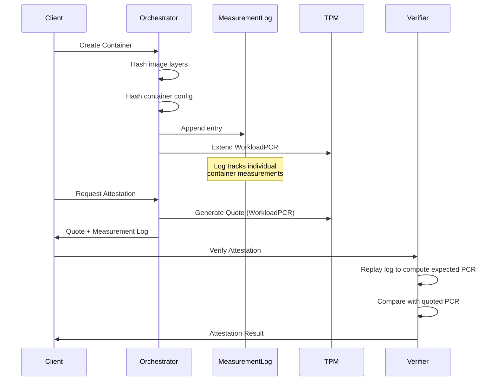

# Workload Attestation

> **Status: REFERENCE** · Last verified: 2026-10-13
> The `pkg/attestation/workload` measurement chain and lifecycle API; [architecture.md](architecture.md) is normative.

Workload attestation tracks containers and virtual machines through WorkloadPCR extensions, creating a tamper-evident chain of all workloads running on a host.

> **Note:** WorkloadPCR refers to the configurable PCR index used for workload measurements. The default is PCR 14, but this can be configured via `attestation.workload.pcr` in the platform configuration or overridden per-device in the Device Profile.

## Overview

The workload attestation system extends the platform's hardware root of trust to encompass dynamic workloads. Each time a container starts or a VM boots, the platform extends WorkloadPCR with a measurement of the workload's identity. This creates an ordered, tamper-evident log that can be verified by remote attestation.

Package: `pkg/attestation/workload/`

## Key Types

### WorkloadType

Identifies the type of workload being measured.

```go
type WorkloadType string

const (
    WorkloadTypeContainer WorkloadType = "container"
    WorkloadTypeVM        WorkloadType = "vm"
)
```

### WorkloadMeasurement

Represents data to be measured into WorkloadPCR.

```go
type WorkloadMeasurement struct {
    WorkloadType WorkloadType  // Type of workload (container, vm)
    WorkloadID   string        // Unique identifier (container ID, VM UUID)
    ImageDigest  string        // Cryptographic digest of image/disk
}
```

### ChainEntry

Represents a single entry in the workload chain.

```go
type ChainEntry struct {
    Index          uint64        // Sequence number in the chain
    Timestamp      time.Time     // When the measurement was taken
    WorkloadType   WorkloadType  // Type of workload
    WorkloadID     string        // Unique identifier
    ImageDigest    string        // Image/disk digest
    Digest         []byte        // Computed measurement digest
    PCRValue       []byte        // PCR value after extension
    HashAlgorithm  string        // Hash algorithm used
}
```

## Interfaces

### ChainManager

Manages the workload attestation chain.

```go
type ChainManager interface {
    // Initialize sets up the chain manager with configuration.
    Initialize(ctx context.Context, config *config.WorkloadConfig) error

    // ExtendPCR extends WorkloadPCR with a workload measurement.
    ExtendPCR(ctx context.Context, measurement *WorkloadMeasurement) (*ChainEntry, error)

    // GetChain returns all entries in the current chain.
    GetChain() []*ChainEntry

    // VerifyChain verifies the chain matches the current PCR value.
    VerifyChain(ctx context.Context) (bool, error)

    // ReadPCR reads the current WorkloadPCR value.
    ReadPCR(ctx context.Context) ([]byte, error)

    // Close releases resources.
    Close() error
}
```

### LifecycleHook

Provides hooks for workload lifecycle events.

```go
type LifecycleHook interface {
    // OnWorkloadStart is called when a workload starts.
    OnWorkloadStart(ctx context.Context, wt WorkloadType, id, imageDigest string) error

    // OnWorkloadStop is called when a workload stops.
    OnWorkloadStop(ctx context.Context, wt WorkloadType, id string) error
}
```

## Usage

### Basic Chain Management

```go
import (
    "github.com/jeremyhahn/go-trusted-platform/pkg/attestation/workload"
    "github.com/jeremyhahn/go-trusted-platform/pkg/config"
)

// Create chain manager
cm := workload.NewChainManager(
    workload.WithTPMDevice(tpmDevice),
    workload.WithLogger(logger),
)

// Initialize
cfg := &config.WorkloadConfig{
    Enabled: true,
    PCR:     14,
    PCRBank: "sha256",
}
if err := cm.Initialize(ctx, cfg); err != nil {
    log.Fatal(err)
}
defer cm.Close()

// Extend PCR with container measurement
measurement := &workload.WorkloadMeasurement{
    WorkloadType: workload.WorkloadTypeContainer,
    WorkloadID:   "abc123",
    ImageDigest:  "sha256:def456...",
}
entry, err := cm.ExtendPCR(ctx, measurement)
if err != nil {
    log.Fatal(err)
}

fmt.Printf("Extended WorkloadPCR, new value: %x\n", entry.PCRValue)
```

### Lifecycle Management

```go
import "github.com/jeremyhahn/go-trusted-platform/pkg/attestation/workload"

// Create lifecycle manager
lm, err := workload.NewLifecycleManager(
    chainManager,
    &config.WorkloadConfig{Enabled: true, PCR: 14},
    workload.WithLifecycleLogger(logger),
)
if err != nil {
    log.Fatal(err)
}
defer lm.Close()

// Handle container start
err = lm.OnWorkloadStart(ctx,
    workload.WorkloadTypeContainer,
    "container-xyz",
    "sha256:abc123...",
)

// Check active workloads
active := lm.GetActiveWorkloads()
fmt.Printf("Active workloads: %d\n", len(active))

// Handle container stop
err = lm.OnWorkloadStop(ctx,
    workload.WorkloadTypeContainer,
    "container-xyz",
)

// Get event history
history := lm.GetEventHistory()
for _, event := range history {
    fmt.Printf("%s: %s %s\n", event.Type, event.WorkloadType, event.WorkloadID)
}
```

### Chain Verification

```go
// Verify chain integrity
valid, err := cm.VerifyChain(ctx)
if err != nil {
    log.Fatal(err)
}

if valid {
    fmt.Println("Chain verified successfully")
} else {
    fmt.Println("Chain verification failed - possible tampering")
}

// Get current chain
chain := cm.GetChain()
for _, entry := range chain {
    fmt.Printf("[%d] %s: %s (digest: %x)\n",
        entry.Index,
        entry.WorkloadType,
        entry.WorkloadID,
        entry.Digest,
    )
}
```

## WorkloadPCR Extension Formula

When a workload starts, the measurement digest is computed as:

```
digest = SHA256(workload_type || workload_id || image_digest)
```

The PCR is then extended:

```
PCR[14]_new = SHA256(PCR[14]_current || digest)
```

## Chain Growth Example

```
Initial State (boot):
  PCR[14] = 0x0000...0000 (all zeros)

Extension 1 (Container A starts):
  digest_1 = SHA256("container" || "container-a" || "sha256:abc...")
  PCR[14] = SHA256(PCR[14] || digest_1)
         = 0x3a7b...c4e2

Extension 2 (VM B starts):
  digest_2 = SHA256("vm" || "vm-b" || "sha256:def...")
  PCR[14] = SHA256(PCR[14] || digest_2)
         = 0x8f12...9d3a

Extension 3 (Container C starts):
  digest_3 = SHA256("container" || "container-c" || "sha256:ghi...")
  PCR[14] = SHA256(PCR[14] || digest_3)
         = 0x2c5e...a1b7
```

## Chain Properties

| Property | Description |
|----------|-------------|
| Order-dependent | Same workloads in different order produce different PCR values |
| Tamper-evident | Cannot remove or reorder entries without detection |
| Verifiable | Can replay the chain to verify the current PCR value |
| Auditable | Provides complete history of workload lifecycle events |

## Configuration

### WorkloadConfig

```go
type WorkloadConfig struct {
    Enabled           bool   // Enable workload attestation
    PCR               int    // PCR to use (default: 14)
    PCRBank           string // PCR bank (sha256, sha384)
    IncludeImageDigest   bool // Include image digest in measurement
    IncludeContainerID   bool // Include container ID in measurement
    IncludeWorkloadType  bool // Include workload type in measurement
}
```

### YAML Configuration

```yaml
attestation:
  workload:
    enabled: true
    pcr: 14
    pcr-bank: sha256
    include-image-digest: true
    include-container-id: true
    include-workload-type: true
```

## Error Types

| Error | Description |
|-------|-------------|
| `ErrChainNotInitialized` | Chain manager not initialized |
| `ErrLifecycleNotInitialized` | Lifecycle manager not initialized |
| `ErrPCRExtendFailed` | TPM PCR extend operation failed |
| `ErrChainVerificationFailed` | Chain does not match current PCR |
| `ErrInvalidConfig` | Invalid configuration |
| `ErrContextCanceled` | Operation canceled via context |

## Container Workload Attestation

Container attestation uses an event-log approach where WorkloadPCR holds an aggregate measurement and a measurement log tracks individual containers.

### MeasurementLog Structure

The measurement log tracks per-container measurements for attestation verification.

```go
type MeasurementLog struct {
    Entries []MeasurementEntry
}

type MeasurementEntry struct {
    ContainerID    string              // Unique container identifier
    ContainerName  string              // Human-readable container name
    Timestamp      time.Time           // When the measurement was recorded
    EventType      MeasurementEventType // CREATE, START, STOP, REMOVE
    Image          string              // Image reference (create events)
    ImageDigest    string              // Canonical OCI digest, "sha256:<64 hex>"
    ConfigDigest   string              // orchestration.ContainerConfigDigest
    CumulativeHash []byte              // Hash extended to WorkloadPCR
}
```

`ImageDigest` is the registry manifest digest resolved through the go-quicbaas
SDK, and `ConfigDigest` is `orchestration.ContainerConfigDigest`; both are
canonical OCI digest strings. The cumulative hash covers those strings, so any
golden PCR set captured before the digests took this form no longer matches and
must be recaptured from a current measurement log.

### MeasurementEntry Event Types

| Event Type | Constant | Description |
|------------|----------|-------------|
| CREATE | `EventContainerCreate` | Container created with image/config hashes |
| START | `EventContainerStart` | Container execution started |
| STOP | `EventContainerStop` | Container execution stopped |
| REMOVE | `EventContainerRemove` | Container removed from system |

```go
type MeasurementEventType int

const (
    EventContainerCreate MeasurementEventType = iota
    EventContainerStart
    EventContainerStop
    EventContainerRemove
)
```

### Container Attestation Flow



### Attestation Flow Details

**1. Container Create:**

```
a. Hash image layers -> imageDigest
b. Hash container config (env, mounts, caps) -> configDigest
c. Compute entryHash = SHA256(containerID || imageDigest || configDigest)
d. Extend WorkloadPCR with entryHash
e. Append entry to measurement log
```

**2. Container Start/Stop/Remove:**

```
a. Record event in measurement log
b. Extend WorkloadPCR with event hash
```

**3. Remote Attestation:**

```
a. Generate TPM quote over WorkloadPCR
b. Provide measurement log to verifier
c. Verifier replays log to compute expected WorkloadPCR value
d. Compare computed value with quoted value
e. Individual container measurements extracted from log
```

### Verification Implementation

```go
// VerifyAttestation verifies a container's attestation by replaying the log
func (o *Orchestrator) VerifyAttestation(ctx context.Context, containerID string,
    quote *tpm.Quote, log *MeasurementLog) (*AttestationResult, error) {

    // 1. Replay log to compute expected WorkloadPCR
    expectedPCR := computeExpectedPCR(log)

    // 2. Verify quote signature with AIK
    if err := o.tpm.VerifyQuote(quote); err != nil {
        return nil, err
    }

    // 3. Compare PCR values
    if !bytes.Equal(expectedPCR, quote.PCRs[14]) {
        return nil, ErrPCRMismatch
    }

    // 4. Extract individual container measurement from log
    entry := log.FindEntry(containerID)
    return &AttestationResult{
        ContainerID:  containerID,
        ImageDigest:  entry.ImageDigest,
        ConfigDigest: entry.ConfigDigest,
        Verified:     true,
    }, nil
}
```

### Computing Expected PCR Value

To verify attestation, replay all log entries to compute the expected WorkloadPCR value:

```go
func computeExpectedPCR(log *MeasurementLog) []byte {
    // Start with zero-initialized PCR
    pcr := make([]byte, 32) // SHA-256

    for _, entry := range log.Entries {
        // PCR[14]_new = SHA256(PCR[14]_current || entry.CumulativeHash)
        h := sha256.New()
        h.Write(pcr)
        h.Write(entry.CumulativeHash)
        pcr = h.Sum(nil)
    }

    return pcr
}
```

### Container Measurement Example

```
Container Create Event:
  ContainerID:  "abc123def456"
  ImageDigest:  sha256:e3b0c44298fc1c149afbf4c8996fb924...
  ConfigDigest: sha256:7d865e959b2466918c9863afca942d0f...

  CumulativeHash = SHA256(
    "abc123def456" ||
    sha256:e3b0c44298fc1c149afbf4c8996fb924... ||
    sha256:7d865e959b2466918c9863afca942d0f...
  )

  PCR[14]_new = SHA256(PCR[14]_old || CumulativeHash)
```

### One Derivation: What Is Launched Is What Is Measured

The container's effective launch configuration — every mount, every device,
every flag — is derived **exactly once**, by `newLaunchConfig` in
`pkg/compute/container/launch_config.go`, into a `*PodmanContainerConfig`.
That single value is what the container backend is handed, and it is the only
input to the measurement: `PodmanContainerConfig.AttestationSpec` projects it
onto the go-quicbaas SDK container spec that
`orchestration.ContainerConfigDigest` hashes. `Orchestrator.measureCreate`
takes the launch configuration and is given no access to the
`OrchestratorContainerSpec`, so the measurement path cannot reach a field the
launch path did not derive.

`OrchestratorContainerSpec.ToAttestationSpec` is a convenience over that same
path (`newLaunchConfig(spec).AttestationSpec()`), not a second derivation.

This replaced two independent derivations of the same thing. The launch path
appended a `/dev/tpm0` bind mount whenever `TPMAccess` was set, while the
measurement path mapped only `spec.Mounts`. Two specifications differing only
by `TPMAccess` therefore produced the **same** configuration digest while one
of them received the platform's root of trust — granting a workload the host
TPM did not change its measurement. That was one instance of a class: any
field wired into the launch derivation but not the measurement derivation
escaped measurement silently. There is now nothing to keep in step.

Two consequences of measuring the launch configuration are worth stating:

- `Command` and `Args` are concatenated into the single argv the container
  executes, so two specifications that differ only in where the command stops
  and the arguments begin measure identically. They launch the same process.
- Exposing the host TPM has exactly one representation, a mount of
  `/dev/tpm0`, which is part of the measured mount list. There is no parallel
  TPM boolean on the launch configuration: the backend recognizes the grant
  from the mount itself (`PodmanContainerConfig.GrantsTPMDevice`), so the
  device cannot be requested without appearing in the digest.

The remaining risk is omission rather than divergence — a field added to the
launch configuration and used by the backend, but dropped by
`AttestationSpec`. `TestLaunchConfig_MeasurementCoverage` enumerates every
field of the launch configuration by reflection and fails until the new field
is classified as measured or as a stated gap;
`TestOrchestratorContainerSpec_MeasurementGaps` does the same for the
specification. Neither can be satisfied by omission.

### Container Configuration Included in Measurement

`ConfigDigest` is `orchestration.ContainerConfigDigest` over the measurement
spec produced by `PodmanContainerConfig.AttestationSpec`. It covers exactly
these fields and nothing else:

| Field | SDK spec field | Notes |
|-------|----------------|-------|
| Image reference | `Image` | Pinned form, i.e. `repository@sha256:...` when a digest is known |
| Image content digest | `ImageDigest` | Resolved, never a hash of the reference |
| Environment variables | `Env` | Hashed in sorted key order |
| Labels | `Labels` | Hashed in sorted key order |
| Mount source, target, read-only, **type** | `Mounts[i]` | Declaration order is significant |
| **Host TPM device** | `Mounts[i]` | `TPMAccess` is the `/dev/tpm0` entry in the measured mount list |
| Port mappings | `Ports` | Canonical `[hostIP:]hostPort:containerPort[/proto]` |
| Working directory | `WorkDir` | |
| Entrypoint, argv | `Entrypoint`, `Command` | Order significant; `Command` is the spec's command followed by its args |
| Network mode | `Network` | The declared platform mode, including `sdn` — see the gap list below |
| User/Group | `User` | |
| **Privileged mode** | `Privileged` | |
| **Added capabilities** | `CapAdd` | Sorted before hashing: order is not significant |
| **Dropped capabilities** | `CapDrop` | Sorted before hashing: order is not significant |
| Auto-remove | `AutoRemove` | |
| Trust label | `TrustLabel` | Lets one image+config carry two measured identities |

The container **name** is deliberately excluded: it is a per-instance
identifier, so two identically configured containers with different names
measure identically.

The bold rows are the ones that decide how much of the host a workload can
reach. Privileged, added capabilities, dropped capabilities and mount type were
once smuggled into the digest through reserved `trustedplatform.io/*` labels
because the SDK container spec had no fields for them; those fields now exist
upstream in `sdk/go/orchestration` and are hashed directly, so the label
carrier has been deleted. Nothing may be folded into a label to get it
measured; the fix for an unmeasured field is to add it to the SDK spec and its
digest upstream.

Because the digest input changed again — the measurement is now taken over the
effective launch configuration, so the TPM device mount is included and the
command and arguments are hashed as one argv — any previously recorded
`ConfigDigest`, `CumulativeHash`, golden PCR 14 value or stored measurement log
is **stale and must be recaptured** from a re-measured launch. There is exactly
one measurement format; there is no versioning, format gate or migration path
for the old values.

Making the standalone generators emit the measured launch configuration, and
deleting the runtime's host-level TPM default, did **not** change the digest
input again: `AttestationSpec` projects the same fields it did before, resource
limits are not among them, and the deleted knob only ever affected what the
runtime applied, never what was hashed. Golden values recaptured after the
single-derivation refactor remain valid.

#### Measurement gaps

Two kinds of field are outside `ConfigDigest`, and the distinction matters.

**Upstream gaps.** The field changes what the container can reach, but the SDK
container spec has no field for it. Each names the upstream field that would
close it. Closing one means adding that field to
`go-quicbaas/pkg/orchestration` and its `ContainerConfigDigest` — never
smuggling the value through a label — and recapturing golden values again.

| Field | Why it matters | Closed by |
|-------|----------------|-----------|
| `MountConfig.Propagation` | `rshared` propagation can leak mount events back to the host; a shared mount can be substituted for a private one | `orchestration.ContainerMount.Propagation` |
| `Network.Hostname` | Reaches the container as the OCI process hostname | `orchestration.ContainerSpec.Hostname` |
| `Network.DNSServers` | Changes name resolution, and therefore reachability. Also dropped at the podman adapter today, so it currently reaches nothing | `orchestration.ContainerSpec.DNS` |
| `Network.DNSSearch` | Same as DNS servers | `orchestration.ContainerSpec.DNSSearch` |
| `Network.ExtraHosts` | Would override `/etc/hosts` entries. Inert today: no launch path applies it | `orchestration.ContainerSpec.ExtraHosts` |
| Read-only rootfs | Whether the container can write its own filesystem. Inert today: nothing sets it | `orchestration.ContainerSpec.ReadOnlyRootFS` |
| `Network.SDN` | Bridge, VLAN, static IP, security groups and OpenFlow rules decide reachability. Applied by the network manager after create, outside the configuration the backend receives, so it is not part of the container-config digest at all | An SDN attachment digest folded into the measurement |

**Deliberate exclusions.** These are availability, lifecycle or management
concerns rather than integrity, or nothing in the launch path reads them.
Measuring them would make golden values brittle without protecting anything.

| Field | Why it is not measured |
|-------|-----------------------|
| `Resources` | CPU, memory and process limits can starve a workload but cannot change what it runs or what it can reach. They are carried on the effective launch configuration and applied by **every** launch path — the podman backend and a generated systemd unit or rc script alike — so no supervisor runs a differently constrained container than another. Unlike the upstream gaps above this is a decision, not a missing field: adding `orchestration.ContainerSpec.Resources` upstream would let them be measured, but availability limits are deliberately kept out of the workload's identity |
| `RestartPolicy` | Lifecycle, not integrity, and inert: nothing in the launch path reads the field |
| `HealthCheck` | Inert: no code path applies it, so the command cannot reach a container. It **would** be integrity-relevant if wired, because the runtime would execute it inside the container; `TestLaunchConfig_MeasurementCoverage` will demand it be measured on the day it is |
| `Annotations` | Inert metadata with no consumer. `Labels` are measured and are where measured metadata belongs |
| `Service` | Selects the supervisor (platformd or an init service), not the container's contents or privileges. See the caveat below |
| Stop timeout | Bounds how long a stop waits: availability only |

`TestOrchestratorContainerSpec_MeasurementGaps` and
`TestLaunchConfig_MeasurementCoverage` in `pkg/compute/container` pin both
lists exhaustively: a field that starts affecting the digest, and a field newly
added to either the specification or the launch configuration, both fail the
tests and force this table, the `AttestationSpec` doc comment and the
classification to be updated together.

#### Standalone service mode launches the measured configuration

`Service.Mode: standalone` writes a systemd unit or an rc script, and both start
the container's effective launch configuration — the same `*PodmanContainerConfig`
`newLaunchConfig` derives for the embedded path and `AttestationSpec` measures.
`podmanRunArgs` (`launch_command.go`) is the ONE rendering of that value as a
command line, and each generator emits it verbatim; the specification is read
only to derive the value, never to build a command line a second time.

This closed a third derivation and an attestation bypass. Each generator used to
walk the specification itself, omitting capabilities, the user, the working
directory, the argv tail, the hostname and the TPM device grant, and applying
resource limits the backend never received. In standalone mode the container
systemd started was therefore **not** the container that had been measured: the
measurement attested a configuration that never ran. Embedded mode was
unaffected.

Three properties keep the paths together:

- The TPM grant renders as `--device /dev/tpm0:/dev/tpm0`, from the same mount
  predicate the backend's device request uses, so the grant cannot be measured
  and then not applied — or applied and not measured.
- Fields the podman adapter drops (`Entrypoint`, `AutoRemove`, `DNS`,
  `DNSSearch`) are not rendered either, so neither supervisor applies something
  the other does not.
- `TestPodmanRunArgs_LaunchCoverage` enumerates every field of the launch
  configuration by reflection and requires each to be rendered on the command
  line or proven inert by the backend projection dropping it too. Wiring a field
  into the backend without rendering it into the generated service fails the
  test.

### Integration with Container Orchestrator

The Container Orchestrator (`pkg/compute/container/`) provides:

| File | Purpose |
|------|---------|
| `attestation.go` | TPM WorkloadPCR extension operations |
| `measurement_log.go` | Per-container measurement tracking |

### Event-Log Approach Benefits

| Benefit | Description |
|---------|-------------|
| Unlimited containers | Single PCR supports any number of containers |
| Individual tracking | Each container measurement recoverable from log |
| Standard approach | Follows TCG measured boot patterns |
| Audit capability | Log can be persisted and audited |
| Remote verification | Verifier can validate any container in the log |

## Related Documentation

- [Architecture](architecture.md) - Attestation architecture overview
- [VM Attestation](vm-attestation.md) - vTPM quote generation for VMs
- [Manifest](manifest.md) - Aggregating attestations
- [API Reference](api-reference.md) - REST/gRPC APIs
