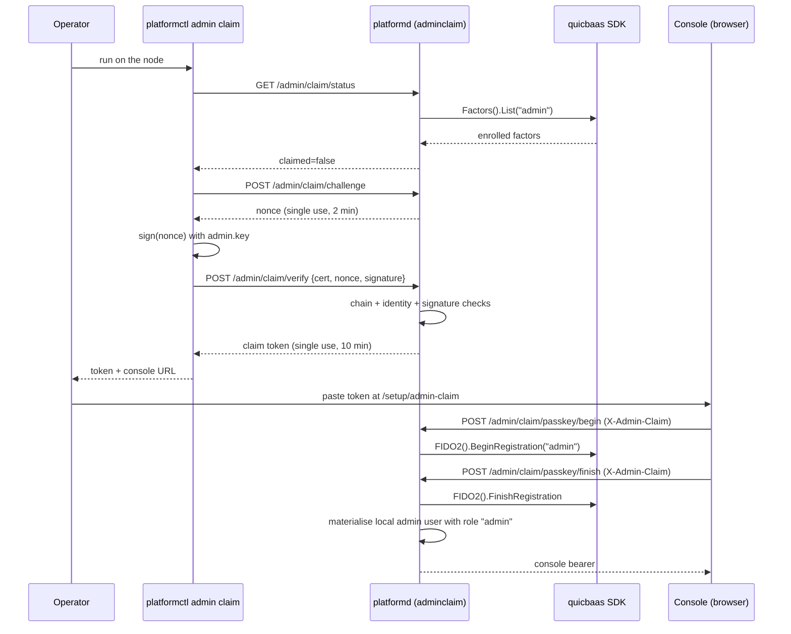

# Platform Authentication — Architecture

> **Status: NORMATIVE** · Scope: `pkg/auth/` · Last verified: 2026-10-09
> Conflicts with this document are defects. Fix them here first.
> The feature folder is: [architecture.md](architecture.md) · [engineering.md](engineering.md) · [cli.md](cli.md) · [api.md](api.md) · [user.md](user.md).

---

## 1. Read this first: what `pkg/auth` actually is

**`pkg/auth` is a certificate-to-identity extractor. That is the whole
package.** Five non-test Go files, no storage, no network calls of its own, no
tokens, no sessions, no roles, no policy.

Given an `*x509.Certificate` it will: check validity dates, verify the chain
against a configured root pool, optionally ask a CA whether the certificate is
revoked, optionally check TCG IDevID/IAK markers, and project the certificate
into an `auth.Identity` struct — an ID, a tenant, an email, a fingerprint, a
serial, and a small attribute map.

**It is not IAM.** It does not know what a user is, it does not decide what
anyone may do, and it never talks to an identity store.

| Question | Answered by | Documented in |
|---|---|---|
| "Is this X.509 certificate one of ours, and whose is it?" | `pkg/auth` | **this folder** |
| "Who is this principal, what roles do they hold, may they do X?" | go-qrdb's identity model and its single RBAC decision point, composed by go-quicbaas, re-exported here | [`docs/iam/`](../iam/) |
| "Is this bearer token valid, and does it carry the scope this call needs?" | The per-transport interceptors, against a broker-issued platform token | [`docs/daemon/api.md`](../daemon/api.md) §5 |

`docs/iam/architecture.md` states the same boundary from the other side:
*"`pkg/auth/` is **not** IAM. It is transport-level authentication — mTLS and
token validation."* This folder is the mTLS half of that sentence; the token
half lives in the transport packages and is catalogued in
[`docs/daemon/api.md`](../daemon/api.md).

**This document does not duplicate [`docs/iam/`](../iam/).** Where a question
is about identities, groups, roles, policies, applications or invitations, go
there.

## 2. The problem

A platform that provisions bare metal has principals that predate any user
account: a machine holding a TPM-issued IDevID, an installer holding an
enrollment credential, a `gatewayd` process holding a platform-issued client
certificate. Those principals authenticate with a certificate, on a transport,
before anything resembling a session exists.

Meanwhile human and service principals authenticate with factors — mTLS, FIDO2,
PIV — and receive a token. Both paths have to arrive at the same notion of "who
is this" so downstream authorization has one input.

## 3. The shape chosen

**Two layers, deliberately separate.**

1. **Certificate → `auth.Identity`** (`pkg/auth`). A pure function of a
   certificate plus a configured trust anchor. Reusable by any transport, any
   binary, with no daemon and no database.

2. **Transport → authenticated context.** Each transport owns its own
   interceptor/middleware, all of which either wrap layer 1 (mTLS) or validate a
   broker-issued platform token:

   | Transport | Mechanism | Where |
   |---|---|---|
   | gRPC (TCP) | mTLS interceptor → `auth.Authenticator` | `pkg/api/daemon/mtls_interceptor.go` |
   | gRPC (TCP) | OIDC / platform-token interceptor | `pkg/api/grpc/oidc_interceptor.go` |
   | Unix socket | `SO_PEERCRED`, kernel-verified PID/UID/GID | `pkg/util/peercred/peercred.go` |
   | QUIC | `AuthMiddleware` over the frame's token field | `pkg/api/quic/auth.go` |
   | MCP | OAuth 2.1 bearer + `AuthorizationChecker` | `pkg/api/mcp/authz.go`, `oauth_metadata.go` |
   | REST | JWT middleware; `/login`, `/login/refresh`, WebAuthn | `pkg/webservice/v1/router/` |
   | Edge proxy | `pkg/proxy` auth chain, seamed to `auth.MTLSAdapter` | `pkg/proxy/authchain.go` |

3. **Session issuance is not in this repo.** `platformctl auth login` and the
   whole N-factor enrolment surface delegate to
   `go-quicbaas/sdk/go`'s `Security().Auth().Factors()` through the thin wrapper
   `sdk/go/services/auth`. The platform issues no factors and stores no
   enrolments.

### Alternatives rejected

| Alternative | Why it was rejected |
|---|---|
| **Put identity extraction inside each transport's interceptor** | Five copies of "which certificate field is the tenant" is five places for them to diverge. `pkg/auth` is one small library that gRPC, the proxy, `gatewayd` and the IAM middleware all call. |
| **Make `pkg/auth` own users, roles and sessions** | go-qrdb owns the identity model and the single RBAC decision point (docs/00 L2). A second one here would drift, and the drift would only surface when two authorization decisions disagreed. The absence of a `pkg/iam` in this repository is the enforcement. |
| **A single fixed identity field (always CN)** | Certificates in this fleet are issued for different purposes: IDevIDs carry TPM serials, human certificates carry emails, service certificates carry DNS names. `MTLSConfig.IdentityField` selects; `extractFallbackIdentity` tries email → CN → subject serial → first DNS SAN when the selected field is empty. |
| **Require a CA for every `MTLSAdapter`** | `gatewayd` validates platform-issued client certificates without hosting the CA in-process; it sources roots through `pkg/trust`. `NewMTLSAdapterFromRoots` exists for exactly that. |
| **Silently skip revocation when no CA is available** | That is fail-open on the one check whose whole point is catching a stolen certificate. `NewMTLSAdapterFromRoots` rejects `WithRequireRevocation` at construction time with `ErrRevocationRequiresCA` — the failure happens at assembly, not at request time. |
| **Treat a failed IDevID check as an authentication failure** | Not every client certificate is an IDevID. `Authenticate` logs the failure at debug and continues. This is a **fail-open** decision with a real cost, called out in §6.3. Callers that need a device certificate call `auth.ValidateIDevID` / `auth.ValidateIAK` directly and act on the error. |
| **Implement the platform's own token issuer** | The platform is a broker-token **validator**, not a token authorization decision point. Tokens are minted elsewhere and enforced here by offline `scp` claim checks. |
| **Password authentication on the platform API** | Removed. Authentication is certificate-based (mTLS, IDevID), WebAuthn/FIDO2/PIV, or bearer token. |

## 4. Component boundaries

| Piece | Location | Owner |
|---|---|---|
| Certificate → `Identity` projection | `pkg/auth/mtls.go`, `interface.go` | this repo |
| X.509 / TCG validators (`ValidateCertificate`, `ValidateIDevID`, `ValidateIAK`, key-usage helpers) | `pkg/auth/validator.go` | this repo |
| Typed authentication errors | `pkg/auth/errors.go` | this repo |
| gRPC mTLS interceptors | `pkg/api/daemon/mtls_interceptor.go` | this repo |
| gRPC platform-token / OIDC interceptors | `pkg/api/grpc/oidc_interceptor.go` | this repo |
| Unix `SO_PEERCRED` credentials and interceptors | `pkg/util/peercred/peercred.go` | this repo |
| QUIC auth middleware and operation catalog (opcode / sub-opcode → permission) | `pkg/api/quic/auth.go`, `opcode_permissions.go` | this repo |
| MCP OAuth 2.1 metadata and tool authorization | `pkg/api/mcp/oauth_metadata.go`, `authz.go` | this repo |
| REST login / refresh / WebAuthn routers | `pkg/webservice/v1/router/authentication.go`, `webauthn.go` | this repo |
| IDevID/IAK attestation middleware | `pkg/webservice/v1/middleware/iam/attestation.go` | this repo |
| Edge-proxy auth chain | `pkg/proxy/authchain.go` | this repo — [`docs/proxy/`](../proxy/) |
| `platformctl auth` / `platformctl credential` | `pkg/cli/commands/canonical_auth.go` | this repo |
| Auth SDK wrapper | `sdk/go/services/auth` | this repo |
| **Certificate issuance and revocation state** | go-xkms `TrustedCA`, reached through `go-quicbaas/sdk/go/xkms/ca` | **not this repo** — [`docs/ca/`](../ca/) |
| **Identity model, users, groups, roles, policies, the single RBAC PDP** | go-qrdb, composed by go-quicbaas | **not this repo** — [`docs/iam/`](../iam/) |
| **N-factor enrolment and login** | go-quicbaas `Security().Auth().Factors()` (M10) over go-qrdb's User N-AuthFactor service (M14) | **not this repo** |
| **Platform token minting** | The broker | **not this repo** |
| **Invitations** | `InvitationService` — [`docs/tenant/architecture.md`](../tenant/architecture.md) | this repo, **different feature** |

The §R capability row is part of *"Re-export frontage of the composed stack (CA,
KMS, IAM, FIDO2/PIV, barrier, ceremony, LUKS, auth, data services)"*, Tier 1 —
the `auth` entry — reached through `sdk/go/services/auth`.

## 5. Data flow

### A machine authenticating with a client certificate (gRPC/TCP)

1. TLS handshake completes with `RequireAndVerifyClientCert`; Go populates
   `tls.ConnectionState.VerifiedChains`.
2. `MTLSUnaryInterceptor` skips the method if it is in `SkipMethods`;
   otherwise `authenticateFromPeer` pulls `credentials.TLSInfo` off the gRPC
   peer.
3. `extractClientCerts` prefers `VerifiedChains[0]`, falling back to
   `PeerCertificates`.
4. `auth.MTLSAdapter.Authenticate(ctx, leaf)`:
   dates → chain verify against `TrustedRoots` with `ExtKeyUsageClientAuth` →
   optional revocation check via the CA → optional IDevID check (advisory) →
   `ExtractIdentity` → `ExtractTenant` (or `DefaultTenant`).
5. The `*auth.Identity` is stored on the context under `ContextKeyIdentity`;
   handlers read it with `daemon.IdentityFromContext`.

Nothing is persisted. Nothing crosses a host boundary except the TLS handshake
itself and, when revocation checking is on, the call to the CA.

### A human authenticating and receiving a token

1. `platformctl auth login [--method mtls|fido2|piv]` resolves a go-quicbaas
   address from `PLATFORMCTL_QUICBAAS_ADDR`, else the active CLI context.
2. `sdk/go/services/auth.Client.Login` performs the factor exchange against
   go-quicbaas.
3. A session token comes back; `--save-token` writes it `0600` under
   `$HOME/.platformctl/session.token` (or `--token-path`).
4. Subsequent platform calls present it as a bearer token, validated per
   transport and enforced against the `scp` claim.

**The platform never sees the factor.** It sees the resulting token.

### A browser authenticating with WebAuthn

`/api/v1/webauthn/login/begin` → `finish`. Both verbs delegate to the platform's
single unified login driver (`pkg/webservice/v1/login`), which drives qrdb's
login ceremony through the quicbaas SDK. **The backbone authenticates; the
platform issues.** Every factor proof is verified upstream and every principal
is resolved upstream — the REST layer runs no ceremony and holds no credential
store — and the driver then mints the session credential from the identity the
ceremony resolved.

The ceremony is **usernameless**. `BeginLogin` sends no hint, which drives the
backbone's discoverable-credential flow; the authenticator picks the credential
and the backbone resolves the principal from the credential id the assertion
carries — the same base64url encoding the registration write-through enrolled
the factor under. No username is collected and no directory is searched, which
is why an account on a public email domain is not a special case.

**Registration therefore requires a resident key.** A credential the
authenticator cannot discover would enrol and then never sign in, so the
platform sets the embedded server's `iam.webauthn.resident_key_requirement` to
`required` (`pkg/storage/quicbaas/config.go`, `ToQuicBaaSConfig`) instead of
taking the upstream `preferred` default. The registration options then carry
`authenticatorSelection.residentKey: "required"`, and an authenticator that
cannot store a discoverable credential refuses the ceremony in the browser. The
setting is the embedded server's; a platform on a remote quicbaas transport gets
whatever that server's own `iam.webauthn` section says. A credential enrolled
before this rule under `preferred` keeps working only if the authenticator made
it discoverable anyway; one that did not must be registered again.

`begin` answers with the `PublicKeyCredentialRequestOptions` the browser passes
to `navigator.credentials.get()`, plus the `session_id` the client echoes back on
`finish` in the `X-Session-Id` header — the platform persists no ceremony state.

> **The discoverable ceremony does not complete against `go-xkms v0.9.4-alpha`,
> the tag this tree pins.** Traced in the tagged sources: an empty hint makes
> xkms begin the ceremony with `BeginDiscoverableLogin()`, which leaves
> `SessionData.UserID` empty; its `WebAuthnFactorVerifier.Verify` then re-derives
> a handle from the resolved factor and passes it to `FinishLogin`, whose
> `finishLoginUser` only consults the session when the caller supplied nothing —
> so the non-empty handle selects the user-identified branch, and go-webauthn's
> `ValidateLogin` rejects the pair with `ID mismatch for User and Session`.
>
> The platform is on the correct side of this: sending no hint is what a
> usernameless login is, and the two xkms halves contradict each other. Filed as
> **jeremyhahn/go-xkms#558** with the fix that honours the comment already in
> `finishLoginUser`. Until that tag lands, a real authenticator reaches `finish`
> and is refused there.
>
> The platform's own login tests fake the SDK `AuthService`, so they never reach
> the xkms verifier and cannot catch this — which is exactly why it needs saying
> here rather than being left to a green suite.

`/api/v1/login` is the same driver's **mTLS** route. mTLS is a single-shot
factor: possession was proven by the handshake before the request body was read,
so there is no challenge to issue and nothing for the client to sign, and the
driver would complete the ceremony in the one request. It reads no request body
either way: an mTLS login has no credential *in* the request.

#### The mTLS factor is declined, and not only because it cannot work

The binder refuses both verbs, so `/api/v1/login` answers **403** and no
ceremony is opened. The platform cannot bind the caller's peer certificate to
the ceremony through `sdk/go` — neither the peer-certificate context helper nor
the key derivation is re-exported (jeremyhahn/go-quicbaas#857) — so the login
could not succeed regardless.

What makes the refusal *necessary* rather than tidy is the failure mode if a
ceremony were opened anyway. The SDK client can run in **remote transport
mode** (`pkg/app/app.go`, `QuicBaaSSDKClient`). On a network transport the
backbone populates the verified peer certificate from the connection it
actually sees — which is **platformd's** client certificate, not the browser's
— and would resolve whatever identity that certificate is enrolled as. An
unauthenticated caller of `/api/v1/login` would receive a session for the
daemon's own identity. On the embedded transport the same request is merely
refused for an empty lookup key, so nothing reveals the hole until someone
points the daemon at a remote control plane.

Refusing in the binder means no `FinishLogin` carrying an identity the platform
did not intend ever leaves the process. The refusal is on Begin **and** Finish:
a binder whose safety depends on the driver calling Begin first is a binder
whose safety lives somewhere else. Both go away together when #857 lands.

Every route answers with the same session object — `bearer` and `expiresAt`.

#### Why the platform still mints the bearer

The inbound seam every protected route shares is `Router.authMiddleware`
(`pkg/webservice/v1/router.go`), and with `JWT.PlatformToken` disabled — the
only shipped configuration — it validates tokens **this platform's signer**
produced. The backbone's bearer is signed by quicbaas's OIDC token service with
a different key, and the SDK exposes no working way to validate it inbound:
`sdk/go/client/auth`'s `ValidateToken` type-asserts `*service.TokenClaims`
while the embedded transport's `quicbaas.Auth/ValidateToken` answers with
`*service.ValidateTokenResponse`, so the call cannot succeed on the default
in-process deployment. That is filed upstream as jeremyhahn/go-quicbaas#955.

So the driver mints, through `login.SessionIssuer` — one seam, implemented by
`jwt.Service`, the same signer the inbound middleware verifies with. The
alternative is the defect this ordering exists to prevent: a login that
authenticates the operator correctly and then answers with a credential the
next request to the same server rejects with a 401.

Issuance cannot widen what the ceremony decided. It runs only after the
backbone returned a bearer (the evidence the ceremony succeeded) *and* an
identity (who it succeeded for); a bearer with no identity is refused 401
rather than minted into an anonymous session, and a mint that fails is a 500 —
a platform fault — never a rejected login. The claims are a projection of the
backbone's identity: `sub`/`user_id`/`email` from its subject and `roles` from
its roles; `tenant_id` is the tenant the factor's binder names, which for a
browser login is the user's workspace (below). `uid` is deliberately omitted:
it keys the platform user store and the backbone's subject keys a different
one, so copying one into the other could resolve an unrelated platform user on
a numeric collision. Every site that needs the platform user id therefore
refuses a backbone-issued session — the correct fail-closed answer until the
two stores converge (phase 3 of #644):

| Site | Backbone-issued session |
|------|-------------------------|
| `/login/refresh` — `jwt.RestHandler.RefreshToken` | `401 ErrInvalidToken`; the user store is not consulted. A refresh mints from the *current* authorization, and copying the old token's roles and tenant forward would roll a revoked privilege forward, so the client renews by running the login ceremony again. Test: `TestHandlerRefreshToken_RefusesABackboneSession` |
| Session creation — `jwt.RestHandler.CreateSession` | `400 ErrInvalidUserClaim`, no session. Test: `TestCreateSession_RefusesABackboneSession` |
| `POST /api/v1/invitations` — `rest/invitation` `resolveUserID` | Resolves no inviter (0) when the body names none; `InvitationService.Create` refuses it (`ErrInvalidInvitation`, "inviter ID is required") rather than recording an invitation from nobody. The tenant is the session's, which is now the workspace |
| Tenant middleware — `middleware/tenant` `ExtractTenantContext` | `401 ErrMissingUserClaim`. Nothing constructs it (`NewMiddleware`) outside its tests today |
| Legacy invitation handler — `webservice/v1/invitation` | `401` "missing user context". Nothing outside its tests imports the package today |
| `InvitationService.Accept`, MCP `platform_invitation_accept` | Not session-derived: the redeemer's platform user id comes from registration (`RegisterInvitedUser`) or the tool's `user_id` argument, and 0 is refused |

No renewal credential reaches the client while this holds. The backbone mints
one alongside its own bearer, but it renews the backbone's session, and the
client is holding the platform's. Handing over a credential no route can redeem
is the same defect as returning a bearer no route can validate, one layer down.
When the inbound validator lands (#202, phases 3 and 4 of #644) the mint is
deleted, the backbone's bearer becomes the session, and its renewal credential
travels with it.

Removing the mint before the validating seam exists is the ordering error the
driver refuses to allow: it will not construct without a `SessionIssuer`.

And the gate runs the other way too. When `JWT.PlatformToken.Enabled` makes the
BROKER validator the inbound seam, a platform-minted session is the credential
that seam rejects — so `HandlerRegistry.LoginDriver()` returns `nil` and the
login routes (and with them the WebAuthn routes, whose login verbs run on that
driver) are not registered at all. That is the same refusal
`AdminClaimRestHandler` already makes, for the same reason: a flow that ends by
handing the operator a session the same server refuses should not be offered.
Neither seam is taught to accept both token types; converging them is #202.

One driver serves every factor because there is one ceremony. A factor
contributes a *binder* — the translation between its HTTP shape and the two
ceremony requests, and the tenant its session lands in — never a second copy of
the Begin/Finish sequence.

#### Which tenant a login lands in

A browser login authenticates into the **user's own workspace**, never into the
operating or system tenant (#662). The workspace is the tenant registration
created for the user (`TenantUserService.RegisterNewUser`) or an invitation
joined them to (`RegisterInvitedUser`); on the daemon both are go-quicbaas IAM
tenants.

The WebAuthn ceremony itself has to run in the operating tenant — that is where
the relying party and the enrolled credential live — so the identity the
backbone returns names the operating tenant. The driver therefore asks the
binder (`Binder.Tenant`) which tenant the session is for before it mints:

| Factor | `tenant_id` in the session |
|--------|----------------------------|
| `fido2` (browser) | The principal's workspace, from `TenantUserService.Workspace`: the platform user with the backbone subject's email, its `TenantID`, confirmed to still exist through the tenant manager. |
| `mtls` | None: the factor declines every verb until go-quicbaas#857, and which tenant a certificate login lands in is decided then. |

A browser login whose principal has **no workspace** — no platform user, a user
in no tenant, a deleted workspace, or a workspace that resolves to the operating
tenant itself — is refused `403` with `login.NoWorkspaceError`. There is no
fallback to the operating tenant: the proof was good, but there is nowhere of
the principal's own to land. An operator whose only tenant is the operating one
signs in to that tenant through the admin claim, not the browser login.

Without a tenant user service (no tenant manager wired) the registry does not
offer the `fido2` factor at all, and declines the WebAuthn routes, registration
included, since the only tenant left for their sessions would be the operating
one.

Registration follows the same rule. The session minted at registration finish
is for the workspace the registration created or the invitation joined, minted
by `TenantUserService.IssueToken`; there is no unscoped JWT fallback. An
invitation into the operating tenant is refused `403` at registration begin,
before a ceremony opens or an account exists, and a registered user who still
resolves to no tenant or to the operating tenant is refused `403` at finish
instead of being issued a session.

**Ownership.** `is_tenant_owner` in a login session is always `false`. Ownership
has to come from the identity the backbone resolves, and the pinned SDK does not
carry it: `quicbaas.Identity` is go-qrdb's `transport.Identity` (`Subject`,
`TenantID`, `Roles`, `Metadata`), filled by go-qrdb's
`transport/embedded.defaultIdentityHydrator`, which copies the principal's
username, tenant and roles and sets only `factor_id` and `factor_type` in
`Metadata`. The platform does not fill the claim from its own user store — #645
removed that coupling. The claim is mapped once the hydrator emits an ownership
attribute (for example a `tenant_owner` metadata entry).

**Roles.** The backbone's `roles` are the principal's roles in the ceremony's
tenant, the operating one, so a session moved into a workspace never carries
them: an admin of the operating tenant who is a plain member of their workspace
would otherwise be an admin there. Before minting, the driver asks its
`login.RoleResolver` for the principal's roles in the workspace and the session
carries those, and only those. On the daemon the resolver is
`restiam.WorkspaceRoleResolver`, which reads the workspace's go-quicbaas IAM user
by the backbone subject's email through the SDK
(`IAM().User().GetByEmail(ctx, workspace, email)`) and takes its `Roles`, the
names the user mirror and IAM role assignments store and the session guards
check.

| Lookup | Session roles |
|--------|---------------|
| The workspace holds the user | That user's roles in the workspace |
| The workspace does not hold the user (`NotFound`: an invited member is mirrored only by the startup reconcile) | None |
| No IAM client wired, so no resolver | None |
| Any other failure | No session: `500` with `login.WorkspaceRolesError`, nothing is minted |

A session that stays in the ceremony's tenant keeps the backbone's roles.

### A local CLI over the Unix socket

No token, no certificate. `NewUnixTransportCredentials` performs `SO_PEERCRED`
during the server handshake and the kernel-verified `UnixCredentials{PID, UID,
GID}` land on the context. `RequireRoot` / `RequireUID` / `RequireGID` /
`RequireUIDOrRoot` are the assertions built on it.

## 6. Trust boundaries

1. **Trust anchor.** Everything `pkg/auth` concludes depends on
   `MTLSConfig.TrustedRoots`. `NewMTLSAdapter` fills it from
   `ca.CABundleCertPool()` when the caller supplied none — and on failure
   **logs a warning and continues with a nil pool**.
   **A nil `TrustedRoots` means `Authenticate` skips chain verification
   entirely** (`if m.config.TrustedRoots != nil { ... }`). Dates, revocation,
   IDevID and identity extraction still run; the *chain* does not. This is the
   single most important fail-open path in the package. Callers that must not
   accept an unchained certificate should construct with explicit
   `WithTrustedRoots` (or use `NewMTLSAdapterFromRoots`, which requires a
   non-nil pool and returns `ErrMissingTrustedRoots` otherwise).

2. **Revocation.** Off by default. `WithRequireRevocation(endpoint)` turns it
   on, and `NewMTLSAdapterFromRoots` refuses that combination outright
   (`ErrRevocationRequiresCA`) because revocation state lives in the CA and
   skipping the check silently would be fail-open. When it is on,
   `checkRevocation` calls `ca.Verify(cert, nil)` and maps an error containing
   the substring `"revoked"` to `ErrCertificateRevoked`. **Any other
   verification error is logged at debug and treated as not-revoked** — a
   deliberate narrowing, and a second fail-open path.

3. **IDevID/IAK checks are advisory inside `Authenticate`.** With
   `WithIDevIDValidation(true)`, a failing `ValidateIDevID` is logged at debug
   and authentication continues, on the reasoning that not every client
   certificate is a device certificate. **Attestation-gated paths must call
   `auth.ValidateIDevID` / `auth.ValidateIAK` themselves and act on the error**
   — which is exactly what `pkg/webservice/v1/middleware/iam/attestation.go` and
   `pkg/proxy/authchain.go` do.

4. **Identity extraction is not authorization.** `Identity.ID` and
   `Identity.TenantID` are whatever the certificate asserted, within the bounds
   of what the CA was willing to issue. **A CA that will issue a certificate
   with an arbitrary Organization is a CA that will issue arbitrary tenants**,
   because `TenantField` defaults to `IdentityFieldOrganization`.

5. **`DefaultTenant` weakens tenant binding.** When set, a certificate with no
   extractable tenant is assigned it instead of failing with
   `ErrTenantNotFound`. `gatewayd` sets `WithDefaultTenant("default")`. That is
   fine for a single-tenant edge and wrong for a multi-tenant one.

6. **`SkipMethods` is an authentication bypass by design.** Health and
   reflection endpoints are the intended contents. Anything else added there is
   unauthenticated.

7. **Token validation is per transport, and the scope catalogs default to
   deny.** The gRPC catalog maps every registered RPC (#768), and the OIDC
   interceptor answers `PermissionDenied` for any method that has no entry.
   The only exception is the commented pre-auth list in
   `pkg/api/grpc/method_permissions.go`: the health probe,
   invitation redemption, pre-enrollment config delivery and
   the diskless boot calls (`DeviceService/BootCertificate`, `BootDelivery`).
   MCP (since #300) and QUIC (since #767) refuse an unmapped operation too. A contract test generated from the
   service descriptors fails when a new RPC ships without an entry
   ([`docs/daemon/api.md`](../daemon/api.md) §5). A token without scope
   claims (platform tokens off, the default) is authorized against the same
   catalog by the IAM PEP; without a PEP the gRPC TCP transport does not start.
   The embedded quicbaas SDK has a PEP client that answers every `Check` with
   `ServiceNotConfigured` (go-quicbaas `sdk/go/transport/embedded/handlers_iam.go`,
   `handleIAMPEPCheck`), so `daemon.New` refuses gRPC TCP with
   `ErrEmbeddedPEPUnavailable` when that is the only decision path — embedded
   quicbaas, mTLS off, platform tokens off (#770). The operator enables mTLS
   or platform tokens instead
   ([daemon configuration](../daemon/configuration.md#grpc-tcp-needs-mtls-or-platform-tokens-under-embedded-quicbaas)).
   There is no local policy engine and no fallback to allow.
   The mTLS path authenticates the client certificate and does not apply the
   per-method scope catalog.

8. **QUIC authorizes every frame before dispatch, and fails closed (#767).**
   `QUICServiceHandler` cannot be built without an `AuthMiddleware`
   (`ErrQUICAuthMiddlewareRequired`). `GuardRequest` admits the documented
   pre-auth list (health, liveness, readiness, IAM authenticate) without a
   credential. Every other frame is authenticated and then classified by the
   operation catalog in `pkg/api/quic/opcode_permissions.go`: the opcode, or
   for a category opcode its sub-opcode. The frame is authorized against the
   resulting resource/action pair. An unclassified operation is
   `StatusPermissionDenied`. With `requireAuth` set and no validator the
   middleware answers `StatusUnavailable`. Under mTLS the verified peer
   certificate authenticates a tokenless frame. `SkipIAMValidation` disables
   authentication only, and the catalog still refuses unclassified
   operations. MCP likewise refuses permissioned tools when no authorization
   backend exists (#440).

9. **Unix socket credentials are kernel-verified and unforgeable** — the
   strongest authentication in the platform — **and carry no tenant.** A local
   root process is authenticated as root, not as a tenant principal.

10. **Session tokens on disk.** `--save-token` writes the token to
    `$HOME/.platformctl/session.token`, mode `0600`, directory `0700`. It is a
    bearer credential in a file.

11. **PINs and certificates via environment.** `PLATFORMCTL_USER_PIN`,
    `PLATFORMCTL_CLIENT_CERT`, `PLATFORMCTL_TOKEN_PATH` are read by
    `auth login` when the corresponding flag is absent. Environment variables
    are visible to the process's children.

## 6b. Admin claim — taking possession of the first-boot system admin

> Code: `pkg/webservice/v1/adminclaim/` · CLI: `platformctl admin claim` ·
> Contract: `software/docs/08-bootstrap-auth-contract.md`
> §"Admin enrollment" (amended 2026-09-01).

### 6b.1 The gap this closes

qrdb first-boot creates a passwordless, certificate-based `admin` user in
the system tenant on **every** node, and quicbaas layers an `mtls` auth
factor onto it. On the default enrollment path the credential bundle lands
at `<quicbaas data-dir>/admin/{admin.crt,admin.key}` — by default
`/var/lib/trusted-platform/quicbaas/admin`. Until this feature existed the
platform consumed none of it: nobody could sign in to the console as the
system admin, and no administration surface had an authenticated principal
to gate on.

### 6b.1a Three enrollment paths — and only one puts a key on the node

Which credential first-boot produces is chosen by the embedded server's
`auth.*` config, which the platform passes through from its `quicbaas:`
section (`pkg/storage/quicbaas/config.go`). The platform names none of this
vocabulary itself: go-qrdb owns it and go-xkms implements the ceremonies.

| Path | Platform config key | What reaches the node |
|---|---|---|
| **A. generate-and-distribute** (default) | neither path key set | certificate **and private key** written under `<data-dir>/admin` |
| **B. CSR-sign** | `bootstrap-admin-csr-path` | certificate only — first-boot returns **no key at all** on this path |
| **C. adopt a held certificate** | `bootstrap-admin-piv-cert-path` | certificate only; its SHA-256 thumbprint is bound as a PIV-attested binding |

Path A is the convenient default and the only one where a private key
exists on the node — so it is also the only one where the operator has
something to collect and then delete. Paths B and C are the structural
answer to plaintext-key-at-rest: with a CSR configured there is no key on
disk to protect in the first place.

`admin-factors` is a **separate** concern from the path. It is the ordered
set of LOGIN factors enrolled for that administrator — any of `mtls`,
`fido2`, `piv` — and empty means the mTLS baseline alone. `passkey-device`
picks one FIDO2 authenticator when several are attached. A seal strategy
answers "how is the barrier key protected at rest"; a login factor answers
"how does a human prove who they are". Conflating them yields an init that
can unseal a database nobody can log into.

The platform does **not** validate the factor names. `ParseAdminFactors`
belongs to the go-qrdb SDK and is not re-exported through the quicbaas SDK,
so duplicating its list here would drift from the owner; the embedded
server validates during enrollment and an unknown factor fails at first
boot rather than at config load.

The **login** half needs nothing further: `platformctl auth login --method
mtls|fido2|piv` already drives the SDK's unified `BeginLogin`/`FinishLogin`
challenge-response ([cli.md](cli.md)).

### 6b.2 System-level enrollment is certificate-only

The system admin — like every Security Officer and custodian — enrolls by
**certificate, always, with no invite tokens**. That rule is not
configurable: these identities guard barrier material and a mailed token is
not an acceptable bootstrap anchor for them. The tenant-admin invitation
path added in the same amendment applies to **tenant** admins and has no
counterpart here.

The claim flow does **not** introduce an alternative bootstrap. The
certificate remains the sole anchor — it is what the operator proves
possession of, and nothing else opens a claim. Registering a passkey
afterwards is **ordinary auth-factor enrollment** on an identity that is
already bootstrapped, through the same `authfactors` seam any user's second
factor uses.

### 6b.3 The flow

Two proofs of possession are accepted, and the **transport** decides which,
never the caller:

| Situation | Proof |
|---|---|
| The TLS handshake's **leaf** certificate is the admin's | The handshake itself. Go's TLS server validates `CertificateVerify` against the leaf, so possession of its private key is proved. |
| Ordinary server-authenticated TLS (the CLI, the console) | A signature over a server-issued nonce, sent with the certificate. |

Both then run the **same** certificate checks: chain to the configured
anchor, inside its validity window, TLS-client EKU, `CN == admin`, **and** a
SPIFFE URI SAN of exactly the shape
`spiffe://<trust-domain>/tenant/<operating tenant>/user/admin`.

The SPIFFE identity is **mandatory, not conditional**. qrdb first-boot cannot
issue the admin certificate without a configured SPIFFE trust domain — the
whole IAM bootstrap fails without one — so every genuine admin certificate
carries it, and requiring it keeps the bootstrap credential class to exactly
that identity rather than to any ClientAuth certificate the anchor ever
issued with `CN=admin`. The path is matched **segment-wise**, so a trust
domain, tenant or user crafted to end in `user/admin` does not satisfy it.

The `/init` admin bundle carries the same identity. When the platform CA is
loaded, the bundle's certificate is signed with the CA's SPIFFE sign options:
trust domain `quicbaas.spiffe-trust-domain`, tenant `system`, name `admin`. The
CA builds the SAN `spiffe://<trust-domain>/tenant/system/user/admin` with its
canonical SPIFFE helper. The platform hands it the identity as
`pkg/app/backends.AdminIdentity`. Without a trust
domain, `/init` refuses to mint the bundle (`ErrAdminIdentityIncomplete`)
rather than hand out a certificate that admin-claim would reject. With no
local CA, the bundle is issued through the SDK Certificate service, whose
request has no identity field; that path depends on the server's CA adapter
to stamp the SAN.

**The tenant segment is compared**, against the platform's adopted operating
tenant. The same deployment CA also issues certificates for tenant users, so
accepting any tenant would let a tenant whose administrator happens to be
named `admin` present `spiffe://<domain>/tenant/acme/user/admin` and claim
the *system* admin identity. qrdb's system tenant has the fixed id `system`
and the platform adopts it (`pkg/app.adoptSystemTenant`), so the id the
ceremony is scoped to is exactly the name that appears in the SPIFFE path —
verified against a live node's `admin.crt`.

### 6b.4 Why the platform proves possession itself

The SDK's unified mTLS login trusts a **caller-supplied lookup key** on the
in-process embedded transport — the transport `platformd` runs. A
certificate fingerprint is not a secret, so accepting one over REST would
authenticate anybody who can read a public certificate. The platform is
therefore the trust boundary for this flow and performs its own chain,
identity and signature checks before it touches the SDK.

### 6b.5 Fail-closed properties

- The claim routes are **pre-auth by necessity** — no session can exist
  before the admin is claimed. They are not registered at all when the
  deployment cannot support the ceremony (no SDK ceremony client, no factor
  client, no trust anchor, no operating tenant): an unreachable admin
  surface is a fault, an unverifiable one is a breach.
- The flow is **closed while an authenticator is enrolled** for the admin, so
  a stolen copy of the bootstrap certificate cannot displace the operator's
  passkey while they hold it. It is deliberately **not irreversible**:
  removing the last factor re-opens the ceremony, and that is the recovery
  path for a lost security key. An irreversible marker would brick a
  deployment's admin identity the first time someone loses one — a worse
  failure than a re-claim, which still demands the node's root-only
  bootstrap private key, and which can only be reached by first removing the
  factor through an authenticated admin session. *(Raised in review; recorded
  here as a deliberate trade-off rather than settled silently.)* What makes
  the trade-off acceptable is that a re-claim is **detected, not denied**: a
  claim completing over a revoked `fido2` factor raises a high-severity
  security event of its own type (#169) — see
  [engineering.md invariant 8a](engineering.md).
- A **multi-instance deployment is refused, not unregistered** — and that
  asymmetry with the bullet above is deliberate. The four conditions there
  mean the node cannot *verify* a certificate, so publishing the ceremony
  would be publishing an unverifiable admin surface. A clustered node
  verifies perfectly well; what it cannot guarantee is *one-time-ness*, since
  the ceremony's challenge and claim-token state is process-local and SDK
  factor enrolment is not conditional (#170). So the four MUTATING paths —
  `Challenge`, `Prove`, `BeginPasskey`, `FinishPasskey` — refuse with
  `ErrMultiInstanceUnsupported`, answered as **501 Not Implemented** carrying
  the reason and the issue that would lift it. It is not a 500: the refusal
  is what this build implements, not a fault handling the request.
- **Status stays readable on a clustered node.** It mutates nothing, and the
  console has to be able to distinguish a deployment that will not run the
  ceremony from one that is simply broken. Refusing it would remove that
  signal without removing any risk.
- Status **fails closed**: an SDK error is a 500, never "unclaimed".
- Challenges and claim tokens are single-use, short-lived, capped in number,
  and live only in the daemon's memory — a restart invalidates every
  outstanding one. **The secrets themselves are never retained:** the store
  is keyed by their SHA-256 digest and hashes what a caller presents, so a
  claim token — which authorises enrolling an administrative authenticator —
  is not recoverable from process memory. Go strings cannot be wiped, which
  is why the token is never held as one.
- Every rejection is the same generic 403, so a caller cannot probe the
  anchor, the identity rule and the challenge store independently.
- A claim token is spent by `passkey/finish` **whatever the ceremony's
  outcome**, so a failed attestation cannot be retried against one proof.
- **Completion is serialised.** "Is it claimed?" followed by "enrol this
  authenticator" is a check-then-act, and what it protects is a one-time
  ownership transfer: two callers holding different valid claim tokens could
  otherwise both observe an unclaimed identity and both enrol, letting a
  copied bootstrap key race the legitimate operator. A process-local lock
  makes the loser observe the winner's enrolment and get `ErrAlreadyClaimed`.
  *Residual, and it is a real one:* several `platformd` instances sharing one
  qrdb could still both complete, because the lock is process-local. Closing
  it needs a **conditional** factor enrolment from the SDK — `Factors().Add`
  and the WebAuthn write-through are both unconditional — so it cannot be
  fixed from this side without inventing a distributed lease, which is a
  larger design than this change carries. Tracked upstream as **#170**;
  until then, run the ceremony against a single active instance.
- **Nothing that can fail runs after the enrolment.** The SDK enrolment is
  the irreversible step — once the factor exists the ceremony is closed
  forever — so the platform-local admin record is written *before* it. A
  record on its own grants nothing (every login path demands a factor), so
  writing it early is safe, and it means a store failure leaves the identity
  still claimable rather than stranding the operator with a claimed identity
  and no way in. Only token issuance follows, and failing there costs the
  operator one response: the passkey is enrolled, so they sign in with it.
- **A failed read is not an absent record.** `materialiseAdmin`
  distinguishes "no such user" from "the store could not answer" and fails
  closed on the latter, rather than replacing an existing admin record with
  a fresh minimal one mid-ceremony.
- **Only the handshake leaf counts.** `r.TLS.PeerCertificates` is the entire
  Certificate message the client sent — leaf first, then whatever chain it
  chose to attach — but TLS proves possession of the private key for the
  leaf alone. Scanning the whole list would let a client holding any
  acceptable certificate present its own as the leaf, attach a copy of the
  (public, freely readable) admin certificate behind it, and receive a claim
  token with no signature at all.
- **The outstanding-secret cap reserves its slot atomically.** A
  check-then-increment would let any number of concurrent pre-auth callers
  all observe the count below the cap and all store, which is precisely the
  burst the cap exists to prevent.

## 6c. Server-side authorization — the gated set

Before this feature the RBAC middleware in
`pkg/webservice/v1/middleware/iam/` had **zero call sites**: the console
gated admin surfaces client-side off the `roles` claim, and the server
enforced nothing.

Three pieces close that:

1. **`iam.SessionGuard`** (`middleware/iam/guard.go`) — the one
   implementation of `RequireRoles`, `RequireAllRoles` and `RequireTenant`.
   `AuthMiddleware` embeds it, so a route gated through the middleware and a
   route gated through a directly mounted guard reach the identical
   decision. Every guard answers **401 when no session is present**, so
   mounting one without an authenticator ahead of it denies rather than
   opens.
2. **The live verifier publishes a session.** `jwt.RestHandler.Verify` now
   projects the claims it just verified into an `iam.IAMSession` on the
   request context. Verification still happens exactly once; the guards
   never re-parse a token. The broker platform-token middleware already did
   this.

   `jwt.Service.ParseToken` accepts the platform JWT from **either** carrier,
   because the platform's two first-class clients credential differently:
   `Authorization: Bearer` (platformctl, scripts, service callers) or the
   `jwt` / `token` cookie (the console — its SDK client is configured
   `credentials: "include"` and sends no Authorization header). The header
   wins, so an explicit credential is never shadowed by an ambient one, and
   the cookie is set `Secure` + `SameSite=Strict`.

   **The `Bearer` scheme is required, not optional.** Accepting a bare
   header token let the verifier and the resource handlers disagree about
   which credential a request carried — the handlers recognise only Bearer,
   so a caller could authenticate with a valid raw-header token for their
   own tenant while the handlers fell through to a cookie naming somebody
   else's.

3. **Resource handlers read the verified session, never a token.**
   `IAMHandlers.getTenantID` used to base64-decode the request's JWT
   payload *without verifying it*. It now takes the tenant from the
   `IAMSession` the auth middleware published, so one verified identity
   drives both the authorization decision and the tenant the handler acts
   on. This is the structural fix for the desync above; the scheme
   requirement is the belt to its braces.
4. **`middleware.Authenticator`** adapts the chosen auth seam to the
   `func(http.Handler) http.Handler` shape `mux.Router.Use` takes.

### The minimum gated set (decided here)

**`/api/v1/iam/**` — the whole subtree — requires an authenticated caller
holding the `admin` role.** Reading a tenant's users, roles, policies or
OAuth applications is administrative disclosure, so the gate is not limited
to the mutating verbs.

**Every route whose target tenant comes from the URL requires that tenant to
be the caller's own.** The IAM handlers give the path's `{tenant}` precedence
over the session's (`getTenantID`), so the admin role *alone* would let an
administrator of one tenant reach any other tenant's users, groups, roles,
policies or applications simply by naming it in the path. `RequireOwnTenant`
closes that, and it applies to the system tenant too — no carve-out, because
go-quicbaas#357 denies system-tenant impersonation of tenant users outright
and an exception here would be built on behaviour that is being removed. A
request that names no tenant is admitted; the handler then resolves it from
the verified session, which is not a caller-controlled input.

**Tenant lifecycle (`/api/v1/iam/tenants`, `/api/v1/iam/tenants/{tenant}`,
all methods) instead requires the caller's tenant to be the system
tenant.** These are the tenant *records*, a control-plane surface the system
tenant drives across tenants, so they carry `RequireSystemTenant` rather than
`RequireOwnTenant`. A tenant-scoped admin holds the same `admin` role inside
their own tenant; the control plane owns tenant records
(08-bootstrap-auth-contract §"Control plane vs data plane"), so they must not
be able to enumerate, create or delete tenants with it. A tenant admin reads
their own tenant through `/api/v1/tenants`.

This is chosen to **tighten, never break**, under the upstream narrowing
(go-quicbaas#356 removing the blanket cross-tenant lift, #357 making an empty
`TenantIDs` stop matching every tenant and denying system-tenant impersonation
of tenant users). Nothing here relies on a system admin being able to reach
tenant data — `RequireOwnTenant` denies it today, for the system tenant as much
as any other.

**Both upstream issues are closed, and neither fix is present at the version
this repo consumes.** #356 closed 2026-09-01 and #357 on 2026-09-02, but
`go.mod` pins `go-quicbaas v0.3.0-alpha` while upstream is tagged
`v0.6.0-alpha`, and at the pinned version
`pkg/iam/tenant_scope.go:49` still returns the requested tenant for any caller
where `qrdbsdk.IsSystemTenant(callerTenant)` holds. A closed issue upstream is
not a delivered property downstream until the pin moves; #298 tracks the bump
and is the place that determination gets recorded.

`NewIAMRouter` takes an `Authorization` with all four guards and **returns
an error** if any is missing; the caller then leaves the routes
unregistered. `TestRegisterRoutes_EveryTenantScopedRouteIsGuarded` walks the
registered route table rather than a hand-written list, so a route added
later cannot quietly skip the guard its neighbours carry.

### What this campaign covers, and what it does not

**Everything in §6c is about the `pkg/webservice/v1` router.** That is the
router `webserver_v1` mounts under `/api/v1`, and it is the one the
default-deny audit walks.

**`pkg/api/daemon.RESTServer` is a SEPARATE server on the same `/api/v1`
prefix**, with its own handlers in `pkg/api/rest/`, and #165 does not touch
it. `TestRegisterRoutes_EveryRouteDeniesWithoutCredential` is structurally
incapable of observing it: it walks one router's finished route table, and
that server registers nothing on it. Its surface — tenant barrier, KMS, CA,
auth-factor certificate issuance, compute, device, overlay, NTP — carries no
authentication middleware at all, and `platformd serve` starts it by default
on any node whose config yields no webservices. That is tracked on **#232**.

So a sentence like "every REST route now denies without a credential" would
be **true of this router and false of the platform**. Any coverage claim made
from §6c has to carry that boundary with it.

### The router is not the unit of authorization; the principal is

**Stated as a principle because it now has a sample size, and because getting
it wrong is an outage rather than a hole.**

Every REST surface #165 has examined looked gateable by path prefix. Five of
them were not: each carried a machine- or invitee-facing half whose caller
cannot hold an operator session, alongside an operator half that must be
gated. In every case the giveaway was reading the **handler**, not the prefix.

| Surface | The half a prefix gate would have broken | What that caller actually presents |
|---|---|---|
| `/ca` | `/ca/bootstrap`, `/ca/crl` | Nothing, by design — a client that does not trust the platform yet, and a relying party fetching a CRL |
| `/gateway` | `/gateway/telemetry`, `/gateway/desired-config/{id}`, `/gateway/vpn-leases/**` | A **verified mTLS client certificate**, bound to `gateway_id` |
| `/provisioning` | `/provisioning/{config,config/nonce,sign}` | **EAB**, plus the EK for the signing route |
| `/invitations` | `/invitations/{accept,token/{token}}` | The **invitation token itself** — an invitee has no session by construction |
| `/pxe` | `/pxe/webhook/complete` | **Nothing, and nothing is checked** — see #238 |

**Two of these would have caused an outage** had the prefix been gated:
`/gateway` stops every gateway in the fleet reporting, and `/invitations`
makes invitations unacceptable. `/pxe` is the opposite failure — its
machine-facing half has no credential to preserve, so it cannot be gated
*or* left as it is without a decision.

Three rules follow, and slice 3 opens with them:

1. **Assume a surface is mixed until measured at the handler.** Five for
   five. The prefix is a routing artifact, not a statement about who calls.
2. **Split by principal, not by verb.** "Gate the writes, publish the reads"
   is the wrong axis: `/ca/bootstrap` is a read that must stay open and
   `/gateway/state` is a read that must be gated, in the same API.
3. **"Authenticates differently" is not "unauthenticated".** A route that
   refuses anonymous callers on its own terms needs its own assertion, not a
   role guard — and see the note on the audit's blind spot below, because a
   green default-deny run cannot tell the two apart.

Two evidentiary rules earned the same way, both instances of a plausible
artifact standing in for the thing itself:

- **A route's name is not evidence.** `/api/v1/status` was justified here as
  "liveness" from its name; the handler returns SMBIOS serials, kernel
  version, hostname and interface addresses (#236). A mis-explained public
  route is worse than an unexplained one — the unexplained one invites the
  next reader to check.
- **The client-side default is not evidence of what the server requires.**
  `gatewayd`'s reporter builds its default client with no certificate and no
  token, which reads as "presents nothing"; the server has always demanded a
  verified client certificate. Measure at the server.

### The credential-bearing surfaces (#165, slice 1)

**`/api/v1/{kms,tenants,tpm,vtpm,idevid}/**` and `/api/v1/ca/certificates/**`
require an authenticated caller holding the `admin` role.** These are the
routers whose routes hold, move or destroy credentials: KMS keys, DEKs and
secrets plus encrypt/decrypt/sign; the per-tenant DEK and the per-tenant
barrier's init, unseal and seal; the host TPM's provision, clear, key
creation and NVRAM writes; vTPM bundles; the node's own IDevID and IAK; and
certificate issuance and revocation. Reads are gated with the writes — a
PCR bank, an event log or an issued-certificate inventory is exactly what an
attacker reads before forging something.

They are gated in `pkg/webservice/v1/router.go` through `v1Router.gated(...)`
(`authz.go`), which mounts the same two pieces the IAM subtree mounts:
`middleware.Authenticator` over the configured inbound seam, then
`iam.SessionGuard.RequireRoles`. The gate hangs on a matcher-less mux
grouping subrouter, one per role set, so a router still registers its own
path prefix underneath and registration order is preserved.

The mount lives in the one file that enumerates every router **so that the
audit can be a default-deny assertion over the finished route table**:
`TestRegisterRoutes_EveryRouteDeniesWithoutCredential` walks the registered
routes, issues a credential-free request against each, and requires a
refusal from every route not named in an explicit, justified public list. A
router added later that never calls `gated(...)` fails the build gate
instead of shipping open. `TestRegisterRoutes_EveryDeclaredOpenRouteIsActuallyOpen`
asserts the converse, so the public list cannot decay into stale
documentation.

The audit has been watched go red: adding a router registered on the ungated
parent fails it, naming each leaked route; gating that same router through
`gated(...)` makes it pass again. A default-deny assertion nobody has seen
fail is not known to deny.

The console's own carrier is asserted end to end against the real verifier
rather than a seam double — a real signing key, a real signed token in the
`jwt` cookie, no Authorization header — reaching every gated route, with the
same request minus the cookie refused 401 and a cookie this signer did not
produce refused too.

When the inbound seam cannot be built the groups mount a deny-all middleware
and answer 401. That differs from the IAM subtree, which leaves its routes
unregistered; both fail closed, and 401 is the one an operator can tell
apart from a typo. The condition is unreachable in the daemon —
`HandlerRegistry.JSONWebTokenHandler` aborts startup rather than returning
nil.

### The platform operations surface (#165, slice 2)

**`/api/v1/platform/**` requires an authenticated caller holding `admin`** —
the live merged config and its reload, configuration snapshots including
rollback and delete, service start/stop/restart, the structured log query and
its SSE live stream, and the health, metrics, status, version, system and
protocol reports.

Unlike `/ca` this needs no public half. Every `/platform` caller in the tree is
the console, which authenticates, and the health feature's documented
load-balancer integration points at the unversioned `/health`, `/health/live`
and `/health/ready` probes, served on both listeners without a credential
(`docs/health/user.md`), not at anything under `/api/v1/platform`.
The component-by-component health breakdown is gated **with** the rest
deliberately: which subsystem is degraded is useful to somebody choosing where
to push, and a caller that needs only liveness or readiness has the probes,
which carry the overall status and never a component name.

**`/platform/service-registry` is not part of it.** It is registered separately
on the ungated router under its own earlier decision, so the console can show
dark surfaces before login. Because the rest of `/platform` now sits behind the
gate, a request for it is offered to the gated group's `/platform` subrouter
first, finds no match, and falls through to the public route — a property of
gorilla/mux's matcher chain rather than of anything this repo controls, so
`TestServiceRegistryEndpoint_SurvivesTheGatedPlatformSubtree` asserts it
instead of assuming it.

### Compute and the curated image surface (#165, slice 2)

**`/api/v1/compute/**` and `/api/v1/compute/images/**` require an
authenticated caller holding `admin`** — VM and container lifecycle, migration,
snapshots, disks, `POST /compute/containers/{id}/exec`, and image push and
delete. Reads are gated with the writes: the workload inventory is the map of
what runs on this node and for whom.

**The `/v2` OCI Distribution surface at the host root is deliberately NOT part
of this.** It authenticates by TPM attestation — the registry's own method
(`docs/registry/engineering.md` §2) — and a role gate in front of it would
demand a bearer token from a client whose credential is a quote. `/compute/images`
is the human management view; `/v2` is the machine protocol.

The `/compute/images`-before-`/compute` registration order still holds: both
now live in the same memoised gated group, and because groups preserve
registration order the registry surface is still matched before an
unconfigured compute service's catch-all 503 stub.
`TestComputeImagesRoutesStillPrecedeTheComputeStub` asserts it.

### The network fabric (#165, slice 2)

**`/api/v1/{sdn,switches,overlay,dns,eab,ntp}/**` require an authenticated
caller holding `admin`.** Flow rules ARE the network policy this platform
enforces, a VLAN move relocates a physical machine between network zones, a VNI
is a tenant's layer-2 isolation boundary, an EAB credential is a bearer secret
that authorises certificate issuance, and `POST /ntp/step` is a
denial-of-service primitive whose symptoms name everything except the clock
(`docs/ntp/user.md`). None of these routers has a machine caller: the only
in-repo consumers are the console and the SDK REST adapter, which attaches a
bearer token when its context carries one.

### `/api/v1/gateway` is split by PRINCIPAL, not by verb (#165, slice 2)

| Half | State | Why |
|---|---|---|
| `GatewayService` — `/gateway/{status,mode}`, `/gateway/bgp/**`, `/gateway/ipam/**` | **gated**, `admin` | Operator controls over routing and addressing. An anonymous BGP announce is a route hijack. |
| Control plane, operator — `GET /gateway/state`, `GET\|DELETE /gateway/state/{id}` | **gated**, `admin` | The fleet-wide read and admin surface. Not cert-bound on purpose: a fleet-wide list is exactly what no single gateway's certificate should authorise. |
| Control plane, gatewayd-facing — `POST /gateway/telemetry`, `GET /gateway/desired-config/{id}`, `PUT /gateway/vpn-leases/{id}`, `DELETE /gateway/vpn-leases/{id}/{tenant}/{lease}` | **not role-gated — already authenticated** | Requires a **verified mTLS client certificate** and binds the request's `gateway_id` to its Common Name: 401 without a certificate, 403 when the id names another gateway (`ControlPlane.authenticatedGateway`). |

The last row is the point of #165 scope item 2, and the reading that matters is
**"authenticates differently", not "unauthenticated"**. gatewayd's credential is
a certificate; a role guard in front of those routes would demand a bearer
token from it and stop every gateway in the fleet reporting. The split is
`ControlPlane.RegisterRoutes` versus `ControlPlane.RegisterGatewayFacingRoutes`,
asserted exactly and for disjointness.

Because the default-deny audit sees those two routes refuse an anonymous caller
— from their OWN authentication, not from #165's gate — its green there would
survive a regression that removed that authentication. So
`TestGatewayFacingRoutes_RefuseACallerWithNoClientCertificate` asserts the
refusal directly, and `TestGatewayFacingRoutes_AreNotBehindTheRoleGate` asserts
the converse: a gateway presenting a valid certificate and no bearer token is
still served.

The `/gateway/state` routes carry the same RBAC role guard §6c establishes for
the rest of the API.

#### `/api/v1/tenants` carries a within-tenant boundary the role cannot express (#234)

`#165` gated this router on `admin`. That says the **caller** is an
administrator; it does not say they administer the tenant they named — and
every route under `/{id}` takes its target tenant from the URL. So an
administrator of tenant A could read, suspend, re-quota, rotate the DEK of and
unseal the barrier of tenant B by changing a path segment.

| Routes | Guard | Why |
|---|---|---|
| `/tenants/{id}` and every `/{id}/**` | **`RequireOwnTenantOrSystem`** | The caller's own tenant, **or** the system tenant acting as the control plane. |
| `GET /tenants`, `POST /tenants`, `POST /tenants/sync` | **`RequireSystemTenant`** | Inherently cross-tenant. A tenant admin must not enumerate or create tenants with the role they hold inside their own — the decision #159 already made for `/api/v1/iam/tenants`. |
| `GET /tenants/by-name/{name}` | **`RequireOwnTenantNameOrSystem`** | The caller's own tenant's name, **or** any name for the system tenant (#304). |

**Neither existing guard was usable alone, and the naive fix would have caused
an outage.** `RequireOwnTenant` — which is what this issue originally
prescribed — denies the **system** tenant acting on any other, and that is how
the platform operates today: `platformctl` drives
`/api/v1/tenants/{id}/barrier/*` through the SDK as a system admin naming a
tenant. `RequireTenant(system)` alone denies a tenant reading itself, which
this document says elsewhere is what the surface is for. The disjunction is
therefore the documented model rather than a new one; what it removes is the
third case, which is the defect.

**`by-name` could not take the `{id}` guard even in principle.** Tenant ids are
UUIDs (`pkg/tenant/manager.go` generates `uuid.New()`), so comparing a *name*
against the session's tenant *id* would deny every caller including a tenant
looking up its own. Its guard resolves the name first, then applies
`tenant.AuthorizeNameLookup` — the rule gRPC, QUIC, MCP and Unix apply — to
the session's tenant claim. Another tenant's name and an unknown name get the
same `403` (#304; `docs/tenant/api.md` §7).

**On severity: this was latent, not live.** Nothing in the tree provisions a
tenant-scoped administrator today — tenant creation does not create an admin
user, and no code path assigns the `admin` role to a non-system-tenant user.
So there were no tenant-scoped sessions to escalate from. **#158 is the issue
that would create them**, which is why this guard has to precede it: without
it, the feature that introduces tenant admins introduces the escalation with
them.

`NewTenantRouter` takes an `Authorization` and **returns an error** if either
guard is missing; the caller then leaves the routes unregistered.

#### `/api/v1/ca` is deliberately split

The CA router registers in two halves — `RegisterRoutes` (gated) and
`RegisterPublicRoutes` (ungated) — because gating it wholesale would break
the clients it exists to serve:

| Route | State | Why |
|---|---|---|
| `POST/GET /ca/certificates`, `GET/DELETE /ca/certificates/{serial}` | **gated**, `admin` | Issuance and revocation are privileged, and the list of certificates this CA has issued is an inventory of every identity on the platform. |
| `GET /ca/bootstrap` | public | The trust-bootstrap fetch. Its purpose is to serve the bundle to a client that does not trust this platform yet and therefore cannot have authenticated to it. |
| `GET /ca/crl` | public | RFC 5280 relying parties retrieve a CRL anonymously. A gated CRL cannot be consumed by the verifiers it exists for. |
| `GET /ca/bundle`, `GET /ca/root`, `GET /ca/intermediate` | public | The CA's own chain, present in every TLS handshake this platform performs and a strict subset of what `/ca/bootstrap` already publishes. |
| `GET /ca/info` | public | CA identity, default algorithm and validity, plus summaries of those same certificates. No issued-certificate inventory, no key material. |

Nothing that mutates CA state and nothing that enumerates issued
certificates may join the public half; the split is asserted exactly, in
both directions, by `pkg/webservice/v1/rest/ca/router_test.go`.

### The permanently public routes

Outside the CA the following answer a caller holding no credential, and each
must:

| Route | Why |
|---|---|
| `GET /api/v1/status` | Bootstrap liveness, and it is load-bearing: `pkg/bootstrap/orchestrator.go`'s `httpHealthChecker` probes `https://<node>:{8443,9443,443}/api/v1/status` to decide a node has finished booting, from a machine with no credential that may not yet trust the node's CA, and `platformctl bootstrap status` probes it across the fleet. **Its response is now the liveness core only** — status, uptime, timestamp. It previously returned SMBIOS product/board/chassis including serial numbers, kernel version, hostname, network interfaces and addresses, CPU, TPM and CA state to any caller that could open a connection; that was an information-disclosure defect a gate could not fix, and it was fixed by narrowing the body instead (#236). |
| `GET /health`, `GET /health/live`, `GET /health/ready` | The load-balancer and orchestrator probes, mounted on the root router outside the `/api/v1` chain (#452). Each body is the overall status only — never a component name, message or detail; the breakdown stays `admin`-gated on `/api/v1/platform/health` (`docs/health/api.md` §7). |
| `GET /api/v1/pubkey`, `GET /api/v1/certificate` | The server's own public key and certificate, which it presents on every TLS handshake. |
| `/api/v1/login`, `/api/v1/login/refresh` | Credential issuance. Gating the endpoint that mints the credential is a deadlock. Registered with no method matcher, so they answer every verb. |
| `/api/v1/admin/claim/**` | The one-time admin-claim ceremony, pre-auth by necessity and protected instead by the firstboot certificate proof (§Admin claim). |
| `GET /api/v1/platform/service-registry` | Wire state only — which REST surfaces are configured. Public so the console can show dark surfaces before login; predates this change. |
| `/api/v1/acme/**` | ACME authenticates by its own protocol mechanisms (account keys, EAB), not by platform tokens. |
| `/api/v1/webauthn/**` | The registration and login ceremonies, which run before a session exists. |

The service-registry's 503 stub for an unconfigured service also stays
ungated: it reports only that a surface is dark, which is exactly what
`/platform/service-registry` already reports.

### The tenancy, device and provisioning surfaces (#165, slice 3)

**`/api/v1/invitations`, `/api/v1/devices` + `/api/v1/device/**`,
`/api/v1/pxe`, the `/api/v1/provisioning` session surface, and the
`/api/v1/quicbaas/*` and `/api/v1/users/{id}/factors` console stubs now
require an authenticated `admin`** — with three by-principal splits, because
all three routers carry a half whose caller has no operator session.

| Router | Gated half | Ungated half, and what it presents instead |
|---|---|---|
| `invitation` | list, create, read, delete, revoke | `GET /invitations/token/{token}`, `POST /invitations/accept` — **the invitation token is the credential**; the invitee has no session, which is the point of an invitation |
| `device` | device and profile CRUD, templates, profile assignment, provisioning **session** views and fulfilment | `/device/{profile,activate,heartbeat}` — **verified mTLS client certificate**; `/provisioning/{config,config/nonce}` — **EAB**; `/provisioning/sign` — **EAB + EK**; `/provisioning/sessions/{id}/poll` — polled by the client while it waits |
| `pxe` | service start/stop/status, and the device lifecycle including **authorize**, **quarantine**, **retry** and the provisioning-state write | `POST /pxe/webhook/complete` — **nothing, and nothing is checked**; see below |

Two of these are worth stating plainly.

**Provisioning fulfilment was reachable anonymously.** `POST
/provisioning/sessions/{id}/fulfill` binds a profile to a device waiting for
one, which decides what configuration that machine boots with. It is now
`admin`.

**The PXE webhook is the one route this campaign left open without being able
to justify it.** Its caller is a booting node, so it cannot take a role gate —
but unlike every other machine-facing route above, it presents no credential
and the server checks none: the device is identified by a MAC address taken
from the request body, and `pkg/compute/pxe/config.go` *requires* a
`WebhookSecret` described as the HMAC secret for webhook authentication that
nothing ever reads. Choosing what a booting node should present is an
architecture decision, so it is recorded in `pendingRoutes` as an open defect
rather than in the public list as a justified exception. **#238.**

#### #171: the unverified decoders are deleted, not corrected

The invitation handlers resolved both the tenant and the **inviter** by
base64-decoding the request's JWT payload without verifying it, falling back
to a `jwt`/`token` cookie. Both now read the verified `IAMSession`.

The inviter half is the one #171 did not name and is the worse of the two: it
is recorded as *who issued the invitation*, so an anonymous caller chose not
only the tenant an invitation landed in but the identity it was attributed
to — an audit trail that is attacker-**authored** rather than merely
attacker-triggered, pointing at a real innocent user id with nothing to
distinguish it from a genuine record.

The decoders are **deleted** rather than fixed to read the session. A
locally-correct decoder is still a second verification path, and a second
path drifts from the seam. The `tenant_id` query-parameter fallback went with
them: a caller-supplied tenant on a tenant-scoped read is the same defect in
a different carrier.

### What is NOT gated yet, and why

Measured from the built route table on 2026-09-05 (#165, #420) rather than
from this section's earlier prose, which had gone stale twice: **seven routes
answer a request carrying no credential** when every optional route is mounted
(eight until #177 took `GET /devices/config` off the table), and six by
default, because the PXE webhook is mounted only when enabled (#238). Every
one is either blocked on a decision that is not a lane's or authenticated in
its handler by design.

| Routes | Why they are open | Blocker / mechanism |
|---|---|---|
| `POST /devices/templates`, `POST /devices/templates/{id}/create-profile` | bootstrap seeder (`pkg/webservice/v1/rest/device`); presents `admin@system` over **mTLS** (#121/#176) | go-quicbaas#376 → #28 (SDK bump), then #176 |
| `POST /pxe/webhook/complete` | authenticates nobody; identifies the device by a MAC from the request body; registered only when `pxe.ServiceConfig.WebhookEnabled` is true (default false) | #238 — what a booting node presents is an architecture decision |
| `POST /provisioning/config`, `GET /provisioning/config/nonce`, `POST /provisioning/sign`, `GET /provisioning/sessions/{sessionID}/poll` | a machine at boot has no operator session; EAB + single-use nonce (+ EK for signing) are verified **in the handler** (`configdelivery/service.go` `verifyNonceAndEAB`, `verifyEKBinding`; `sign.go`) | by design; what is missing is a direct assertion that the handler refuses without a valid EAB, which the deny audit cannot see |

`GET /devices/config` is not in this table because no general listener mounts
it. It is the unauthenticated boot-time config fetch. Only a webservice with
`surface: provisioning`, bound inside the provisioning zone, serves it (#177). That listener serves nothing else. An EK-bound challenge is
the planned follow-up ([`docs/device/architecture.md`](../device/architecture.md)
§4.2).

**`/api/v1/attestation` is gated (#387).** The earlier hold here — "the split
axis depends on what a node presents" — was resolved by the #226 design:
attestation is pull, the platform's own component dials the node with an admin
credential, so every attestation route takes the admin gate. The ten routes
this section used to list left the ungated set with that change.

`/v2` is never role-gated — it authenticates by TPM attestation, and a role
guard would demand a bearer token from a client whose credential is a quote.

**The seeder's third route was hidden from the audit, not absent from it.**
`POST /devices/templates/{id:[0-9]+}/create-profile` is in `routes.golden`,
and the deny test passed it because its probe substituted the literal
`"probe"` for the numeric-pattern placeholder: mux matched nothing, answered
404, and the audit read 404 as a refusal. Thirty-one routes with
`{id:[0-9]+}` placeholders were in that state — a green produced by never
reaching the route. #420 made the probe pattern-aware (the same `concreteFor`
the SDK-claim walk uses), and the create-profile route surfaced as the only
one of the 31 that was actually open. Positive control: with the EAB router
ungated, the old probe flagged 5 of its 12 routes; the pattern-aware probe
flags all 12.

Those seeder routes are **always live** in a running platformd. They register
behind `templateService != nil && profileService != nil`, which reads like a
real condition and is not one: `pkg/app/app.go` constructs both
unconditionally and calls `FatalError` on failure (#121), so the guard is only
ever false in a fixture.

The remainder is enumerated route by route in `pendingRoutes`
(`pkg/webservice/v1/router_authz_test.go`) rather than only in prose, so it
shrinks visibly as the blockers clear and cannot silently grow.

### The audit's reach, stated as measured (#420)

The audit only asserts routes its fixture builds. Until #420 the fixture left
four production surfaces unbuilt, so they had **zero lines in the golden** and
no route test could see them — the same shape as the 70 IAM routes #400 found:

| Surface | Routes | Now classified as |
|---|---|---|
| `/webauthn/{registration/begin,finish,status}`, `/webauthn/login/{begin,finish}` | 5 | **public** — the ceremony issues the credential (docs/auth/api.md §3); registration without an invitation is refused by the handler when self-service registration is off |
| `/acme/**` | 26 walked lines (11 JWS-authenticated verbs, 6 public-by-protocol, the rest subrouter prefix entries) | directory, new-nonce (GET and HEAD) and the CA bundle **public** per RFC 8555; every other verb **pending-with-mechanism**: JWS-authenticated inside the xkms ACME server (docs/ca/api.md §5) |
| `/admin/claim/{status,challenge,verify,passkey/begin,passkey/finish}` | 5 | status **public** (discloses no secret, docs/auth/api.md §2b); challenge and verify **pending-with-mechanism** (firstboot certificate proof, §6b); the passkey steps refuse without the claim token and need no listing |
| `/device/{profile,activate,heartbeat}` | 3 | **self-authenticating by mTLS**: the fixture mounts the real `middleware.NewMTLSMiddleware` over an empty pool, so a plain probe is refused 401 by production's own code path. Positive control: removing the wrapper from `GET /device/profile` turns the audit red naming it |

The admin-claim handler registers only when the legacy JWT seam, both SDK
auth clients and a trust anchor are configured; the fixture builds it from
probe doubles of those four interfaces so its routes are walked
unconditionally.

What is still outside the assertion: the `/v2` OCI mount, which
`webserver_v1` registers on the **root** router rather than under `/api/v1`,
and the `pkg/api/daemon.RESTServer` second REST server (#232). Both are
stated here rather than left to be discovered.

**Correcting slice 1**, which named `/bmc` as part of the blind spot: the
webservice serves **no** `/bmc` route. `pkg/webservice/v1/router/bmc.go`
exists, but `NewBMCRouter` has no non-test caller, and the live BMC surface
belongs to the second REST server tracked on #232.

Tracked on #165 (the seven routes) and #420 (the audit's reach) — do not read
this section as a claim that the platform is fully gated.

## 7. What this feature deliberately does not do

- **It does not store identities.** No users, no groups, no roles, no
  enrolments. [`docs/iam/`](../iam/).
- **`pkg/auth` does not make authorization decisions.** There is exactly one
  RBAC decision point in the portfolio and it is not in `pkg/auth`. The
  route-level guards described in §6c are enforcement points, not a second
  decision point: they read a role/tenant already resolved upstream.
- **It does not issue or revoke certificates.** [`docs/ca/`](../ca/).
- **It does not mint tokens.** The platform validates broker-issued tokens
  offline against the `scp` claim.
- **It does not implement WebAuthn, FIDO2 or PIV.** It consumes them through
  the stack. The SDK FIDO2 ceremony surface is tenant-scoped and the wire
  structs carry no tenant field: the WebAuthn REST proxy stamps the
  platform's operating tenant (the firstboot system tenant adopted by
  `pkg/app`) onto every ceremony call's context
  (`sdk/go/transport.ContextWithTenant`), and refuses construction without
  one — an unscoped call fails closed in the SDK with `tenant is required`.
- **It does not manage invitations** despite invitations being an
  authentication-adjacent flow — see
  [`docs/tenant/architecture.md`](../tenant/architecture.md).
  The legacy `invitation-flow.md` this folder held predated the IAM
  conversion and is deleted; the tenant architecture holds the flow.
- **It does not enforce IDevID inside `Authenticate`.** See §6.3.
- **It has no API surface of its own.** `pkg/auth` is a library; there is no
  `AuthService` on any transport. [api.md](api.md).

## 8. Corrections against the code

Recorded per `conventions/feature-docs.md` §7 — the code wins.

| Stale statement | Where | Reality (2026-08-18) |
|---|---|---|
| *"designed to work with the go-trusted-ca `CertificateAuthority` interface"* | `pkg/auth/doc.go` | `NewMTLSAdapter` takes `quicbaasca.CACertificateAuthority` from `go-quicbaas/sdk/go/xkms/ca`. `go-trusted-ca` was decommissioned; its CA rolled into go-xkms. |
| *"IAM Module (`pkg/iam/`)"* with a tenant manager, identity store, WebAuthn and an ABAC engine | deleted legacy `docs/auth/README.md` diagram (and `docs/iam/architecture.md`, which already flags it) | **There is no `pkg/iam` in this repository.** Those components live in go-qrdb / go-quicbaas. |
| *"QuicBaaS IAM — ABAC for all permission decisions"* as this repo's design | deleted legacy `docs/auth/README.md` | Correct as a *statement about the stack*; it is not a description of `pkg/auth`, which makes no permission decisions. |
| Port table (`8443/9443`, `10443`, `9444`, `8000`) presented as configuration | deleted legacy `docs/auth/README.md` | Those are defaults in deployment examples, not constants in `pkg/auth`. Ports are configured per deployment; do not treat the table as normative. |

## 9. Related

- [engineering.md](engineering.md) · [cli.md](cli.md) · [api.md](api.md) · [user.md](user.md)
- [`docs/iam/`](../iam/) — identity, RBAC, policies, invitations (**the other half of this story**)
- [`docs/daemon/api.md`](../daemon/api.md) — transports and the authorization catalogs
- [`docs/ca/`](../ca/) — certificate issuance and revocation
- [`docs/proxy/`](../proxy/) — the edge auth chain
- [`docs/attestation/`](../attestation/) — what IDevID/IAK evidence is used for
