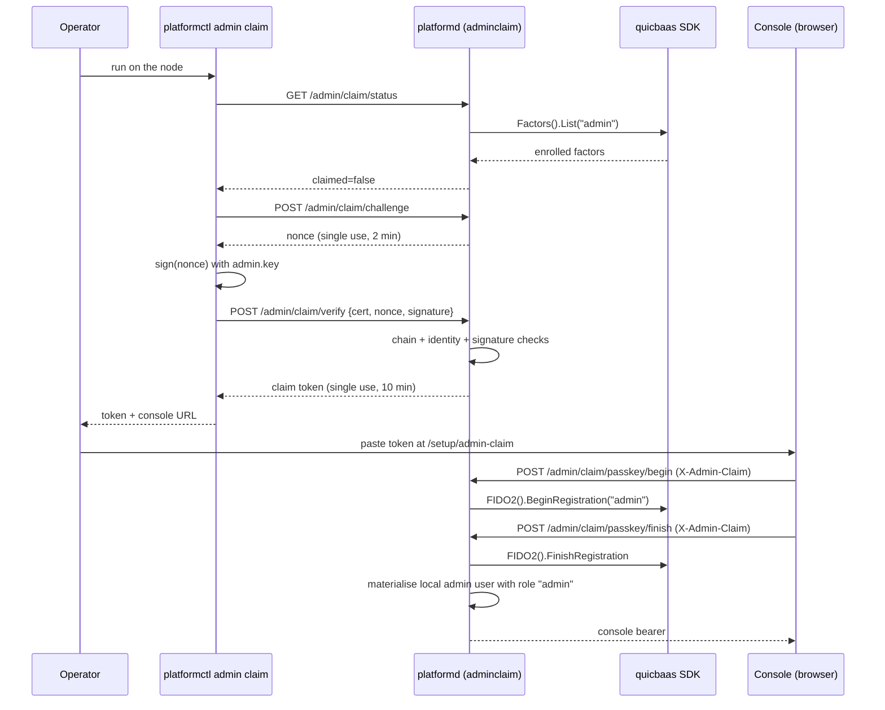

# Platform Authentication — Architecture

> **Status: NORMATIVE** · Scope: `pkg/auth/` · Last verified: 2026-08-18
> Conflicts with this document are defects. Fix them here first.
> The feature folder is: [architecture.md](architecture.md) · [engineering.md](engineering.md) · [cli.md](cli.md) · [api.md](api.md) · [user.md](user.md).

---

## 1. Read this first: what `pkg/auth` actually is

**`pkg/auth` is a certificate-to-identity extractor. That is the whole
package.** Five non-test Go files, no storage, no network calls of its own, no
tokens, no sessions, no roles, no policy.

Given an `*x509.Certificate` it will: check validity dates, verify the chain
against a configured root pool, optionally ask a CA whether the certificate is
revoked, optionally check TCG IDevID/IAK markers, and project the certificate
into an `auth.Identity` struct — an ID, a tenant, an email, a fingerprint, a
serial, and a small attribute map.

**It is not IAM.** It does not know what a user is, it does not decide what
anyone may do, and it never talks to an identity store.

| Question | Answered by | Documented in |
|---|---|---|
| "Is this X.509 certificate one of ours, and whose is it?" | `pkg/auth` | **this folder** |
| "Who is this principal, what roles do they hold, may they do X?" | go-qrdb's identity model and its single RBAC decision point, composed by go-quicbaas, re-exported here | [`docs/iam/`](../iam/) |
| "Is this bearer token valid, and does it carry the scope this call needs?" | The per-transport interceptors, against a broker-issued platform token | [`docs/daemon/api.md`](../daemon/api.md) §5 |

`docs/iam/architecture.md` states the same boundary from the other side:
*"`pkg/auth/` is **not** IAM. It is transport-level authentication — mTLS and
token validation."* This folder is the mTLS half of that sentence; the token
half lives in the transport packages and is catalogued in
[`docs/daemon/api.md`](../daemon/api.md).

**This document does not duplicate [`docs/iam/`](../iam/).** Where a question
is about identities, groups, roles, policies, applications or invitations, go
there.

## 2. The problem

A platform that provisions bare metal has principals that predate any user
account: a machine holding a TPM-issued IDevID, an installer holding an
enrollment credential, a `gatewayd` process holding a platform-issued client
certificate. Those principals authenticate with a certificate, on a transport,
before anything resembling a session exists.

Meanwhile human and service principals authenticate with factors — mTLS, FIDO2,
PIV — and receive a token. Both paths have to arrive at the same notion of "who
is this" so downstream authorization has one input.

## 3. The shape chosen

**Two layers, deliberately separate.**

1. **Certificate → `auth.Identity`** (`pkg/auth`). A pure function of a
   certificate plus a configured trust anchor. Reusable by any transport, any
   binary, with no daemon and no database.

2. **Transport → authenticated context.** Each transport owns its own
   interceptor/middleware, all of which either wrap layer 1 (mTLS) or validate a
   broker-issued platform token:

   | Transport | Mechanism | Where |
   |---|---|---|
   | gRPC (TCP) | mTLS interceptor → `auth.Authenticator` | `pkg/api/daemon/mtls_interceptor.go` |
   | gRPC (TCP) | OIDC / platform-token interceptor | `pkg/api/grpc/oidc_interceptor.go` |
   | Unix socket | `SO_PEERCRED`, kernel-verified PID/UID/GID | `pkg/api/grpc/unix_credentials.go` |
   | QUIC | `AuthMiddleware` over the frame's token field | `pkg/api/quic/auth.go` |
   | MCP | OAuth 2.1 bearer + `AuthorizationChecker` | `pkg/api/mcp/authz.go`, `oauth_metadata.go` |
   | REST | JWT middleware; `/login`, `/login/refresh`, WebAuthn | `pkg/webservice/v1/router/` |
   | Edge proxy | `pkg/proxy` auth chain, seamed to `auth.MTLSAdapter` | `pkg/proxy/authchain.go` |

3. **Session issuance is not in this repo.** `platformctl auth login` and the
   whole N-factor enrolment surface delegate to
   `go-quicbaas/sdk/go`'s `Security().Auth().Factors()` through the thin wrapper
   `sdk/go/services/auth`. The platform issues no factors and stores no
   enrolments.

### Alternatives rejected

| Alternative | Why it was rejected |
|---|---|
| **Put identity extraction inside each transport's interceptor** | Five copies of "which certificate field is the tenant" is five places for them to diverge. `pkg/auth` is one small library that gRPC, the proxy, `gatewayd` and the IAM middleware all call. |
| **Make `pkg/auth` own users, roles and sessions** | go-qrdb owns the identity model and the single RBAC decision point (docs/00 L2). A second one here would drift, and the drift would only surface when two authorization decisions disagreed. The absence of a `pkg/iam` in this repository is the enforcement. |
| **A single fixed identity field (always CN)** | Certificates in this fleet are issued for different purposes: IDevIDs carry TPM serials, human certificates carry emails, service certificates carry DNS names. `MTLSConfig.IdentityField` selects; `extractFallbackIdentity` tries email → CN → subject serial → first DNS SAN when the selected field is empty. |
| **Require a CA for every `MTLSAdapter`** | `gatewayd` validates platform-issued client certificates without hosting the CA in-process; it sources roots through `pkg/trust`. `NewMTLSAdapterFromRoots` exists for exactly that. |
| **Silently skip revocation when no CA is available** | That is fail-open on the one check whose whole point is catching a stolen certificate. `NewMTLSAdapterFromRoots` rejects `WithRequireRevocation` at construction time with `ErrRevocationRequiresCA` — the failure happens at assembly, not at request time. |
| **Treat a failed IDevID check as an authentication failure** | Not every client certificate is an IDevID. `Authenticate` logs the failure at debug and continues. This is a **fail-open** decision with a real cost, called out in §6.3. Callers that need a device certificate call `auth.ValidateIDevID` / `auth.ValidateIAK` directly and act on the error. |
| **Implement the platform's own token issuer** | The platform is a broker-token **validator**, not a token authorization decision point. Tokens are minted elsewhere and enforced here by offline `scp` claim checks. |
| **Password authentication on the platform API** | Removed. Authentication is certificate-based (mTLS, IDevID), WebAuthn/FIDO2/PIV, or bearer token. |

## 4. Component boundaries

| Piece | Location | Owner |
|---|---|---|
| Certificate → `Identity` projection | `pkg/auth/mtls.go`, `interface.go` | this repo |
| X.509 / TCG validators (`ValidateCertificate`, `ValidateIDevID`, `ValidateIAK`, key-usage helpers) | `pkg/auth/validator.go` | this repo |
| Typed authentication errors | `pkg/auth/errors.go` | this repo |
| gRPC mTLS interceptors | `pkg/api/daemon/mtls_interceptor.go` | this repo |
| gRPC platform-token / OIDC interceptors | `pkg/api/grpc/oidc_interceptor.go` | this repo |
| Unix `SO_PEERCRED` credentials and interceptors | `pkg/api/grpc/unix_credentials.go` | this repo |
| QUIC auth middleware and opcode→permission map | `pkg/api/quic/auth.go` | this repo |
| MCP OAuth 2.1 metadata and tool authorization | `pkg/api/mcp/oauth_metadata.go`, `authz.go` | this repo |
| REST login / refresh / WebAuthn routers | `pkg/webservice/v1/router/authentication.go`, `webauthn.go` | this repo |
| IDevID/IAK attestation middleware | `pkg/webservice/v1/middleware/iam/attestation.go` | this repo |
| Edge-proxy auth chain | `pkg/proxy/authchain.go` | this repo — [`docs/proxy/`](../proxy/) |
| `platformctl auth` / `platformctl credential` | `pkg/cli/commands/canonical_auth.go` | this repo |
| Auth SDK wrapper | `sdk/go/services/auth` | this repo |
| **Certificate issuance and revocation state** | go-xkms `TrustedCA`, reached through `go-quicbaas/sdk/go/xkms/ca` | **not this repo** — [`docs/ca/`](../ca/) |
| **Identity model, users, groups, roles, policies, the single RBAC PDP** | go-qrdb, composed by go-quicbaas | **not this repo** — [`docs/iam/`](../iam/) |
| **N-factor enrolment and login** | go-quicbaas `Security().Auth().Factors()` (M10) over go-qrdb's User N-AuthFactor service (M14) | **not this repo** |
| **Platform token minting** | The broker | **not this repo** |
| **Invitations** | `InvitationService` — [`docs/iam/api-reference-invitations.md`](../iam/api-reference-invitations.md) | this repo, **different feature** |

The §R capability row is part of *"Re-export frontage of the composed stack (CA,
KMS, IAM, FIDO2/PIV, barrier, ceremony, LUKS, auth, data services)"*, Tier 1 —
the `auth` entry — reached through `sdk/go/services/auth`.

## 5. Data flow

### A machine authenticating with a client certificate (gRPC/TCP)

1. TLS handshake completes with `RequireAndVerifyClientCert`; Go populates
   `tls.ConnectionState.VerifiedChains`.
2. `MTLSUnaryInterceptor` skips the method if it is in `SkipMethods`;
   otherwise `authenticateFromPeer` pulls `credentials.TLSInfo` off the gRPC
   peer.
3. `extractClientCerts` prefers `VerifiedChains[0]`, falling back to
   `PeerCertificates`.
4. `auth.MTLSAdapter.Authenticate(ctx, leaf)`:
   dates → chain verify against `TrustedRoots` with `ExtKeyUsageClientAuth` →
   optional revocation check via the CA → optional IDevID check (advisory) →
   `ExtractIdentity` → `ExtractTenant` (or `DefaultTenant`).
5. The `*auth.Identity` is stored on the context under `ContextKeyIdentity`;
   handlers read it with `daemon.IdentityFromContext`.

Nothing is persisted. Nothing crosses a host boundary except the TLS handshake
itself and, when revocation checking is on, the call to the CA.

### A human authenticating and receiving a token

1. `platformctl auth login [--method mtls|fido2|piv]` resolves a go-quicbaas
   address from `PLATFORMCTL_QUICBAAS_ADDR`, else the active CLI context.
2. `sdk/go/services/auth.Client.Login` performs the factor exchange against
   go-quicbaas.
3. A session token comes back; `--save-token` writes it `0600` under
   `$HOME/.platformctl/session.token` (or `--token-path`).
4. Subsequent platform calls present it as a bearer token, validated per
   transport and enforced against the `scp` claim.

**The platform never sees the factor.** It sees the resulting token.

### A browser authenticating with WebAuthn

`/api/v1/webauthn/registration/begin` → `finish` →
`/api/v1/webauthn/login/begin` → `finish`, terminating at the REST layer, which
mints a JWT. `/api/v1/login` and `/api/v1/login/refresh` are the JWT
middleware's own endpoints.

### A local CLI over the Unix socket

No token, no certificate. `NewUnixTransportCredentials` performs `SO_PEERCRED`
during the server handshake and the kernel-verified `UnixCredentials{PID, UID,
GID}` land on the context. `RequireRoot` / `RequireUID` / `RequireGID` /
`RequireUIDOrRoot` are the assertions built on it.

## 6. Trust boundaries

1. **Trust anchor.** Everything `pkg/auth` concludes depends on
   `MTLSConfig.TrustedRoots`. `NewMTLSAdapter` fills it from
   `ca.CABundleCertPool()` when the caller supplied none — and on failure
   **logs a warning and continues with a nil pool**.
   **A nil `TrustedRoots` means `Authenticate` skips chain verification
   entirely** (`if m.config.TrustedRoots != nil { ... }`). Dates, revocation,
   IDevID and identity extraction still run; the *chain* does not. This is the
   single most important fail-open path in the package. Callers that must not
   accept an unchained certificate should construct with explicit
   `WithTrustedRoots` (or use `NewMTLSAdapterFromRoots`, which requires a
   non-nil pool and returns `ErrMissingTrustedRoots` otherwise).

2. **Revocation.** Off by default. `WithRequireRevocation(endpoint)` turns it
   on, and `NewMTLSAdapterFromRoots` refuses that combination outright
   (`ErrRevocationRequiresCA`) because revocation state lives in the CA and
   skipping the check silently would be fail-open. When it is on,
   `checkRevocation` calls `ca.Verify(cert, nil)` and maps an error containing
   the substring `"revoked"` to `ErrCertificateRevoked`. **Any other
   verification error is logged at debug and treated as not-revoked** — a
   deliberate narrowing, and a second fail-open path.

3. **IDevID/IAK checks are advisory inside `Authenticate`.** With
   `WithIDevIDValidation(true)`, a failing `ValidateIDevID` is logged at debug
   and authentication continues, on the reasoning that not every client
   certificate is a device certificate. **Attestation-gated paths must call
   `auth.ValidateIDevID` / `auth.ValidateIAK` themselves and act on the error**
   — which is exactly what `pkg/webservice/v1/middleware/iam/attestation.go` and
   `pkg/proxy/authchain.go` do.

4. **Identity extraction is not authorization.** `Identity.ID` and
   `Identity.TenantID` are whatever the certificate asserted, within the bounds
   of what the CA was willing to issue. **A CA that will issue a certificate
   with an arbitrary Organization is a CA that will issue arbitrary tenants**,
   because `TenantField` defaults to `IdentityFieldOrganization`.

5. **`DefaultTenant` weakens tenant binding.** When set, a certificate with no
   extractable tenant is assigned it instead of failing with
   `ErrTenantNotFound`. `gatewayd` sets `WithDefaultTenant("default")`. That is
   fine for a single-tenant edge and wrong for a multi-tenant one.

6. **`SkipMethods` is an authentication bypass by design.** Health and
   reflection endpoints are the intended contents. Anything else added there is
   unauthenticated.

7. **Token validation is per transport, and the scope catalogs default to
   allow.** gRPC covers 185 of 461 RPCs; MCP covers 71 of 449 tools; an entry
   absent from either catalog is permitted once the token validates
   ([`docs/daemon/api.md`](../daemon/api.md) §5). Authentication is enforced;
   *authorization* is only enforced where a catalog entry exists.

8. **QUIC `AuthMiddleware` fails closed when `requireAuth` is set and no
   validator is configured** (`StatusUnavailable`), and **fails open when
   `requireAuth` is false** — no validator means no check.
   `AuthorizationChecker.AuthorizeTool` on MCP likewise returns success when
   both `authService` and `authManager` are nil, which is the test-mode
   (`SkipIAMValidation`) and standalone path.

9. **Unix socket credentials are kernel-verified and unforgeable** — the
   strongest authentication in the platform — **and carry no tenant.** A local
   root process is authenticated as root, not as a tenant principal.

10. **Session tokens on disk.** `--save-token` writes the token to
    `$HOME/.platformctl/session.token`, mode `0600`, directory `0700`. It is a
    bearer credential in a file.

11. **PINs and certificates via environment.** `PLATFORMCTL_USER_PIN`,
    `PLATFORMCTL_CLIENT_CERT`, `PLATFORMCTL_TOKEN_PATH` are read by
    `auth login` when the corresponding flag is absent. Environment variables
    are visible to the process's children.

## 6b. Admin claim — taking possession of the first-boot system admin

> Code: `pkg/webservice/v1/adminclaim/` · CLI: `platformctl admin claim` ·
> Contract: `software/docs/08-bootstrap-auth-contract.md`
> §"Admin enrollment" (amended 2026-09-01).

### 6b.1 The gap this closes

qrdb first-boot creates a passwordless, certificate-based `admin` user in
the system tenant on **every** node, and quicbaas layers an `mtls` auth
factor onto it. The credential bundle lands at
`<quicbaas data-dir>/admin/{admin.crt,admin.key}` — by default
`/var/lib/trusted-platform/quicbaas/admin`. Until this feature existed the
platform consumed none of it: nobody could sign in to the console as the
system admin, and no administration surface had an authenticated principal
to gate on.

### 6b.2 System-level enrollment is certificate-only

The system admin — like every Security Officer and custodian — enrolls by
**certificate, always, with no invite tokens**. That rule is not
configurable: these identities guard barrier material and a mailed token is
not an acceptable bootstrap anchor for them. The tenant-admin invitation
path added in the same amendment applies to **tenant** admins and has no
counterpart here.

The claim flow does **not** introduce an alternative bootstrap. The
certificate remains the sole anchor — it is what the operator proves
possession of, and nothing else opens a claim. Registering a passkey
afterwards is **ordinary auth-factor enrollment** on an identity that is
already bootstrapped, through the same `authfactors` seam any user's second
factor uses.

### 6b.3 The flow

Two proofs of possession are accepted, and the **transport** decides which,
never the caller:

| Situation | Proof |
|---|---|
| The TLS handshake's **leaf** certificate is the admin's | The handshake itself. Go's TLS server validates `CertificateVerify` against the leaf, so possession of its private key is proved. |
| Ordinary server-authenticated TLS (the CLI, the console) | A signature over a server-issued nonce, sent with the certificate. |

Both then run the **same** certificate checks: chain to the configured
anchor, inside its validity window, TLS-client EKU, `CN == admin`, **and** a
SPIFFE URI SAN of exactly the shape
`spiffe://<trust-domain>/tenant/<operating tenant>/user/admin`.

The SPIFFE identity is **mandatory, not conditional**. qrdb first-boot cannot
issue the admin certificate without a configured SPIFFE trust domain — the
whole IAM bootstrap fails without one — so every genuine admin certificate
carries it, and requiring it keeps the bootstrap credential class to exactly
that identity rather than to any ClientAuth certificate the anchor ever
issued with `CN=admin`. The path is matched **segment-wise**, so a trust
domain, tenant or user crafted to end in `user/admin` does not satisfy it.

**The tenant segment is compared**, against the platform's adopted operating
tenant. The same deployment CA also issues certificates for tenant users, so
accepting any tenant would let a tenant whose administrator happens to be
named `admin` present `spiffe://<domain>/tenant/acme/user/admin` and claim
the *system* admin identity. qrdb's system tenant has the fixed id `system`
and the platform adopts it (`pkg/app.adoptSystemTenant`), so the id the
ceremony is scoped to is exactly the name that appears in the SPIFFE path —
verified against a live node's `admin.crt`.

### 6b.4 Why the platform proves possession itself

The SDK's unified mTLS login trusts a **caller-supplied lookup key** on the
in-process embedded transport — the transport `platformd` runs. A
certificate fingerprint is not a secret, so accepting one over REST would
authenticate anybody who can read a public certificate. The platform is
therefore the trust boundary for this flow and performs its own chain,
identity and signature checks before it touches the SDK.

### 6b.5 Fail-closed properties

- The claim routes are **pre-auth by necessity** — no session can exist
  before the admin is claimed. They are not registered at all when the
  deployment cannot support the ceremony (no SDK ceremony client, no factor
  client, no trust anchor, no operating tenant): an unreachable admin
  surface is a fault, an unverifiable one is a breach.
- The flow is **closed while an authenticator is enrolled** for the admin, so
  a stolen copy of the bootstrap certificate cannot displace the operator's
  passkey while they hold it. It is deliberately **not irreversible**:
  removing the last factor re-opens the ceremony, and that is the recovery
  path for a lost security key. An irreversible marker would brick a
  deployment's admin identity the first time someone loses one — a worse
  failure than a re-claim, which still demands the node's root-only
  bootstrap private key, and which can only be reached by first removing the
  factor through an authenticated admin session. *(Raised in review; recorded
  here as a deliberate trade-off rather than settled silently.)*
- A **multi-instance deployment is refused, not unregistered** — and that
  asymmetry with the bullet above is deliberate. The four conditions there
  mean the node cannot *verify* a certificate, so publishing the ceremony
  would be publishing an unverifiable admin surface. A clustered node
  verifies perfectly well; what it cannot guarantee is *one-time-ness*, since
  the ceremony's challenge and claim-token state is process-local and SDK
  factor enrolment is not conditional (#170). So the four MUTATING paths —
  `Challenge`, `Prove`, `BeginPasskey`, `FinishPasskey` — refuse with
  `ErrMultiInstanceUnsupported`, answered as **501 Not Implemented** carrying
  the reason and the issue that would lift it. It is not a 500: the refusal
  is what this build implements, not a fault handling the request.
- **Status stays readable on a clustered node.** It mutates nothing, and the
  console has to be able to distinguish a deployment that will not run the
  ceremony from one that is simply broken. Refusing it would remove that
  signal without removing any risk.
- Status **fails closed**: an SDK error is a 500, never "unclaimed".
- Challenges and claim tokens are single-use, short-lived, capped in number,
  and live only in the daemon's memory — a restart invalidates every
  outstanding one. **The secrets themselves are never retained:** the store
  is keyed by their SHA-256 digest and hashes what a caller presents, so a
  claim token — which authorises enrolling an administrative authenticator —
  is not recoverable from process memory. Go strings cannot be wiped, which
  is why the token is never held as one.
- Every rejection is the same generic 403, so a caller cannot probe the
  anchor, the identity rule and the challenge store independently.
- A claim token is spent by `passkey/finish` **whatever the ceremony's
  outcome**, so a failed attestation cannot be retried against one proof.
- **Completion is serialised.** "Is it claimed?" followed by "enrol this
  authenticator" is a check-then-act, and what it protects is a one-time
  ownership transfer: two callers holding different valid claim tokens could
  otherwise both observe an unclaimed identity and both enrol, letting a
  copied bootstrap key race the legitimate operator. A process-local lock
  makes the loser observe the winner's enrolment and get `ErrAlreadyClaimed`.
  *Residual, and it is a real one:* several `platformd` instances sharing one
  qrdb could still both complete, because the lock is process-local. Closing
  it needs a **conditional** factor enrolment from the SDK — `Factors().Add`
  and the WebAuthn write-through are both unconditional — so it cannot be
  fixed from this side without inventing a distributed lease, which is a
  larger design than this change carries. Tracked upstream as **#170**;
  until then, run the ceremony against a single active instance.
- **Nothing that can fail runs after the enrolment.** The SDK enrolment is
  the irreversible step — once the factor exists the ceremony is closed
  forever — so the platform-local admin record is written *before* it. A
  record on its own grants nothing (every login path demands a factor), so
  writing it early is safe, and it means a store failure leaves the identity
  still claimable rather than stranding the operator with a claimed identity
  and no way in. Only token issuance follows, and failing there costs the
  operator one response: the passkey is enrolled, so they sign in with it.
- **A failed read is not an absent record.** `materialiseAdmin`
  distinguishes "no such user" from "the store could not answer" and fails
  closed on the latter, rather than replacing an existing admin record with
  a fresh minimal one mid-ceremony.
- **Only the handshake leaf counts.** `r.TLS.PeerCertificates` is the entire
  Certificate message the client sent — leaf first, then whatever chain it
  chose to attach — but TLS proves possession of the private key for the
  leaf alone. Scanning the whole list would let a client holding any
  acceptable certificate present its own as the leaf, attach a copy of the
  (public, freely readable) admin certificate behind it, and receive a claim
  token with no signature at all.
- **The outstanding-secret cap reserves its slot atomically.** A
  check-then-increment would let any number of concurrent pre-auth callers
  all observe the count below the cap and all store, which is precisely the
  burst the cap exists to prevent.

## 6c. Server-side authorization — the gated set

Before this feature the RBAC middleware in
`pkg/webservice/v1/middleware/iam/` had **zero call sites**: the console
gated admin surfaces client-side off the `roles` claim, and the server
enforced nothing.

Three pieces close that:

1. **`iam.SessionGuard`** (`middleware/iam/guard.go`) — the one
   implementation of `RequireRoles`, `RequireAllRoles` and `RequireTenant`.
   `AuthMiddleware` embeds it, so a route gated through the middleware and a
   route gated through a directly mounted guard reach the identical
   decision. Every guard answers **401 when no session is present**, so
   mounting one without an authenticator ahead of it denies rather than
   opens.
2. **The live verifier publishes a session.** `jwt.RestHandler.Verify` now
   projects the claims it just verified into an `iam.IAMSession` on the
   request context. Verification still happens exactly once; the guards
   never re-parse a token. The broker platform-token middleware already did
   this.

   `jwt.Service.ParseToken` accepts the platform JWT from **either** carrier,
   because the platform's two first-class clients credential differently:
   `Authorization: Bearer` (platformctl, scripts, service callers) or the
   `jwt` / `token` cookie (the console — its SDK client is configured
   `credentials: "include"` and sends no Authorization header). The header
   wins, so an explicit credential is never shadowed by an ambient one, and
   the cookie is set `Secure` + `SameSite=Strict`.

   **The `Bearer` scheme is required, not optional.** Accepting a bare
   header token let the verifier and the resource handlers disagree about
   which credential a request carried — the handlers recognise only Bearer,
   so a caller could authenticate with a valid raw-header token for their
   own tenant while the handlers fell through to a cookie naming somebody
   else's.

3. **Resource handlers read the verified session, never a token.**
   `IAMHandlers.getTenantID` used to base64-decode the request's JWT
   payload *without verifying it*. It now takes the tenant from the
   `IAMSession` the auth middleware published, so one verified identity
   drives both the authorization decision and the tenant the handler acts
   on. This is the structural fix for the desync above; the scheme
   requirement is the belt to its braces.
4. **`middleware.Authenticator`** adapts the chosen auth seam to the
   `func(http.Handler) http.Handler` shape `mux.Router.Use` takes.

### The minimum gated set (decided here)

**`/api/v1/iam/**` — the whole subtree — requires an authenticated caller
holding the `admin` role.** Reading a tenant's users, roles, policies or
OAuth applications is administrative disclosure, so the gate is not limited
to the mutating verbs.

**Every route whose target tenant comes from the URL requires that tenant to
be the caller's own.** The IAM handlers give the path's `{tenant}` precedence
over the session's (`getTenantID`), so the admin role *alone* would let an
administrator of one tenant reach any other tenant's users, groups, roles,
policies or applications simply by naming it in the path. `RequireOwnTenant`
closes that, and it applies to the system tenant too — no carve-out, because
go-quicbaas#357 denies system-tenant impersonation of tenant users outright
and an exception here would be built on behaviour that is being removed. A
request that names no tenant is admitted; the handler then resolves it from
the verified session, which is not a caller-controlled input.

**Tenant lifecycle (`/api/v1/iam/tenants`, `/api/v1/iam/tenants/{tenant}`,
all methods) instead requires the caller's tenant to be the system
tenant.** These are the tenant *records*, a control-plane surface the system
tenant drives across tenants, so they carry `RequireSystemTenant` rather than
`RequireOwnTenant`. A tenant-scoped admin holds the same `admin` role inside
their own tenant; the control plane owns tenant records
(08-bootstrap-auth-contract §"Control plane vs data plane"), so they must not
be able to enumerate, create or delete tenants with it. A tenant admin reads
their own tenant through `/api/v1/tenants`.

This is chosen to **tighten, never break**, under the in-flight upstream
narrowing (go-quicbaas#356 removing the blanket cross-tenant lift, #357
making an empty `TenantIDs` stop matching every tenant and denying
system-tenant impersonation of tenant users). Nothing here relies on a
system admin being able to reach tenant data — `RequireOwnTenant` denies it
today, for the system tenant as much as any other, which is the direction
#357 is heading.

`NewIAMRouter` takes an `Authorization` with all four guards and **returns
an error** if any is missing; the caller then leaves the routes
unregistered. `TestRegisterRoutes_EveryTenantScopedRouteIsGuarded` walks the
registered route table rather than a hand-written list, so a route added
later cannot quietly skip the guard its neighbours carry.

### The credential-bearing surfaces (#165, slice 1)

**`/api/v1/{kms,tenants,tpm,vtpm,idevid}/**` and `/api/v1/ca/certificates/**`
require an authenticated caller holding the `admin` role.** These are the
routers whose routes hold, move or destroy credentials: KMS keys, DEKs and
secrets plus encrypt/decrypt/sign; the per-tenant DEK and the per-tenant
barrier's init, unseal and seal; the host TPM's provision, clear, key
creation and NVRAM writes; vTPM bundles; the node's own IDevID and IAK; and
certificate issuance and revocation. Reads are gated with the writes — a
PCR bank, an event log or an issued-certificate inventory is exactly what an
attacker reads before forging something.

They are gated in `pkg/webservice/v1/router.go` through `v1Router.gated(...)`
(`authz.go`), which mounts the same two pieces the IAM subtree mounts:
`middleware.Authenticator` over the configured inbound seam, then
`iam.SessionGuard.RequireRoles`. The gate hangs on a matcher-less mux
grouping subrouter, one per role set, so a router still registers its own
path prefix underneath and registration order is preserved.

The mount lives in the one file that enumerates every router **so that the
audit can be a default-deny assertion over the finished route table**:
`TestRegisterRoutes_EveryRouteDeniesWithoutCredential` walks the registered
routes, issues a credential-free request against each, and requires a
refusal from every route not named in an explicit, justified public list. A
router added later that never calls `gated(...)` fails the build gate
instead of shipping open. `TestRegisterRoutes_EveryDeclaredOpenRouteIsActuallyOpen`
asserts the converse, so the public list cannot decay into stale
documentation.

The audit has been watched go red: adding a router registered on the ungated
parent fails it, naming each leaked route; gating that same router through
`gated(...)` makes it pass again. A default-deny assertion nobody has seen
fail is not known to deny.

The console's own carrier is asserted end to end against the real verifier
rather than a seam double — a real signing key, a real signed token in the
`jwt` cookie, no Authorization header — reaching every gated route, with the
same request minus the cookie refused 401 and a cookie this signer did not
produce refused too.

When the inbound seam cannot be built the groups mount a deny-all middleware
and answer 401. That differs from the IAM subtree, which leaves its routes
unregistered; both fail closed, and 401 is the one an operator can tell
apart from a typo. The condition is unreachable in the daemon —
`HandlerRegistry.JSONWebTokenHandler` aborts startup rather than returning
nil.

#### `/api/v1/ca` is deliberately split

The CA router registers in two halves — `RegisterRoutes` (gated) and
`RegisterPublicRoutes` (ungated) — because gating it wholesale would break
the clients it exists to serve:

| Route | State | Why |
|---|---|---|
| `POST/GET /ca/certificates`, `GET/DELETE /ca/certificates/{serial}` | **gated**, `admin` | Issuance and revocation are privileged, and the list of certificates this CA has issued is an inventory of every identity on the platform. |
| `GET /ca/bootstrap` | public | The trust-bootstrap fetch. Its purpose is to serve the bundle to a client that does not trust this platform yet and therefore cannot have authenticated to it. |
| `GET /ca/crl` | public | RFC 5280 relying parties retrieve a CRL anonymously. A gated CRL cannot be consumed by the verifiers it exists for. |
| `GET /ca/bundle`, `GET /ca/root`, `GET /ca/intermediate` | public | The CA's own chain, present in every TLS handshake this platform performs and a strict subset of what `/ca/bootstrap` already publishes. |
| `GET /ca/info` | public | CA identity, default algorithm and validity, plus summaries of those same certificates. No issued-certificate inventory, no key material. |

Nothing that mutates CA state and nothing that enumerates issued
certificates may join the public half; the split is asserted exactly, in
both directions, by `pkg/webservice/v1/rest/ca/router_test.go`.

### The permanently public routes

Outside the CA the following answer a caller holding no credential, and each
must:

| Route | Why |
|---|---|
| `GET /api/v1/status` | Bootstrap liveness, and it is load-bearing: `pkg/bootstrap/orchestrator.go`'s `httpHealthChecker` probes `https://<node>:{8443,9443,443}/api/v1/status` to decide a node has finished booting, from a machine with no credential that may not yet trust the node's CA. **It also over-discloses for that purpose** — SMBIOS product/board/chassis including serials, kernel version, hostname, network interfaces and addresses, TPM and CA status, to a caller that reads only the status code. That is an information-disclosure defect tracked on #236; the fix is to narrow the body, not to gate the route. |
| `GET /api/v1/pubkey`, `GET /api/v1/certificate` | The server's own public key and certificate, which it presents on every TLS handshake. |
| `/api/v1/login`, `/api/v1/login/refresh` | Credential issuance. Gating the endpoint that mints the credential is a deadlock. Registered with no method matcher, so they answer every verb. |
| `/api/v1/admin/claim/**` | The one-time admin-claim ceremony, pre-auth by necessity and protected instead by the firstboot certificate proof (§Admin claim). |
| `GET /api/v1/platform/service-registry` | Wire state only — which REST surfaces are configured. Public so the console can show dark surfaces before login; predates this change. |
| `/api/v1/acme/**` | ACME authenticates by its own protocol mechanisms (account keys, EAB), not by platform tokens. |
| `/api/v1/webauthn/**` | The registration and login ceremonies, which run before a session exists. |

The service-registry's 503 stub for an unconfigured service also stays
ungated: it reports only that a surface is dark, which is exactly what
`/platform/service-registry` already reports.

### What is NOT gated yet, and why

These REST routers remain unauthenticated: `compute`, `registry`,
`platform`, `sdn`, `switch`, `gateway`, `overlay`, `pxe`, `dns`, `eab`,
`invitation`, `device`, `attestation`, `ntp`, the `/v2` OCI surface at the
host root, and the `/users/{id}/factors` and `/quicbaas/*` stubs registered
directly on the v1 router. That is a real hole, and a deliberately separate
change: several of those routers are called by machine principals whose
credential story differs per surface (PXE callbacks from booting nodes, the
bootstrap seeder, the `gatewayd` control plane), so gating them without
first establishing what each caller presents would break deployments rather
than secure them.

The remainder is enumerated route by route in `pendingRoutes`
(`pkg/webservice/v1/router_authz_test.go`) rather than only in prose, so it
shrinks visibly as the tranches land and cannot silently grow. The audit's
reach is bounded by what its fixture wires — a router whose backing service
is nil never registers, so `/bmc`, `/provisioning` and the `/v2` OCI mount at
the host root are outside the assertion until a later slice wires them into
it. Tracked on #165 — do not read this section as a claim that the platform
is fully gated.

A **second REST server** — `pkg/api/daemon.RESTServer`, serving its own
`/api/v1` handlers from `pkg/api/rest/` with no authentication middleware at
all — is outside #165 entirely and is tracked on #232.

## 7. What this feature deliberately does not do

- **It does not store identities.** No users, no groups, no roles, no
  enrolments. [`docs/iam/`](../iam/).
- **`pkg/auth` does not make authorization decisions.** There is exactly one
  RBAC decision point in the portfolio and it is not in `pkg/auth`. The
  route-level guards described in §6c are enforcement points, not a second
  decision point: they read a role/tenant already resolved upstream.
- **It does not issue or revoke certificates.** [`docs/ca/`](../ca/).
- **It does not mint tokens.** The platform validates broker-issued tokens
  offline against the `scp` claim.
- **It does not implement WebAuthn, FIDO2 or PIV.** It consumes them through
  the stack. The SDK FIDO2 ceremony surface is tenant-scoped and the wire
  structs carry no tenant field: the WebAuthn REST proxy stamps the
  platform's operating tenant (the firstboot system tenant adopted by
  `pkg/app`) onto every ceremony call's context
  (`sdk/go/transport.ContextWithTenant`), and refuses construction without
  one — an unscoped call fails closed in the SDK with `tenant is required`.
- **It does not manage invitations** despite invitations being an
  authentication-adjacent flow — see
  [`docs/iam/api-reference-invitations.md`](../iam/api-reference-invitations.md).
  The legacy `docs/auth/invitation-flow.md` in this folder predates the IAM
  conversion and is superseded by it.
- **It does not enforce IDevID inside `Authenticate`.** See §6.3.
- **It has no API surface of its own.** `pkg/auth` is a library; there is no
  `AuthService` on any transport. [api.md](api.md).

## 8. Corrections against the code

Recorded per `conventions/feature-docs.md` §7 — the code wins.

| Stale statement | Where | Reality (2026-08-18) |
|---|---|---|
| *"designed to work with the go-trusted-ca `CertificateAuthority` interface"* | `pkg/auth/doc.go` | `NewMTLSAdapter` takes `quicbaasca.CACertificateAuthority` from `go-quicbaas/sdk/go/xkms/ca`. `go-trusted-ca` was decommissioned; its CA rolled into go-xkms. |
| *"IAM Module (`pkg/iam/`)"* with a tenant manager, identity store, WebAuthn and an ABAC engine | legacy `docs/auth/README.md` diagram (and `docs/iam/architecture.md`, which already flags it) | **There is no `pkg/iam` in this repository.** Those components live in go-qrdb / go-quicbaas. |
| *"QuicBaaS IAM — ABAC for all permission decisions"* as this repo's design | legacy `docs/auth/README.md` | Correct as a *statement about the stack*; it is not a description of `pkg/auth`, which makes no permission decisions. |
| Port table (`8443/9443`, `10443`, `11443`, `8000`) presented as configuration | legacy `docs/auth/README.md` | Those are defaults in deployment examples, not constants in `pkg/auth`. Ports are configured per deployment; do not treat the table as normative. |

## 9. Related

- [engineering.md](engineering.md) · [cli.md](cli.md) · [api.md](api.md) · [user.md](user.md)
- [`docs/iam/`](../iam/) — identity, RBAC, policies, invitations (**the other half of this story**)
- [`docs/daemon/api.md`](../daemon/api.md) — transports and the authorization catalogs
- [`docs/ca/`](../ca/) — certificate issuance and revocation
- [`docs/proxy/`](../proxy/) — the edge auth chain
- [`docs/attestation/`](../attestation/) — what IDevID/IAK evidence is used for
