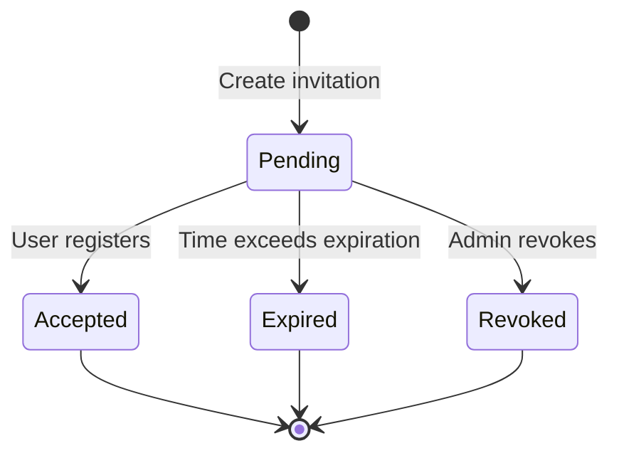
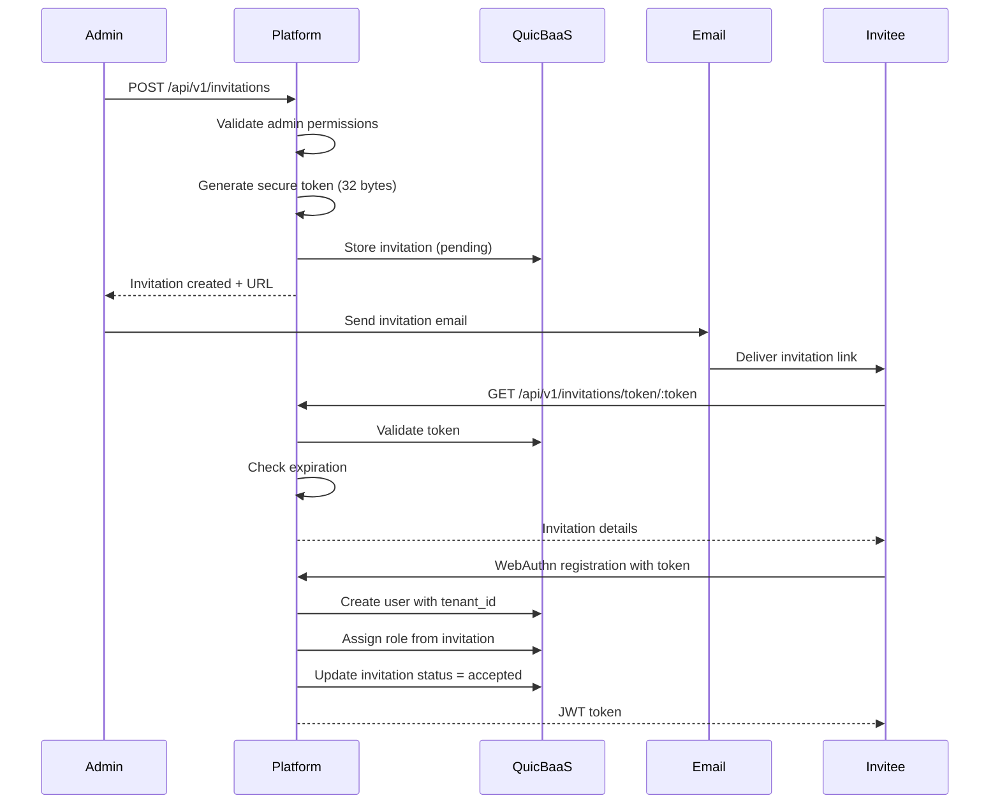
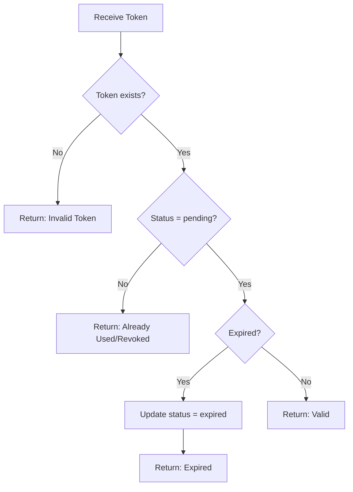

# Invitation Flow

> **Status: ARCHIVE — historical record. Do NOT build from this document.**
> Last verified: 2026-10-13 · Replaced by [iam/api-reference-invitations.md](../iam/api-reference-invitations.md).

This document describes the complete invitation lifecycle for adding users to existing tenants in the Trusted Platform.

## Table of Contents

- [Overview](#overview)
- [Invitation Lifecycle](#invitation-lifecycle)
- [Invitation Entity](#invitation-entity)
- [API Reference](#api-reference)
- [Flow Diagrams](#flow-diagrams)
- [Token Security](#token-security)
- [Expiration and Revocation](#expiration-and-revocation)
- [Error Handling](#error-handling)

## Overview

Invitations allow tenant owners and administrators to invite new users to join their tenant with specific roles. The invitation system provides secure, time-limited tokens for user onboarding.

### Key Features

| Feature | Description |
|---------|-------------|
| Cryptographically secure tokens | 32-byte random tokens encoded as base64url |
| Time-limited validity | Default 7-day expiration |
| Role pre-assignment | Specify role during invitation |
| Status tracking | Pending, accepted, expired, revoked |
| Audit trail | Track inviter, creation, and acceptance times |

## Invitation Lifecycle



### Status Transitions

| Status | Description | Final |
|--------|-------------|-------|
| `pending` | Awaiting user acceptance | No |
| `accepted` | User completed registration | Yes |
| `expired` | Expiration time passed | Yes |
| `revoked` | Manually cancelled by admin | Yes |

## Invitation Entity

The Invitation entity represents an invitation to join a tenant.

```go
type Invitation struct {
    ID          uint64           `json:"id"`
    Token       string           `json:"token"`
    TenantID    string           `json:"tenant_id"`
    Email       string           `json:"email"`
    Role        string           `json:"role"`
    Status      InvitationStatus `json:"status"`
    InvitedByID uint64           `json:"invited_by_id"`
    ExpiresAt   time.Time        `json:"expires_at"`
    CreatedAt   time.Time        `json:"created_at"`
    AcceptedAt  *time.Time       `json:"accepted_at,omitempty"`
}
```

### Field Descriptions

| Field | Type | Description |
|-------|------|-------------|
| `ID` | uint64 | Unique identifier (derived from token hash) |
| `Token` | string | Base64URL-encoded 32-byte secure token |
| `TenantID` | string | Target tenant UUID |
| `Email` | string | Invitee email address |
| `Role` | string | Role to assign upon registration |
| `Status` | string | Current invitation status |
| `InvitedByID` | uint64 | User ID of the inviter |
| `ExpiresAt` | time.Time | Token expiration timestamp |
| `CreatedAt` | time.Time | Invitation creation timestamp |
| `AcceptedAt` | *time.Time | Acceptance timestamp (nil if pending) |

## API Reference

### Create Invitation

Creates a new invitation to join a tenant.

**Endpoint:** `POST /api/v1/invitations`

**Authorization:** Requires `invitation:create` permission on tenant

**Request:**
```bash
curl -X POST https://platform.example.com/api/v1/invitations \
  -H "Authorization: Bearer <token>" \
  -H "Content-Type: application/json" \
  -d '{
    "email": "newuser@example.com",
    "role": "developer",
    "expires_in_days": 7
  }'
```

**Response:**
```json
{
  "id": 12345678901234567890,
  "token": "aGVsbG8td29ybGQtdGhpcy1pcy1hLXNlY3VyZS10b2tlbg==",
  "tenant_id": "tenant-550e8400-e29b-41d4",
  "email": "newuser@example.com",
  "role": "developer",
  "status": "pending",
  "invited_by_id": 98765432109876543210,
  "expires_at": "2025-01-22T00:00:00Z",
  "created_at": "2025-01-15T12:00:00Z",
  "invitation_url": "https://platform.example.com/register?token=aGVsbG8t..."
}
```

### List Invitations

Lists all invitations for the current tenant.

**Endpoint:** `GET /api/v1/invitations`

**Authorization:** Requires `invitation:read` permission on tenant

**Query Parameters:**

| Parameter | Type | Default | Description |
|-----------|------|---------|-------------|
| `status` | string | all | Filter by status (pending, accepted, expired, revoked) |
| `limit` | int | 50 | Maximum results per page |
| `offset` | int | 0 | Pagination offset |

**Request:**
```bash
curl -X GET "https://platform.example.com/api/v1/invitations?status=pending" \
  -H "Authorization: Bearer <token>"
```

**Response:**
```json
{
  "invitations": [
    {
      "id": 12345678901234567890,
      "email": "newuser@example.com",
      "role": "developer",
      "status": "pending",
      "expires_at": "2025-01-22T00:00:00Z",
      "created_at": "2025-01-15T12:00:00Z"
    }
  ],
  "total": 1,
  "limit": 50,
  "offset": 0
}
```

### Get Invitation by Token

Validates an invitation token and returns invitation details.

**Endpoint:** `GET /api/v1/invitations/token/:token`

**Authorization:** None required (public endpoint for registration)

**Request:**
```bash
curl -X GET "https://platform.example.com/api/v1/invitations/token/aGVsbG8t..."
```

**Response (Valid):**
```json
{
  "valid": true,
  "email": "newuser@example.com",
  "tenant_name": "Engineering",
  "role": "developer",
  "expires_at": "2025-01-22T00:00:00Z"
}
```

**Response (Invalid/Expired):**
```json
{
  "valid": false,
  "error": "invitation_expired",
  "message": "This invitation has expired"
}
```

### Delete (Revoke) Invitation

Revokes a pending invitation.

**Endpoint:** `DELETE /api/v1/invitations/:id`

**Authorization:** Requires `invitation:delete` permission on tenant

**Request:**
```bash
curl -X DELETE "https://platform.example.com/api/v1/invitations/12345678901234567890" \
  -H "Authorization: Bearer <token>"
```

**Response:**
```json
{
  "success": true,
  "message": "Invitation revoked successfully"
}
```

## Flow Diagrams

### Complete Invitation Flow



### Token Validation Flow



## Token Security

### Token Generation

Invitation tokens are generated using cryptographically secure random bytes:

```go
func generateSecureToken() (string, error) {
    tokenBytes := make([]byte, 32)  // 256 bits of entropy
    _, err := rand.Read(tokenBytes)
    if err != nil {
        return "", ErrTokenGeneration{Cause: err}
    }
    return base64.URLEncoding.EncodeToString(tokenBytes), nil
}
```

### Security Properties

| Property | Implementation |
|----------|----------------|
| Entropy | 256 bits (32 bytes) |
| Encoding | Base64URL (URL-safe) |
| Storage | Hashed in secondary index |
| Transmission | HTTPS only |
| Lifetime | Default 7 days |

### Best Practices

1. **Never log tokens** - Tokens should be treated as secrets
2. **Single use** - Each token can only be accepted once
3. **Rate limiting** - Limit token validation attempts per IP
4. **Secure delivery** - Use encrypted email or secure channels
5. **Audit logging** - Log invitation creation and acceptance

## Expiration and Revocation

### Default Expiration

| Setting | Default | Description |
|---------|---------|-------------|
| `expires_in_days` | 7 | Days until token expires |
| Minimum | 1 | Shortest allowed expiration |
| Maximum | 30 | Longest allowed expiration |

### Checking Expiration

`entities.Invitation` never reads the clock: every method whose answer depends
on the time takes it as `now` (#311). `InvitationService` reads its clock once
per operation and passes that instant to every entity method it calls. See
[`docs/tenant/architecture.md`](../tenant/architecture.md#time-is-a-parameter).

```go
// IsExpired reports whether the invitation's expiry is strictly before now.
// A zero now is reported as expired (fail closed).
func (inv *Invitation) IsExpired(now time.Time) bool {
    if now.IsZero() {
        return true
    }
    return now.After(inv.ExpiresAt)
}

// IsPending returns true if the invitation is still pending.
func (inv *Invitation) IsPending() bool {
    return inv.Status == InvitationStatusPending
}
```

### Revocation

Administrators can revoke pending invitations at any time:

- Revoked invitations cannot be used for registration
- Revocation is immediate and irreversible
- Audit log captures who revoked and when

## Error Handling

### Error Responses

| Error Code | HTTP Status | Description |
|------------|-------------|-------------|
| `invitation_not_found` | 404 | Token does not exist |
| `invitation_expired` | 410 | Token has expired |
| `invitation_revoked` | 410 | Token was revoked |
| `invitation_accepted` | 409 | Token already used |
| `invalid_email` | 400 | Email format invalid |
| `permission_denied` | 403 | Insufficient permissions |

### Error Response Format

```json
{
  "error": "invitation_expired",
  "message": "This invitation expired on 2025-01-22T00:00:00Z",
  "details": {
    "expired_at": "2025-01-22T00:00:00Z",
    "expired_days_ago": 3
  }
}
```

## Related Documentation

- [User Registration](../iam/user-registration.md) - Registration process details
- [Authentication](../iam/authentication.md) - Token management
- [User-Tenant Relationship](../tenant/user-relationship.md) - Multi-tenancy model
- [ABAC Policies](../iam/abac-policies.md) - Role-based access control
- [Invitation API Reference](../iam/api-reference-invitations.md) - Complete REST API documentation
