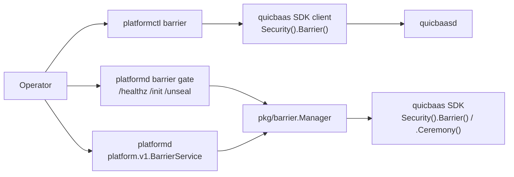
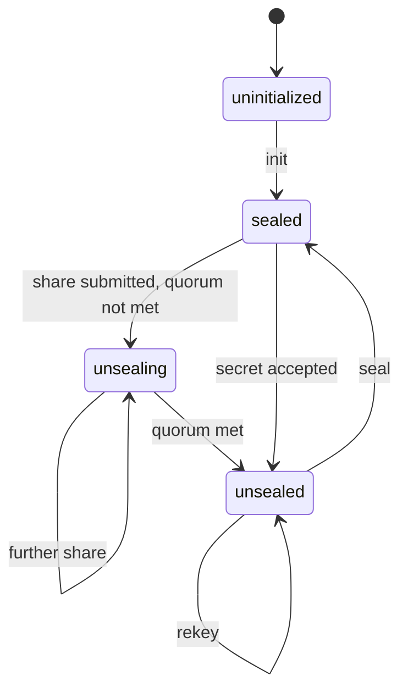
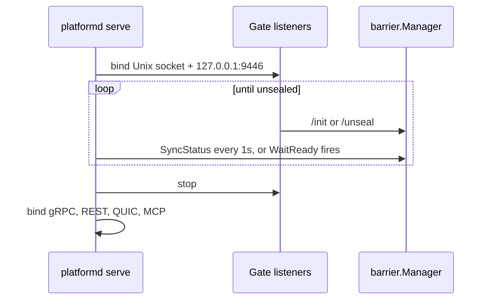

# Barrier Architecture

> **Status: NORMATIVE** · Scope: the platform barrier (`pkg/barrier/`, the barrier gate, `platform.v1.BarrierService`, `platformctl barrier`) and the per-tenant barrier frontage · Last verified: 2026-10-11
> Conflicts with this document are defects. Fix them here first.
> The feature folder is: architecture (this file) · [engineering.md](engineering.md) ·
> [cli.md](cli.md) · [api.md](api.md) · [user.md](user.md).

## The problem

The platform's data at rest — secrets, credentials and keys held in the
replicated store — must stay unreadable until an authorized operator, a quorum
of officers or a hardware factor releases it. Until that happens, a daemon that
answers on its network ports serves requests it cannot satisfy and exposes
attack surface for no benefit.

## The shape chosen

**A barrier is a single encryption layer over the store, with a lifecycle of
init → unseal → seal, and the daemon does not bind its production transports
until the barrier is unsealed.**

The barrier itself — the key hierarchy, the seal strategies, Shamir splitting,
the PIN backend and the officer ceremony — is owned by the layers below this
repository and reached through the quicbaas SDK (`Security().Barrier()`,
`Security().Ceremony()`). This repository implements none of it. What it owns:

| Concern | Where | Owned here? |
|---|---|---|
| Barrier crypto, seal strategies, Shamir, PINs, ceremony | quicbaas SDK `Security().Barrier()` / `.Ceremony()` | **No** — consumed only |
| Platform wrapper with local state tracking | `pkg/barrier/` (`Manager`, `Config`) | Yes |
| Daemon start-up gate (pre-unseal listeners) | `pkg/daemon/commands/serve_barrier_gate.go`, `pkg/api/daemon/initonly.go`, `pkg/api/rest/init_handlers.go` | Yes |
| Platform barrier RPCs on platformd | `platform.v1.BarrierService` — `pkg/api/daemon/barrier_grpc_service.go` | Yes |
| Operator CLI | `platformctl barrier` — `pkg/cli/commands/barrier/` | Yes |
| Per-tenant barrier frontage | `pkg/tenant.Manager` barrier methods and the tenant transports | Yes — see [`docs/tenant/`](../tenant/) |

## Two barriers

| | Platform barrier | Per-tenant barrier |
|---|---|---|
| Scope | One per platform store; gates daemon start-up | One per tenant namespace |
| Created by | `/init` on the gate, `BarrierService.Init`, or `platformctl barrier init` | Automatically by tenant creation, or explicitly |
| Operator surface | `platformctl barrier` | `platformctl tenant barrier` |
| Documented in | this folder | this folder for the model; [`docs/tenant/`](../tenant/) for the routes and verbs |

**They are different capabilities.** The tenant barrier opcodes and tools
(`OpTenantBarrierCategory`, `platform_tenant_barrier_*`) never unseal the
platform barrier, and the platform barrier verbs never touch a tenant.

## Control paths for the platform barrier

There are two independent paths, and they reach the barrier through different
daemons.

1. **`platformctl barrier` talks to quicbaasd, not platformd.** Every verb
   builds a quicbaas SDK client from the CLI context and calls
   `Security().Barrier()` on it. The root `--transport` flag does not choose
   this connection; see [cli.md §2](cli.md#2-where-the-verbs-go).
2. **platformd drives the barrier through `barrier.Manager`.** The gate routes
   and `BarrierService` call the manager, which calls the quicbaas SDK client the
   daemon was built with.

Both paths end at the same barrier. The manager learns about changes made on
the other path only when `SyncStatus` runs.

## Lifecycle

| Step | Meaning |
|---|---|
| **init** | Creates the barrier key under a seal strategy. Single-secret strategies take a passphrase; Shamir splits the key M-of-N. |
| **unseal** | Supplies the secret, or Shamir shares until the threshold is met. The barrier becomes readable. |
| **seal** | Locks the barrier. Every data-plane read and write fails until the next unseal. |
| **rekey** | Replaces the barrier key and, for Shamir, regenerates the share set at a new M-of-N. |
| **recovery** | A separate M-of-N recovery share set, used to recover when the primary unseal material is lost. Reachable from `platformctl barrier recovery`; platformd exposes no recovery RPC. |

The gate reports `unsealing` from the manager's cached flags. The flag is set
when a Shamir share is accepted and the quorum is not yet met. It is cleared by
an unseal, a seal, or a status sync that finds the barrier unsealed. Upstream
status carries no share progress, so a node that has not taken a share itself
reports `sealed`. See [engineering.md §4](engineering.md#4-the-barrier-gate).

### Seal strategies

The `barrier.seal_strategy` configuration key names the strategy:

| Value | Meaning |
|---|---|
| `none` | No encryption; the barrier is always open |
| `passphrase` | Key derived from an operator passphrase |
| `software` | Alias of `passphrase`; **the default** |
| `shamir` | M-of-N secret sharing with an officer ceremony |
| `tpm2` | Barrier key sealed to a TPM 2.0 |
| `pkcs11` | Barrier key protected by a PKCS#11 token |

`platformctl barrier init` accepts only `none`, `passphrase` and `shamir`.

### Share-free contract

**Share material never crosses the wire on init, rekey or recovery generation.**
Shares are sealed to enrolled Security Officers, and each officer claims a share
through the ceremony's challenge–response claim flow. `BarrierService` reserves
the former `unseal_keys` fields in its init and rekey responses so they cannot
return. Shares do travel on unseal and recover, because that is when an officer
presents one.

## The barrier gate

`platformd serve` runs the gate before it constructs the daemon. The gate:

1. Binds **only** the Unix socket (`--socket-path`, default `/run/platformd.sock`) and a loopback HTTP listener on `127.0.0.1:9446`.
2. Serves exactly `GET|HEAD /healthz`, `POST /init` and `POST /unseal` on both.
   There is no gRPC, no business REST, no QUIC and no MCP during the gate.
3. Blocks until the barrier is initialized and unsealed, or the context is
   cancelled.
4. Tears its listeners down. The production transports bind afterwards.

**The gate gates only when a barrier is configured.** The manager exists only
when the configuration has a `barrier:` section. Without one, the gate binds,
finds no manager, treats the platform as ready and releases at once.

### Trust assumptions

- **The gate routes carry no authentication.** Access control is the loopback
  bind and the Unix socket's file mode (`0660`). Any local process that can
  reach either can call `/init` on an uninitialized node, and the first caller
  wins.
- The state checks are the guard. `/init` is refused unless the state is
  `uninitialized`; `/unseal` is refused unless it is `sealed` or `unsealing`.

## Platform `BarrierService`

`platform.v1.BarrierService` (`Init`, `GetStatus`, `Unseal`, `Seal`, `Rekey`)
is registered on platformd's TCP gRPC server and on its gRPC-over-Unix server.
It is reachable only after the gate releases, so in practice it serves status,
seal and rekey on a running node. It has no REST, QUIC or MCP binding; see
[api.md](api.md).

## What this feature deliberately does not do

- **It does not implement barrier crypto.** No strategy, no Shamir, no PIN
  check runs in this repository.
- **It does not run the officer ceremony.** `barrier.Manager` forwards the
  ceremony calls; the ceremony itself is upstream. The ceremony's own surface
  is documented with first boot in [`docs/bootstrap/`](../bootstrap/).
- **It does not auto-unseal.** `platformd` never unseals the barrier itself; a
  sealed barrier waits for an operator — see [engineering.md §3](engineering.md#3-configuration).
- **It does not own tenant lifecycle.** Tenant creation, deletion and quotas are
  in [`docs/tenant/`](../tenant/).

## Related

- [`docs/bootstrap/`](../bootstrap/) — first boot and the ceremony that precedes init
- [`docs/tenant/`](../tenant/) — per-tenant barrier routes and verbs
- [`docs/daemon/api.md`](../daemon/api.md) — the six-transport model and authorization
