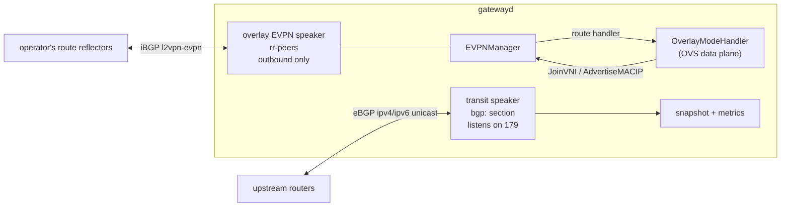

# BGP Speaker — Architecture

> **Status: NORMATIVE** · Scope: `pkg/sdn/bgp/` and the gatewayd services that run it · Last verified: 2026-10-14
> Conflicts with this document are defects. Fix them here first.
> The feature folder is: [architecture.md](architecture.md) · [engineering.md](engineering.md) · [cli.md](cli.md) · [api.md](api.md) · [user.md](user.md).

---

## 1. Problem

A gateway needs two things from BGP:

- **Transit sessions.** The gateway holds eBGP sessions to upstream routers so
  it can learn their routes, and later announce the site's public prefixes.
- **An overlay control plane.** VTEPs need EVPN (RFC 7432, RFC 8365) to tell
  each other which MACs, MAC/IP bindings and VNIs sit behind them.

`pkg/sdn/bgp` is one speaker library that serves both. It wraps GoBGP
`v4.9.0` (`pkg/sdn/bgp/speaker.go:1103`). The platform does not encode BGP
itself; EVPN routes are built and parsed with GoBGP's constructors
(`pkg/sdn/bgp/evpn_codec.go`).

## 2. Who runs a speaker

| Role | Speakers | Evidence |
|---|---|---|
| Gateway (`gatewayd`) | Up to two: the **transit speaker** and the **overlay EVPN speaker** | `bgp.NewSpeaker` has exactly two production callers: `pkg/sdn/gateway/handlers.go:1135` (transit) and `:1003` (overlay) |
| Control plane (`platformd`) | None | `GatewayService.SetBGPSpeaker` (`pkg/api/daemon/gateway_grpc_service.go:139`) has no production caller, so the BGP verbs answer "not configured" ([api.md](api.md)) |
| Switch | None | No switch template has a `bgp:` or `rr-peers:` key; the only templates that do are `configs/platform/templates/dedicated/supermicro/x10/gatewayd.yaml:90,193` and `gateway.yaml:730` in the same profile |

**The platform ships no route reflector.** A speaker reflects to a peer marked
`route-reflector-client` (`pkg/sdn/bgp/speaker.go:1149-1155`), but no shipped
template configures one. The overlay's `rr-peers` name reflectors the operator
runs; the x10 template names one `cp-01-rr` (`gatewayd.yaml:194`), and nothing
in this repository starts a speaker on a control-plane node.

### What enables each speaker

- **Transit.** The `gateway.bgp:` section (`pkg/sdn/gateway/types.go:1265`).
  The transit service is on when `bgp:` is present or `transit.enabled` is set
  (`types.go:1490`). Without `bgp:`, the builder refuses with
  `ErrServiceUnavailable` "the transit service needs a bgp: section"
  (`handlers.go:1197-1199`).
- **Overlay EVPN.** The overlay service's `rr-peers` list
  (`types.go:476`). An empty list means no speaker (`handlers.go:973-975`).
  The overlay ASN must be a private 2-octet ASN, 64512–65534
  (`types.go:531-536`, `pkg/sdn/bgp/evpn_rt.go:35-36`).

## 3. Shape

- The **transit speaker** listens on `listen-port` (default 179,
  `pkg/sdn/bgp/types.go:29`) and holds the sessions under `bgp.peers`.
- The **overlay EVPN speaker** is built in code, not from a `bgp:` section. It
  is `OutboundOnly`: it dials from the local VTEP address, and its router ID is
  that address. It carries only the EVPN family, and its neighbors are the
  `rr-peers` (`handlers.go:986-994`). It cannot listen, because the transit
  speaker already owns port 179 (`handlers.go:983-985`).
- The **EVPNManager** (`pkg/sdn/bgp/evpn.go:192`) owns the VTEP's EVPN state.
  The overlay handler builds it (`pkg/sdn/gateway/modes/overlay.go:511`) and
  registers for imported routes (`overlay.go:515`).

## 4. Routes it originates

| Speaker | Originates | Evidence |
|---|---|---|
| Transit | **Nothing.** | `Speaker.Start` installs policy and does not call `AddPath` (`speaker.go:434-522`). `announce:` is only the default export allowlist (`pkg/sdn/bgp/policy.go:118-121`). The template says "ANNOUNCE NOTHING" (`gatewayd.yaml:157-160`) |
| Overlay EVPN | Type-3 for each joined VNI; Type-2 for each locally learned MAC/IP | `OverlayModeHandler.AddVNI` → `JoinVNI` (`overlay.go:777`); `LearnMAC` → `AdvertiseMACIP` (`overlay.go:911`) |

`EVPNManager.AdvertisePrefix` (Type-5, `evpn.go:976`) exists, but nothing
outside the package calls it. `TransitManager` can announce transit prefixes
(`pkg/sdn/bgp/transit.go:198`), but nothing constructs it in production.

**Planned (#553):** the transit speaker announcing the site's public prefixes.
The gateway epic ties lighting a public block to the overlay and to gateway
high availability ([gateway architecture](../gateway/architecture.md)).

## 5. Sessions, families and policy

- **Address families.** `ipv4-unicast`, `ipv6-unicast` and `l2vpn-evpn`, per
  peer (`pkg/sdn/bgp/types.go:300-304`, `:761`).
- **Policy.** RFC 8212: every peer's import and export default to reject
  (`policy.go:27-33`). There are two global policies, `tp-import` and
  `tp-export` (`policy.go:56-57`). They are assigned to the global RIB with a
  reject default (`policy.go:170-183`), because GoBGP ignores per-peer policy
  on anything but a route-server client (#717). Per-peer statements match on a
  neighbor set. EVPN routes are admitted by route target, not by prefix.
- **Authentication.** MD5, or no authentication. TCP-AO is configurable but
  refused when a peer is added ([engineering.md §4](engineering.md#4-authentication-and-secrets)).
- **Failure detection.** Optional single-hop BFD per peer (`types.go:780`).
  Graceful restart is on unless disabled (`types.go:624`).

## 6. Rejected alternatives

- **One speaker for both roles.** The overlay speaker runs in a different ASN
  (the private overlay ASN) from a different source address (the VTEP), so it
  is a second speaker that only dials out (`handlers.go:983-985`).
- **Per-peer GoBGP policy.** GoBGP ignores it for non-route-server peers, so
  the policy is global and conditioned on the neighbor (`policy.go:34-39`,
  #717).
- **GoBGP VRFs for EVPN.** EVPN routes go into the global RIB with an explicit
  RD and route targets. The manager decides import from the route targets of
  the VNIs it has joined ([engineering.md §7](engineering.md#7-evpn)).
- **Hand-rolled BGP or EVPN encoding.** Rejected in favour of GoBGP's native
  constructors (`evpn_codec.go`).

## 7. Component boundaries

| Component | Owns | File |
|---|---|---|
| `bgp.Speaker` | GoBGP server lifecycle, peers, policy, paths, event watch | `pkg/sdn/bgp/speaker.go:363` |
| `bgp.EVPNManager` | EVPN RD/RT, Type-2/3/5 origination and import, MAC mobility | `pkg/sdn/bgp/evpn.go:192` |
| `transitBackend` | Transit speaker lifecycle as a gatewayd service | `pkg/sdn/gateway/handlers.go:1111-1190` |
| `overlayBackend.overlayEVPN` | Overlay speaker construction | `pkg/sdn/gateway/handlers.go:972-1023` |
| `GatewayService` (BGP verbs) | The operator API, which has no speaker on `platformd` | `pkg/api/daemon/gateway_grpc_service.go:263-393` |

These are library code with no production caller:

- `NewDampeningManager` (`pkg/sdn/bgp/dampening.go:240`);
- `NewRPKIValidator` (`rpki.go:204`);
- `NewPeerManager` (`peer.go:244`);
- `NewTransitManager` (`transit.go:198`);
- the overlay package's `WithBGPSpeaker` / `WithEVPNManager`
  (`pkg/sdn/overlay/options.go:59,66`);
- the IPsec controller's `HandleEVPNRoute`
  (`pkg/sdn/ipsec/controller.go:440`). **Planned (#709):** the IPsec control
  path.

## 8. Data flow

1. gatewayd starts the transit service. `transitBackend.Start` resolves the
   peer secrets, starts the speaker, and adds each peer (`handlers.go:1127-1153`).
2. The overlay service starts its speaker, then builds the overlay handler
   with an `EVPNManagerConfig` (`handlers.go:848-853`), then joins every
   configured VNI (`handlers.go:863`). Each join originates a Type-3 route.
3. A received EVPN path is decoded and, if its route target belongs to a
   joined VNI, passed to the overlay handler's `handleEVPNRoute`
   (`pkg/sdn/gateway/modes/overlay_evpn.go:43`), which programs OVS.
4. The gateway snapshot reads the transit speaker's peers
   (`pkg/sdn/gateway/snapshot.go:151-190`). The metrics collector exports them
   ([engineering.md §9](engineering.md#9-observability)).

## 9. Trust boundaries

- **Session secrets.** MD5 keys and TCP-AO master keys are configured as
  references (`auth-key-ref`, `master-key-ref`), never as values. They are
  resolved at start through the gateway's secret resolver
  (`pkg/sdn/bgp/types.go:1050`).
- **Received routes.** Upstream routes are admitted only by the import
  allowlist. EVPN routes are admitted only by route target. Each session has a
  per-family prefix limit, and the session is torn down at the limit
  (`types.go:785`, `:791`).
- **The control-plane API.** BGP verbs need `sdn:read` or `sdn:write`
  ([api.md](api.md)). On `platformd` they reach no speaker.

## 10. What it does not do

- It does not originate transit routes (§4). **Planned (#553).**
- It does not run a route reflector role in any shipped template (§2).
- It does not program these decoded keys:
  - the global `families`;
  - `multipath`;
  - `dampening`, `dampening-half-life` and `dampening-max-suppress`, which are
    validated only (`types.go:652-662`);
  - `capabilities`;
  - `tier`, which is validated only (`types.go:649-651`).
  See [engineering.md §5](engineering.md#5-configuration).
- It does not authenticate with TCP-AO. GoBGP v4.9.0 cannot bind a keychain to
  a neighbor (`speaker.go:580`). **Planned**, blocked upstream; no issue
  number is recorded.
- It does not back the `platformd` BGP operator verbs. **Planned (#65).**
- It does not implement three-tier speakers or route signing.
  **Planned (#559).**
