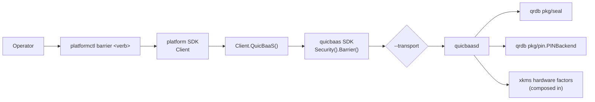

<!--
Copyright (c) 2025 Jeremy Hahn
Copyright (c) 2025 Automate The Things, LLC
SPDX-License-Identifier: AGPL-3.0-or-later
-->

# `platformctl barrier` — Canonical Barrier CLI Surface

`platformctl barrier` exposes the **canonical 9-verb barrier tree**
shared byte-for-byte by `qrdb barrier`, `xkmsctl barrier`, and
`quicbaas barrier`. The canonical narrative — flag semantics,
validation matrix, PIN flow, the `--passphrase` vs. PIN distinction — lives
in the qrdb doc
([`go-qrdb/docs/cli/barrier.md`](../../../go-qrdb/docs/cli/barrier.md)).
This page documents the **platform-specific specifics**: namely that
every verb is dispatched to **quicbaasd** through the platform SDK's
`Client.QuicBaaS()` accessor.

Implementation: [`pkg/cli/commands/barrier/`](../../pkg/cli/commands/barrier/).

---

## 1. The locked 9-verb tree

```
platformctl barrier status
platformctl barrier init           --barrier-strategy <none|passphrase|shamir>
                                   [--passphrase <pp>]               (required for passphrase/shamir; rejected for none)
                                   [--so-pin <pin>]              (optional; rejected when --barrier-strategy=none)
                                   [--user-pin <pin>]            (optional; requires --so-pin)
platformctl barrier init-shamir    --passphrase <pp>
                                   --threshold N
                                   --total M
                                   [--so-pin <pin>]
                                   [--user-pin <pin>]            (requires --so-pin)
platformctl barrier unseal         --passphrase <pp>                 (passphrase / single-secret only)
platformctl barrier unseal-shares  --share <s1> [--share <s2> ...]
                                   | --shares-file <path>        ('-' = stdin)
platformctl barrier seal           [--so-pin <pin>]
                                   [-y | --assume-yes]
platformctl barrier rekey          [--so-pin <pin>]              (NO --user-pin on rekey)
                                   [--threshold N --total M]     (paired; Shamir share regeneration)
platformctl barrier recovery generate
                                   --threshold N --total M
                                   [--so-pin <pin>]
platformctl barrier recovery recover
                                   --share <s1> [--share <s2> ...]
```

### Root persistent flag

| Flag | Default | Allowed values | Env override |
|------|---------|----------------|--------------|
| `--transport` | `unix` | `rest`, `grpc`, `quic`, `mcp`, `unix`, `embedded` | `PLATFORMCTL_TRANSPORT` |

`unix` is the default across all four CLIs. See
[`docs/daemon/cli.md`](../daemon/cli.md) §2 for the full root-flag
set.

### Security-officer ceremony verbs (canonical; platformctl mirror pending)

The officer ceremony verb tree (`barrier officer *`,
`barrier shamir-seal-vote`, `barrier recovery officer *`) is part of
the canonical surface — under the share-free INV-1 contract the claim
ceremony is the only way an officer ever holds a share. qrdb is the
reference implementation; the platformctl mirror is pending. See
`08-bootstrap-auth-architecture.md` §6 (software architecture docs)
and [go-qrdb `docs/cli/barrier.md` §3.10](../../../go-qrdb/docs/cli/barrier.md).

---

## 2. Platform-specific dispatch through `Client.QuicBaaS()`

`platformctl` does **not** speak to a platform-local barrier daemon.
Every `barrier *` verb is dispatched to **quicbaasd** through the
platform SDK:

```go
// pkg/cli/commands/barrier/client.go
func defaultBarrierClientFactory(base *cli.BaseCommand) (quicbaassdk.QRDBBarrierClient, error) {
    q, err := base.Client().QuicBaaS()
    if err != nil {
        return nil, err
    }
    bc, err := q.Security().Barrier()
    if err != nil {
        return nil, err
    }
    return bc, nil
}
```

— [`pkg/cli/commands/barrier/client.go`](../../pkg/cli/commands/barrier/client.go).



The platform-local
[`BarrierServiceClient`](../../pkg/server/barrier/) is **still
available** for legacy non-CLI callers that have not yet migrated.
New code MUST go through the SDK accessor.

### Why this architecture

`quicbaasd` is the canonical composer: it pulls qrdb's seal strategies
and PIN backend, plus xkms's hardware factors, into a single daemon
exposed across six transports. `platformd` re-exposes that surface for
trusted-platform-specific concerns (TPM2 attestation, LUKS root-disk
provisioning, etc.) without rebuilding the barrier substrate.
Concentrating barrier administration on `quicbaasd` removes
duplication and keeps the security boundary single-sourced.

---

## 3. `--passphrase` is the strategy wrapping passphrase, not a PIN

| Flag | Concern | Backend (server-side, in quicbaasd) |
|------|---------|--------------------------------------|
| `--passphrase` | Strategy wrapping passphrase. `passphrase` Argon2id-derives the wrapping key; `shamir` uses it as the strategy seal; `none` ignores it. | qrdb `pkg/seal` strategy registry |
| `--so-pin`, `--user-pin` | Two-PIN compliance-gating material (FIPS 140-3 / PCI-DSS v4). Gates rekey / seal / recovery-generate. | qrdb `pkg/pin.PINBackend` (composed via `WithPINBackend`) |

See [the canonical doc §2](../../../go-qrdb/docs/cli/barrier.md#2-architectural-concept---passphrase-is-not-a-pin)
for the architectural rationale. PIN-pair dual-control is enforced at
the platformctl CLI before the RPC leaves the host
([`validateInitFlags`](../../pkg/cli/commands/barrier/init.go),
[`validateInitShamirFlags`](../../pkg/cli/commands/barrier/init_shamir.go)).

---

## 4. Validation matrix

Pure-function validators ship in the per-verb files and are unit-
tested without dialing a live daemon:

| Verb | Validator | Source |
|------|-----------|--------|
| `init` | `validateInitFlags` | [`init.go`](../../pkg/cli/commands/barrier/init.go) |
| `init-shamir` | `validateInitShamirFlags` | [`init_shamir.go`](../../pkg/cli/commands/barrier/init_shamir.go) |
| `unseal` | `runUnseal` (inline `--passphrase` check) | [`unseal.go`](../../pkg/cli/commands/barrier/unseal.go) |
| `unseal-shares` | `resolveShares` | [`unseal_shares.go`](../../pkg/cli/commands/barrier/unseal_shares.go) |
| `seal` | `confirmSeal` + `runSeal` | [`seal.go`](../../pkg/cli/commands/barrier/seal.go) |
| `rekey` | `validateRekeyFlags` | [`rekey.go`](../../pkg/cli/commands/barrier/rekey.go) |
| `recovery generate` | `validateRecoveryGenerateFlags` | [`recovery.go`](../../pkg/cli/commands/barrier/recovery.go) |
| `recovery recover` | inline `--share` check | [`recovery.go`](../../pkg/cli/commands/barrier/recovery.go) |

Typed errors live in
[`pkg/cli/commands/barrier/errors.go`](../../pkg/cli/commands/barrier/errors.go).

### Specific rules

| Rule | Verb(s) | Error |
|------|---------|-------|
| `--barrier-strategy` not in `{none, passphrase, shamir}` | `init` | `ErrInvalidBarrierStrategy` |
| `--passphrase` empty for `passphrase` / `shamir` | `init`, `init-shamir`, `unseal` | `ErrSecretRequired` / `ErrMissingSecret` |
| `--passphrase` supplied with `--barrier-strategy=none` | `init` | `ErrSecretNotAllowed` |
| `--so-pin` with `--barrier-strategy=none` | `init` | `PINsNotAllowedError` |
| `--user-pin` with `--barrier-strategy=none` | `init` | `PINsNotAllowedError` |
| `--user-pin` without `--so-pin` | `init`, `init-shamir` | `ErrUserPinRequiresSOPin` |
| `--threshold` / `--total` not paired | `rekey` | `ErrRekeyPartialFlags` |
| `--threshold < 2` or `> --total` | `init-shamir`, `rekey`, `recovery generate` | `ErrInvalidThreshold` |
| `--total < 2` | `init-shamir`, `rekey`, `recovery generate` | `ErrInvalidTotal` |
| Both `--share` and `--shares-file` supplied | `unseal-shares` | `ErrShareSourcesConflict` |
| Neither `--share` nor `--shares-file` supplied | `unseal-shares` | `ErrMissingShares` |
| `--shares-file` read failure | `unseal-shares` | `ErrSharesFileReadFailed` |
| User answers anything other than y/yes at the seal prompt | `seal` | `ErrSealCancelled` |

---

## 5. Examples

### Routine production posture (passphrase + PIN)

```bash
platformctl barrier init \
  --barrier-strategy passphrase \
  --passphrase '<wrapping-passphrase>' \
  --so-pin SO12345 \
  --user-pin USR12345

platformctl barrier status
platformctl barrier seal --so-pin SO12345 -y
platformctl barrier unseal --passphrase '<wrapping-passphrase>'
```

### Shamir M-of-N with stdin share submission

```bash
platformctl barrier init-shamir --passphrase '<seed>' --threshold 3 --total 5
# Share-free: shares are sealed to enrolled Security Officers; each
# officer claims their share via the share-claim flow. No share
# material is printed or crosses the wire.

cat /run/secrets/shares.txt | platformctl barrier unseal-shares --shares-file -
```

### Rekey + Shamir regeneration

```bash
platformctl barrier rekey \
  --so-pin SO12345 \
  --threshold 3 \
  --total 5
# Share-free: new shares are sealed to enrolled Security Officers and
# claimed via the share-claim flow. No passphrase or share material
# crosses the wire.
```

### Disaster-recovery sideband

```bash
platformctl barrier recovery generate --threshold 3 --total 5 --so-pin SO12345
platformctl barrier recovery recover --share key-a --share key-b --share key-c
```

---

## 6. Transport behaviour

All transports terminate at `quicbaasd`. Use the `--transport` root
flag (or `PLATFORMCTL_TRANSPORT`) to select:

| Transport | Endpoint family |
|-----------|----------------|
| REST | `POST /api/v1/barrier/*` on quicbaasd |
| gRPC | `quicbaas.v1.BarrierService` on quicbaasd |
| QUIC | Native quicbaas barrier handler |
| MCP | `quicbaas.barrier.*` tools |
| Unix | gRPC over Unix domain socket (default) |
| Embedded | In-process via `Security().Barrier()` |

---

## 7. Cross-references

* Canonical narrative + PIN flow + strategy taxonomy:
  [`go-qrdb/docs/cli/barrier.md`](../../../go-qrdb/docs/cli/barrier.md)
* Spec: `08-bootstrap-auth-architecture.md` §6 (software architecture docs)
* Global flags: [`docs/daemon/cli.md`](../daemon/cli.md) §2
* Sibling CLI docs:
  [`qrdb barrier`](../../../go-qrdb/docs/cli/barrier.md) ·
  [`xkmsctl barrier`](../../../go-xkms/docs/cli/barrier.md) ·
  [`quicbaas barrier`](../../../go-quicbaas/docs/cli/barrier.md)
