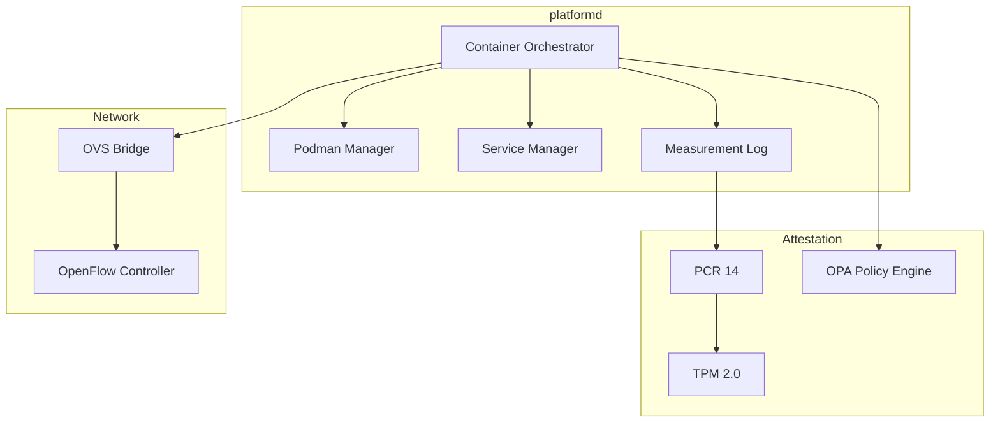
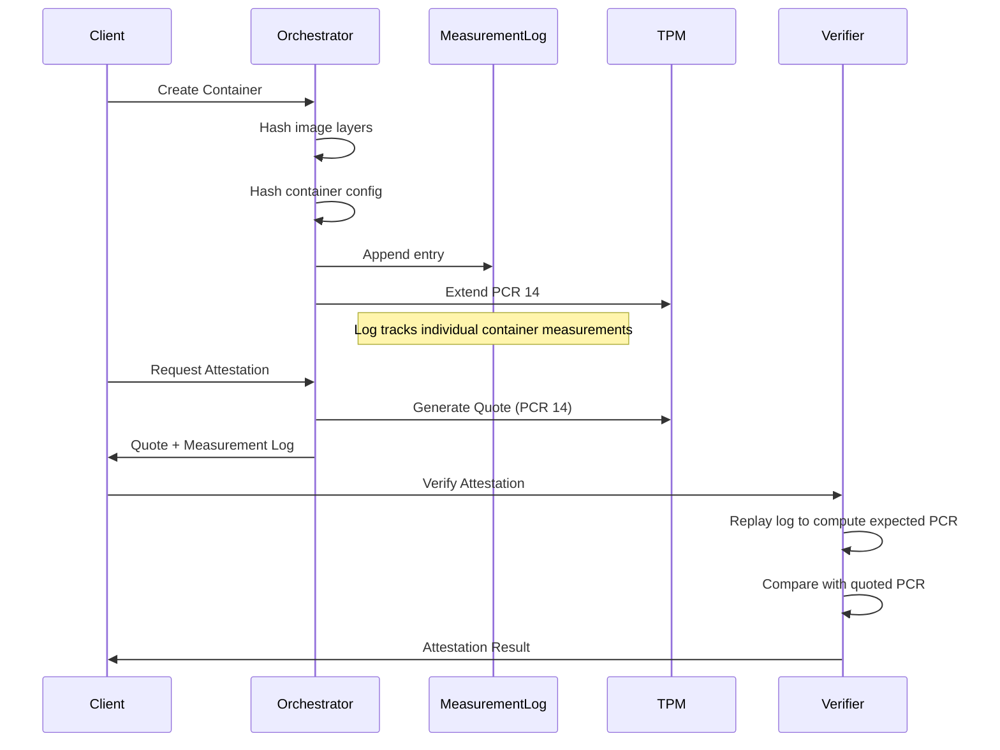
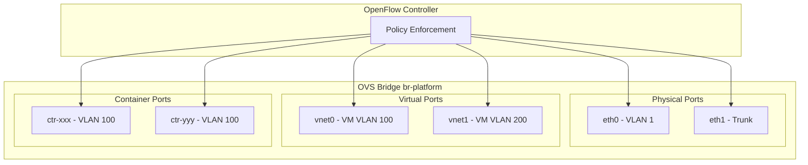

# Container Orchestrator

Container lifecycle management with TPM-based attestation and policy enforcement.

## Overview

The Container Orchestrator provides:

- Embedded Podman container management with TPM-based attestation
- Configurable service mode (embedded in platformd or standalone systemd/rc)
- Multi-protocol API exposure (REST, gRPC, QUIC, MCP, Unix Socket)
- OPA policy enforcement with built-in and custom policies
- Image signing/verification with Platform CA
- Event-log based attestation (PCR 14 aggregate + per-container measurement log)
- Full SDN/OVS/OpenFlow/VLAN integration via Device Profiles

## Architecture



## Production Wiring: Consolidated Compute Orchestrator

The rich container `Orchestrator` engine (attestation, OPA policy, image
verification, logs) is the single production container orchestrator. The
daemon reaches it through `container.ComputeOrchestrator`
(`pkg/compute/container/compute_orchestrator.go`), which presents the
platform-wide `compute.Orchestrator` interface (device-profile lifecycle,
OVS network attach/detach, 802.1X port authentication) on top of the engine
and forwards the rich capability verbs (`Logs`, `Attest`,
`VerifyAttestation`, `EvaluatePolicy`, `PullImage`, `VerifyImage`) so API
layers can reach them via capability type assertions. The former thin
`compute.ContainerOrchestrator` was retired in this consolidation.

Key wiring facts:

- `platformd serve` constructs the consolidated orchestrator in both the
  webservices and daemon-only paths (`pkg/daemon/commands/serve.go`,
  `newComputeOrchestrator`).
- When the host TPM is available, `container.NewHostTPMProvider(App.TPM)`
  (backed by the go-xkms SDK `TrustedPlatformModule`) fills the go-quicbaas
  `orchestration.HostTPM` seam and enables workload measurement into PCR 14
  plus IAK-signed quote attestation. The orchestrator additionally builds
  the SDK trust stack (`container.NewTrustStack`), which supplies image
  digest resolution and the Tier 1 attesting runtime. Without a TPM the
  orchestrator runs unmeasured and `Attest` returns a typed error.
- `container.NewSDKContainerAttestor` fills the go-quicbaas
  `service.ContainerAttestor` seam with the platform's host TPM, so an
  embedder can register it via `quicbaas.WithContainerAttestor`.
- TPM passthrough: when `PodmanConfig.EnableTPMAccess` is set, container
  specs carry `TPMAccess: true` and the engine mounts `/dev/tpm0` into the
  container. The mount is the only representation of the grant, so it is part
  of the measured configuration. The knob is a default for the **specification**
  and is applied by `buildContainerSpec` before measurement; the runtime and
  manager carry no TPM default of their own, so there is no way to hand a
  container the host TPM outside its measured configuration.
- Standalone service mode launches the measured configuration. The systemd unit
  and OpenRC script are emitted from the same effective launch configuration the
  podman backend receives (`newLaunchConfig` -> `podmanRunArgs`), so a container
  supervised by an init system is the container that was measured.
- OVS networking activates only when the OVS socket is detected (same
  gating as the SDN service); port authentication additionally requires
  `PortAuthEnabled` plus a policy engine.

Live container RPCs per protocol:

| Operation | gRPC | REST | QUIC | MCP |
|-----------|------|------|------|-----|
| Create/Start/Stop/Delete/Get/List | ComputeService RPCs | `/api/v1/compute/containers*` | direct + category sub-opcodes | `container_*` tools |
| Attest (incl. attest-on-create) | `AttestContainer` | `POST .../{id}/attest` | `OpContainerAttest` (0xEC) sub-opcode under compute extended category 0x69 | `container_attest` |
| Logs (streaming) | `GetContainerLogs` (server streaming) | `GET .../{id}/logs` (SSE with `follow=true`) | `OpContainerLogs` (0xAF direct, also via category) | `container_logs` (snapshot) |

QUIC note: the direct container opcodes 0xEC and 0xFC-0xFF are shadowed by
the PXE ranges in the top-level dispatcher, so remote clients send them as
sub-opcodes in `payload[0]` under the compute extended category opcode
(`OpVMExtendedCategory`, 0x69) — the same framing the extended VM
operations use.

## Key Interfaces

### ContainerOrchestrator Interface

```go
// ContainerOrchestrator manages container lifecycle with attestation
type ContainerOrchestrator interface {
    // Lifecycle
    Create(ctx context.Context, spec *ContainerSpec) (*Container, error)
    Start(ctx context.Context, id string) error
    Stop(ctx context.Context, id string, timeout time.Duration) error
    Remove(ctx context.Context, id string, force bool) error

    // Status
    Get(ctx context.Context, id string) (*Container, error)
    List(ctx context.Context, opts ListOptions) ([]*Container, error)
    Logs(ctx context.Context, id string, opts LogOptions) (io.ReadCloser, error)

    // Attestation
    Attest(ctx context.Context, id string) (*AttestationReport, error)
    VerifyAttestation(ctx context.Context, id string, evidence []byte) error

    // Policy
    EvaluatePolicy(ctx context.Context, spec *ContainerSpec) (*PolicyDecision, error)

    // Image
    PullImage(ctx context.Context, ref string, opts PullOptions) error
    VerifyImage(ctx context.Context, ref string) (*ImageVerification, error)
}
```

### ContainerSpec

```go
type ContainerSpec struct {
    Name        string
    Image       string
    Command     []string
    Args        []string
    Environment map[string]string
    Volumes     []VolumeMount
    Ports       []PortMapping
    Resources   ResourceConfig
    Network     NetworkConfig
    Service     ServiceConfig
    Labels      map[string]string
}

type ResourceConfig struct {
    Memory     string  // e.g., "2G"
    CPUs       string  // e.g., "2.0"
    MemorySwap string
    CPUShares  int64
}

type NetworkConfig struct {
    Mode           NetworkMode  // sdn, bridge, host, none
    SDN            *SDNConfig
    SecurityGroups []string
}

type ServiceConfig struct {
    Mode       ContainerServiceMode  // embedded, standalone
    Standalone *StandaloneConfig
}
```

## Lifecycle Management

### Container States

```
┌─────────────────┐
│    Creating     │  Container being created
└────────┬────────┘
         │
┌────────▼────────┐
│     Created     │  Container exists, not running
└────────┬────────┘
         │ Start()
┌────────▼────────┐
│     Running     │  Container executing
└────────┬────────┘
         │ Stop()
┌────────▼────────┐
│     Stopped     │  Container exited
└────────┬────────┘
         │ Remove()
┌────────▼────────┐
│     Removed     │  Container deleted
└─────────────────┘
```

### Lifecycle Flow

```go
// Create container
spec := &ContainerSpec{
    Name:  "web-api",
    Image: "registry.example.com/api:v1.2",
    Network: NetworkConfig{
        Mode: NetworkModeSDN,
        SDN: &SDNConfig{
            VLANID: 100,
        },
        SecurityGroups: []string{"web-frontend"},
    },
}

container, err := orchestrator.Create(ctx, spec)
if err != nil {
    return err
}

// Start container
err = orchestrator.Start(ctx, container.ID)

// Stop container (10s timeout)
err = orchestrator.Stop(ctx, container.ID, 10*time.Second)

// Remove container
err = orchestrator.Remove(ctx, container.ID, false)
```

## TPM Attestation with Measurement Log

### Event-Log Approach

PCR registers can only be extended, never reset. With multiple containers, we
use the TCG event log approach:

- **PCR 14** holds the aggregate hash of all container measurements
- A **Measurement Log** tracks individual container measurements
- Verification replays the log to reconstruct expected PCR value



### Measurement Log Structure

```go
type MeasurementLog struct {
    Entries []MeasurementEntry
}

type MeasurementEntry struct {
    ContainerID    string
    Timestamp      time.Time
    EventType      MeasurementEventType
    Image          string  // Image reference the container was created from
    ImageDigest    string  // Canonical OCI content digest, "sha256:<64 hex>"
    ConfigDigest   string  // orchestration.ContainerConfigDigest, same form
    CumulativeHash []byte  // Hash extended to PCR 14
}

// Measurement event types
const (
    EventContainerCreate MeasurementEventType = iota
    EventContainerStart
    EventContainerStop
    EventContainerRemove
)
```

### Layer split

Everything below Tier 3 comes from the go-quicbaas SDK; the platform
implements none of it:

| Operation | Owner |
|-----------|-------|
| Image content digest resolution | `orchestration.ExecContainerRuntime.ResolveImageDigest` + `ValidateImageDigest` |
| Deterministic configuration digest | `orchestration.ContainerConfigDigest` |
| PCR extend / read / quote | `orchestration.HostTPM` (filled by `container.HostTPMProvider`) |
| Fresh quote + golden-PCR comparison | `orchestration.AttestingContainerRuntime.Attest` |
| Measurement event log + replay | platform (`measurement_log.go`) |
| Quote IAK signature verification | platform (`container.QuoteVerifier`) |

### Attestation Flow

1. **Container Create (fail closed):**
   - Resolve the image's OCI content digest through the SDK runtime. A
     locally built image with no repository digest is an ERROR; the
     reference is never hashed as a substitute.
   - Compute the configuration digest with
     `orchestration.ContainerConfigDigest`.
   - Compute entryHash = SHA256(containerID || imageDigest || configDigest || eventType)
   - Extend PCR 14 with entryHash.
   - Append the entry to the measurement log.
   - Any failure returns `UnmeasuredLaunchError` and the created container
     is removed. A container is measured or it does not run.

2. **Container Start:**
   - The start event is measured BEFORE the container is handed to the
     runtime; a failed measurement aborts the launch.

3. **Container Stop/Remove:**
   - Post-hoc records: a failure is logged, and the log replay fails closed
     at the next verification.

### Configuration digest coverage

The launched configuration and the measured configuration are **one value**.
`newLaunchConfig` derives a container's effective launch configuration —
mounts, devices and flags — exactly once, the backend is handed that value, and
`PodmanContainerConfig.AttestationSpec` projects the same value onto the SDK
`orchestration.ContainerSpec` that `ContainerConfigDigest` hashes.
`measureCreate` receives the launch configuration and no specification, so it
cannot measure anything other than what the container is about to receive.
`OrchestratorContainerSpec.ToAttestationSpec` is a convenience over that path,
not a second derivation.

This closed a two-derivations hole: the launch path added a `/dev/tpm0` bind
mount for `TPMAccess` while the measurement path mapped only `spec.Mounts`, so
handing a workload the platform's root of trust did not change its
measurement. The host TPM is now a mount in the measured mount list and has no
parallel boolean — the backend recognizes the grant from the mount
(`GrantsTPMDevice`).

The privilege dimension — `Privileged`, `Capabilities.Add`,
`Capabilities.Drop` and each mount's `Type` — maps to real SDK fields
(`Privileged`, `CapAdd`, `CapDrop`, `ContainerMount.Type`) and is measured
directly. Capability lists are sorted before hashing, so their declaration
order does not change the digest.

These four used to be smuggled in as reserved `trustedplatform.io/*` labels
because the SDK spec had no fields for them. The fields exist upstream now, so
the label carrier is deleted; nothing may be folded into a label to get it
measured. An unmeasured field is fixed upstream in
`go-quicbaas/pkg/orchestration`, or it is a stated gap.

The digest input therefore changed again. Previously recorded `ConfigDigest`,
`CumulativeHash` and golden PCR 14 values are stale and must be recaptured from
a re-measured launch — there is one measurement format and no migration path.

The full measured field list, the upstream gaps and the deliberate exclusions
are documented in
[Workload Attestation](../attestation/workload-attestation.md#container-configuration-included-in-measurement).

### Image verification

`VerifyImage` reports the image's resolved OCI content digest alongside the
signature verdict. The digest comes from `GetImageDigest`, so it is the image's
own content digest and never a hash of the image reference. An image whose
digest cannot be resolved produces NO result: the call returns an error and the
signature verifier is not even consulted, because a verdict that cannot name
its artifact is not evidence. An orchestrator with no `ImageManager` returns
`ErrImageManagerUnavailable` rather than a synthesized "unverified" result.

4. **Remote Attestation:**
   - The platform replays the measurement log to derive the golden PCR 14
     value.
   - The SDK attesting runtime takes a fresh nonce-bound quote and compares
     the quoted PCR set against that golden value, returning
     `orchestration.PCRMismatchError` on drift.
   - The platform then verifies the quote's IAK signature, binding the
     evidence to this device.

### Verification

```go
func (a *ContainerAttestor) VerifyAttestation(ctx context.Context,
    containerID string, log *ThreadSafeMeasurementLog) (*AttestationVerificationResult, error) {

    // Tier 3: replay the event log into the golden PCR 14 value and recover
    // the image identity recorded at container creation.
    // Tier 1 (SDK): take a fresh quote and compare it against that value.
    evidence, err := a.Attest(ctx, containerID, log)
    if err != nil {
        return nil, err // orchestration.PCRMismatchError on drift
    }

    // Tier 3: bind the quote to this device's IAK.
    if err := a.verifier.VerifyQuote(ctx, evidence.Quoted, evidence.Signature); err != nil {
        return nil, ErrQuoteVerificationFailed
    }
    ...
}
```

## OPA Policy Enforcement

### Policy Sources

Policies are loaded from multiple sources:

| Source | Description |
|--------|-------------|
| Built-in | Core security policies bundled with platform |
| Custom Directory | User-defined .rego files from local directory |
| Remote Bundle | Policy bundle from URL |

### Policy Configuration

```go
type PolicyConfig struct {
    EnableBuiltinPolicies bool
    CustomPolicyDir       string  // e.g., /etc/platformd/policies/container/
    PolicyBundleURL       string
    DecisionMode          PolicyDecisionMode
}

type PolicyDecisionMode string
const (
    PolicyEnforce  PolicyDecisionMode = "enforce"   // Block on deny
    PolicyAudit    PolicyDecisionMode = "audit"     // Log but allow
    PolicyDisabled PolicyDecisionMode = "disabled"  // Skip evaluation
)
```

### Built-in Policies

```rego
# Image signature required
package container.builtin

deny[msg] {
    not input.image.signature.verified
    msg := "Container image must be signed"
}

# Block privileged containers without approval
deny[msg] {
    input.container.privileged == true
    not input.container.allow_privileged
    msg := "Privileged containers not allowed without explicit approval"
}
```

### Custom Policies

```rego
# /etc/platformd/policies/container/custom.rego
package container.custom

# Restrict to specific registries
deny[msg] {
    registry := input.image.registry
    allowed := {"registry.example.com", "docker.io"}
    not allowed[registry]
    msg := sprintf("Image registry %s not in allowed list", [registry])
}

# Block 'latest' tag
deny[msg] {
    input.image.tag == "latest"
    msg := "Tag 'latest' is not allowed in production"
}

# Enforce resource limits
deny[msg] {
    input.container.resources.memory_limit > 8589934592  # 8GB
    msg := "Container memory limit exceeds 8GB maximum"
}
```

### Policy Input Schema

```go
type PolicyInput struct {
    Container     ContainerSpec
    Image         ImageInfo
    Signature     *SignatureInfo
    Network       NetworkConfig
    Attestation   *AttestationState
    DeviceProfile *DeviceProfile

    // User context for RBAC policies
    User      string
    Groups    []string
    Namespace string
}

type ImageInfo struct {
    Registry   string
    Repository string
    Tag        string
    Digest     string
    Labels     map[string]string
    Signature  SignatureInfo
}
```

### Policy Evaluation Flow

```
1. Container create request received
2. Build PolicyInput from request + context
3. Load policies (builtin + custom + bundle)
4. Evaluate all policies against input
5. Collect deny/warn messages
6. If DecisionMode == ENFORCE && denies > 0 -> reject
7. If DecisionMode == AUDIT -> log denies, allow
8. Return PolicyDecision with details
```

## SDN/OpenFlow Network Integration

### Unified Network Architecture



### Network Configuration

```go
type ContainerNetworkConfig struct {
    Mode          NetworkMode  // bridge, host, none, sdn
    SDN           *SDNConfig
    OpenFlowRules []OpenFlowRule
}

type SDNConfig struct {
    Bridge         string   // OVS bridge name
    VLANID         uint16   // VLAN assignment
    OVSPort        string   // OVS port name
    FlowTable      int
    FlowPriority   int
    SecurityGroups []string
}
```

### Device Profile Network Example

```yaml
device_profile:
  name: "production-web-tier"

  network:
    ovs_bridge: "br-platform"
    default_vlan: 100

    openflow:
      controller: "tcp:127.0.0.1:6653"
      version: "1.3"

    security_groups:
      - name: "web-frontend"
        rules:
          - direction: ingress
            protocol: tcp
            port: 443
            action: allow
          - direction: egress
            protocol: tcp
            port: 5432
            action: allow

      - name: "backend-services"
        rules:
          - direction: ingress
            protocol: tcp
            port_range: "8080-8090"
            action: allow

    # Physical NICs under OVS control
    physical_interfaces:
      - name: "eth0"
        bridge: "br-platform"
        vlan: 1
        trunk: false
      - name: "eth1"
        bridge: "br-platform"
        trunk: true
        trunk_vlans: [100, 200, 300]

  vms:
    - name: "db-server"
      vlan: 200
      security_groups: ["backend-services"]

  containers:
    - name: "web-api"
      image: "registry.example.com/api:v1.2"
      network:
        mode: sdn
        vlan: 100
        security_groups: ["web-frontend"]

    - name: "worker"
      image: "registry.example.com/worker:v1.0"
      network:
        mode: sdn
        vlan: 100
        security_groups: ["backend-services"]
```

### Network Setup Flow

```go
func (n *NetworkManager) SetupContainerNetwork(ctx context.Context,
    containerID string, cfg *ContainerNetworkConfig) error {

    if cfg.Mode != NetworkModeSDN {
        return n.setupStandardNetwork(ctx, containerID, cfg)
    }

    // 1. Create OVS port for container
    portName := fmt.Sprintf("ctr-%s", containerID[:12])
    if err := n.ovs.AddPort(cfg.SDN.Bridge, portName); err != nil {
        return err
    }

    // 2. Set VLAN tag on port
    if err := n.ovs.SetPortVLAN(portName, cfg.SDN.VLANID); err != nil {
        return err
    }

    // 3. Install OpenFlow rules
    for _, rule := range cfg.OpenFlowRules {
        if err := n.openflow.AddFlow(rule); err != nil {
            return err
        }
    }

    // 4. Apply security group rules
    for _, sg := range cfg.SDN.SecurityGroups {
        flows := n.securityGroupToFlows(sg, portName, cfg.SDN.VLANID)
        for _, flow := range flows {
            if err := n.openflow.AddFlow(flow); err != nil {
                return err
            }
        }
    }

    return nil
}
```

## Service Modes

### Embedded vs Standalone

| Aspect | Embedded | Standalone |
|--------|----------|------------|
| Manager | platformd directly | systemd/OpenRC service |
| Lifetime | Tied to platformd | Survives platformd restarts |
| TPM Access | Shared context | IPC with platformd |
| Use Case | Sidecars, tightly-coupled | Databases, long-running |

### Service Mode Configuration

```go
type ContainerServiceMode string

const (
    ServiceModeEmbedded   ContainerServiceMode = "embedded"
    ServiceModeStandalone ContainerServiceMode = "standalone"
)

type ServiceConfig struct {
    Mode       ContainerServiceMode
    Standalone *StandaloneConfig
}

type StandaloneConfig struct {
    InitSystemOverride string    // Override auto-detection
    ServicePath        string    // Custom service file path
    Restart            string    // always, on-failure, no
    After              []string  // Service dependencies
    Wants              []string  // Service wants
    CPUQuota           string    // e.g., "200%"
    MemoryMax          string    // e.g., "4G"
}
```

### Init System Auto-Detection

The init system is auto-detected from the Device Profile OS configuration:

```go
var osInitSystemDefaults = map[string]string{
    // OpenRC-based
    "alpine":  "rc",
    "gentoo":  "rc",
    "artix":   "rc",

    // systemd-based
    "debian":  "systemd",
    "ubuntu":  "systemd",
    "fedora":  "systemd",
    "centos":  "systemd",
    "rhel":    "systemd",
    "rocky":   "systemd",
    "alma":    "systemd",
    "arch":    "systemd",
    "opensuse":"systemd",

    "default": "systemd",
}
```

### Auto-Detection Flow

```
1. Container config has mode: standalone
2. Check if init_system override is set
   - If set -> use that
   - If not set -> continue to auto-detect
3. Look up os.name in osInitSystemDefaults map
   - "alpine" -> "rc"
   - "debian" -> "systemd"
4. If OS not in map, try pattern matching
5. If still unknown, runtime detect (/run/systemd/system exists?)
6. Generate appropriate service file
```

### Generated systemd Unit

```ini
[Unit]
Description=Container web-api managed by go-trusted-platform
After=network-online.target platformd.service
Wants=platformd.service

[Service]
Type=simple
ExecStartPre=/usr/bin/podman pull registry.example.com/api:v1.2
ExecStart=/usr/bin/podman run --name web-api --rm registry.example.com/api:v1.2
ExecStop=/usr/bin/podman stop web-api
Restart=always
MemoryMax=2G
CPUQuota=200%

[Install]
WantedBy=multi-user.target
```

### Generated OpenRC Script

```sh
#!/sbin/openrc-run

name="container-web-api"
description="Container web-api managed by go-trusted-platform"
command="/usr/bin/podman"
command_args="run --name web-api --rm registry.example.com/api:v1.2"
command_background="yes"
pidfile="/run/${RC_SVCNAME}.pid"

depend() {
    need net platformd
}

stop() {
    /usr/bin/podman stop web-api
}
```

## Package Structure

```
pkg/compute/container/
├── orchestrator.go        # ContainerOrchestrator interface + types
├── compute_orchestrator.go # Consolidated compute.Orchestrator view (OVS, port auth)
├── tpm_provider.go        # HostTPMProvider (xkms TPM -> SDK orchestration.HostTPM)
├── sdk_trust.go           # SDK trust stack + service.ContainerAttestor seam fill
├── sdk_logger.go          # *slog.Logger -> SDK orchestration.Logger adapter
├── podman_adapter.go      # Embedded Podman runtime adapter (PodmanBackend)
├── config.go             # Configuration types and validation
├── lifecycle.go          # Rich Orchestrator engine (lifecycle, logs, attest)
├── attestation.go        # Event-log attestation (PCR 14 aggregate)
├── measurement_log.go    # Per-container measurement tracking
├── policy.go             # OPA policy evaluation
├── policy_loader.go      # Multi-source policy loading
├── image.go              # Image signing/verification
├── network.go            # SDN/OVS/OpenFlow/VLAN integration
├── service.go            # Service file generation
├── init_detector.go      # OS-based init system auto-detection
├── errors.go             # Typed error definitions
└── *_test.go             # Unit tests
```

## Error Handling

```go
var (
    ErrContainerNotFound     = errors.New("container not found")
    ErrContainerExists       = errors.New("container already exists")
    ErrContainerNotRunning   = errors.New("container not running")
    ErrContainerRunning      = errors.New("container already running")
    ErrInvalidSpec           = errors.New("invalid container spec")
    ErrPolicyDenied          = errors.New("policy denied container creation")
    ErrImageVerificationFailed = errors.New("image verification failed")
    ErrAttestationFailed     = errors.New("attestation failed")
    ErrPCRMismatch           = errors.New("PCR value mismatch")
    ErrNetworkSetupFailed    = errors.New("network setup failed")
    ErrServiceSetupFailed    = errors.New("service setup failed")
    ErrUnsupportedInitSystem = errors.New("unsupported init system")
)
```

## See Also

- [Architecture](architecture.md) - Compute orchestrator architecture
- [Embedded Podman Runtime](embedded-podman.md) - Direct OCI runtime package documentation
- [Configuration](configuration.md) - Container configuration reference
- [API Reference](api-reference.md) - API documentation
- [SDN Architecture](../sdn/architecture.md) - SDN/OVS/OpenFlow details
