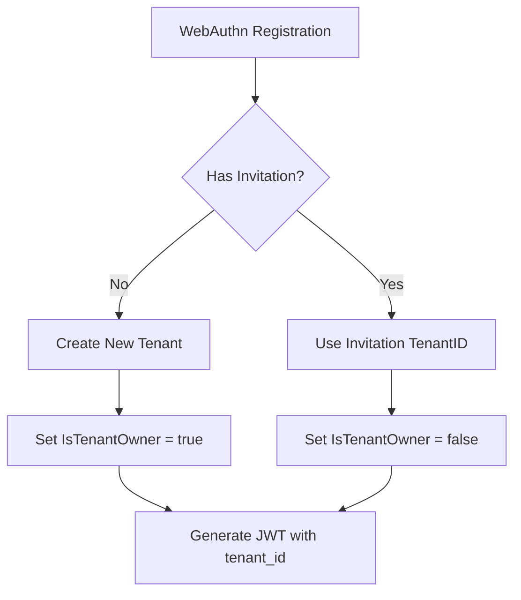
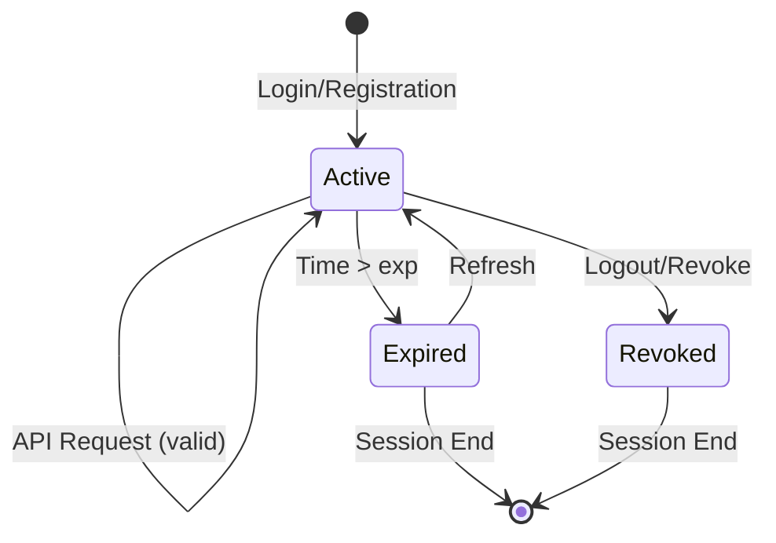
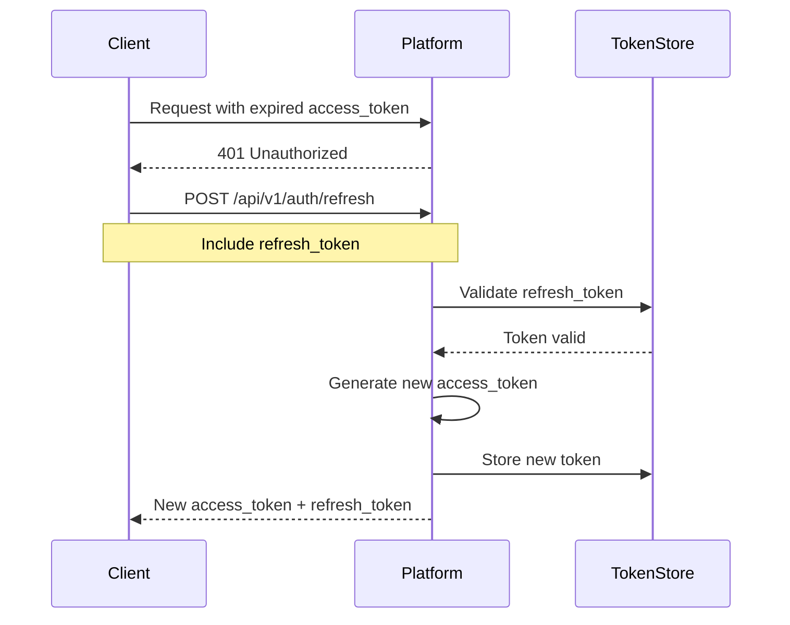

# IAM Authentication

## Overview

Trusted Platform IAM supports multiple authentication methods, with emphasis on passwordless and hardware-backed credentials.

## Authentication Methods

| Method | Security | Hardware | Use Case |
|--------|----------|----------|----------|
| WebAuthn/FIDO2 | Very High | Optional | User authentication, passwordless |
| mTLS | Very High | Optional | Service-to-service, devices |
| OAuth2/OIDC | High | No | Federated identity, applications |
| TPM Attestation | Very High | Required | Device identity, platform binding |
| Password | Medium | No | Legacy fallback (discouraged) |

## WebAuthn/FIDO2

Passwordless authentication using FIDO2 standard.

### Configuration

WebAuthn is configured within the `webservices` section:

```yaml
webservices:
  - name: public
    port: 8080
    tls-port: 8443

    webauthn:
      display-name: Trusted Platform
      id: example.com
      origins:
        - https://example.com
        - https://app.example.com
        - http://localhost:3000
```

### Configuration Options

| Option | Description |
|--------|-------------|
| `display-name` | Human-readable name shown on authenticator prompts |
| `id` | Relying Party ID (your domain) |
| `origins` | Allowed origins for WebAuthn requests |

### Relying Party ID Rules

The `id` field must follow these rules:
- Must be a valid domain name
- Must match or be a registrable domain suffix of the origin
- For `https://app.example.com`, valid IDs: `app.example.com`, `example.com`

### Registration Flow

```bash
# 1. Begin registration (get challenge)
curl -X POST https://platform.example.com/api/v1/iam/webauthn/register/begin \
  -H "Authorization: Bearer <session_token>" \
  -H "Content-Type: application/json"

# Response:
{
  "publicKey": {
    "challenge": "base64-encoded-challenge",
    "rp": {
      "id": "example.com",
      "name": "Trusted Platform"
    },
    "user": {
      "id": "base64-user-id",
      "name": "alice@example.com",
      "displayName": "Alice Smith"
    },
    "pubKeyCredParams": [
      {"type": "public-key", "alg": -7},
      {"type": "public-key", "alg": -257}
    ],
    "timeout": 60000,
    "attestation": "none",
    "authenticatorSelection": {
      "userVerification": "preferred",
      "residentKey": "preferred"
    }
  }
}

# 2. Create credential (browser/authenticator)
# User interacts with authenticator

# 3. Complete registration
curl -X POST https://platform.example.com/api/v1/iam/webauthn/register/finish \
  -H "Authorization: Bearer <session_token>" \
  -H "Content-Type: application/json" \
  -d '{
    "id": "credential-id",
    "rawId": "base64-raw-id",
    "type": "public-key",
    "response": {
      "clientDataJSON": "base64-client-data",
      "attestationObject": "base64-attestation"
    }
  }'
```

### Authentication Flow

```bash
# 1. Begin authentication
curl -X POST https://platform.example.com/api/v1/iam/webauthn/login/begin \
  -H "Content-Type: application/json" \
  -d '{"email": "alice@example.com"}'

# Response:
{
  "publicKey": {
    "challenge": "base64-challenge",
    "timeout": 60000,
    "rpId": "example.com",
    "allowCredentials": [
      {
        "type": "public-key",
        "id": "base64-credential-id"
      }
    ],
    "userVerification": "preferred"
  }
}

# 2. Get assertion (browser/authenticator)
# User interacts with authenticator

# 3. Complete authentication
curl -X POST https://platform.example.com/api/v1/iam/webauthn/login/finish \
  -H "Content-Type: application/json" \
  -d '{
    "id": "credential-id",
    "rawId": "base64-raw-id",
    "type": "public-key",
    "response": {
      "clientDataJSON": "base64-client-data",
      "authenticatorData": "base64-auth-data",
      "signature": "base64-signature"
    }
  }'

# Response:
{
  "access_token": "eyJhbGciOiJFUzI1NiIs...",
  "token_type": "Bearer",
  "expires_in": 3600,
  "refresh_token": "eyJhbGciOiJFUzI1NiIs...",
  "id_token": "eyJhbGciOiJFUzI1NiIs..."
}
```

### Supported Authenticators

| Type | Examples | Features |
|------|----------|----------|
| Platform | Windows Hello, Touch ID, Face ID | Built into device |
| Cross-Platform | YubiKey, Titan Key, Feitian | Portable security keys |
| Passkeys | iCloud Keychain, Google Password Manager | Synced across devices |

## WebAuthn with Tenant Context

WebAuthn authentication integrates with the multi-tenant architecture to provide tenant-scoped access control.

### Tenant Association on Registration

When a user registers via WebAuthn:

1. **New User (no invitation)**: Creates new tenant, user becomes owner
2. **Invited User**: Joins existing tenant with assigned role



### Tenant Context in Authentication

After successful WebAuthn login, the JWT token includes tenant context:

```json
{
  "uid": 12345678901234567890,
  "tenant_id": "tenant-550e8400-e29b-41d4",
  "is_tenant_owner": true,
  "roles": ["owner", "admin"],
  "iss": "trusted-platform",
  "exp": 1705323600
}
```

All subsequent API requests use this tenant context for authorization.

## JWT Token Configuration

JWT settings control token issuance and validation:

```yaml
webservices:
  - name: public
    jwt:
      expiration: 60    # Token expiration in minutes (1 hour default)
      issuer: trusted-platform
```

### JWT Fields

| Field | Type | Description |
|-------|------|-------------|
| `expiration` | integer | Token expiration time in minutes |
| `issuer` | string | Token issuer identifier (appears in `iss` claim) |

### Token Lifetimes

| Use Case | Recommended Expiration |
|----------|------------------------|
| Development | 1440 (24 hours) |
| Production Web | 60 (1 hour — default) |
| Production API | 1440 (24 hours) |
| High Security | 15 (15 minutes) |

## Token Claims Documentation

JWT tokens issued by the platform include standard and custom claims for identity and authorization.

### Token Structure

```go
type TokenClaims struct {
    UserID         uint64   `json:"uid"`           // Unique user identifier
    TenantID       string   `json:"tenant_id"`     // Tenant UUID
    IsTenantOwner  bool     `json:"is_tenant_owner"` // Ownership flag
    Roles          []string `json:"roles"`         // Assigned roles
    Organizations  []uint64 `json:"orgs"`          // Organization refs
    Services       []uint64 `json:"svcs"`          // Service refs
    jwt.RegisteredClaims                           // Standard JWT claims
}
```

### Claim Reference

| Claim | Type | Required | Description |
|-------|------|----------|-------------|
| `uid` | uint64 | Yes | Unique user identifier |
| `tenant_id` | string | Yes | UUID of user's tenant |
| `is_tenant_owner` | bool | Yes | True if user owns tenant |
| `roles` | []string | No | Roles assigned to user |
| `orgs` | []uint64 | No | Organization references |
| `svcs` | []uint64 | No | Service references |
| `iss` | string | Yes | Token issuer |
| `aud` | []string | Yes | Token audience |
| `iat` | int64 | Yes | Issued at timestamp |
| `exp` | int64 | Yes | Expiration timestamp |
| `nbf` | int64 | Yes | Not before timestamp |

### Decoding Example

```bash
# Decode JWT payload (base64)
echo "eyJ1aWQiOjEyMzQ1..." | base64 -d | jq .

# Output:
{
  "uid": 12345678901234567890,
  "tenant_id": "tenant-550e8400-e29b-41d4",
  "is_tenant_owner": true,
  "roles": ["owner", "admin"],
  "orgs": [],
  "svcs": [],
  "iss": "trusted-platform",
  "aud": ["trusted-platform"],
  "iat": 1705320000,
  "exp": 1705323600,
  "nbf": 1705320000
}
```

## Token Lifecycle and Refresh

### Token Lifecycle States



### Refresh Token Flow



### Token Storage Best Practices

| Token Type | Storage Location | Lifetime |
|------------|------------------|----------|
| Access Token | Memory/sessionStorage | Short (15-60 min) |
| Refresh Token | httpOnly cookie | Long (7-30 days) |
| ID Token | Memory | Same as access token |

### Revocation

Tokens can be revoked through:

1. **Logout** - Revokes current session tokens
2. **Session management** - Revoke specific sessions
3. **Admin action** - Force revoke all user tokens
4. **Password change** - Invalidates all tokens

```bash
# Revoke current session
curl -X POST https://platform.example.com/api/v1/auth/logout \
  -H "Authorization: Bearer <token>"

# Revoke all sessions
curl -X POST https://platform.example.com/api/v1/auth/revoke-all \
  -H "Authorization: Bearer <token>"
```

## mTLS Authentication

Certificate-based authentication integrated with the platform CA.

### Configuration

mTLS is configured through the platform's certificate authority and web service TLS settings:

```yaml
webservices:
  - name: public
    tls-port: 8443
    key:
      algorithm: ECDSA
      ecc:
        curve: P-256
      signature-algorithm: ECDSA-SHA256
      hash: SHA-256
      store: software
      password: 123456
      platform-policy: true
    certificate:
      subject:
        cn: server.example.com
        organization: ACME Corporation
        country: US
      sans:
        dns:
          - server.example.com
          - www.server.example.com
```

### Certificate Types

| Type | Description | TPM Required |
|------|-------------|--------------|
| IDevID | Initial Device Identity | Yes |
| IAK | Initial Attestation Key | Yes |
| User Certificate | User identity certificate | No |
| Service Certificate | Service account certificate | No |

### Client Setup

```bash
# Generate client certificate request
openssl req -new -key client.key -out client.csr \
  -subj "/CN=alice@example.com/O=Trusted Platform"

# Issue certificate via platform CA
platformctl ca issue \
  --csr client.csr \
  --output client.crt \
  --usage client-auth

# Connect with mTLS
curl -X GET https://platform.example.com/api/v1/protected \
  --cert client.crt \
  --key client.key \
  --cacert ca.crt
```

### TPM-Backed Certificates

```bash
# Create TPM-backed key and certificate
platformctl tpm key create client-key --algorithm ECDSA-P256

# Generate CSR with TPM key
platformctl ca csr create \
  --key-handle 0x81000010 \
  --subject "CN=device.example.com" \
  --output device.csr

# Issue IDevID certificate
platformctl ca issue \
  --csr device.csr \
  --template idevid \
  --output device.crt
```

## CORS Configuration

CORS settings enable browser-based authentication across origins:

```yaml
webservices:
  - name: public
    cors:
      allowed-origins:
        - https://example.com
        - https://app.example.com
        - http://localhost:3000
      allowed-methods:
        - GET
        - POST
        - PUT
        - DELETE
        - OPTIONS
      allowed-headers:
        - "*"
      allow-credentials: true
```

### CORS Fields

| Field | Type | Description |
|-------|------|-------------|
| `allowed-origins` | list | Origins allowed to make requests |
| `allowed-methods` | list | HTTP methods allowed |
| `allowed-headers` | list | Request headers allowed |
| `allow-credentials` | boolean | Allow cookies/auth headers |

### Security Considerations

- Never use `"*"` for `allowed-origins` in production
- List specific trusted origins only
- `allow-credentials: true` requires explicit origins (not wildcards)

## Password Hashing (Argon2)

When password-based authentication is used, Argon2 provides secure password hashing:

```yaml
argon2:
  memory: 1         # Memory cost in MiB
  iterations: 1     # Time cost (number of iterations)
  parallelism: 1    # Parallelism factor (threads)
  saltLen: 16       # Salt length in bytes
  keyLen: 32        # Output key length in bytes
```

### Recommended Settings

| Environment | memory | iterations | parallelism |
|-------------|--------|------------|-------------|
| Development | 1 | 1 | 1 |
| Production | 64 | 3 | 4 |
| High Security | 256 | 4 | 8 |

## TPM Attestation

Hardware-backed device authentication.

### Attestation Flow

```
Device                     Platform                    TPM
   |                          |                          |
   | 1. Connect with IDevID   |                          |
   |------------------------->|                          |
   |                          |                          |
   |                          | 2. Request attestation   |
   |<-------------------------|                          |
   |                          |                          |
   | 3. Create attestation    |                          |
   |---------------------------------------------->|     |
   |                          |                    |     |
   |                          |                    | Quote with IAK
   |<----------------------------------------------|     |
   |                          |                          |
   | 4. Send attestation      |                          |
   |------------------------->|                          |
   |                          |                          |
   |                          | 5. Verify IAK signature  |
   |                          | 6. Verify PCR values     |
   |                          | 7. Check EK certificate  |
   |                          |                          |
   | 8. Authenticated         |                          |
   |<-------------------------|                          |
```

### Attestation Verification

The platform verifies:

1. **IAK Signature** - Quote signed by valid IAK
2. **PCR Values** - Match expected golden values
3. **EK Certificate** - Endorsement key chain valid
4. **Nonce** - Freshness of attestation
5. **IDevID Chain** - Device identity certificate chain

## Session Management

### Session Creation

Sessions are created after successful authentication:

```json
{
  "id": "sess_abc123",
  "user_id": "user_xyz",
  "tenant_id": "acme-corp",
  "created_at": "2025-01-15T10:30:00Z",
  "expires_at": "2025-01-16T10:30:00Z",
  "last_active": "2025-01-15T14:22:00Z",
  "auth_method": "webauthn",
  "mfa_verified": true,
  "ip_address": "192.168.1.100",
  "user_agent": "Mozilla/5.0..."
}
```

### Session APIs

```bash
# List active sessions
curl -X GET https://platform.example.com/api/v1/iam/sessions \
  -H "Authorization: Bearer <token>"

# Revoke specific session
curl -X DELETE https://platform.example.com/api/v1/iam/sessions/sess_abc123 \
  -H "Authorization: Bearer <token>"

# Revoke all other sessions
curl -X POST https://platform.example.com/api/v1/iam/sessions/revoke-others \
  -H "Authorization: Bearer <token>"
```

## Complete Configuration Example

```yaml
webservices:
  - name: public
    port: 8080
    tls-port: 8443
    home: /var/lib/trusted-platform/public_html

    # JWT token configuration
    jwt:
      expiration: 60          # 1 hour for production
      issuer: platform.example.com

    # WebAuthn passwordless authentication
    webauthn:
      display-name: Example Platform
      id: example.com
      origins:
        - https://example.com
        - https://app.example.com

    # CORS for browser-based auth
    cors:
      allowed-origins:
        - https://example.com
        - https://app.example.com
      allowed-methods:
        - GET
        - POST
        - PUT
        - DELETE
        - OPTIONS
      allowed-headers:
        - Authorization
        - Content-Type
      allow-credentials: true

    # TLS certificate
    key:
      algorithm: ECDSA
      ecc:
        curve: P-256
      signature-algorithm: ECDSA-SHA256
      hash: SHA-256
      store: software
      password: 123456
      platform-policy: true
    certificate:
      subject:
        cn: example.com
        organization: Example Corp
        country: US
      sans:
        dns:
          - example.com
          - app.example.com

# Password hashing
argon2:
  memory: 64
  iterations: 3
  parallelism: 4
  saltLen: 16
  keyLen: 32
```

## Security Best Practices

1. **Use Passwordless** - Prefer WebAuthn over passwords
2. **Require Hardware** - Use hardware security keys for sensitive operations
3. **Enable MFA** - Require MFA for admin actions
4. **Short Token TTL** - Use short-lived access tokens (15-60 minutes)
5. **Check Revocation** - Always check certificate revocation
6. **Secure Origins** - List explicit origins, never use wildcards in production
7. **Audit Everything** - Log all authentication events

## Troubleshooting

### WebAuthn registration failing

```
Check: webauthn.id matches your domain
Check: webauthn.origins includes your app URLs
Check: HTTPS is used (required for WebAuthn in production)
Check: Origins include correct port numbers
```

### Token validation failing

```
Check: jwt.issuer matches between token issuer and validator
Check: jwt.expiration is set appropriately
Check: Token is not expired
Check: Clock sync between servers
```

### CORS errors in browser

```
Check: cors.allowed-origins includes the requesting origin
Check: cors.allowed-methods includes the HTTP method
Check: cors.allow-credentials is true if sending auth headers
Check: No trailing slashes in origin URLs
```
