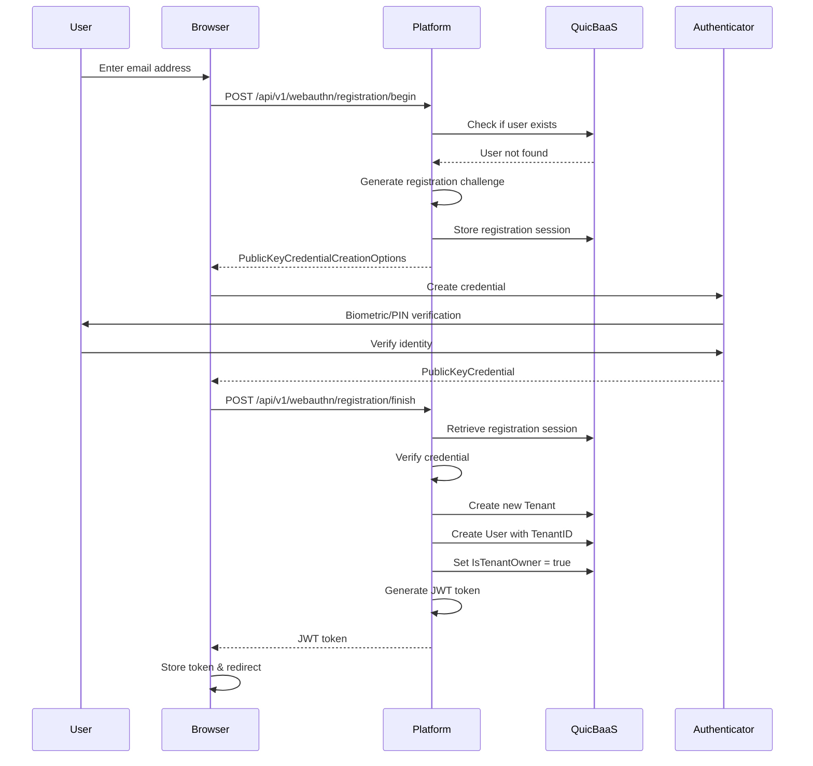
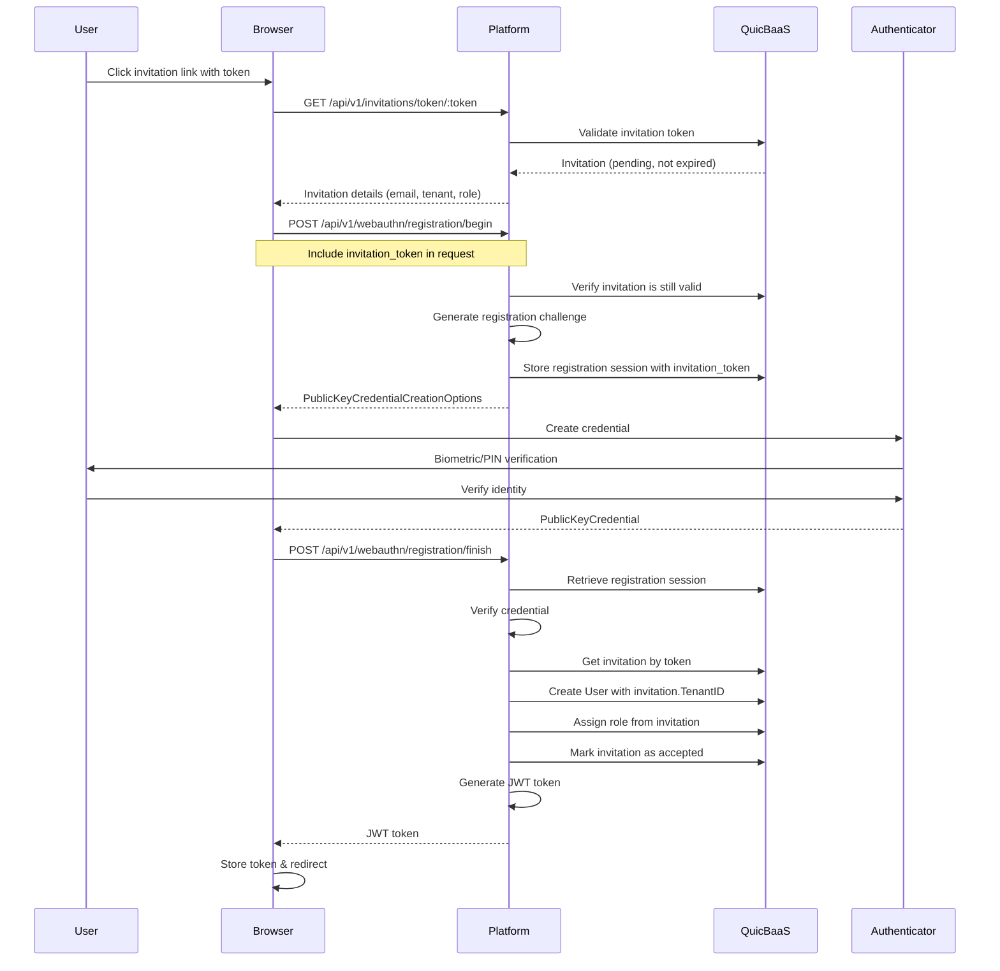

# User Registration

This document describes the user registration process in the Trusted Platform, including WebAuthn-based passwordless registration, tenant association, and JWT token generation.

## Table of Contents

- [Overview](#overview)
- [Registration Flows](#registration-flows)
  - [New User Registration](#new-user-registration)
  - [Invited User Registration](#invited-user-registration)
- [WebAuthn Registration Flow](#webauthn-registration-flow)
- [API Reference](#api-reference)
- [JWT Token Structure](#jwt-token-structure)
- [User Entity Model](#user-entity-model)
- [Security Considerations](#security-considerations)

## Overview

Trusted Platform implements passwordless user registration using the WebAuthn/FIDO2 standard. The registration process supports two primary scenarios:

| Scenario | Description | Tenant Behavior |
|----------|-------------|-----------------|
| **New User** | First-time registration without invitation | Creates new tenant automatically |
| **Invited User** | Registration via invitation token | Joins existing tenant |

## Registration Flows

### New User Registration

When a user registers without an invitation token, the platform creates a new tenant and designates the user as the tenant owner.



### Invited User Registration

When a user registers with a valid invitation token, they join an existing tenant with a pre-assigned role.



## WebAuthn Registration Flow

### Step 1: Begin Registration

The client initiates registration by providing the user's email address.

**Request:**
```bash
curl -X POST https://platform.example.com/api/v1/webauthn/registration/begin \
  -H "Content-Type: application/json" \
  -d '{
    "username": "alice@example.com"
  }'
```

**Response:**
```json
{
  "publicKey": {
    "challenge": "base64url-encoded-challenge",
    "rp": {
      "id": "example.com",
      "name": "Trusted Platform"
    },
    "user": {
      "id": "base64url-encoded-user-id",
      "name": "alice@example.com",
      "displayName": "alice@example.com"
    },
    "pubKeyCredParams": [
      {"type": "public-key", "alg": -7},
      {"type": "public-key", "alg": -257}
    ],
    "timeout": 60000,
    "attestation": "none",
    "authenticatorSelection": {
      "userVerification": "preferred",
      "residentKey": "preferred"
    }
  }
}
```

### Step 2: Finish Registration

After the authenticator creates the credential, the client completes registration.

**Request:**
```bash
curl -X POST https://platform.example.com/api/v1/webauthn/registration/finish \
  -H "Content-Type: application/json" \
  -H "X-User-Id: base64url-encoded-user-id" \
  -d '{
    "id": "credential-id",
    "rawId": "base64url-encoded-raw-id",
    "type": "public-key",
    "response": {
      "clientDataJSON": "base64url-encoded-client-data",
      "attestationObject": "base64url-encoded-attestation"
    }
  }'
```

**Response:**
```json
{
  "access_token": "eyJhbGciOiJFUzI1NiIsInR5cCI6IkpXVCJ9...",
  "token_type": "Bearer",
  "expires_in": 3600
}
```

## API Reference

### Registration Endpoints

| Endpoint | Method | Description |
|----------|--------|-------------|
| `/api/v1/webauthn/registration/begin` | POST | Initiate WebAuthn registration |
| `/api/v1/webauthn/registration/finish` | POST | Complete WebAuthn registration |
| `/api/v1/webauthn/registration/status` | GET | Check registration status |

### Request/Response Headers

| Header | Direction | Description |
|--------|-----------|-------------|
| `X-User-Id` | Request | Base64URL-encoded user ID (required for finish) |
| `Content-Type` | Request | `application/json` |
| `X-User-ID` | Response | User ID returned on successful login begin |

## JWT Token Structure

Upon successful registration, the platform issues a JWT token containing user and tenant claims.

### Token Claims

```json
{
  "uid": 12345678901234567890,
  "tenant_id": "tenant-550e8400-e29b-41d4",
  "is_tenant_owner": true,
  "roles": ["owner", "admin"],
  "orgs": [],
  "svcs": [],
  "iss": "trusted-platform",
  "aud": ["trusted-platform"],
  "iat": 1705320000,
  "exp": 1705323600,
  "nbf": 1705320000
}
```

### Claim Descriptions

| Claim | Type | Description |
|-------|------|-------------|
| `uid` | uint64 | Unique user identifier |
| `tenant_id` | string | UUID of the user's tenant |
| `is_tenant_owner` | bool | True if user owns the tenant |
| `roles` | []string | Assigned roles within tenant |
| `orgs` | []uint64 | Organization references |
| `svcs` | []uint64 | Service references |
| `iss` | string | Token issuer |
| `aud` | []string | Token audience |
| `iat` | int64 | Issued at timestamp |
| `exp` | int64 | Expiration timestamp |
| `nbf` | int64 | Not before timestamp |

## User Entity Model

The User entity represents a registered user in the system.

```go
type User struct {
    ID               uint64                `json:"id"`
    TenantID         string                `json:"tenant_id"`
    IsTenantOwner    bool                  `json:"is_tenant_owner"`
    Credentials      []webauthn.Credential `json:"credentials"`
    DisplayName      string                `json:"display"`
    Email            string                `json:"email"`
    OrganizationRefs []uint64              `json:"orgs"`
    Roles            []*Role               `json:"roles"`
    ServiceRefs      []uint64              `json:"services"`
    CreatedAt        time.Time             `json:"created_at"`
    UpdatedAt        time.Time             `json:"updated_at"`
}
```

### Key Fields

| Field | Description |
|-------|-------------|
| `ID` | Unique identifier derived from email hash |
| `TenantID` | UUID of associated tenant |
| `IsTenantOwner` | True if user created the tenant |
| `Credentials` | WebAuthn credentials for authentication |
| `Email` | Primary email address (unique identifier) |
| `Roles` | Assigned roles within the tenant |

## Security Considerations

### Credential Storage

- WebAuthn credentials are stored in QuicBaaS with Raft consensus
- Private keys never leave the authenticator
- Only public keys are stored server-side

### Tenant Isolation

- Users can only access resources within their tenant
- Tenant ownership cannot be transferred via API
- IsTenantOwner is set at account creation and never afterwards: `true` for self-service registration (the registrant creates the tenant), and from the redeemed invitation's `InitialAdmin` marker for invited users. It is decided by the issuer, not requested by the redeemer, and there is no API that changes it later.

### Registration Security

| Security Measure | Description |
|------------------|-------------|
| Challenge expiration | Registration challenges expire after 60 seconds |
| User verification | Biometric or PIN required by authenticator |
| Replay prevention | Challenges are single-use and stored server-side |
| Attestation | Supports hardware attestation verification |

### Best Practices

1. **Use HTTPS** - WebAuthn requires secure origins in production
2. **Verify origins** - Configure `webauthn.origins` with allowed URLs
3. **Short challenge TTL** - Keep registration session timeout low (60s default)
4. **Audit logging** - Log all registration attempts and outcomes

## Related Documentation

- [Authentication](authentication.md) - Login flows and token management
- [Invitation Flow](../auth/invitation-flow.md) - User invitation lifecycle
- [User-Tenant Relationship](../tenant/user-relationship.md) - Multi-tenancy model
- [ABAC Policies](abac-policies.md) - Role-based access control
- [Invitation API Reference](api-reference-invitations.md) - Invitation REST API endpoints
