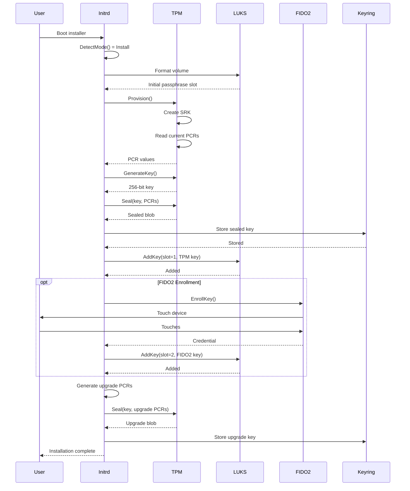
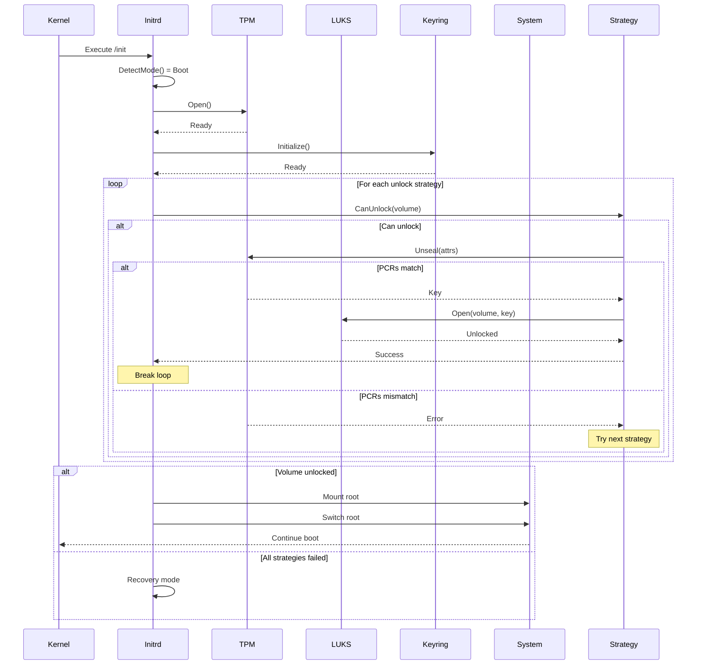
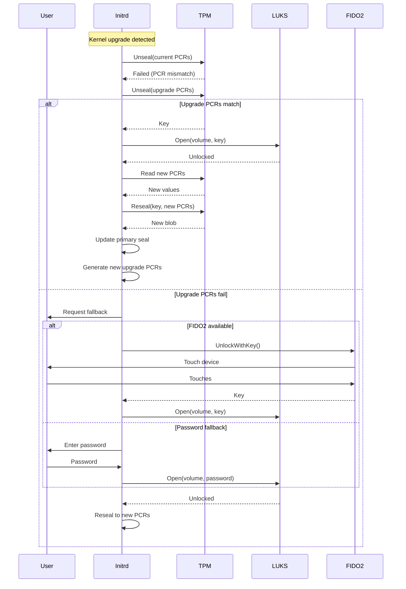

# Platform-Initrd Architecture Design

## Executive Summary

The platform-initrd binary provides a production-grade early boot environment for secure disk encryption using TPM2, LUKS, and FIDO2. This architecture leverages the existing go-trusted-platform codebase while introducing minimal new components for LUKS and offline FIDO2 support.

## Architectural Impact Assessment

**Impact Level: HIGH**

This design introduces critical boot-time functionality that affects system availability and security. The architecture must ensure zero-downtime upgrades and multiple fallback mechanisms.

## Pattern Compliance Checklist

✅ **Single Responsibility Principle**: Each package has a clear, focused purpose
✅ **Open/Closed Principle**: Extension points for new unlock methods
✅ **Liskov Substitution**: Common interfaces for different unlock strategies
✅ **Interface Segregation**: Small, focused interfaces
✅ **Dependency Inversion**: Depend on abstractions, not concrete implementations

## System Architecture

### High-Level Component Architecture

```
┌─────────────────────────────────────────────────────────────┐
│                      platform-initrd                        │
├─────────────────────────────────────────────────────────────┤
│                     Boot Mode Selector                      │
│                  (Install vs Boot Logic)                    │
├─────────────────────────────────────────────────────────────┤
│                   Unlock Strategy Manager                   │
│         (PCR, Upgrade, FIDO2, Password Fallback)            │
├──────────────┬──────────────┬──────────────┬────────────────┤
│    TPM2      │     LUKS     │    FIDO2     │    Keyring     │
│   Handler    │    Handler   │   Handler    │    Manager     │
├──────────────┴──────────────┴──────────────┴────────────────┤
│                   Core Platform Libraries                   │
│            (pkg/tpm2, pkg/platform, pkg/store)              │
└─────────────────────────────────────────────────────────────┘
```

## Package Structure

### New Packages Required

#### 1. pkg/luks - LUKS/Cryptsetup Integration

```go
// pkg/luks/types.go
package luks

import (
    "github.com/jeremyhahn/go-trusted-platform/pkg/store/keystore"
)

// LUKSVersion represents LUKS format version
type LUKSVersion int

const (
    LUKS1 LUKSVersion = 1
    LUKS2 LUKSVersion = 2
)

// VolumeConfig represents a LUKS volume configuration
type VolumeConfig struct {
    DevicePath    string
    MappingName   string
    LUKSVersion   LUKSVersion
    KeySlots      []KeySlot
    AllowDiscards bool
    Timeout       int
}

// KeySlot represents a LUKS key slot configuration
type KeySlot struct {
    Index    int
    Type     UnlockMethod
    Priority int
    Attrs    *keystore.KeyAttributes
}

// UnlockMethod defines how to unlock a volume
type UnlockMethod int

const (
    UnlockTPMPCR UnlockMethod = iota
    UnlockTPMUpgrade
    UnlockFIDO2
    UnlockPassword
    UnlockKeyfile
)

// Handler provides LUKS operations
type Handler interface {
    // Format initializes a LUKS volume
    Format(config *VolumeConfig, password []byte) error

    // Open unlocks and maps a LUKS volume
    Open(config *VolumeConfig, password []byte) error

    // Close unmaps a LUKS volume
    Close(mappingName string) error

    // AddKey adds a new key to a slot
    AddKey(config *VolumeConfig, slot int, oldKey, newKey []byte) error

    // RemoveKey removes a key from a slot
    RemoveKey(config *VolumeConfig, slot int) error

    // Status returns volume status
    Status(devicePath string) (*VolumeStatus, error)

    // IsLUKS checks if device is LUKS formatted
    IsLUKS(devicePath string) (bool, error)
}

// VolumeStatus represents LUKS volume status
type VolumeStatus struct {
    Version     LUKSVersion
    UUID        string
    ActiveSlots []int
    Cipher      string
    Mode        string
    KeySize     int
}
```

#### 2. pkg/fido2 - Offline FIDO2 CTAP2 Protocol Support

```go
// pkg/fido2/types.go
package fido2

import (
    "crypto"
    "github.com/jeremyhahn/go-trusted-platform/pkg/store/keystore"
)

// Authenticator represents a FIDO2 authenticator
type Authenticator interface {
    // GetInfo returns authenticator capabilities
    GetInfo() (*AuthenticatorInfo, error)

    // MakeCredential creates a new credential
    MakeCredential(req *MakeCredentialRequest) (*MakeCredentialResponse, error)

    // GetAssertion gets an assertion for authentication
    GetAssertion(req *GetAssertionRequest) (*GetAssertionResponse, error)

    // Reset performs factory reset (requires user presence)
    Reset() error
}

// AuthenticatorInfo contains device capabilities
type AuthenticatorInfo struct {
    Versions   []string
    AAGUID     []byte
    Options    map[string]bool
    Algorithms []Algorithm
    PinUVAuth  []byte
}

// Algorithm represents a COSE algorithm
type Algorithm struct {
    Type int
    Alg  int
}

// MakeCredentialRequest for creating credentials
type MakeCredentialRequest struct {
    ClientDataHash []byte
    RP             RelyingParty
    User           User
    PubKeyCredParams []PubKeyCredParam
    Extensions     map[string]interface{}
    Options        AuthenticatorOptions
    PinUVAuth      []byte
}

// GetAssertionRequest for getting assertions
type GetAssertionRequest struct {
    RPID           string
    ClientDataHash []byte
    AllowList      []PublicKeyCredentialDescriptor
    Extensions     map[string]interface{}
    Options        AuthenticatorOptions
    PinUVAuth      []byte
}

// Handler provides FIDO2 operations for LUKS
type Handler interface {
    // EnrollKey enrolls a FIDO2 key for LUKS
    EnrollKey(device string, slot int) (*EnrollmentResult, error)

    // UnlockWithKey unlocks using FIDO2
    UnlockWithKey(device string) ([]byte, error)

    // ListDevices returns available FIDO2 devices
    ListDevices() ([]Device, error)

    // WaitForDevice waits for device insertion
    WaitForDevice(timeout int) (*Device, error)
}

// EnrollmentResult contains enrollment data
type EnrollmentResult struct {
    CredentialID []byte
    Salt         []byte
    Iterations   int
    Slot         int
}

// Device represents a FIDO2 device
type Device struct {
    Path         string
    Vendor       string
    Product      string
    SerialNumber string
}
```

#### 3. pkg/initrd - Initrd-Specific Utilities

```go
// pkg/initrd/types.go
package initrd

import (
    "github.com/jeremyhahn/go-trusted-platform/pkg/fido2"
    "github.com/jeremyhahn/go-trusted-platform/pkg/luks"
    "github.com/jeremyhahn/go-trusted-platform/pkg/store/keystore"
    "github.com/jeremyhahn/go-trusted-platform/pkg/tpm2"
)

// BootMode represents the operational mode
type BootMode int

const (
    ModeInstall BootMode = iota
    ModeBoot
    ModeRecovery
    ModeMaintenance
)

// Config represents initrd configuration
type Config struct {
    Mode           BootMode
    RootDevice     string
    BootDevice     string
    KeyringPath    string
    PCRBanks       []string
    PCRSelection   []uint
    UnlockTimeout  int
    FallbackMethods []luks.UnlockMethod
}

// UnlockStrategy defines volume unlock strategy
type UnlockStrategy interface {
    // Name returns strategy name
    Name() string

    // Priority returns execution priority (lower = higher priority)
    Priority() int

    // CanUnlock checks if strategy can unlock
    CanUnlock(volume *luks.VolumeConfig) bool

    // Unlock attempts to unlock volume
    Unlock(volume *luks.VolumeConfig) error

    // Install performs installation tasks
    Install(volume *luks.VolumeConfig) error
}

// Manager orchestrates boot process
type Manager interface {
    // Initialize prepares the boot environment
    Initialize() error

    // DetectMode determines boot mode
    DetectMode() (BootMode, error)

    // Install performs initial setup
    Install() error

    // Boot performs normal boot
    Boot() error

    // Recovery performs recovery boot
    Recovery() error

    // RegisterStrategy registers unlock strategy
    RegisterStrategy(strategy UnlockStrategy)

    // UnlockVolumes unlocks all volumes
    UnlockVolumes() error
}

// Platform provides unified platform access
type Platform struct {
    TPM     tpm2.TrustedPlatformModule
    LUKS    luks.Handler
    FIDO2   fido2.Handler
    Keyring *platform.Keyring
    Config  *Config
}
```

### Core Unlock Strategies

```go
// pkg/initrd/strategies/pcr.go
package strategies

import (
    "github.com/jeremyhahn/go-trusted-platform/pkg/initrd"
    "github.com/jeremyhahn/go-trusted-platform/pkg/luks"
    "github.com/jeremyhahn/go-trusted-platform/pkg/store/keystore"
)

// PCRUnlockStrategy unlocks using TPM PCR policy
type PCRUnlockStrategy struct {
    platform *initrd.Platform
    priority int
}

func NewPCRUnlockStrategy(p *initrd.Platform) initrd.UnlockStrategy {
    return &PCRUnlockStrategy{
        platform: p,
        priority: 1, // Highest priority
    }
}

func (s *PCRUnlockStrategy) Name() string {
    return "TPM2-PCR"
}

func (s *PCRUnlockStrategy) Priority() int {
    return s.priority
}

func (s *PCRUnlockStrategy) CanUnlock(volume *luks.VolumeConfig) bool {
    // Check if TPM is available and PCR slot exists
    for _, slot := range volume.KeySlots {
        if slot.Type == luks.UnlockTPMPCR {
            return true
        }
    }
    return false
}

func (s *PCRUnlockStrategy) Unlock(volume *luks.VolumeConfig) error {
    // Find PCR sealed key slot
    for _, slot := range volume.KeySlots {
        if slot.Type != luks.UnlockTPMPCR {
            continue
        }

        // Unseal key using TPM with PCR policy
        key, err := s.platform.TPM.Unseal(
            slot.Attrs,
            s.platform.Keyring.Backend(),
        )
        if err != nil {
            continue // Try next slot
        }

        // Attempt LUKS unlock
        if err := s.platform.LUKS.Open(volume, key); err == nil {
            return nil
        }
    }

    return ErrUnlockFailed
}

func (s *PCRUnlockStrategy) Install(volume *luks.VolumeConfig) error {
    // Generate new key
    key := s.platform.TPM.RandomBytes(32)

    // Seal to current PCR values
    attrs := &keystore.KeyAttributes{
        CN:             "luks-root-key",
        PlatformPolicy: true,
        Parent:         s.platform.Keyring.TPM2().(*tpm2ks.KeyStore).SRKAttributes(),
    }

    _, err := s.platform.TPM.Seal(
        attrs,
        s.platform.Keyring.Backend(),
        false,
    )
    if err != nil {
        return err
    }

    // Add to LUKS slot
    return s.platform.LUKS.AddKey(volume, 0, nil, key)
}
```

## Integration Architecture

### Integration with Existing Components

```go
// Integration points with existing codebase

// 1. TPM2 Package Extensions
// Extend existing seal/unseal for LUKS-specific requirements
type LUKSSealer interface {
    tpm2.TrustedPlatformModule

    // SealLUKSKey seals LUKS key with upgrade path
    SealLUKSKey(current, upgrade []byte, pcrs []uint) error

    // UnsealLUKSKey tries current then upgrade PCRs
    UnsealLUKSKey() ([]byte, error)
}

// 2. Keyring Integration
// Extend keyring for initrd-specific key management
type InitrdKeyring interface {
    platform.Keyring

    // LoadLUKSKeys loads all LUKS keys
    LoadLUKSKeys() ([]*keystore.KeyAttributes, error)

    // StoreLUKSKey stores LUKS key
    StoreLUKSKey(attrs *keystore.KeyAttributes) error
}

// 3. Platform Password Extension
// Extend for LUKS password caching
type LUKSPassword struct {
    *tpm2.PlatformPassword
    fallback keystore.Password
}

func (p *LUKSPassword) Bytes() ([]byte, error) {
    // Try TPM first
    bytes, err := p.PlatformPassword.Bytes()
    if err == nil {
        return bytes, nil
    }

    // Fall back to alternate method
    if p.fallback != nil {
        return p.fallback.Bytes()
    }

    return nil, err
}
```

## Boot Flow Sequences

### Installation Flow



### Normal Boot Flow



### Upgrade/Recovery Flow



## Build System Architecture

### Static Binary Requirements

```makefile
# build/iso/alpine/amd64/Makefile additions

INITRD_BINARY := platform-initrd
INITRD_SOURCES := cmd/platform-initrd/*.go \
                   pkg/luks/*.go \
                   pkg/fido2/*.go \
                   pkg/initrd/*.go

# Static linking flags for initrd
INITRD_LDFLAGS := -linkmode external \
                  -extldflags '-static -ldevmapper -lcryptsetup -lblkid -luuid' \
                  -X main.Version=$(VERSION)

# Build static initrd binary
$(INITRD_BINARY): $(INITRD_SOURCES)
	CGO_ENABLED=1 \
	GOOS=linux \
	GOARCH=amd64 \
	go build -tags static,osusergo,netgo \
		-ldflags "$(INITRD_LDFLAGS)" \
		-o $@ ./cmd/platform-initrd

# Install to initramfs
install-initrd: $(INITRD_BINARY)
	install -D -m 755 $(INITRD_BINARY) $(DESTDIR)/usr/lib/initcpio/hooks/platform
	install -D -m 644 build/initcpio/platform.conf $(DESTDIR)/etc/initcpio/install/platform
```

### Docker Build Environment

```dockerfile
# build/docker/platform-initrd-builder/Dockerfile
FROM golang:alpine AS builder

# Install build dependencies
RUN apk add --no-cache \
    gcc musl-dev \
    cryptsetup-dev \
    lvm2-dev \
    util-linux-dev \
    libusb-dev \
    eudev-dev

# Build static binary
WORKDIR /build
COPY . .
RUN make platform-initrd

# Final minimal image
FROM alpine:3.19
RUN apk add --no-cache \
    cryptsetup \
    lvm2 \
    util-linux \
    libusb \
    eudev

COPY --from=builder /build/platform-initrd /usr/local/bin/
ENTRYPOINT ["/usr/local/bin/platform-initrd"]
```

## Security Boundaries and Data Validation

### Critical Security Points

1. **TPM Communication**
   - All TPM operations through existing validated tpm2 package
   - Session-based authorization for all sensitive operations
   - Audit logging of all TPM commands

2. **Key Material Handling**
   - Keys never stored in plaintext on disk
   - Memory wiping after use via secure memguard
   - Minimal key lifetime in memory

3. **LUKS Operations**
   - Input validation for all device paths
   - Secure password handling with memory protection
   - Atomic operations to prevent partial states

4. **FIDO2 Communication**
   - User presence verification required
   - Challenge-response protocol validation
   - Device attestation when available

### Data Flow Validation

```go
// Validation layer for all external inputs
type ValidationLayer struct {
    logger *logging.Logger
}

func (v *ValidationLayer) ValidateDevicePath(path string) error {
    // Check path exists
    if _, err := os.Stat(path); err != nil {
        return fmt.Errorf("invalid device path: %w", err)
    }

    // Check is block device
    info, err := os.Lstat(path)
    if err != nil {
        return err
    }

    if info.Mode()&os.ModeDevice == 0 {
        return errors.New("not a device")
    }

    // Validate path format
    if !strings.HasPrefix(path, "/dev/") {
        return errors.New("invalid device path format")
    }

    return nil
}

func (v *ValidationLayer) ValidatePCRSelection(pcrs []uint) error {
    for _, pcr := range pcrs {
        if pcr > 23 {
            return fmt.Errorf("invalid PCR index: %d", pcr)
        }
    }
    return nil
}
```

## Performance Implications

### Architectural Decisions Impact

1. **Sequential vs Parallel Unlock**
   - Sequential: Simpler, predictable, easier debugging
   - Chosen: Sequential with timeout per strategy
   - Rationale: Boot time is not performance critical

2. **Memory Management**
   - Static allocation where possible
   - Pre-allocated buffers for crypto operations
   - Minimal heap allocations during boot

3. **TPM Session Management**
   - Reuse sessions when possible
   - Flush immediately after use
   - Maximum 3 concurrent sessions

### Performance Targets

- Installation time: < 30 seconds for TPM provisioning
- Boot unlock time: < 5 seconds for TPM PCR unlock
- Fallback unlock: < 10 seconds for FIDO2
- Memory usage: < 50MB resident

## Error Handling and Recovery

### Fallback Chain

```go
type FallbackChain struct {
    strategies []UnlockStrategy
    logger     *logging.Logger
}

func (f *FallbackChain) Execute(volume *luks.VolumeConfig) error {
    var lastErr error

    // Sort by priority
    sort.Slice(f.strategies, func(i, j int) bool {
        return f.strategies[i].Priority() < f.strategies[j].Priority()
    })

    for _, strategy := range f.strategies {
        f.logger.Infof("Trying unlock strategy: %s", strategy.Name())

        if !strategy.CanUnlock(volume) {
            f.logger.Debugf("Strategy %s cannot unlock volume", strategy.Name())
            continue
        }

        if err := strategy.Unlock(volume); err == nil {
            f.logger.Infof("Successfully unlocked with %s", strategy.Name())
            return nil
        } else {
            lastErr = err
            f.logger.Warnf("Strategy %s failed: %v", strategy.Name(), err)
        }
    }

    return fmt.Errorf("all unlock strategies failed: %w", lastErr)
}
```

## Testing Strategy

### Unit Test Coverage Requirements

- TPM sealing/unsealing: 90%+ coverage
- LUKS operations: 85%+ coverage
- FIDO2 protocol: 80%+ coverage
- Integration tests: Full boot flow simulation

### Integration Test Framework

```go
// pkg/initrd/testing/framework.go
type TestFramework struct {
    mockTPM   *tpm2.MockTPM
    mockLUKS  *luks.MockHandler
    mockFIDO2 *fido2.MockHandler
}

func (tf *TestFramework) SimulateBoot(scenario BootScenario) error {
    // Set up scenario conditions
    tf.configureScenario(scenario)

    // Execute boot sequence
    manager := initrd.NewManager(tf.mockTPM, tf.mockLUKS, tf.mockFIDO2)

    return manager.Boot()
}
```

## Implementation Priorities

### Phase 1: Core Infrastructure (Week 1-2)
1. ✅ Create pkg/luks with basic operations
2. ✅ Integrate with existing TPM seal/unseal
3. ✅ Create pkg/initrd manager framework
4. ✅ Implement PCR unlock strategy

### Phase 2: Extended Features (Week 3-4)
1. ⬜ Implement upgrade PCR strategy
2. ⬜ Create pkg/fido2 with CTAP2 support
3. ⬜ Implement FIDO2 unlock strategy
4. ⬜ Add password fallback strategy

### Phase 3: Production Hardening (Week 5-6)
1. ⬜ Add comprehensive error handling
2. ⬜ Implement audit logging
3. ⬜ Add performance monitoring
4. ⬜ Complete test coverage

### Phase 4: Integration (Week 7-8)
1. ⬜ Build system integration
2. ⬜ Initramfs packaging
3. ⬜ Documentation
4. ⬜ Integration testing

## Gaps Analysis

### Current Gaps

1. **LUKS Integration**
   - No existing LUKS support in codebase
   - Need cryptsetup library bindings
   - Require device mapper integration

2. **FIDO2 Support**
   - No offline FIDO2 implementation
   - Need CTAP2 protocol implementation
   - Require HID device communication

3. **Initrd Environment**
   - No initrd-specific utilities
   - Need minimal runtime environment
   - Require static linking setup

### Mitigation Strategies

1. **Use Existing Libraries**
   - cryptsetup-go for LUKS operations
   - libfido2 bindings for FIDO2
   - Leverage existing TPM infrastructure

2. **Incremental Implementation**
   - Start with TPM-only unlock
   - Add FIDO2 as enhancement
   - Password as final fallback

3. **Testing Infrastructure**
   - Use QEMU with swtpm for TPM testing
   - Use loopback devices for LUKS testing
   - Mock FIDO2 for unit tests

## Long-Term Implications

### Maintenance Considerations

1. **Kernel Updates**
   - PCR values change with kernel
   - Upgrade seal mechanism critical
   - Need automated reseal process

2. **Hardware Compatibility**
   - TPM 2.0 firmware variations
   - FIDO2 device compatibility
   - UEFI secure boot integration

3. **Security Updates**
   - Regular cryptography library updates
   - TPM firmware updates impact
   - FIDO2 specification evolution

### Scalability Considerations

1. **Multiple Volumes**
   - Support for multiple LUKS volumes
   - Shared key management
   - Parallel unlock capability

2. **Network Unlock**
   - Future Tang/Clevis integration
   - Remote attestation support
   - Network boot scenarios

3. **Cloud Integration**
   - Cloud KMS integration potential
   - Remote attestation services
   - Centralized policy management

## Conclusion

This architecture provides a robust, secure, and maintainable solution for TPM-based disk encryption with multiple fallback mechanisms. It leverages the existing go-trusted-platform infrastructure while adding minimal new components focused on LUKS and FIDO2 integration. The design follows SOLID principles, provides clear abstraction boundaries, and ensures production-grade reliability with comprehensive error handling and recovery mechanisms.

The phased implementation approach allows for incremental development and testing, with clear priorities and deliverables. The architecture is designed to evolve with future requirements while maintaining backward compatibility and security guarantees.
