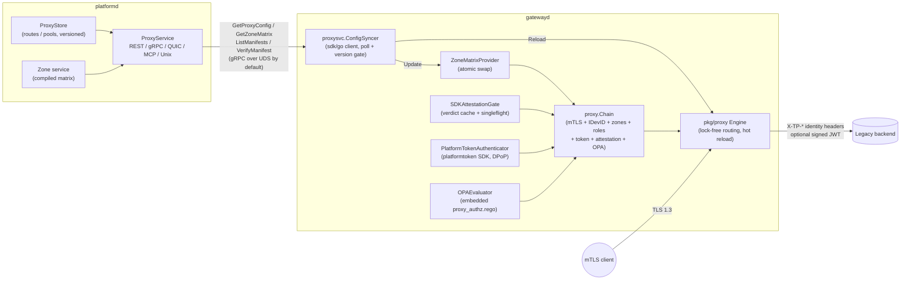

# Proxy Architecture

## Components

## Auth chain (fail-closed)

Per request — the first failing check denies with a stable
machine-readable reason (`403` + audit event). Credential selection:
`mtls` routes require a certificate, `token` routes require a platform
access token, and `mtls-or-token` routes take the mutual-TLS path
whenever a certificate is present — **mTLS wins when both credentials
arrive** (it is the stronger, hardware-anchored credential; the bearer
token is ignored and never forwarded).

mTLS path:

1. **TLS layer**: client cert (when presented) verified against the
   client CA pool (`VerifyClientCertIfGiven`); TLS 1.3 minimum.
2. **mTLS adapter** (`pkg/auth.MTLSAdapter`): validity window, chain to
   the platform CA roots, identity extraction (CN).
3. **IDevID** (routes with `require-idevid`): TCG IDevID validation.
4. **Zone extraction**: canonical `OIDTPNetworkZone` X.509 extension via
   the quicbaas SDK parser; missing zone on a zone-scoped route = deny.
5. **AllowedZones / BackendZone**: checked against the compiled
   `zone.Matrix` — the same matrix that generates OVS flow rules.
6. **Roles**: certificate-derived roles vs `required-roles`.

Token path (routes with `mode: token`, or `mtls-or-token` without a
certificate; requires the `proxy.token-auth` section):

1. **Bearer extraction**: `Authorization: Bearer` (case-insensitive
   scheme); the RFC 9449 `DPoP` header is captured alongside.
2. **platformtoken SDK pipeline** (the same contract platformd's
   transports enforce): JWKS-by-kid signature, `iss`/`aud`/`exp`,
   RFC 9068 `typ: at+jwt`, DPoP proof verification for `cnf.jkt`-bound
   tokens (htm = request method, htu = `scheme://host/path` rebuilt from
   the proxy's own TLS state — inbound `X-Forwarded-*` headers are
   deliberately ignored because the proxy IS the trust boundary), scope
   enforcement (`required-scopes`, qrdb wildcard grant semantics; the
   first scope is enforced before any liveness round trip), and per-mode
   liveness/revocation (offline / online / hybrid introspection).
3. **Zones**: token clients carry no certificate zone. On zone-enforcing
   routes the operator-assigned `auth.token-zone` stands in and passes
   the same `allowed-zones` + matrix checks; without it the request is
   denied (`zone_requires_mtls`). Unknown zones fail closed in the
   matrix.
4. **Roles**: token `roles` claim vs `required-roles`.

Shared trusted-computing gates then run for both paths:

5. **Attestation gate** (routes with `require-attestation`): see below.
6. **OPA policy** (routes with `opa-policy`): the input document
   `{client: {id, zone, device_id, attested, auth_method, roles},
   route: {id, hosts, path_prefix, backend_zone},
   request: {method, path, host}}` is evaluated against the named
   policy; not-allowed denies with `opa_denied` (violations are logged
   and audited server-side, never leaked to the client) and evaluation
   errors deny with `opa_error`.

Identity is then injected toward the backend as `X-TP-Client-ID`,
`X-TP-Device-ID`, `X-TP-Client-Zone`, `X-TP-Auth-Method`,
`X-TP-Attested`, `X-TP-Cert-Fingerprint` — after stripping every inbound
`X-TP-*` header (spoofing defense). The caller's inbound `Authorization`
value is never forwarded on authenticated routes. The proxy never mints
or injects credentials toward backends: backends authenticate the proxy
through its mTLS platform identity and read the caller's identity from
the trusted `X-TP-*` headers.

## Attestation gate

Attestation manifests are keyed by the **IDevID CN** (the enrollment
hook stores `HostManifest.HostID = certificate CN`), so the chain passes
the mTLS leaf's Common Name to the gate; token principals have no device
identity and are denied `attestation_unavailable` on attestation-gated
routes. Freshness semantics:

- **Freshness anchor**: the newest stored manifest's signed collection
  `Timestamp` (validated under the AK signature at enrollment capture),
  fetched via the sdk/go attestation client (`ListManifests(host, 1)`).
- **Verification**: platformd's `VerifyManifest` verdict for that
  manifest must be `VERIFIED`; each gate refresh therefore also lands in
  the platform attestation event trail (`manifest_verified` /
  `manifest_rejected` events feeding the quarantine loop).
- **Policy**: age > the route's `attestation-max-age` (default: the
  `defaults.attestation-max-age`, then the platform-wide 24h manifest
  policy) ⇒ `attestation_stale`. No manifest or a rejected verification
  ⇒ `attestation_stale`. platformd unreachable ⇒
  `attestation_unavailable`. Every outcome denies except fresh+verified,
  which marks the identity `Attested` (visible to OPA and backends).

Verdict caching (`proxysvc.SDKAttestationGate`): per-device verdicts
(manifest timestamp + verification result, NOT the per-route decision)
are cached for `attestation.cache-ttl` (default 60s) and refreshed
through singleflight, so one platformd round trip serves routes with
different max-age policies. Failed queries are cached for
`attestation.negative-cache-ttl` (default 5s) only, so a platformd blip
neither hammers the control plane nor denies longer than necessary.

## gatewayd assembly

`pkg/sdn/gateway/commands.BuildGateway` (the `serve` command):

1. Parse `gateway:`, `proxy:`, `trust:` sections (`LoadServeConfig`).
2. `BuildProxyHandler`:
   - server TLS keypair from `proxy.tls`; client CA pool from
     `client-ca-file` or the `pkg/trust` resolver (class `internal`);
   - auth chain from `auth.NewMTLSAdapterFromRoots` + the canonical zone
     extractor + the hot-swappable matrix provider + the enabled
     trusted-computing collaborators (`attestation:` →
     `SDKAttestationGate` over a lazily dialed sdk/go attestation
     client, `token-auth:` → `PlatformTokenAuthenticator`, `opa:` →
     `OPAEvaluator` over the embedded pkg/policy/opa engine);
   - backend trust via `proxysvc.TrustResolverAdapter` (pkg/trust classes
     `default` / `bmc` / `internal`);
   - `proxy.New` (fail-closed capability checks), then the
     `ConfigSyncer` over a lazily dialed sdk/go client.
3. Register the handler on the gateway node (`RegisterServiceHandler`,
   service name `proxy`) beside the config-driven SDN services.
4. `Gateway.Start` → engine listeners bind, sync loop launches; SIGINT/
   SIGTERM → graceful `Stop` with a 30s drain.

platformd being unreachable at boot is not fatal: the engine serves the
static file configuration and the sync loop keeps retrying on its ticker.

## Sync loop

- Poll interval: `proxy.sync.interval` (default 15s), `time.Ticker` +
  context cancellation.
- Zone matrix refreshes **every** cycle (zones change without a proxy
  version bump) and swaps in atomically.
- Route/pool config applies only when the platformd version changes;
  a failed `Reload` keeps the running config, surfaces in the handler
  health snapshot, and retries next tick (version not advanced).
- Merge semantics: see [configuration.md](configuration.md).

## OVS VIP seam

The engine listens on regular TCP sockets. Anycast/VIP exposure is an L3
concern: the gateway's OVS/BGP services (overlay, transit, NAT) own
steering a VIP to the gatewayd host; the proxy binds the address it is
given and stays datapath-agnostic. No OpenFlow programming happens in
the proxy path.
