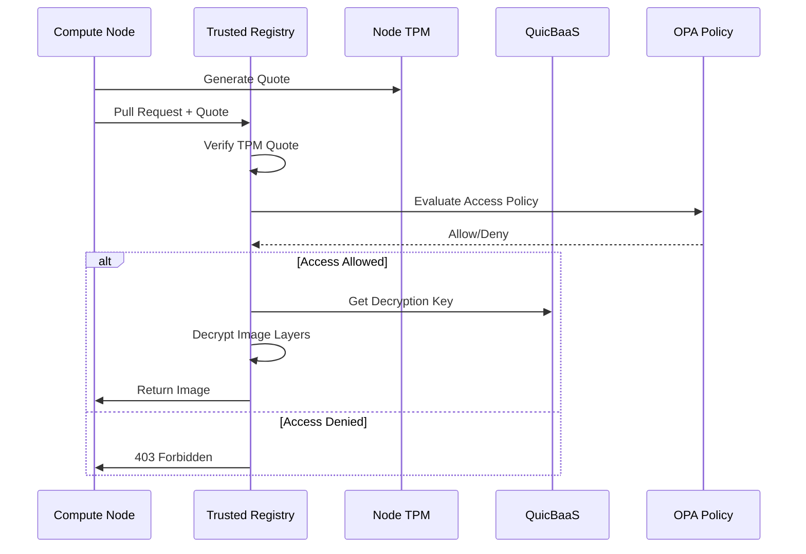
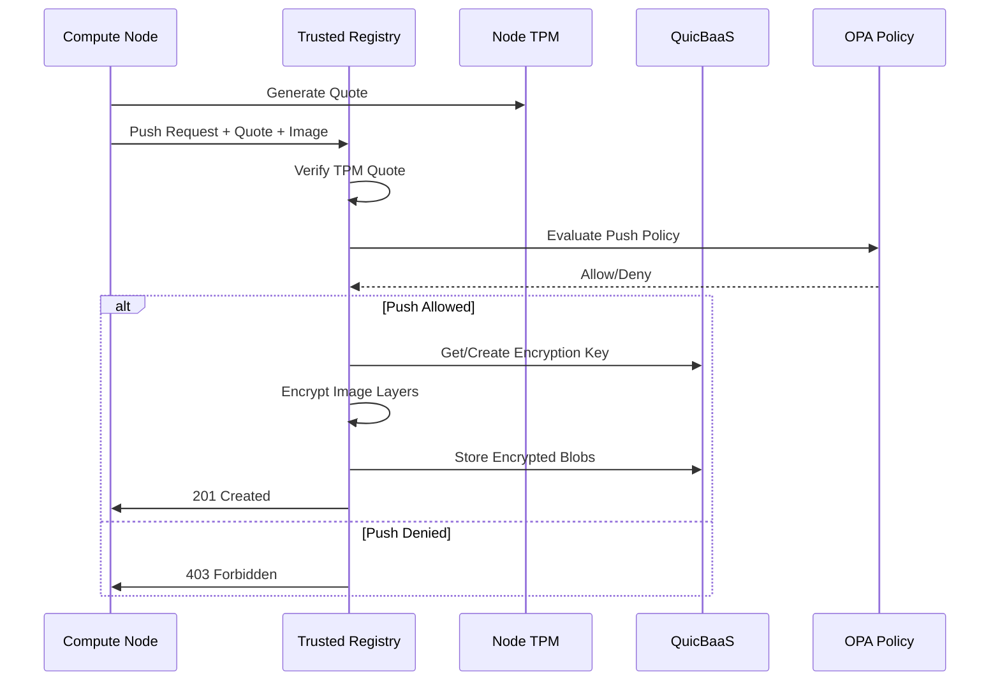
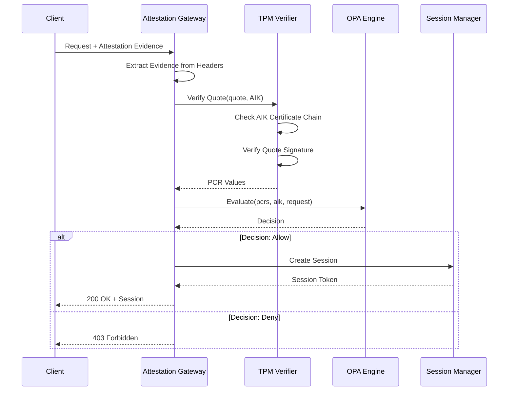

# Trusted Registry Architecture

## Overview

The Trusted Registry implements an OCI-compliant container registry with attestation-gated access and QuicBaaS-backed encryption. Only hosts that can prove their integrity via TPM attestation can access container images.

## Component Architecture

```
+-------------------------------------------------------------+
|                     Trusted Registry                         |
+-------------------------------------------------------------+
|  +-----------------+  +-----------------+  +---------------+ |
|  |   Attestation   |  |     Image       |  |  Encryption   | |
|  |    Gateway      |  |    Storage      |  |    Engine     | |
|  +--------+--------+  +--------+--------+  +-------+-------+ |
|           |                    |                   |         |
|           v                    v                   v         |
|  +-------------------------------------------------------+   |
|  |               QuicBaaS Integration                    |   |
|  |      (Key Management + Encrypted Blob Storage)        |   |
|  +-------------------------------------------------------+   |
+-------------------------------------------------------------+
                              |
                              | Attestation Required
                              v
+-------------------------------------------------------------+
|                 Attested Compute Nodes                       |
|       (Only nodes with valid TPM attestation can pull)       |
+-------------------------------------------------------------+
```

## Core Interfaces

### TrustedRegistry

```go
// TrustedRegistry is a container registry requiring host attestation
type TrustedRegistry interface {
    // Image operations
    Push(ctx context.Context, ref string, image Image, opts PushOptions) error
    Pull(ctx context.Context, ref string, opts PullOptions) (Image, error)
    Delete(ctx context.Context, ref string) error
    List(ctx context.Context, opts ListOptions) ([]ImageManifest, error)

    // Attestation-gated access
    VerifyClient(ctx context.Context, attestation *AttestationEvidence) error

    // Encryption
    EncryptImage(ctx context.Context, ref string, keyID string) error
    DecryptImage(ctx context.Context, ref string) (Image, error)
}
```

### RegistryAuthHandler

Validates client attestation before granting access:

```go
// RegistryAuthHandler validates client attestation before access
type RegistryAuthHandler struct {
    attestor     *attestation.Verifier
    policyEngine *opa.PolicyEngine
    quicBaaS     *quicbaas.Client
}

func (h *RegistryAuthHandler) Authenticate(ctx context.Context,
    req *http.Request) (*RegistrySession, error) {

    // 1. Extract attestation evidence from request header
    evidence, err := extractAttestationEvidence(req)
    if err != nil {
        return nil, ErrAttestationRequired
    }

    // 2. Verify TPM quote
    result, err := h.attestor.VerifyQuote(ctx, evidence.Quote, evidence.AIK)
    if err != nil {
        return nil, ErrInvalidQuote
    }

    // 3. Check PCR values against policy
    policyInput := map[string]interface{}{
        "pcrs":      result.PCRs,
        "aik":       evidence.AIK,
        "client_ip": req.RemoteAddr,
        "requested": req.URL.Path,
    }

    decision, err := h.policyEngine.Evaluate(ctx, "registry.access", policyInput)
    if err != nil || !decision.Allow {
        return nil, ErrAccessDenied
    }

    // 4. Create authenticated session
    return &RegistrySession{
        ClientID:   evidence.ClientID,
        AIK:        evidence.AIK,
        PCRs:       result.PCRs,
        ValidUntil: time.Now().Add(time.Hour),
    }, nil
}
```

### ImageEncryptor

Handles image layer encryption using QuicBaaS-managed keys:

```go
// ImageEncryptor handles image layer encryption using QuicBaaS keys
type ImageEncryptor struct {
    quicBaaS *quicbaas.Client
    keyNS    string
}

func (e *ImageEncryptor) EncryptImage(ctx context.Context,
    image Image, keyID string) (*EncryptedImage, error) {

    // 1. Get or create encryption key from QuicBaaS
    key, err := e.quicBaaS.GetKey(ctx, e.keyNS, keyID)
    if err != nil {
        key, err = e.quicBaaS.CreateKey(ctx, &quicbaas.KeySpec{
            Namespace:   e.keyNS,
            ID:          keyID,
            Algorithm:   "AES-256-GCM",
            Extractable: false,  // Key never leaves QuicBaaS
        })
        if err != nil {
            return nil, err
        }
    }

    // 2. Encrypt each layer
    encryptedLayers := make([]EncryptedLayer, len(image.Layers))
    for i, layer := range image.Layers {
        // Generate per-layer DEK, wrap with QuicBaaS key
        dek := generateDEK()
        wrappedDEK, err := e.quicBaaS.WrapKey(ctx, keyID, dek)
        if err != nil {
            return nil, err
        }

        // Encrypt layer content
        encrypted, err := encryptLayer(layer.Content, dek)
        if err != nil {
            return nil, err
        }

        encryptedLayers[i] = EncryptedLayer{
            Digest:     layer.Digest,
            Encrypted:  encrypted,
            WrappedDEK: wrappedDEK,
            KeyID:      keyID,
        }
    }

    return &EncryptedImage{
        Manifest:        image.Manifest,
        EncryptedLayers: encryptedLayers,
    }, nil
}

func (e *ImageEncryptor) DecryptImage(ctx context.Context,
    encrypted *EncryptedImage) (Image, error) {

    layers := make([]Layer, len(encrypted.EncryptedLayers))
    for i, el := range encrypted.EncryptedLayers {
        // Unwrap DEK using QuicBaaS
        dek, err := e.quicBaaS.UnwrapKey(ctx, el.KeyID, el.WrappedDEK)
        if err != nil {
            return Image{}, ErrDecryptionFailed
        }

        // Decrypt layer
        content, err := decryptLayer(el.Encrypted, dek)
        if err != nil {
            return Image{}, err
        }

        layers[i] = Layer{
            Digest:  el.Digest,
            Content: content,
        }
    }

    return Image{
        Manifest: encrypted.Manifest,
        Layers:   layers,
    }, nil
}
```

## Sequence Diagrams

### Image Pull Flow



### Image Push Flow



### Attestation Verification Flow



## Storage Architecture

### QuicBaaS-Only Backend

The Trusted Registry uses QuicBaaS exclusively for storage. QuicBaaS internally supports various backends (filesystem, S3, etc.), so no additional storage abstraction is needed.

```go
// StorageConfig for QuicBaaS-backed registry storage
type StorageConfig struct {
    // QuicBaaS connection
    Addr      string  // QuicBaaS server address
    Namespace string  // Namespace for registry blobs

    // Encryption settings
    Encrypted bool    // Encrypt blobs at rest (default: true)
    KeyID     string  // Encryption key ID in QuicBaaS
}
```

### Blob Storage Layout

```
QuicBaaS Namespace: registry-blobs/
├── manifests/
│   ├── {repo}/
│   │   ├── {tag} -> {digest}
│   │   └── sha256:{digest}
├── blobs/
│   └── sha256/
│       └── {digest}  (encrypted layer data)
└── uploads/
    └── {uuid}/  (in-progress uploads)
```

### Encryption Key Layout

```
QuicBaaS Namespace: container-images/
├── kek/
│   └── {key-id}  (Key Encryption Key)
└── dek/
    └── {layer-digest}  (wrapped Data Encryption Key)
```

## OCI Registry API Endpoints

The registry implements standard OCI Distribution Spec endpoints:

| Method | Endpoint | Description |
|--------|----------|-------------|
| GET | `/v2/` | API version check |
| GET | `/v2/{name}/manifests/{reference}` | Pull manifest |
| PUT | `/v2/{name}/manifests/{reference}` | Push manifest |
| DELETE | `/v2/{name}/manifests/{reference}` | Delete manifest |
| GET | `/v2/{name}/blobs/{digest}` | Pull blob |
| HEAD | `/v2/{name}/blobs/{digest}` | Check blob exists |
| DELETE | `/v2/{name}/blobs/{digest}` | Delete blob |
| POST | `/v2/{name}/blobs/uploads/` | Start blob upload |
| PATCH | `/v2/{name}/blobs/uploads/{uuid}` | Upload blob chunk |
| PUT | `/v2/{name}/blobs/uploads/{uuid}` | Complete blob upload |
| GET | `/v2/{name}/tags/list` | List tags |
| GET | `/v2/_catalog` | List repositories |

All endpoints require attestation via `X-Attestation-Evidence` header.

## Error Handling

```go
// pkg/registry/errors.go
var (
    ErrAttestationRequired = errors.New("attestation evidence required")
    ErrInvalidQuote        = errors.New("invalid TPM quote")
    ErrAccessDenied        = errors.New("access denied by policy")
    ErrDecryptionFailed    = errors.New("image decryption failed")
    ErrKeyNotFound         = errors.New("encryption key not found")
    ErrBlobNotFound        = errors.New("blob not found")
    ErrManifestNotFound    = errors.New("manifest not found")
    ErrUploadNotFound      = errors.New("upload not found")
    ErrDigestMismatch      = errors.New("digest mismatch")
)
```

## Thread Safety

- HTTP handlers are stateless and thread-safe
- QuicBaaS client handles connection pooling
- Session cache uses sync.Map for concurrent access
- Encryption operations are stateless

## Performance Considerations

- Session tokens cached to avoid repeated attestation
- Blob streaming for large layers (no full materialization)
- QuicBaaS connection pooling
- Parallel layer encryption/decryption
- Chunked uploads supported for large images

## Security Considerations

1. **No Password Authentication** - TPM attestation is the only method
2. **Encryption at Rest** - All blobs encrypted before storage
3. **Key Isolation** - KEKs never leave QuicBaaS
4. **PCR Binding** - Access requires specific PCR values
5. **TLS Required** - All connections must use TLS
6. **Audit Trail** - All access attempts logged

## See Also

- [Configuration Reference](configuration.md)
- [Container Orchestrator](../compute/container-orchestrator.md)
- [TPM Documentation](../tpm/README.md)
- [QuicBaaS Documentation](../quicbaas/README.md)
