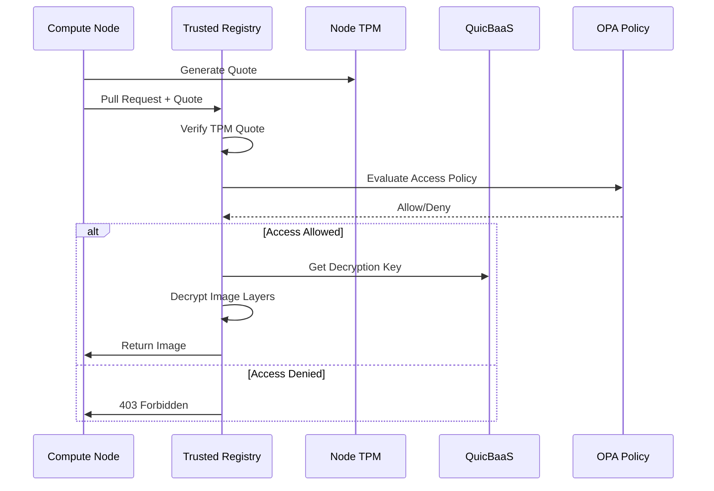
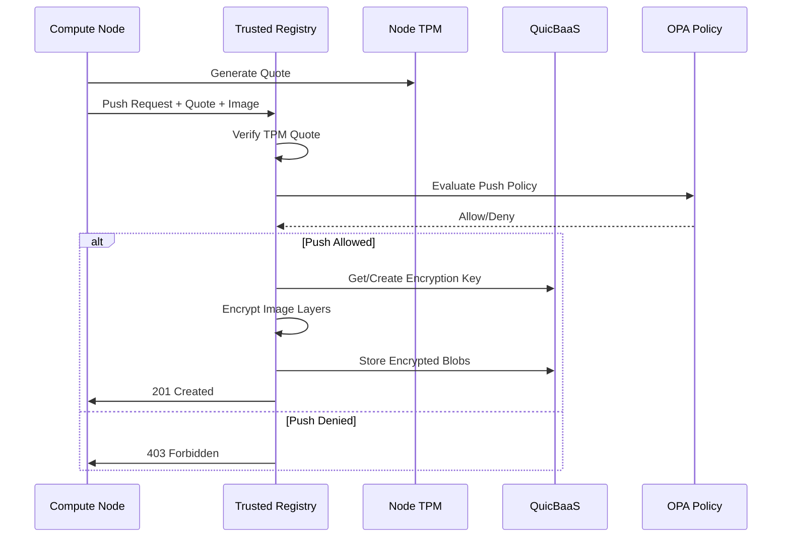
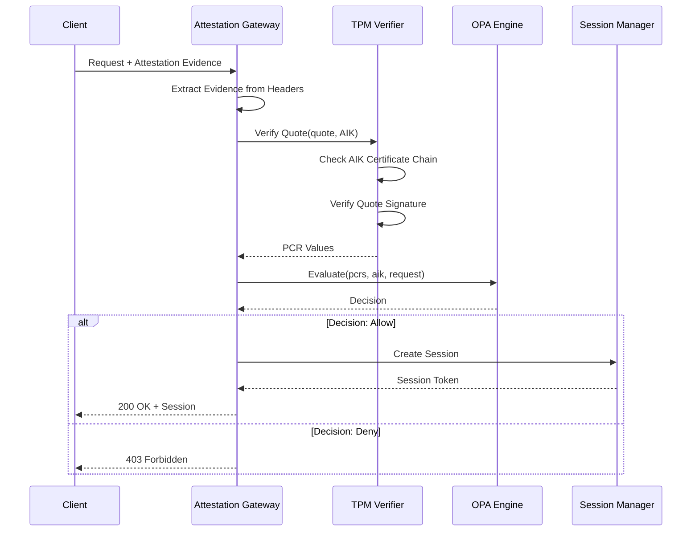

# Trusted Registry Architecture

> **Status: NORMATIVE** · Scope: `pkg/registry/` · Last verified: 2026-08-18
> Conflicts with this document are defects. Fix them here first.
> The feature folder is: architecture (this file) · [engineering.md](engineering.md) ·
> [cli.md](cli.md) · [api.md](api.md) · [user.md](user.md).
>
> **Verification scope.** The interface signatures, route tables and error names
> in this file were re-checked against code on 2026-08-18 and corrected where
> they disagreed. The narrative sections below (sequence diagrams, performance
> notes) predate the feature-folder migration and were carried over rather than
> re-derived; treat them as orientation, not as a contract.

## The problem

A container registry authenticates a *principal*. That is the wrong unit for a
trusted-computing platform, where the question is not "who is asking" but "what
is the machine asking on behalf of, and is it still the machine we enrolled".
A stolen registry credential works from anywhere; a TPM quote does not.

## The shape chosen

TPM attestation **is** the authentication method. A client presents attestation
evidence, the registry verifies the quote's signature, freshness and PCRs
against a golden policy, and only then serves bytes. On top of that, layers are
encrypted individually under per-layer DEKs wrapped by a managed key, so the
storage backend never holds plaintext.

### Alternatives rejected

| Alternative | Why it was rejected |
|---|---|
| **Bearer tokens or basic auth, with attestation as an added factor** | A second credential path is a bypass path. Anything that can be copied off the node defeats the premise, and "attestation optional" configurations become the deployed default. Attestation is the only method. |
| **Whole-image encryption under one key** | Rotating the key would mean re-encrypting every layer of every image. Per-layer DEKs mean rotation rewraps small key blobs and never touches layer bytes. |
| **A plain OCI registry behind an authenticating reverse proxy** | The proxy would have to terminate and re-issue the OCI protocol to make an attestation decision per blob, and the registry itself would still be reachable by anything that could route to it. Putting the gate inside the registry keeps one enforcement point. |
| **Signing only, no encryption** | Signatures prove provenance but leave layer contents readable to anyone who reaches storage. In the deployments this platform targets, the storage backend is not inside the trust boundary. |
| **A bespoke pull protocol instead of OCI distribution `/v2`** | Standard tooling would stop working, and every consumer would need a platform-specific client. The `/v2` API is served unchanged; only the gate in front of it is ours. |

## Component boundaries

| Piece | Package | Owner |
|---|---|---|
| Registry core, attestation gate, session cache | `pkg/registry/` | this repo |
| Per-layer encryption envelope | `pkg/registry/encryption.go`, `encryption_envelope.go` | this repo |
| OCI distribution `/v2` surface | `pkg/webservice/v1/rest/registry/ocidist.go` | this repo |
| Platform REST surface `/api/v1/compute/images` | `pkg/webservice/v1/rest/registry/` | this repo |
| gRPC `RegistryService` | `pkg/api/grpc/proto/registry.proto`, `pkg/registry/grpc_adapter.go` | this repo |
| MCP tools | `pkg/api/mcp/registry_tools.go` | this repo |
| **Key management (DEK wrap/unwrap)** | consumed through the quicbaas SDK | **not this repo** |
| **Blob storage** | consumed through the quicbaas SDK | **not this repo** |
| **Attestation verification primitives** | `pkg/attestation/` — see [`docs/attestation/`](../attestation/) | this repo |

The capability row this feature implements is *"Attestation-gated OCI
registry"*, Tier 1, reached through `services/registry` in the platform SDK.
Everything below the platform — keys, blobs, identity — is reached through
`go-quicbaas/sdk/go` and is never reimplemented here.
`LocalKMSClient` and `FileStorageClient` exist for development and tests only;
the storage config's own doc comment names the stack's object-storage service as
the sole supported production backend.

## Trust boundaries

1. **Client → registry.** Crossed by attestation evidence. Everything on the
   client side of this line is untrusted until the quote verifies. A failure
   here denies; there is no degraded-service path.
2. **Registry → key management.** Crossed by DEK wrap/unwrap requests. The
   registry never holds a long-term key; it holds wrapped DEKs and asks for them
   to be unwrapped.
3. **Registry → blob storage.** Crossed by ciphertext when encryption is on.
   Storage is treated as outside the trust boundary.
4. **Session cache.** A verified client skips re-attestation for a configured
   window. That window is the exposure if a node is compromised *after* it
   attested — keep it short in high-assurance deployments.

## What this feature deliberately does not do

- **It does not authenticate users.** There are no registry accounts, roles or
  passwords. Identity questions belong to IAM ([`docs/iam/`](../iam/)).
- **It does not run its own key management.** Keys come from the stack.
- **It does not build images.** It stores, encrypts and serves them.
- **It does not expose push and pull over MCP.** Blob transfer over JSON-RPC is
  a deliberate omission, documented in [api.md](api.md) §4.
- **It has no QUIC surface today.** That is a gap, recorded as such in
  [api.md](api.md) §2 — not a design decision.

## Overview

The Trusted Registry implements an OCI-compliant container registry with attestation-gated access and QuicBaaS-backed encryption. Only hosts that can prove their integrity via TPM attestation can access container images.

## Component Architecture

```
+-------------------------------------------------------------+
|                     Trusted Registry                         |
+-------------------------------------------------------------+
|  +-----------------+  +-----------------+  +---------------+ |
|  |   Attestation   |  |     Image       |  |  Encryption   | |
|  |    Gateway      |  |    Storage      |  |    Engine     | |
|  +--------+--------+  +--------+--------+  +-------+-------+ |
|           |                    |                   |         |
|           v                    v                   v         |
|  +-------------------------------------------------------+   |
|  |               QuicBaaS Integration                    |   |
|  |      (Key Management + Encrypted Blob Storage)        |   |
|  +-------------------------------------------------------+   |
+-------------------------------------------------------------+
                              |
                              | Attestation Required
                              v
+-------------------------------------------------------------+
|                 Attested Compute Nodes                       |
|       (Only nodes with valid TPM attestation can pull)       |
+-------------------------------------------------------------+
```

## Core Interfaces

### TrustedRegistry

Verbatim from `pkg/registry/registry.go:29`:

```go
// TrustedRegistry is a container registry requiring host attestation
type TrustedRegistry interface {
    // Image operations
    Push(ctx context.Context, ref string, image *Image, opts PushOptions) error
    Pull(ctx context.Context, ref string, opts PullOptions) (*Image, error)
    Delete(ctx context.Context, ref string) error
    List(ctx context.Context, opts RegistryListOptions) ([]*ImageManifest, error)

    // Attestation-gated access
    VerifyClient(ctx context.Context, attestation *AttestationEvidence) error

    // Encryption
    EncryptImage(ctx context.Context, ref string, keyID string) error
    DecryptImage(ctx context.Context, ref string) (*Image, error)
}
```

> **Corrected 2026-08-18.** This block previously read `image Image` (by value),
> `(Image, error)` returns, and `opts ListOptions` returning
> `[]ImageManifest`. All four were wrong: images cross the boundary as
> **pointers**, and the list option type is **`RegistryListOptions`** —
> `ListOptions` is a different type belonging to other packages. Code built
> against the old text would not compile. See [engineering.md](engineering.md)
> §1 for the full exported surface.

### RegistryAuthHandler

Validates client attestation before granting access:

```go
// RegistryAuthHandler validates client attestation before access
type RegistryAuthHandler struct {
    attestor     *attestation.Verifier
    policyEngine *opa.PolicyEngine
    quicBaaS     *quicbaas.Client
}

func (h *RegistryAuthHandler) Authenticate(ctx context.Context,
    req *http.Request) (*RegistrySession, error) {

    // 1. Extract attestation evidence from request header
    evidence, err := extractAttestationEvidence(req)
    if err != nil {
        return nil, ErrAttestationRequired
    }

    // 2. Verify TPM quote
    result, err := h.attestor.VerifyQuote(ctx, evidence.Quote, evidence.AIK)
    if err != nil {
        return nil, ErrInvalidQuote
    }

    // 3. Check PCR values against policy
    policyInput := map[string]interface{}{
        "pcrs":      result.PCRs,
        "aik":       evidence.AIK,
        "client_ip": req.RemoteAddr,
        "requested": req.URL.Path,
    }

    decision, err := h.policyEngine.Evaluate(ctx, "registry.access", policyInput)
    if err != nil || !decision.Allow {
        return nil, ErrAccessDenied
    }

    // 4. Create authenticated session
    return &RegistrySession{
        ClientID:   evidence.ClientID,
        AIK:        evidence.AIK,
        PCRs:       result.PCRs,
        ValidUntil: time.Now().Add(time.Hour),
    }, nil
}
```

### ImageEncryptor

Handles image layer encryption using QuicBaaS-managed keys:

```go
// ImageEncryptor handles image layer encryption using QuicBaaS keys
type ImageEncryptor struct {
    quicBaaS *quicbaas.Client
    keyNS    string
}

func (e *ImageEncryptor) EncryptImage(ctx context.Context,
    image Image, keyID string) (*EncryptedImage, error) {

    // 1. Get or create encryption key from QuicBaaS
    key, err := e.quicBaaS.GetKey(ctx, e.keyNS, keyID)
    if err != nil {
        key, err = e.quicBaaS.CreateKey(ctx, &quicbaas.KeySpec{
            Namespace:   e.keyNS,
            ID:          keyID,
            Algorithm:   "AES-256-GCM",
            Extractable: false,  // Key never leaves QuicBaaS
        })
        if err != nil {
            return nil, err
        }
    }

    // 2. Encrypt each layer
    encryptedLayers := make([]EncryptedLayer, len(image.Layers))
    for i, layer := range image.Layers {
        // Generate per-layer DEK, wrap with QuicBaaS key
        dek := generateDEK()
        wrappedDEK, err := e.quicBaaS.WrapKey(ctx, keyID, dek)
        if err != nil {
            return nil, err
        }

        // Encrypt layer content
        encrypted, err := encryptLayer(layer.Content, dek)
        if err != nil {
            return nil, err
        }

        encryptedLayers[i] = EncryptedLayer{
            Digest:     layer.Digest,
            Encrypted:  encrypted,
            WrappedDEK: wrappedDEK,
            KeyID:      keyID,
        }
    }

    return &EncryptedImage{
        Manifest:        image.Manifest,
        EncryptedLayers: encryptedLayers,
    }, nil
}

func (e *ImageEncryptor) DecryptImage(ctx context.Context,
    encrypted *EncryptedImage) (Image, error) {

    layers := make([]Layer, len(encrypted.EncryptedLayers))
    for i, el := range encrypted.EncryptedLayers {
        // Unwrap DEK using QuicBaaS
        dek, err := e.quicBaaS.UnwrapKey(ctx, el.KeyID, el.WrappedDEK)
        if err != nil {
            return Image{}, ErrDecryptionFailed
        }

        // Decrypt layer
        content, err := decryptLayer(el.Encrypted, dek)
        if err != nil {
            return Image{}, err
        }

        layers[i] = Layer{
            Digest:  el.Digest,
            Content: content,
        }
    }

    return Image{
        Manifest: encrypted.Manifest,
        Layers:   layers,
    }, nil
}
```

## Sequence Diagrams

### Image Pull Flow



### Image Push Flow



### Attestation Verification Flow



## Storage Architecture

### QuicBaaS-Only Backend

The Trusted Registry uses QuicBaaS exclusively for storage. QuicBaaS internally supports various backends (filesystem, S3, etc.), so no additional storage abstraction is needed.

```go
// StorageConfig for QuicBaaS-backed registry storage
type StorageConfig struct {
    // QuicBaaS connection
    Addr      string  // QuicBaaS server address
    Namespace string  // Namespace for registry blobs

    // Encryption settings
    Encrypted bool    // Encrypt blobs at rest (default: true)
    KeyID     string  // Encryption key ID in QuicBaaS
}
```

### Blob Storage Layout

```
QuicBaaS Namespace: registry-blobs/
├── manifests/
│   ├── {repo}/
│   │   ├── {tag} -> {digest}
│   │   └── sha256:{digest}
├── blobs/
│   └── sha256/
│       └── {digest}  (encrypted layer data)
└── uploads/
    └── {uuid}/  (in-progress uploads)
```

### Encryption Key Layout

```
QuicBaaS Namespace: container-images/
├── kek/
│   └── {key-id}  (Key Encryption Key)
└── dek/
    └── {layer-digest}  (wrapped Data Encryption Key)
```

## OCI Registry API Endpoints

The registry implements standard OCI Distribution Spec endpoints:

| Method | Endpoint | Description |
|--------|----------|-------------|
| GET | `/v2/` | API version check |
| GET | `/v2/{name}/manifests/{reference}` | Pull manifest |
| PUT | `/v2/{name}/manifests/{reference}` | Push manifest |
| DELETE | `/v2/{name}/manifests/{reference}` | Delete manifest |
| GET | `/v2/{name}/blobs/{digest}` | Pull blob |
| HEAD | `/v2/{name}/blobs/{digest}` | Check blob exists |
| DELETE | `/v2/{name}/blobs/{digest}` | Delete blob |
| POST | `/v2/{name}/blobs/uploads/` | Start blob upload |
| PATCH | `/v2/{name}/blobs/uploads/{uuid}` | Upload blob chunk |
| PUT | `/v2/{name}/blobs/uploads/{uuid}` | Complete blob upload |
| GET | `/v2/{name}/tags/list` | List tags |
| GET | `/v2/_catalog` | List repositories |

All endpoints require attestation via `X-Attestation-Evidence` header.

## Error Handling

```go
// pkg/registry/errors.go
var (
    ErrAttestationRequired = errors.New("attestation evidence required")
    ErrInvalidQuote        = errors.New("invalid TPM quote")
    ErrAccessDenied        = errors.New("access denied by policy")
    ErrDecryptionFailed    = errors.New("image decryption failed")
    ErrKeyNotFound         = errors.New("encryption key not found")
    ErrBlobNotFound        = errors.New("blob not found")
    ErrManifestNotFound    = errors.New("manifest not found")
    ErrUploadNotFound      = errors.New("upload not found")
    ErrDigestMismatch      = errors.New("digest mismatch")
)
```

## Thread Safety

- HTTP handlers are stateless and thread-safe
- QuicBaaS client handles connection pooling
- Session cache uses sync.Map for concurrent access
- Encryption operations are stateless

## Performance Considerations

- Session tokens cached to avoid repeated attestation
- Blob streaming for large layers (no full materialization)
- QuicBaaS connection pooling
- Parallel layer encryption/decryption
- Chunked uploads supported for large images

## Security Considerations

1. **No Password Authentication** - TPM attestation is the only method
2. **Encryption at Rest** - All blobs encrypted before storage
3. **Key Isolation** - KEKs never leave QuicBaaS
4. **PCR Binding** - Access requires specific PCR values
5. **TLS Required** - All connections must use TLS
6. **Audit Trail** - All access attempts logged

## See Also

- [Configuration Reference](configuration.md)
- [Container Orchestrator](../compute/container-orchestrator.md)
- [TPM Documentation](../tpm/README.md)
- [SDK Documentation](../sdk/architecture.md)
