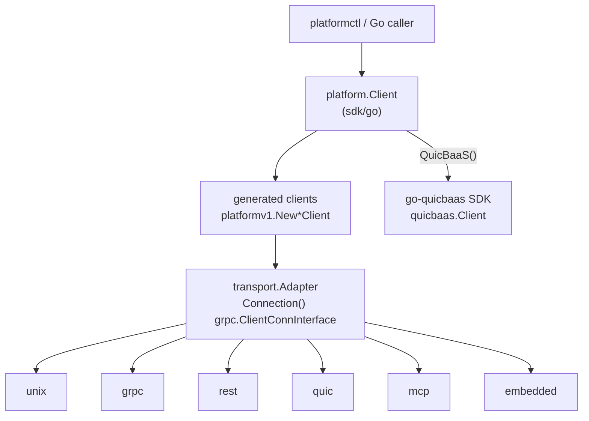

# Go SDK — Architecture

> **Status: NORMATIVE** · Scope: the `sdk/go` module · Last verified: 2026-10-13
> Conflicts with this document are defects. Fix them here first.

---

## 1. What the SDK is

`sdk/go` is the Go client for `platformd`. It is a separate Go module,
`github.com/jeremyhahn/go-trusted-platform/sdk/go`, and the only way
`platformctl` (`pkg/cli`) reaches the daemon. Every platform service is a gRPC
service in package `platform.v1`. The SDK carries those calls over six
transports and returns the same generated client types on each one.

The SDK owns three things:

| Concern | Package |
|---|---|
| Connection, protocol selection, typed errors | `sdk/go` (package `platform`) |
| Transport adapters, one per protocol | `sdk/go/transport/{unix,grpc,rest,quic,mcp,embedded}` |
| Service clients and domain wrappers | `sdk/go/gen` (package `platformv1`), `sdk/go/services/*` |

It also carries connection credentials (`sdk/go/auth`) and a typed frontage
over the go-quicbaas SDK (`sdk/go/services/quicbaas`, `sdk/go/services/auth`,
`sdk/go/services/orchestration`, `sdk/go/services/{orchestrator,project,account,sdlc}`
and `sdk/go/services/{cache,vector,timeseries,objectstorage,scheduler,messaging}`).

## 2. Layering



Every adapter implements `transport.Adapter`:

```go
type Adapter interface {
    Connection() grpc.ClientConnInterface
    Close() error
    IsConnected() bool
    Target() string
}
```

`Connection()` is the seam. Unix and gRPC return a real `*grpc.ClientConn`.
REST, QUIC, MCP and embedded return their own `grpc.ClientConnInterface`. Each
one translates the full gRPC method name (`/platform.v1.<Service>/<Method>`)
into its wire form and translates failures back into gRPC status codes. Callers
therefore see one API and one error model whichever transport carried the call.

| Transport | `Invoke` translation | Streaming |
|---|---|---|
| unix | native gRPC over `unix://<socket>` | yes |
| grpc | native gRPC over TLS 1.3 | yes |
| rest | method → HTTP route (`grpcMethodToRESTMap`, `templatedRouteTable`); HTTP status → gRPC code | no |
| quic | method → opcode (`grpcMethodToOpcodeMap`, `categorySubOpcodeMap`); a request its translator refuses fails `InvalidArgument` before it is sent; QUIC status → gRPC code | no |
| mcp | method → MCP tool (`grpcMethodToMCPToolMap`) via `CallTool` | no |
| embedded | method → in-process handler map built from `ServiceRegistry`; reply copied by proto marshal | no |

## 3. Protocol registration and selection

Adapters self-register from `init()` through
`platform.RegisterProtocol(Protocol, ConnectFunc)`. A caller links a transport
with a blank import. A protocol nobody imported fails with
`ErrProtocolNotImplemented`.

`Connect` validates `Options` and then does one of two things:

- `OnlyProtocol` set: try that protocol alone.
- Otherwise walk `buildProtocolOrder`, returning the first adapter that connects:
  1. `PreferredProtocol`, if set;
  2. Unix, when the process is root (euid 0) and `UnixSocket` is set;
  3. gRPC, REST, QUIC, MCP, each only when its address is set;
  4. embedded, when `EmbeddedServices` is set.

  If nothing is configured and the process is root, Unix is tried. When every
  candidate fails, `Connect` returns `ErrDaemonUnavailable{Attempted, LastErr}`.

After the adapter connects, `Connect` builds every generated service client on
`adapter.Connection()`. Accessors such as `TPM()` and `CA()` then return those
clients.

## 4. Authentication model

| Transport | Peer authentication | Caller identity |
|---|---|---|
| unix | none on the wire; the daemon reads the peer's Unix credentials | the local user |
| grpc | TLS 1.3 (`TLSConfig`, else the system pool) | `BearerToken`, sent as `authorization: Bearer` per RPC |
| rest | TLS 1.3; an `http://` address is refused | `BearerToken`, sent as `Authorization: Bearer` |
| quic | TLS 1.3, ALPN `platform-quic` | `BearerToken`, framed into every request |
| mcp | TLS 1.3 over `https://` (the default); none over a bare `http://` | `BearerToken`, over `https://` only |
| embedded | none; same process | the embedding process |

The credential options are `BearerToken`, `TLSConfig` and `TLSServerName`.
gRPC, REST and QUIC dial with `Options.ClientTLSConfig()`: a clone of
`TLSConfig` (or the system roots), raised to TLS 1.3, with `TLSServerName`
applied. MCP uses it over `https://`. Every adapter either honours the
credential options or refuses them with a typed error; none drops them:

- MCP over `http://` refuses any of them with `ErrInsecureTransport`. A bare
  `http://` address with none of them set is allowed.
- REST refuses every `http://` address with `ErrInsecureTransport`.
- Unix and embedded refuse any of them with `ErrUnsupportedOption`. Unix
  authenticates by `SO_PEERCRED`; embedded calls never leave the process.

[../daemon/api.md §1](../daemon/api.md#1-the-six-transports) states the
credential rules per transport alongside the server listeners, and
[§5](../daemon/api.md#5-authorization--the-platform-wide-picture) covers how the
daemon authorizes the caller.

`sdk/go/auth` builds the TLS material and tokens: `MTLSProvider`,
`TokenProvider` and `NoneProvider`, all behind `auth.Provider`. A provider's
`GetTLSConfig()` feeds `platform.WithTLSConfig`, and its token feeds
`platform.WithBearerToken`.

## 5. The go-quicbaas side-client

The platform is the top layer of the stack. It reaches go-quicbaas and the
layers below it only through the go-quicbaas SDK. `Options.QuicBaaSAddr` and
`Options.QuicBaaSTransport` make `Connect` open a second client, a
`quicbaas.Client`, next to the platform connection, over the TLS configuration
in `Options.QuicBaaSTLSConfig`. `Client.QuicBaaS()` returns it.

- A failure to open it does not fail `Connect`; `QuicBaaS()` returns
  `ErrQuicBaaSInitFailed`. An address without `QuicBaaSTLSConfig` is such a
  failure (`ErrQuicBaaSTLSNotConfigured`): the go-quicbaas SDK refuses every
  connection without TLS.
- With no address configured, `QuicBaaS()` returns `ErrQuicBaaSNotConfigured`.
- `Close()` closes the side-client first, then the platform adapter.

`sdk/go/services/quicbaas.Client` wraps a `quicbaas.Client` with typed
accessors. `sdk/go/services/auth` adapts `Security().Auth()` for
`platformctl auth`. `sdk/go/services/orchestration` re-exports the container-trust
types of the agentic surface as aliases, and
`sdk/go/services/{orchestrator,project,account,sdlc}` re-export the request
and response types of the matching agentic client.
`sdk/go/services/{cache,vector,timeseries,objectstorage,scheduler,messaging}`
do the same for the application and search clients. [api.md §3](api.md#3-go-quicbaas-re-export-surface) lists
which go-quicbaas groups are re-exported.

A re-exported accessor is a route, not a platform service: its calls travel on
the side-client's own transport (`QuicBaaSTransport`) straight to quicbaasd.
platformd serves none of them and `platformctl` has no command group for them,
except where the platform adds its own behaviour (`platformctl auth`,
`platformctl barrier`, `platformctl kms`) and for Cache, Scheduler, Messaging
and ObjectStorage. platformd serves those four itself through the composed SDK
on REST, gRPC, QUIC, MCP and the Unix socket ([api.md §3.5](api.md#35-application-services-on-platformd)),
`platform.Client` reaches them with `Cache()`, `Scheduler()`, `Messaging()` and
`ObjectStorage()`, and platformctl has a group for each ([cli.md](cli.md)).
Vector and time-series stay side-client routes.

## 6. Invariants

1. One API on every transport. A capability reachable on one transport is
   reachable on all six, or [api.md](api.md) marks the gap `MISSING`.
2. No credential travels in plaintext, and none is dropped silently. gRPC,
   REST and QUIC always use TLS 1.3 and apply `TLSConfig`, `TLSServerName` and
   `BearerToken`; MCP does so over `https://` and refuses them over `http://`
   (`ErrInsecureTransport`); Unix and embedded refuse them
   (`ErrUnsupportedOption`). See §4.
3. `Connect` falls back on failure: any error from an adapter moves it to the
   next candidate, including a refused credential option. REST probes
   `GET /health/live` (liveness, so a degraded platform still connects), MCP runs `initialize` and QUIC completes its handshake before
   returning, so a dead endpoint fails there with `ErrConnectionFailed`. gRPC
   and Unix build a lazy `grpc.ClientConn` (Unix checks only that the socket
   exists); a dead gRPC endpoint fails on the first RPC with `Unavailable`.
4. Errors are typed values (`sdk/go/errors.go`) and work with `errors.As` on
   value targets. Transport failures surface as gRPC status codes.
5. The SDK imports go-quicbaas only through `go-quicbaas/sdk/go`. It never
   imports go-xkms, go-qrdb, go-quicraft or go-truststrap
   (`pkg/arch/layerguard_test.go`).

## 7. Related

- [engineering.md](engineering.md): module layout, adding a service, tests
- [api.md](api.md): transport coverage per service and the re-export surface
- [user.md](user.md): connecting and calling services
- [../daemon/api.md](../daemon/api.md): the server side of the six transports
