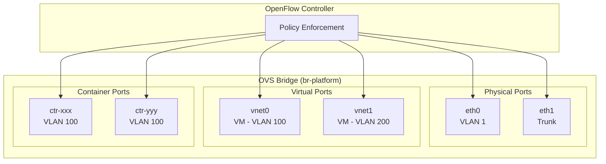

# SDN Architecture

> **Status: NORMATIVE** · Scope: `pkg/sdn/` (excluding `pkg/sdn/gateway/`), `pkg/switch/` · Last verified: 2026-08-18
> Conflicts with this document are defects. Fix them here first.
> The feature folder is: architecture (this file) · [engineering.md](engineering.md) ·
> [cli.md](cli.md) · [api.md](api.md) · [user.md](user.md).
>
> **Verification scope.** Package boundaries, the port state machine,
> configuration errors, CLI verbs and the transport matrix were re-checked
> against code on 2026-08-18. The diagrams and narrative below predate the
> feature-folder migration and were carried over rather than re-derived.

## The problem

A trusted-computing platform cannot inherit its network's trust model from the
network. A switch port that forwards because a cable is plugged into it makes
every other control — attestation, tenancy, workload admission — conditional on
physical access nobody is checking.

## The shape chosen

**The port is the enforcement point, and a device certificate is what opens
it.** A device presents an IDevID; the control plane validates it, decides the
device's zone, and programs OpenFlow rules that match that decision. Until then
the port is on a provisioning-only path or in quarantine.

Segmentation is layered: **zones** (the trust boundary), **VLANs** (the L2
boundary within a host), and **VXLAN/EVPN** (the L2 boundary across hosts).
Zones are the unit everything else is checked against, which is why five of the
twenty-two configuration errors are about the zone graph.

### Alternatives rejected

| Alternative | Why it was rejected |
|---|---|
| **802.1X with EAP and a RADIUS server** | It adds a second identity system, a second credential store and a second failure domain alongside the platform's own device identity. The platform already issues IDevIDs and already knows which device is which; making the network ask a RADIUS server the same question is duplication with a new outage mode. The state machine here validates certificates directly. |
| **Shelling out to `ovs-vsctl` / `ovs-ofctl`** | External command dependencies mean parsing human-oriented output, no typed errors, and a binary that must be present and version-matched on every node. The OVSDB and OpenFlow clients are implemented in Go. |
| **Trusting a VLAN tag as the trust boundary** | A VLAN tag is asserted by whatever is on the wire. A zone carried in an IDevID certificate (`encode_zone_in_cert`) is attested. VLANs remain the *mechanism*; zones are the *decision*. |
| **Letting an unauthenticated port default to a guest VLAN with internet access** | That converts an authentication failure into working connectivity, which is how default-allow gets shipped. An unauthenticated port reaches enrollment and nothing else. |
| **A `blocked` state that ages out** | Auto-recovery from a policy violation means the violation is not enforced, only delayed. `blocked` is a source state for no transition; clearing it is an administrative act. |
| **Validating network configuration lazily** | An inconsistent zone/pool/VLAN graph produces silent cross-zone reachability — traffic going where it should not, with nothing logged. Validation is eager and the subsystem refuses to start. |

## Component boundaries

| Piece | Package | Owner |
|---|---|---|
| OVS / OVSDB client, OpenFlow | `pkg/sdn/ovs`, `pkg/sdn/openflow` | this repo |
| Port authentication state machine, quarantine, zone flows | `pkg/sdn/policy` | this repo |
| IPAM, DHCP | `pkg/sdn/ipam`, `pkg/sdn/dhcp` | this repo |
| VLAN, VXLAN, tunnels, overlay | `pkg/sdn/vlan`, `vxlan`, `tunnel`, `overlay` | this repo |
| BGP speaker | `pkg/sdn/bgp` | this repo |
| Fabric, zones, cluster state | `pkg/sdn/fabric`, `zone`, `cluster` | this repo |
| Host networking (TAP, links, routes) | `pkg/sdn/netlink` | this repo |
| Physical switches | `pkg/switch` | this repo |
| **Edge gateway and reverse proxy** | `pkg/sdn/gateway`, `pkg/proxy` — [`docs/gateway/`](../gateway/) | this repo, separate feature |
| **Device certificates (IDevID) and the CA** | consumed through the quicbaas SDK | **not this repo** |
| **Device identity records and enrollment** | `pkg/device` — [`docs/device/`](../device/) | this repo |
| **Workload admission policy (OPA)** | `pkg/policy/opa` | this repo |

The §R capability row is *"SDN — bridges, ports, flows, IDevID port
authentication, VXLAN/EVPN overlay, IPAM, physical switch management"*, Tier 1,
reached through `services/sdn`, `services/overlay` and `services/switch` in the
platform SDK.

**Port authentication is a distinct engine from platform OPA.** `pkg/sdn/policy`
is the port state machine; `pkg/policy/opa` decides container admission. They
answer different questions and neither is a token-authorization decision point.

## Data flow — a device joining the network

1. Link comes up. Port state is `unconnected`.
2. The port moves to `provisioning`: flows permit only enrollment traffic.
3. The device enrolls and obtains an IDevID. Port state becomes `enrolled`.
4. The device activates; its certificate is validated. Port state moves through
   `authenticating` to `authorized`.
5. The zone is decided — from the certificate when `encode_zone_in_cert` is on,
   from configuration otherwise — and `zone_flow_manager` programs the flows
   that put the port in that zone's VLAN.
6. If any check fails, the port goes to `quarantined` (isolated VLAN,
   remediable) or `blocked` (administrative).

Steps 5 and 6 happen in the datapath. A quarantine that only set a database
field would not be a quarantine.

This flow describes a device attached through the OVS fabric. A device that
enrolls over the management LAN — a worker joining the control plane before
any fabric attach — has no port when enrollment completes: the certificate is
issued on the strength of the validated attestation, and the port state
machine engages when the device later attaches and the fabric learns its
port. The port is the enforcement point; with no port in the fabric there is
nothing to open, and refusing the certificate would enforce nothing.

## Trust boundaries

1. **Device → port.** Crossed by the IDevID certificate. Everything on the
   device side is untrusted until it validates.
2. **Certificate → zone.** With `encode_zone_in_cert`, the zone is inside the
   attested certificate. Without it, the zone comes from configuration keyed on
   something the device asserts — a weaker binding, and a deliberate choice
   somebody made.
3. **Host → host.** Crossed by VXLAN tunnels. The overlay transport network is
   its own segment; a compromised overlay endpoint reaches other endpoints.
4. **Control plane → physical switch.** Crossed by SSH. The switch's own
   credentials are outside the platform's trust chain.

## What this feature deliberately does not do

- **It does not speak EAP or RADIUS.** Certificate validation is direct.
- **It does not issue certificates.** The CA is reached through the stack.
- **It does not run the edge gateway.** BGP announcement, NAT, DHCP relay at the
  edge, PXE and the reverse proxy are [`docs/gateway/`](../gateway/), even
  though `sdn gateway` is where the CLI puts them.
- **It does not manage physical switches beyond VLAN assignment and port
  enable/disable.** Five operations, and that is the whole intended surface.
- **It does not make workload admission decisions.** That is platform OPA.
- **It does not defend an address it already holds.** The duplicate-address
  guard runs once, before assignment, and refuses a contested address. It is
  not a continuous RFC 5227 conflict-resolution loop, and it is not a
  first-party VRRP/HSRP speaker: the platform never shares a bridge address
  between two stations on purpose.

## Overview

The SDN subsystem provides certificate-based network access control with
OpenFlow for dynamic policy enforcement. All components are implemented in pure
Go without external command dependencies.

> **Corrected 2026-08-18.** This paragraph previously described the subsystem as
> "using 802.1X principles". It is IDevID-certificate port authentication: there
> is no EAP exchange and no RADIUS server anywhere in `pkg/sdn/policy`. The
> phrase led readers to look for an authenticator they would not find.

## Component Architecture

```
┌──────────────────────────────────────────────────────────────────────────┐
│                             Policy Engine                                │
│  (pkg/sdn/policy)                                                        │
│  ┌─────────────────────┐  ┌─────────────────────┐  ┌──────────────────┐  │
│  │ Port State Machine  │  │ Certificate Policy  │  │ Flow Rule        │  │
│  │ - State transitions │  │ - X.509 extraction  │  │ - ACL generation │  │
│  │ - Event handling    │  │ - Tenant ID         │  │ - VLAN rules     │  │
│  └─────────────────────┘  │ - VLAN assignment   │  │ - DROP rules     │  │
│                           └─────────────────────┘  └──────────────────┘  │
└───────────────┬────────────────────────────┬─────────────────────────────┘
                │                            │
    ┌───────────▼───────────┐      ┌─────────▼─────────┐
    │      OVS Client       │      │    ARP Reader     │
    │   (pkg/sdn/ovs)       │      │  (pkg/sdn/arp)    │
    │                       │      │                   │
    │  ┌─────────────────┐  │      │  Parse entries:   │
    │  │ OVSDB JSON-RPC  │  │      │  203.0.113.1      │
    │  │ - transact      │  │      │  0x1 0x2          │
    │  │ - list_dbs      │  │      │  aa:bb:cc:dd:ee:ff│
    │  │ - get_schema    │  │      │  * eth0           │
    │  └─────────────────┘  │      └───────────────────┘
    │                       │
    │  ┌─────────────────┐  │
    │  │ Bridge Mgmt     │  │
    │  │ - Create/Delete │  │
    │  │ - List          │  │
    │  └─────────────────┘  │
    │                       │
    │  ┌─────────────────┐  │
    │  │ Port Mgmt       │  │
    │  │ - Add/Remove    │  │
    │  │ - VLAN config   │  │
    │  │ - State (up/dn) │  │
    │  └─────────────────┘  │
    └───────────┬───────────┘
                │
    ┌───────────▼───────────┐
    │    OpenFlow Client    │
    │  (pkg/sdn/openflow)   │
    │                       │
    │  ┌─────────────────┐  │
    │  │ OF 1.3 Binary   │  │
    │  │ - Hello         │  │
    │  │ - Features      │  │
    │  │ - FlowMod       │  │
    │  │ - Barrier       │  │
    │  └─────────────────┘  │
    │                       │
    │  ┌─────────────────┐  │
    │  │ Match Fields    │  │
    │  │ - in_port       │  │
    │  │ - eth_dst/src   │  │
    │  │ - ip_dst/src    │  │
    │  │ - tcp/udp_dst   │  │
    │  └─────────────────┘  │
    │                       │
    │  ┌─────────────────┐  │
    │  │ Actions         │  │
    │  │ - output        │  │
    │  │ - set_vlan      │  │
    │  │ - pop_vlan      │  │
    │  │ - drop          │  │
    │  └─────────────────┘  │
    └───────────────────────┘
```

## Package Details

### pkg/sdn/arp

Pure Go ARP: a table reader, and the duplicate-address detector that guards
bridge addressing. Neither shells out — no `arping`, no `ip`.

The table reader parses `/proc/net/arp` directly without external commands.

```go
// Entry represents an ARP table entry
// Parse format: 203.0.113.1 0x1 0x2 aa:bb:cc:dd:ee:ff * eth0
type Entry struct {
    IP        string
    HWType    int
    Flags     int
    HWAddress string
    Mask      string
    Device    string
}
```

Key features:
- Reads real-time ARP cache from kernel
- Filters incomplete entries (00:00:00:00:00:00)
- Thread-safe lookups
- No external dependencies

`DuplicateAddressDetector` is the RFC 5227 probe platformd runs before it
assigns an address to an OVS bridge. It opens a raw `AF_PACKET` socket bound
to the bridge and filtered to the ARP EtherType, sends three probes whose
sender protocol address is `0.0.0.0`, and listens a second after each. A reply
or request carrying the probed address from a foreign MAC is a
`ConflictError` naming both hardware addresses.

```go
// ProbeTransport opens probe sessions; the production transport is the raw
// AF_PACKET socket, and tests substitute a fake so no test touches a segment.
type ProbeTransport interface {
    Open(iface string) (ProbeSession, error)
}
```

The interval is fixed rather than randomised as the RFC suggests: platformd
probes a few statically configured addresses once per boot, not a fleet of
clients booting together, so the probe storm the randomisation defends against
cannot arise. See [engineering.md](engineering.md) §5 for what the platform
does with the verdict.

### pkg/sdn/openflow

Native OpenFlow 1.3 protocol implementation over Unix socket.

**Supported Messages:**
- Hello / FeaturesRequest / FeaturesReply
- FlowMod (add/modify/delete)
- MultipartRequest/Reply (flow stats)
- BarrierRequest/Reply
- EchoRequest/Reply

**Match Fields:**
- in_port, eth_dst, eth_src, eth_type
- ip_dst, ip_src, ip_proto
- tcp_dst, udp_dst, vlan_vid

**Actions:**
- output, set_vlan, pop_vlan, drop, goto_table

```go
// Binary message format (big-endian)
type Header struct {
    Version uint8  // 0x04 for OF 1.3
    Type    uint8  // Message type
    Length  uint16 // Total length
    Xid     uint32 // Transaction ID
}
```

### pkg/sdn/ovs

OVSDB client implementing RFC 7047 JSON-RPC 2.0 protocol.

**Operations:**
- Transact (insert, update, delete, mutate, select)
- List databases
- Get schema
- Echo

**Managed Tables:**
- Bridge
- Port
- Interface
- Open_vSwitch

```go
// OVSDB transaction operation
type Operation struct {
    Op      string                 `json:"op"`
    Table   string                 `json:"table"`
    Where   []Condition            `json:"where,omitempty"`
    Row     map[string]interface{} `json:"row,omitempty"`
    Columns []string               `json:"columns,omitempty"`
}
```

### pkg/sdn/netlink

TAP device management using netlink protocol.

- Create/delete TAP devices
- Set link state (up/down)
- Set device owner (UID/GID)
- MTU configuration

### pkg/sdn/policy

802.1X-style port authentication with certificate-based policies.

**Port State Machine:**

```
┌────────────────────────┐
│      Unconnected       │  Port not detected
└───────────┬────────────┘
            │ device connects
┌───────────▼────────────┐
│      Provisioning      │  VLAN 998 - Limited access
│                        │  (DHCP, DNS, HTTPS to platform)
└───────────┬────────────┘
            │ enrollment complete
┌───────────▼────────────┐
│        Enrolled        │  Still VLAN 998 - Awaiting activation
└───────────┬────────────┘
            │ client activates
┌───────────▼────────────┐
│       Authorized       │  Production VLAN - Full access per ACLs
└───────────┬────────────┘
            │ cert expired/compliance
┌───────────▼────────────┐
│      Quarantined       │  VLAN 666 - Isolated for remediation
└───────────┬────────────┘
            │ cert revoked
┌───────────▼────────────┐
│        Blocked         │  DROP all traffic
└────────────────────────┘
```

**Certificate Policy Extraction:**

Policies encoded in IDevID certificate extensions:
- Tenant ID (from Subject.Organization)
- VLAN assignment (custom OID or profile lookup)
- ACL rules (from profile)
- Rate limits (future)

## OVS/OVSDB Integration

```
┌───────────────────┐            ┌─────────────────────┐
│     Platform      │            │    ovsdb-server     │
│   (SDN Client)    │            │                     │
│                   │   Unix     │   ┌─────────────┐   │
│  ┌─────────────┐  │  Socket    │   │ Open_vSwitch│   │
│  │ OVS Client  │──────┬───────────>│ Bridge      │   │
│  └─────────────┘  │   │        │   │ Port        │   │
│                   │   │        │   │ Interface   │   │
└───────────────────┘   │        └───┴─────────────┴───┘
                        │                  │
                        │        ┌─────────▼─────────┐
                        │        │   ovs-vswitchd    │
                        │        │                   │
                        └───────>│  ┌─────────────┐  │
                          Mgmt   │  │  OpenFlow   │  │
                         Socket  │  │  Datapath   │  │
                                 │  └─────────────┘  │
                                 └───────────────────┘
```

### Connection Flow

```
Client                             ovsdb-server
   │                                     │
   │──── Connect (Unix socket) ─────────>│
   │                                     │
   │──── list_dbs ──────────────────────>│
   │<─── ["Open_vSwitch"] ───────────────│
   │                                     │
   │──── transact [ops...] ─────────────>│
   │<─── [{uuid, rows}, ...] ────────────│
```

## OpenFlow Integration

```
Client                             ovs-vswitchd
   │                                     │
   │──── Connect (br0.mgmt socket) ─────>│
   │                                     │
   │──── Hello (OF 1.3) ────────────────>│
   │<─── Hello (OF 1.3) ─────────────────│
   │                                     │
   │──── FeaturesRequest ───────────────>│
   │<─── FeaturesReply ──────────────────│
   │                                     │
   │──── FlowMod (add flow) ────────────>│
   │──── BarrierRequest ────────────────>│
   │<─── BarrierReply ───────────────────│
```

## TAP/Netlink Integration

```
┌───────────────────┐            ┌───────────────────┐
│     Platform      │            │   Linux Kernel    │
│  (Compute Orch.)  │            │                   │
│                   │  Netlink   │   ┌───────────┐   │
│  ┌─────────────┐  │  Socket    │   │  TAP/TUN  │   │
│  │ TAP Manager │──────┬───────────>│  Driver   │   │
│  └─────────────┘  │   │        │   └───────────┘   │
│                   │   │        │         │         │
└───────────────────┘   │        │   ┌─────▼─────┐   │
                        │        │   │ veth pair │   │
      VM (QEMU)         │        │   └───────────┘   │
   ┌─────────────┐      │        │         │         │
   │ virtio-net  │──────┴────────┼─────────┘         │
   └─────────────┘               │                   │
                                 └───────────────────┘
```

## Thread Safety

All clients use mutex protection for concurrent access:
- OVSDB client: Single connection, serialized requests
- OpenFlow client: Atomic transaction IDs, pending response map
- ARP reader: Lock-free reads from /proc filesystem
- Policy engine: RWMutex for state machine access

## Error Handling

All packages use typed errors:

```go
// pkg/sdn/ovs/errors.go
var (
    ErrNotConnected      = errors.New("not connected to OVSDB")
    ErrBridgeNotFound    = errors.New("bridge not found")
    ErrPortNotFound      = errors.New("port not found")
    ErrTransactionFailed = errors.New("OVSDB transaction failed")
    ErrInvalidSocket     = errors.New("invalid socket path")
    ErrConnectionFailed  = errors.New("connection failed")
    ErrConnectionClosed  = errors.New("connection closed")
)

// pkg/sdn/openflow/errors.go
var (
    ErrNotConnected     = errors.New("not connected")
    ErrVersionMismatch  = errors.New("OpenFlow version mismatch")
    ErrTimeout          = errors.New("operation timed out")
    ErrSocketNotFound   = errors.New("management socket not found")
)

// pkg/sdn/policy/errors.go
var (
    ErrInvalidPortID     = errors.New("invalid port ID")
    ErrInvalidPolicy     = errors.New("invalid policy")
    ErrInvalidState      = errors.New("invalid state transition")
    ErrInvalidVLAN       = errors.New("invalid VLAN ID")
    ErrPolicyNotFound    = errors.New("policy not found")
    ErrFlowInstallFailed = errors.New("flow installation failed")
    ErrFlowDeleteFailed  = errors.New("flow deletion failed")
)
```

## VLAN Configuration

### Reserved VLANs

| VLAN | Purpose | Access |
|------|---------|--------|
| 998 | Provisioning | DHCP, DNS, HTTPS to platform |
| 666 | Quarantine | Isolated remediation network |
| 1-997, 999-4094 | Production | Full access per ACLs |

### Provisioning VLAN Flows

```
# Allow DHCP
priority=100,udp,tp_dst=67,actions=normal
priority=100,udp,tp_dst=68,actions=normal

# Allow DNS
priority=100,udp,tp_dst=53,actions=normal
priority=100,tcp,tp_dst=53,actions=normal
priority=100,udp,tp_dst=8053,actions=normal
priority=100,tcp,tp_dst=8053,actions=normal

# Allow HTTPS to platform
priority=100,tcp,tp_dst=443,actions=normal
priority=100,tcp,tp_dst=8443,actions=normal

# Drop all other traffic
priority=0,actions=drop
```

## Performance Considerations

- OpenFlow client maintains connection pool per bridge
- Related OVSDB operations (e.g., bridge/port/interface creation) are combined into single multi-operation transactions
- ARP lookups are O(n) but table is typically small
- Policy engine caches port states in memory
- Flow rules use priority-based matching for efficiency

## Security Considerations

1. **Unix Socket Authentication** - OVSDB and OpenFlow use Unix sockets
2. **Certificate Validation** - IDevID certificates validated before policy
3. **Flow Rule Isolation** - Each port has isolated flow rules
4. **VLAN Segmentation** - Provisioning and quarantine VLANs isolated
5. **Defense in Depth** - Both OpenFlow DROP and OVSDB admin_state=down for blocking

## Unified Network Model (Host + VMs + Containers)

The SDN subsystem provides a unified network model where host traffic, VMs, and containers all flow through the same OVS/OpenFlow pipeline. This enables consistent policy enforcement across all workload types.

### Architecture Overview



### Physical NIC Management

Physical NICs can be added to OVS bridges, placing all traffic under OpenFlow control:

```go
// HostNetworkConfig for physical NIC management
type HostNetworkConfig struct {
    // Physical NICs to add to OVS management
    PhysicalInterfaces []PhysicalInterface

    // Host traffic policies (applied to host's own traffic)
    HostPolicies []OpenFlowRule
}

type PhysicalInterface struct {
    Name       string   // e.g., "eth0", "enp3s0"
    Bridge     string   // OVS bridge to attach to
    VLANID     uint16   // VLAN for host traffic on this NIC
    Trunk      bool     // If true, passes all VLANs (trunk port)
    TrunkVLANs []uint16 // Specific VLANs if trunk
}
```

### Unified Port Diagram

```
+-------------------------------------------------------------+
|                    OpenFlow Controller                       |
|               (Unified Policy Enforcement)                   |
+-------------------------------------------------------------+
                              |
                              v
+-------------------------------------------------------------+
|                       OVS Bridge                             |
|                      (br-platform)                           |
+----------+----------+----------+----------+-----------------+
|   eth0   |   eth1   |  vnet0   | ctr-xxx  |      ...        |
|  (host)  | (trunk)  |   (VM)   |(container)|                |
|  VLAN 1  |  trunk   | VLAN 100 | VLAN 100 |                 |
+----------+----------+----------+----------+-----------------+

All traffic (host + VM + container) flows through OpenFlow pipeline
Same security groups and policies apply uniformly
```

### Host Traffic Policies via OpenFlow

When physical NICs are added to OVS, host traffic can be controlled with OpenFlow rules:

```yaml
device_profile:
  name: "trusted-compute-node"

  network:
    ovs_bridge: "br-platform"

    # Physical NICs under OVS/OpenFlow control
    physical_interfaces:
      - name: "eth0"
        bridge: "br-platform"
        vlan: 1              # Management VLAN for host
        trunk: false

      - name: "eth1"
        bridge: "br-platform"
        trunk: true          # Trunk for VM/container traffic
        trunk_vlans: [100, 200, 300]

    # Host traffic policies (host's own traffic, not VM/container)
    host_policies:
      - name: "allow-ssh"
        match:
          in_port: "eth0"
          dl_type: 0x0800
          nw_proto: 6
          tp_dst: 22
        actions: [allow]

      - name: "allow-platformd-api"
        match:
          in_port: "eth0"
          dl_type: 0x0800
          nw_proto: 6
          tp_dst: 8443
        actions: [allow]

      - name: "deny-host-default"
        match:
          in_port: "eth0"
        actions: [drop]
        priority: 1  # Low priority catch-all
```

### Container Network Configuration

Containers use the same network model as VMs:

```go
// ContainerNetworkConfig from Device Profile
type ContainerNetworkConfig struct {
    // Network mode
    Mode NetworkMode  // bridge, host, none, sdn

    // SDN/OVS configuration (when Mode == sdn)
    SDN *SDNConfig

    // OpenFlow policies applied to this container
    OpenFlowRules []OpenFlowRule
}

type SDNConfig struct {
    // OVS bridge to attach container
    Bridge string  // e.g., "br-containers"

    // VLAN assignment
    VLANID uint16  // Unique VLAN for isolation

    // Port configuration
    OVSPort string  // OVS port name for container

    // OpenFlow table/priority for this container
    FlowTable    int
    FlowPriority int

    // Security groups (translated to OpenFlow rules)
    SecurityGroups []string
}
```

### Device Profile Example (VMs + Containers)

```yaml
device_profile:
  name: "production-web-tier"

  network:
    ovs_bridge: "br-platform"
    default_vlan: 100

    # OpenFlow controller
    openflow:
      controller: "tcp:127.0.0.1:6653"
      version: "1.3"

    # Security groups (reusable across VMs and containers)
    security_groups:
      - name: "web-frontend"
        rules:
          - direction: ingress
            protocol: tcp
            port: 443
            action: allow
          - direction: egress
            protocol: tcp
            port: 5432
            action: allow  # DB access

      - name: "backend-services"
        rules:
          - direction: ingress
            protocol: tcp
            port_range: "8080-8090"
            action: allow

  # VMs use unified network model
  vms:
    - name: "db-server"
      vlan: 200
      security_groups: ["backend-services"]

  # Containers use unified network model
  containers:
    - name: "web-api"
      image: "registry.example.com/api:v1.2"
      network:
        mode: sdn
        vlan: 100
        security_groups: ["web-frontend"]

    - name: "worker"
      image: "registry.example.com/worker:v1.0"
      network:
        mode: sdn
        vlan: 100
        security_groups: ["backend-services"]
```

### Container Network Setup Flow

```go
// NetworkManager integrates containers with SDN
func (n *NetworkManager) SetupContainerNetwork(ctx context.Context,
    containerID string, cfg *ContainerNetworkConfig) error {

    if cfg.Mode != NetworkModeSDN {
        return n.setupStandardNetwork(ctx, containerID, cfg)
    }

    // 1. Create OVS port for container
    portName := fmt.Sprintf("ctr-%s", containerID[:12])
    if err := n.ovs.AddPort(cfg.SDN.Bridge, portName); err != nil {
        return err
    }

    // 2. Set VLAN tag on port
    if err := n.ovs.SetPortVLAN(portName, cfg.SDN.VLANID); err != nil {
        return err
    }

    // 3. Install OpenFlow rules for container
    for _, rule := range cfg.OpenFlowRules {
        if err := n.openflow.AddFlow(rule); err != nil {
            return err
        }
    }

    // 4. Apply security group rules as OpenFlow
    for _, sg := range cfg.SDN.SecurityGroups {
        flows := n.securityGroupToFlows(sg, portName, cfg.SDN.VLANID)
        for _, flow := range flows {
            if err := n.openflow.AddFlow(flow); err != nil {
                return err
            }
        }
    }

    return nil
}
```

### Benefits of Unified Model

| Benefit | Description |
|---------|-------------|
| **Single Policy Model** | Same security groups apply to host, VMs, and containers |
| **Consistent Enforcement** | All traffic through OpenFlow pipeline |
| **Host Hardening** | Host traffic controlled via OpenFlow (not just iptables) |
| **Micro-segmentation** | Fine-grained isolation between all workload types |
| **Centralized Visibility** | Single point for traffic monitoring and logging |
| **Simplified Operations** | One tool (OpenFlow) for all network policies |

### Traffic Control Capabilities

The unified model supports:

- **Ingress/Egress Filtering** - Per-port and per-workload filtering
- **Rate Limiting** - Traffic shaping per container/VM
- **QoS Classes** - Priority queues from Device Profile
- **Micro-segmentation** - East-west traffic policies between containers
- **VLAN Isolation** - Layer 2 separation between workloads
- **Security Groups** - Reusable policy definitions
