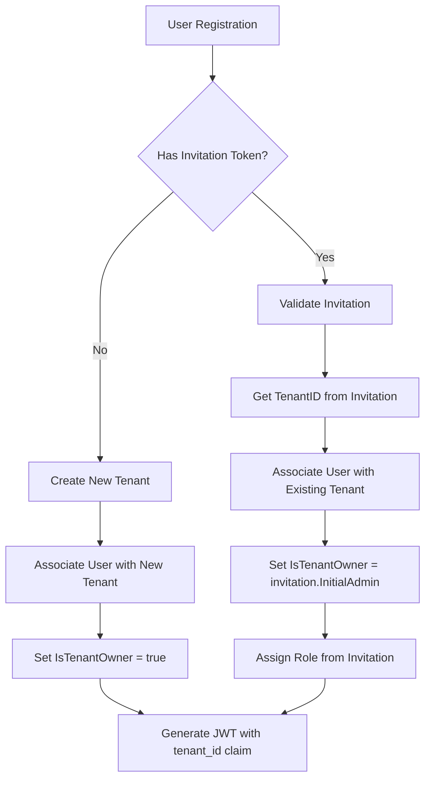

# Tenant Architecture

> **Status: NORMATIVE** · Scope: `pkg/tenant/` · Last verified: 2026-08-18
> Conflicts with this document are defects. Fix them here first.
> The feature folder is: architecture (this file) · [engineering.md](engineering.md) ·
> [cli.md](cli.md) · [api.md](api.md) · [user.md](user.md).
>
> **Verification scope.** Package layout, the state machine, quota fields, CLI
> flags, error names and the transport matrix were checked against code on
> 2026-08-18. The narrative below predates the migration and was carried over.

## The problem

Multi-tenancy on an ordinary platform is a filter: rows carry a tenant column
and queries add a predicate. On a platform whose premise is hardware-rooted
isolation, a filter is the wrong mechanism — a bug in one query, or one code
path that forgets the predicate, and the isolation is gone with nothing to
detect it.

## The shape chosen

A tenant is **four independent allocations plus a quota**, each enforced by a
different layer:

| Allocation | Enforced by |
|---|---|
| **VLAN** | The datapath — traffic is separated in OVS, not in application code |
| **Bridge** | The datapath — the tenant's ports attach to its own bridge |
| **Keyspace** | The key path in the store — separation is in the key, not in a read-time filter |
| **DEK** | Encryption at rest — a tenant's data is unreadable without its key |
| **Quota** | Admission — `HasCapacity` before allocation, not accounting after |

An escape therefore requires defeating a network datapath, a key path and an
encryption key, rather than missing one `WHERE` clause.

Optionally, a **per-tenant barrier** seals the tenant's data cryptographically
until unsealed.

### Alternatives rejected

| Alternative | Why it was rejected |
|---|---|
| **A tenant column and query filters** | One forgotten predicate is a total isolation failure with no signal. Isolation belongs in mechanisms that fail visibly. |
| **One shared DEK with per-tenant subkeys derived at read time** | A single compromise reaches every tenant, and rotation becomes all-or-nothing. Per-tenant DEKs make rotation a per-tenant operation. |
| **Namespaces without VLANs** | Container/process namespaces do not separate layer 2. Two tenants on one host would share a broadcast domain. |
| **Soft quotas measured after the fact** | Accounting after allocation means the limit is advisory. `CheckQuota` and `HasCapacity` run before. |
| **Reversible deletion (a "deleted" state you can leave)** | A tenant's VLAN, bridge, keyspace and DEK are released on deletion. A state you can return from would have to hold those allocations indefinitely, which is what deletion was for. `deleted` is terminal. |
| **Strict transitions with no same-state allowance** | Retried API calls and reconciliation loops would fail on the second attempt. `CanTransitionTo` permits same-state transitions for idempotency. |

## Component boundaries

| Piece | Package | Owner |
|---|---|---|
| Tenant manager, entity, lifecycle | `pkg/tenant/manager.go`, `entity.go`, `state.go` | this repo |
| Quotas and usage | `pkg/tenant/quotas.go`, `quota/` | this repo |
| VLAN allocation | `pkg/tenant/vlan/` | this repo |
| Bridge lifecycle | `pkg/tenant/bridge/` | this repo |
| Keyspace | `pkg/tenant/keyspace.go` | this repo |
| DEK operations | `pkg/tenant/dek_client.go` — wraps `quicbaas.DEKClient` | **delegates to the stack** |
| **Key management** | consumed through the quicbaas SDK | **not this repo** |
| **Barrier** | consumed through the quicbaas SDK | **not this repo** |
| **Storage** | consumed through the quicbaas SDK | **not this repo** |
| **VLANs and bridges in the datapath** | `pkg/sdn/` — [`docs/sdn/`](../sdn/) | this repo, separate feature |
| **Users, groups, roles** | IAM — [`docs/iam/`](../iam/) | **not this feature** |

The §R capability row is *"Platform tenancy (VLAN/keyspace/quota)"*, Tier 1,
reached through `services/tenant`.

**Key material is never a raw byte slice here.** `TenantDEKClient` delegates to
the stack's DEK client. This repository sits above Layer 3 and uses the stack's
owned abstractions rather than coding protected memory directly.

## Trust boundaries

1. **Tenant → tenant.** The one this feature exists to establish. Crossed only
   by defeating the VLAN, the keyspace and the DEK.
2. **Platform → tenant DEK.** The DEK is managed by the stack's key management,
   not held here. Rotation rewraps the key and leaves the data alone.
3. **Barrier.** When sealed, a tenant's data is inaccessible until an unseal key
   is supplied. The unseal key is the highest-value secret in the feature and
   passes through the CLI as `--key-hex` / `--key-base64` — see
   [cli.md](cli.md) §5.
4. **Tenant administration.** Currently reachable with any validated token on
   gRPC, Unix, MCP and embedded, with no required scope — including barrier
   init, seal and unseal. Recorded in [api.md](api.md) §7 and raised for the
   owner.

## What this feature deliberately does not do

- **It does not manage identities.** Users, groups, roles and policies are IAM's.
  IAM has its own tenant scoping, which is a different thing from a platform
  tenant — see [api.md](api.md) §6.
- **It does not manage keys.** DEKs and barriers come from the stack.
- **It does not program the datapath.** It allocates a VLAN and a bridge name;
  SDN makes them real.
- **It does not support undeleting a tenant.** See the rejected alternatives.

## System Architecture

```
╔═══════════════════════════════════════════════════════════════════════════════╗
║                          TRUSTED PLATFORM MULTI-TENANCY                       ║
╠═══════════════════════════════════════════════════════════════════════════════╣
║                                                                               ║
║  ┌─────────────────────────────────────────────────────────────────────────┐  ║
║  │                         API / CLI Layer                                 │  ║
║  │                                                                         │  ║
║  │  ┌─────────────┐  ┌───────────────┐  ┌────────────────┐  ┌────────────┐ │  ║
║  │  │ platformctl │  │ REST Gateway  │  │ gRPC Services  │  │ Web Console│ │  ║
║  │  └──────┬──────┘  └───────┬───────┘  └────────┬───────┘  └─────┬──────┘ │  ║
║  │         │                 │                   │                │        │  ║
║  └─────────┼─────────────────┼───────────────────┼────────────────┼────────┘  ║
║            │                 │                   │                │           ║
║  ┌─────────┴─────────────────┴───────────────────┴────────────────┴────────┐  ║
║  │                      TENANT SERVICE LAYER                               │  ║
║  │                                                                         │  ║
║  │  ┌───────────────────┐  ┌────────────────────┐  ┌────────────────────┐  │  ║
║  │  │  TenantManager    │  │   QuotaEnforcer    │  │  ResourceAllocator │  │  ║
║  │  │                   │  │                    │  │                    │  │  ║
║  │  │  • CRUD ops       │  │  • Pre-allocation  │  │  • OVS bridges     │  │  ║
║  │  │  • State machine  │  │  • Usage tracking  │  │  • VLAN ranges     │  │  ║
║  │  │  • Validation     │  │  • Quota policies  │  │  • DEK generation  │  │  ║
║  │  └───────────────────┘  └────────────────────┘  └────────────────────┘  │  ║
║  │                                                                         │  ║
║  └─────────┬────────────────────┬────────────────────┬─────────────────────┘  ║
║            │                    │                    │                        ║
║  ┌─────────▼─────────┐ ┌────────▼────────┐ ┌────────▼─────────┐               ║
║  │   QuicBaaS        │ │   SDN Service   │ │   Key Service    │               ║
║  │   (Raft)          │ │   (OVS/OF)      │ │   (TPM/KMS)      │               ║
║  │                   │ │                 │ │                  │               ║
║  │  • TenantEntity   │ │  • Bridge mgmt  │ │  • DEK creation  │               ║
║  │  • QuotaEntity    │ │  • VLAN config  │ │  • Key sealing   │               ║
║  │  • AuditEntity    │ │  • Flow rules   │ │  • Key rotation  │               ║
║  └───────────────────┘ └─────────────────┘ └──────────────────┘               ║
║                                                                               ║
╚═══════════════════════════════════════════════════════════════════════════════╝
```

## Tenant Isolation Model

```
╔═══════════════════════════════════════════════════════════════════════════════╗
║                         TENANT ISOLATION ARCHITECTURE                         ║
╠═══════════════════════════════════════════════════════════════════════════════╣
║                                                                               ║
║   TENANT A (engineering)              TENANT B (production)                   ║
║   ╔══════════════════════╗            ╔══════════════════════╗                ║
║   ║                      ║            ║                      ║                ║
║   ║  ┌────────────────┐  ║            ║  ┌────────────────┐  ║                ║
║   ║  │ OVS Bridge     │  ║            ║  │ OVS Bridge     │  ║                ║
║   ║  │ br-tenant-eng  │  ║            ║  │ br-tenant-prod │  ║                ║
║   ║  └───────┬────────┘  ║            ║  └───────┬────────┘  ║                ║
║   ║          │           ║            ║          │           ║                ║
║   ║  ┌───────▼────────┐  ║            ║  ┌───────▼────────┐  ║                ║
║   ║  │ VLAN Namespace │  ║            ║  │ VLAN Namespace │  ║                ║
║   ║  │ VLANs 100-199  │  ║            ║  │ VLANs 200-299  │  ║                ║
║   ║  └────────────────┘  ║            ║  └────────────────┘  ║                ║
║   ║          │           ║            ║          │           ║                ║
║   ║  ┌───────▼────────┐  ║            ║  ┌───────▼────────┐  ║                ║
║   ║  │ VMs/Containers │  ║  ISOLATED  ║  │ VMs/Containers │  ║                ║
║   ║  │ vm-eng-001     │◀─╬────────────╬─▶│ vm-prod-001    │  ║                ║
║   ║  │ vm-eng-002     │  ║            ║  │ vm-prod-002    │  ║                ║
║   ║  └────────────────┘  ║            ║  └────────────────┘  ║                ║
║   ║          │           ║            ║          │           ║                ║
║   ║  ┌───────▼────────┐  ║            ║  ┌───────▼────────┐  ║                ║
║   ║  │ Per-Tenant DEK │  ║            ║  │ Per-Tenant DEK │  ║                ║
║   ║  │ DEK-eng        │  ║            ║  │ DEK-prod       │  ║                ║
║   ║  │ (TPM-sealed)   │  ║            ║  │ (TPM-sealed)   │  ║                ║
║   ║  └────────────────┘  ║            ║  └────────────────┘  ║                ║
║   ║                      ║            ║                      ║                ║
║   ╚══════════════════════╝            ╚══════════════════════╝                ║
║                                                                               ║
╚═══════════════════════════════════════════════════════════════════════════════╝
```

## Per-Tenant Resources

### Network Resources

Each tenant receives dedicated network infrastructure:

| Resource | Naming Convention | Purpose |
|----------|-------------------|---------|
| OVS Bridge | `br-tenant-{name}` | Primary network bridge for tenant |
| VLAN Range | Configurable (e.g., 100-199) | L2 isolation for tenant workloads |
| Flow Tables | `tenant:{id}:flows` | OpenFlow rules for tenant traffic |
| ACL Rules | `tenant:{id}:acls` | Access control policies |

```
                     ┌───────────────────────────┐
                     │   br-tenant-engineering   │
                     └─────────────┬─────────────┘
                                   │
              ┌────────────────────┼────────────────────┐
              │                    │                    │
        ┌─────▼─────┐        ┌─────▼─────┐        ┌─────▼─────┐
        │  VLAN 100 │        │  VLAN 101 │        │  VLAN 102 │
        │ (web tier)│        │ (app tier)│        │ (db tier) │
        └─────┬─────┘        └─────┬─────┘        └─────┬─────┘
              │                    │                    │
        ┌─────▼─────┐        ┌─────▼─────┐        ┌─────▼─────┐
        │ vm-web-01 │        │ vm-app-01 │        │ vm-db-01  │
        │ vm-web-02 │        │ vm-app-02 │        │ vm-db-02  │
        └───────────┘        └───────────┘        └───────────┘
```

### Compute Resources

Tenant compute quotas are tracked and enforced:

```go
type ComputeQuota struct {
    // Instance limits
    MaxVMs         int64  // Maximum VM instances
    MaxContainers  int64  // Maximum containers

    // Resource limits
    MaxVCPUs       int64  // Total vCPU allocation
    MaxMemoryMB    int64  // Total memory in MB
    MaxDiskGB      int64  // Total disk storage in GB

    // Usage tracking (updated in real-time)
    UsedVMs        int64
    UsedContainers int64
    UsedVCPUs      int64
    UsedMemoryMB   int64
    UsedDiskGB     int64
}
```

### Key Isolation

Per-tenant cryptographic key hierarchy:

```
┌───────────────────────────┐
│   Platform Master Key     │
│   (TPM-sealed)            │
└─────────────┬─────────────┘
              │
    ┌─────────┴─────────┐
    │                   │
┌───▼───┐           ┌───▼───┐
│ KEK-A │           │ KEK-B │   Key Encryption Keys
│ (eng) │           │ (prod)│   (per-tenant)
└───┬───┘           └───┬───┘
    │                   │
┌───▼───┐           ┌───▼───┐
│ DEK-A │           │ DEK-B │   Data Encryption Keys
│ (eng) │           │ (prod)│   (per-tenant, TPM-sealed)
└───┬───┘           └───┬───┘
    │                   │
    ▼                   ▼
┌─────────┐         ┌─────────┐
│ Tenant  │         │ Tenant  │
│ Data A  │         │ Data B  │
└─────────┘         └─────────┘
```

## QuicBaaS TenantManager Integration

### Entity Schema

```go
// TenantEntity stored in QuicBaaS
type TenantEntity struct {
    // Primary key
    ID          uint64    `quicbaas:"pk"`

    // Unique identifiers
    TenantID    string    `quicbaas:"index"`  // UUID
    Name        string    `quicbaas:"unique"` // Human-readable

    // Configuration
    DisplayName string
    State       TenantState
    VLANRange   VLANRange

    // Resource allocation
    OVSBridge   string
    DEKHandle   uint32    // TPM handle for DEK

    // Quotas (embedded)
    ComputeQuota  ComputeQuota
    NetworkQuota  NetworkQuota
    StorageQuota  StorageQuota

    // Metadata
    Labels      map[string]string
    Annotations map[string]string

    // Timestamps
    CreatedAt   time.Time
    UpdatedAt   time.Time
    DeletedAt   *time.Time  // Soft delete
}
```

### QuicBaaS Operations

```go
// TenantManager uses QuicBaaS for persistent storage
type TenantManager struct {
    db     *quicbaas.Client
    logger *logging.Logger
}

// Create stores a new tenant with Raft consensus
func (tm *TenantManager) Create(ctx context.Context, tenant *TenantEntity) error {
    data, err := json.Marshal(tenant)
    if err != nil {
        return ErrSerializationFailed{Cause: err}
    }

    return tm.db.Put(ctx, "tenant", tenant.ID, data)
}

// Get retrieves a tenant with linearizable read
func (tm *TenantManager) Get(ctx context.Context, id uint64) (*TenantEntity, error) {
    data, found, err := tm.db.Get(ctx, "tenant", id)
    if err != nil {
        return nil, err
    }
    if !found {
        return nil, ErrTenantNotFound{ID: id}
    }

    var tenant TenantEntity
    if err := json.Unmarshal(data, &tenant); err != nil {
        return nil, ErrDeserializationFailed{Cause: err}
    }
    return &tenant, nil
}

// Query finds tenants by name using secondary index
func (tm *TenantManager) FindByName(ctx context.Context, name string) (*TenantEntity, error) {
    entities, err := tm.db.Query(ctx, "tenant", "name", []byte(name))
    if err != nil {
        return nil, err
    }
    if len(entities) == 0 {
        return nil, ErrTenantNotFound{Name: name}
    }

    var tenant TenantEntity
    if err := json.Unmarshal(entities[0].Data, &tenant); err != nil {
        return nil, ErrDeserializationFailed{Cause: err}
    }
    return &tenant, nil
}
```

## Data Flow Diagrams

### Tenant Creation Flow

```
┌──────────┐    ┌───────────────┐    ┌───────────────┐    ┌──────────┐    ┌──────────┐
│  Client  │    │ TenantManager │    │ QuicBaaS/Raft │    │ OVS/SDN  │    │ KMS/TPM  │
└────┬─────┘    └───────┬───────┘    └───────┬───────┘    └────┬─────┘    └────┬─────┘
     │                  │                    │                 │               │
     │ CreateTenant     │                    │                 │               │
     │─────────────────▶│                    │                 │               │
     │                  │                    │                 │               │
     │                  │ Validate request   │                 │               │
     │                  │────┐               │                 │               │
     │                  │    │               │                 │               │
     │                  │◀───┘               │                 │               │
     │                  │                    │                 │               │
     │                  │ Put(TenantEntity)  │                 │               │
     │                  │───────────────────▶│                 │               │
     │                  │                    │                 │               │
     │                  │                    │ Raft Propose    │               │
     │                  │                    │────┐            │               │
     │                  │                    │    │ (replicate)│               │
     │                  │                    │◀───┘            │               │
     │                  │                    │                 │               │
     │                  │ Success            │                 │               │
     │                  │◀───────────────────│                 │               │
     │                  │                    │                 │               │
     │                  │ CreateBridge       │                 │               │
     │                  │─────────────────────────────────────▶│               │
     │                  │                    │                 │               │
     │                  │                    │       OVSDB     │               │
     │                  │                    │       Insert    │               │
     │                  │                    │       ┌────┐    │               │
     │                  │                    │       │    │    │               │
     │                  │                    │       └◀───┘    │               │
     │                  │                    │                 │               │
     │                  │ Bridge created     │                 │               │
     │                  │◀─────────────────────────────────────│               │
     │                  │                    │                 │               │
     │                  │ GenerateDEK        │                 │               │
     │                  │─────────────────────────────────────────────────────▶│
     │                  │                    │                 │               │
     │                  │                    │                 │   TPM Create  │
     │                  │                    │                 │   ┌────┐      │
     │                  │                    │                 │   │    │      │
     │                  │                    │                 │   └◀───┘      │
     │                  │                    │                 │               │
     │                  │ DEK handle         │                 │               │
     │                  │◀─────────────────────────────────────────────────────│
     │                  │                    │                 │               │
     │                  │ Update tenant      │                 │               │
     │                  │───────────────────▶│                 │               │
     │                  │                    │                 │               │
     │ Tenant created   │                    │                 │               │
     │◀─────────────────│                    │                 │               │
     │                  │                    │                 │               │
```

### Resource Allocation Flow

```
┌──────────┐    ┌───────────────┐    ┌───────────────┐    ┌──────────────┐
│  Client  │    │ QuotaEnforcer │    │ TenantManager │    │   QuicBaaS   │
└────┬─────┘    └───────┬───────┘    └───────┬───────┘    └──────┬───────┘
     │                  │                    │                   │
     │ CreateVM         │                    │                   │
     │─────────────────▶│                    │                   │
     │                  │                    │                   │
     │                  │ GetTenant          │                   │
     │                  │───────────────────▶│                   │
     │                  │                    │                   │
     │                  │                    │ Get(tenant_id)    │
     │                  │                    │──────────────────▶│
     │                  │                    │                   │
     │                  │                    │ TenantEntity      │
     │                  │                    │◀──────────────────│
     │                  │                    │                   │
     │                  │ TenantEntity       │                   │
     │                  │◀───────────────────│                   │
     │                  │                    │                   │
     │                  │ CheckQuota         │                   │
     │                  │────┐               │                   │
     │                  │    │ (local check) │                   │
     │                  │◀───┘               │                   │
     │                  │                    │                   │
     │  [If within quota]                    │                   │
     │                  │                    │                   │
     │                  │ IncrementUsage     │                   │
     │                  │───────────────────▶│                   │
     │                  │                    │                   │
     │                  │                    │ Put(updated)      │
     │                  │                    │──────────────────▶│
     │                  │                    │                   │
     │                  │                    │ Raft consensus    │
     │                  │                    │          ┌────┐   │
     │                  │                    │          │    │   │
     │                  │                    │          └◀───┘   │
     │                  │                    │                   │
     │                  │                    │ Success           │
     │                  │                    │◀──────────────────│
     │                  │                    │                   │
     │                  │ Quota updated      │                   │
     │                  │◀───────────────────│                   │
     │                  │                    │                   │
     │ VM Created       │                    │                   │
     │◀─────────────────│                    │                   │
     │                  │                    │                   │
```

## State Machine

### Tenant States

```
                           ┌───────────────────┐
                           │      CREATED      │
                           │  (initial state)  │
                           └─────────┬─────────┘
                                     │
                           provision_resources()
                                     │
                           ┌─────────▼─────────┐
           ┌──────────────▶│      ACTIVE       │◀──────────────┐
           │               │   (operational)   │               │
           │               └─────────┬─────────┘               │
           │                         │                         │
       resume()              suspend() │ delete()          resume()
           │                    │      │                       │
           │          ┌─────────▼──────┴───────┐               │
           │          │                        │               │
           │   ┌──────▼──────┐          ┌──────▼──────┐        │
           └───│  SUSPENDED  │          │   DELETING  │        │
               │   (paused)  │          │  (cleanup)  │        │
               └──────┬──────┘          └──────┬──────┘        │
                      │                        │               │
                delete()               cleanup_complete()      │
                      │                        │               │
                      │                 ┌──────▼──────┐        │
                      └────────────────▶│   DELETED   │────────┘
                                        │  (terminal) │
                                        └─────────────┘
```

### State Transition Rules

```go
// Valid state transitions
var validTransitions = map[TenantState][]TenantState{
    StateCreated:   {StateActive, StateDeleting},
    StateActive:    {StateSuspended, StateDeleting},
    StateSuspended: {StateActive, StateDeleting},
    StateDeleting:  {StateDeleted},
    StateDeleted:   {}, // Terminal state
}

// TransitionTo validates and performs state transition
func (t *TenantEntity) TransitionTo(newState TenantState) error {
    validStates, ok := validTransitions[t.State]
    if !ok {
        return ErrInvalidState{Current: t.State}
    }

    for _, valid := range validStates {
        if valid == newState {
            t.State = newState
            t.UpdatedAt = time.Now()
            return nil
        }
    }

    return ErrInvalidTransition{From: t.State, To: newState}
}
```

## Quota Enforcement Architecture

```
╔═══════════════════════════════════════════════════════════════════════════════╗
║                          QUOTA ENFORCEMENT PIPELINE                           ║
╠═══════════════════════════════════════════════════════════════════════════════╣
║                                                                               ║
║  ┌─────────────────────────────────────────────────────────────────────────┐  ║
║  │                         REQUEST PHASE                                   │  ║
║  │                                                                         │  ║
║  │  ┌───────────┐    ┌──────────────┐    ┌────────────────┐                │  ║
║  │  │ Incoming  │───▶│ Pre-check    │───▶│ Reserve Quota  │                │  ║
║  │  │ Request   │    │ (read quota) │    │ (optimistic)   │                │  ║
║  │  └───────────┘    └──────────────┘    └────────────────┘                │  ║
║  │                                                                         │  ║
║  └──────────────────────────────────┬──────────────────────────────────────┘  ║
║                                     │                                         ║
║                                     ▼                                         ║
║  ┌──────────────────────────────────┴──────────────────────────────────────┐  ║
║  │                       EXECUTION PHASE                                   │  ║
║  │                                                                         │  ║
║  │  ┌────────────────┐    ┌──────────────────┐    ┌──────────────────┐     │  ║
║  │  │ Create         │───▶│ Update Usage     │───▶│ Commit to        │     │  ║
║  │  │ Resource       │    │ (atomic)         │    │ QuicBaaS/Raft    │     │  ║
║  │  └────────────────┘    └──────────────────┘    └──────────────────┘     │  ║
║  │                                                                         │  ║
║  └──────────────────────────────────┬──────────────────────────────────────┘  ║
║                                     │                                         ║
║                            success  │  failure                                ║
║                      ┌──────────────┴───────────────┐                         ║
║                      │                              │                         ║
║                      ▼                              ▼                         ║
║  ┌───────────────────┴────────────┐  ┌──────────────┴───────────────────────┐ ║
║  │      COMMIT PHASE              │  │         ROLLBACK PHASE               │ ║
║  │                                │  │                                      │ ║
║  │  ┌─────────────┐               │  │  ┌────────────────┐                  │ ║
║  │  │ Finalize    │               │  │  │ Release Quota  │                  │ ║
║  │  │ Usage       │               │  │  │ Reservation    │                  │ ║
║  │  └─────────────┘               │  │  └────────────────┘                  │ ║
║  │                                │  │                                      │ ║
║  └────────────────────────────────┘  └──────────────────────────────────────┘ ║
║                                                                               ║
╚═══════════════════════════════════════════════════════════════════════════════╝
```

## Security Model

### Access Control

```
┌────────────────────────────────────────────────────────────────────┐
│                       TENANT ACCESS CONTROL                        │
├────────────────────────────────────────────────────────────────────┤
│                                                                    │
│  ┌───────────────────┐    ┌───────────────────┐                    │
│  │ Platform Admins   │    │ Tenant Admins     │                    │
│  │                   │    │                   │                    │
│  │ • All tenants     │    │ • Own tenant only │                    │
│  │ • Quota mgmt      │    │ • Resource mgmt   │                    │
│  │ • CRUD tenants    │    │ • User mgmt       │                    │
│  └───────────────────┘    └───────────────────┘                    │
│           │                        │                               │
│           ▼                        ▼                               │
│  ┌───────────────────────────────────────────────────┐             │
│  │              POLICY ENFORCEMENT POINT             │             │
│  │                                                   │             │
│  │  ┌─────────────┐  ┌─────────────┐  ┌────────────┐ │             │
│  │  │ Tenant      │  │ Resource    │  │ Action     │ │             │
│  │  │ Boundary    │  │ Type        │  │ Permission │ │             │
│  │  │ Check       │  │ Check       │  │ Check      │ │             │
│  │  └─────────────┘  └─────────────┘  └────────────┘ │             │
│  │                                                   │             │
│  └───────────────────────────────────────────────────┘             │
│                              │                                     │
│                              ▼                                     │
│  ┌───────────────────────────────────────────────────┐             │
│  │                   TENANT RESOURCES                │             │
│  │                                                   │             │
│  │  ┌───────────┐  ┌───────────┐  ┌───────────┐     │             │
│  │  │ Compute   │  │ Network   │  │ Storage   │     │             │
│  │  │ Resources │  │ Resources │  │ Resources │     │             │
│  │  └───────────┘  └───────────┘  └───────────┘     │             │
│  │                                                   │             │
│  └───────────────────────────────────────────────────┘             │
│                                                                    │
└────────────────────────────────────────────────────────────────────┘
```

### Key Isolation Enforcement

```go
// KeyIsolation ensures tenants can only access their own keys
type KeyIsolation struct {
    kms      *kms.Service
    tenantMgr *TenantManager
}

// GetDEK retrieves the tenant-specific DEK
func (ki *KeyIsolation) GetDEK(ctx context.Context, tenantID string) ([]byte, error) {
    // Get tenant to verify DEK handle
    tenant, err := ki.tenantMgr.GetByID(ctx, tenantID)
    if err != nil {
        return nil, err
    }

    // Verify caller has access to this tenant
    callerTenantID := ctx.Value("tenant_id").(string)
    if callerTenantID != tenantID {
        return nil, ErrAccessDenied{
            Caller: callerTenantID,
            Target: tenantID,
        }
    }

    // Unseal DEK from TPM
    return ki.kms.Unseal(ctx, tenant.DEKHandle)
}
```

## User-Tenant Relationship

Users are associated with tenants through the `TenantID` field on the User entity.

### User Entity with TenantID

```go
type User struct {
    ID               uint64    `json:"id"`
    TenantID         string    `json:"tenant_id"`       // Links user to tenant
    IsTenantOwner    bool      `json:"is_tenant_owner"` // Ownership flag
    Email            string    `json:"email"`
    DisplayName      string    `json:"display"`
    Roles            []*Role   `json:"roles"`
    Credentials      []webauthn.Credential `json:"credentials"`
    CreatedAt        time.Time `json:"created_at"`
    UpdatedAt        time.Time `json:"updated_at"`
}
```

### Entity Relationship Diagram

```
┌─────────────────────────────────────────────────────────────────────────────┐
│                           USER-TENANT RELATIONSHIP                          │
├─────────────────────────────────────────────────────────────────────────────┤
│                                                                             │
│  ┌───────────────────────────────────────────────────────────────────────┐  │
│  │                            TenantEntity                               │  │
│  │                                                                       │  │
│  │  ID: tenant-550e8400-e29b-41d4                                        │  │
│  │  Name: engineering                                                    │  │
│  │  DisplayName: Engineering Department                                  │  │
│  │  State: active                                                        │  │
│  │  VLANRange: 100-199                                                   │  │
│  │  OVSBridge: br-tenant-engineering                                     │  │
│  │  DEKHandle: 0x81000001                                                │  │
│  │                                                                       │  │
│  └─────────────────────────────────────┬─────────────────────────────────┘  │
│                                        │                                    │
│                         ┌──────────────┴──────────────┐                     │
│                         │                             │                     │
│                         ▼                             ▼                     │
│  ┌────────────────────────────────┐   ┌────────────────────────────────┐   │
│  │           User (Owner)         │   │          User (Member)         │   │
│  │                                │   │                                │   │
│  │  ID: 12345678901234567890      │   │  ID: 98765432109876543210      │   │
│  │  TenantID: tenant-550e8400...  │   │  TenantID: tenant-550e8400...  │   │
│  │  IsTenantOwner: true           │   │  IsTenantOwner: false          │   │
│  │  Email: alice@example.com      │   │  Email: bob@example.com        │   │
│  │  Roles: [owner, admin]         │   │  Roles: [developer]            │   │
│  │                                │   │                                │   │
│  └────────────────────────────────┘   └────────────────────────────────┘   │
│                                                                             │
│  ┌────────────────────────────────┐                                        │
│  │       Invitation (Pending)     │                                        │
│  │                                │                                        │
│  │  TenantID: tenant-550e8400...  │                                        │
│  │  Email: carol@example.com      │                                        │
│  │  Role: developer               │                                        │
│  │  Status: pending               │                                        │
│  │  ExpiresAt: 2025-01-22T00:00Z  │                                        │
│  │                                │                                        │
│  └────────────────────────────────┘                                        │
│                                                                             │
└─────────────────────────────────────────────────────────────────────────────┘
```

### Tenant Association Flow



### Invite-based tenant-owner enrollment

Redemption does not always produce a member. `entities.Invitation` carries an
`InitialAdmin` marker, and `RegisterInvitedUser` sets `user.IsTenantOwner` from
it. This is how the system admin enrolls a tenant's *first* administrator
without holding that tenant's credential: it mints a single-use invitation whose
redemption binds the redeemer's own passkey and marks them tenant owner.

**Ownership is a property of the invitation, not of the redeemer.** The decision
is made once, by the issuer, at creation time:

| | who decides | how |
|---|---|---|
| `NewInvitation` | issuer | ordinary member invitation, `InitialAdmin` false |
| `NewInitialAdminInvitation` | issuer | owner invitation, `InitialAdmin` true |
| `*InvitationService.CreateInitialAdmin` | issuer | the only service path that persists the marker |

A redeemer cannot ask for ownership, and an ordinary invitation cannot be
promoted to an owner invitation after the fact. `CreateInitialAdmin` is a
distinct service method rather than a field on `CreateInvitationRequest`
precisely because a request field would let any inviting tenant admin mint
themselves an owner — the same reasoning that made the invitation handlers read
their tenant from the verified session rather than from request-supplied JSON.

For the same reason it is **not** on the `InvitationServicer` interface. Every
holder of that interface serves tenant-scoped callers — the gRPC service and MCP
tool provider in `pkg/api/daemon`, the WebAuthn handler, `TenantUserService` —
so putting owner-minting there would hand the capability to all of them at once.
A request field and an interface method are the same widening in two shapes.
Ownership is conferred only by a call site holding the concrete
`*InvitationService`, and the route that eventually exposes it must be
system-tenant-only: the method has no session and cannot check its caller.

**What this does and does not guarantee.** The platform never mints the system
admin a credential in the tenant it provisions — ownership goes to whoever
redeems the invitation with their own authenticator. The platform cannot
additionally guarantee that a system-tenant principal is unable to *reach*
tenant data; that is go-quicbaas#356/#357, closed upstream and not present at
the pinned `v0.3.0-alpha` (see `docs/auth/architecture.md` §6c and #298). Read
the property as "the platform declines to issue one", not as "the system admin
cannot get there".

The certificate enrollment mode described in the 2026-09-01 ruling is not
implemented here: it needs `qrdbsdk.ProvisionTenant` reached through the
quicbaas SDK, which is absent at the pinned version (go-quicbaas#358 item 3).

### Access Control by Tenant

All resource access is scoped by the user's TenantID:

```go
// Example: Get resources for current user's tenant
func (s *Service) GetResources(ctx context.Context, userID uint64) ([]*Resource, error) {
    user, err := s.userDAO.Get(ctx, userID)
    if err != nil {
        return nil, err
    }

    // Query scoped to user's tenant
    return s.resourceDAO.GetByTenant(ctx, user.TenantID)
}
```

### JWT Token with Tenant Context

Authenticated users receive a JWT containing their tenant association:

```json
{
  "uid": 12345678901234567890,
  "tenant_id": "tenant-550e8400-e29b-41d4",
  "is_tenant_owner": true,
  "roles": ["owner", "admin"],
  "iss": "trusted-platform",
  "exp": 1705323600
}
```

## Related Documentation

- [User-Tenant Relationship](user-relationship.md) - Detailed user-tenant model
- [User Registration](../iam/user-registration.md) - Registration and tenant creation
- [Invitation Flow](../auth/invitation-flow.md) - User invitation lifecycle
- [Invitation API Reference](../iam/api-reference-invitations.md) - Invitation REST API endpoints
- [Configuration Reference](configuration.md) - Tenant configuration options
- [Isolation Mechanisms](isolation.md) - Detailed isolation implementation
- [API Reference](api-reference.md) - Programmatic tenant management
- [Cluster Architecture](../cluster/architecture.md) - Multi-node tenancy
