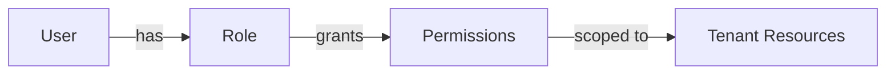
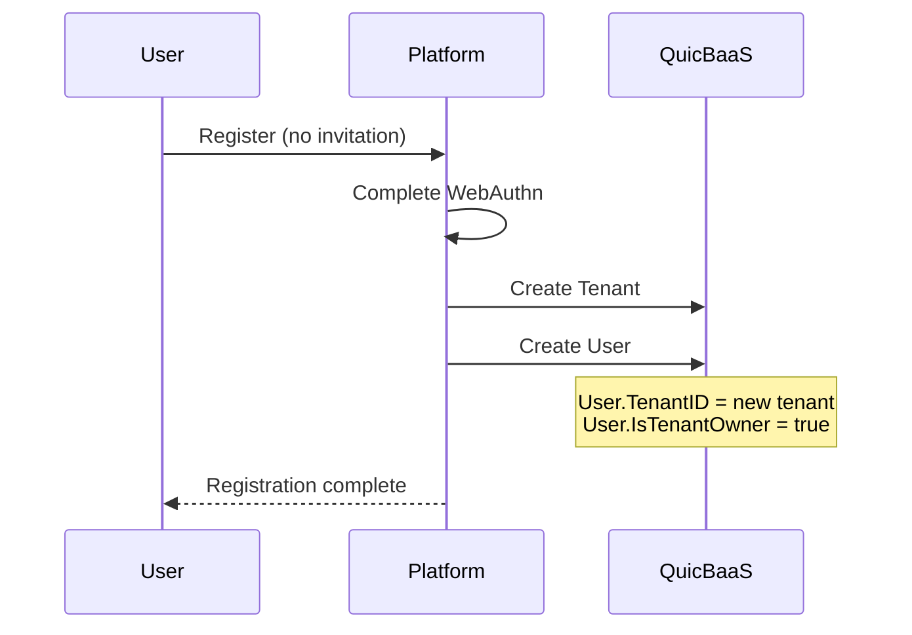
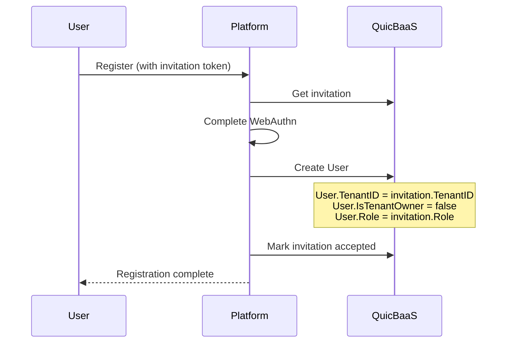
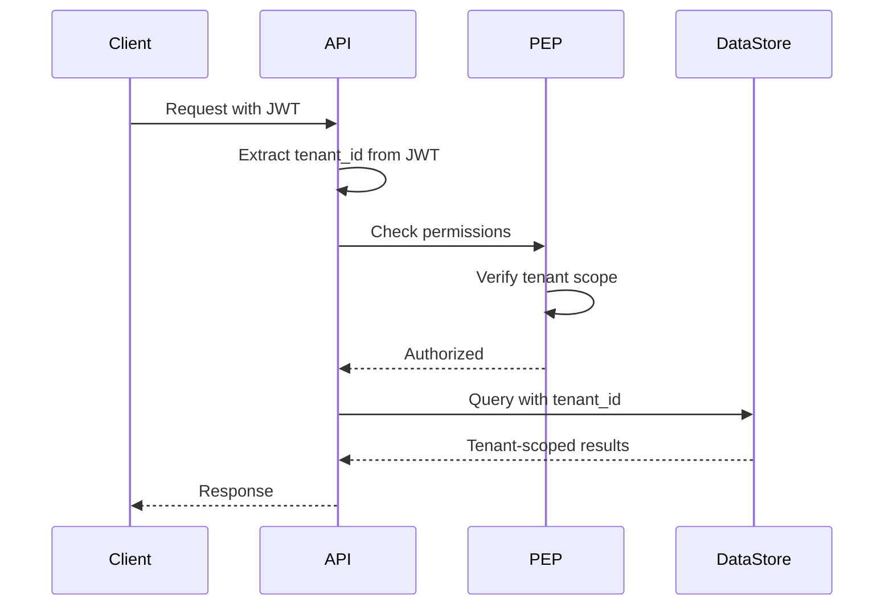

# User-Tenant Relationship

This document describes the user-tenant association model in the Trusted Platform, including ownership, roles, and multi-tenancy isolation principles.

## Table of Contents

- [Overview](#overview)
- [User-Tenant Association Model](#user-tenant-association-model)
- [Tenant Ownership](#tenant-ownership)
- [Roles and Permissions](#roles-and-permissions)
- [Tenant Creation Triggers](#tenant-creation-triggers)
- [Multi-Tenancy Isolation](#multi-tenancy-isolation)
- [Entity Relationships](#entity-relationships)
- [Access Patterns](#access-patterns)

## Overview

In the Trusted Platform, every user belongs to exactly one tenant. The user-tenant relationship is established at registration time and determines the user's access scope for all platform resources.

### Key Principles

| Principle | Description |
|-----------|-------------|
| Single Tenant | Each user belongs to exactly one tenant |
| Tenant Isolation | Users can only access resources within their tenant |
| Immutable Assignment | TenantID cannot be changed after registration |
| Ownership Model | First user becomes tenant owner |

## User-Tenant Association Model

### User Entity with Tenant Context

```go
type User struct {
    ID               uint64    `json:"id"`
    TenantID         string    `json:"tenant_id"`         // Tenant association
    IsTenantOwner    bool      `json:"is_tenant_owner"`   // Ownership flag
    Email            string    `json:"email"`
    DisplayName      string    `json:"display"`
    Roles            []*Role   `json:"roles"`
    // ... other fields
}
```

### Association Diagram

```
                    ┌─────────────────────────────────────┐
                    │              Tenant                 │
                    │                                     │
                    │  ID: tenant-550e8400-e29b-41d4      │
                    │  Name: engineering                  │
                    │  DisplayName: Engineering Dept      │
                    │  State: active                      │
                    │                                     │
                    └──────────────┬──────────────────────┘
                                   │
                    ┌──────────────┼──────────────────────┐
                    │              │                      │
                    ▼              ▼                      ▼
           ┌────────────┐  ┌────────────┐         ┌────────────┐
           │   User A   │  │   User B   │   ...   │   User N   │
           │            │  │            │         │            │
           │ Owner=true │  │ Owner=false│         │ Owner=false│
           │ Role=admin │  │ Role=dev   │         │ Role=viewer│
           └────────────┘  └────────────┘         └────────────┘
```

## Tenant Ownership

### IsTenantOwner Flag

The `IsTenantOwner` boolean flag indicates whether a user is the owner of their tenant.

| Scenario | IsTenantOwner | Description |
|----------|---------------|-------------|
| New registration (no invitation) | `true` | User creates new tenant |
| Invited registration | `false` | User joins existing tenant |

### Owner Privileges

Tenant owners have elevated permissions within their tenant:

| Privilege | Description |
|-----------|-------------|
| Manage users | Invite, remove, and manage user roles |
| Manage invitations | Create and revoke invitations |
| Configure tenant | Update tenant settings |
| Delete tenant | Permanently delete tenant (with all data) |
| Transfer ownership | Assign ownership to another user |

### Owner vs Administrator

```
┌─────────────────────────────────────────────────────────┐
│                    Tenant Owner                         │
│                                                         │
│  ┌───────────────────────────────────────────────────┐  │
│  │                  Admin Role                        │  │
│  │                                                    │  │
│  │  ┌─────────────────────────────────────────────┐  │  │
│  │  │            Member Role                       │  │  │
│  │  │                                              │  │  │
│  │  │  ┌────────────────────────────────────────┐ │  │  │
│  │  │  │           Viewer Role                  │ │  │  │
│  │  │  └────────────────────────────────────────┘ │  │  │
│  │  └─────────────────────────────────────────────┘  │  │
│  └───────────────────────────────────────────────────┘  │
└─────────────────────────────────────────────────────────┘
```

| Role | Permissions |
|------|-------------|
| Owner | Full control + ownership transfer |
| Admin | Manage users, resources, and settings |
| Member | Create and manage own resources |
| Viewer | Read-only access to resources |

## Roles and Permissions

### Role Entity

```go
type Role struct {
    ID          uint64   `json:"id"`
    Name        string   `json:"name"`
    DisplayName string   `json:"display_name"`
    Permissions []string `json:"permissions"`
}
```

### Role Assignment

Roles are assigned to users within the context of their tenant:



### Default Roles

| Role | Default Permissions |
|------|---------------------|
| `owner` | `*:*` (all resources, all actions) |
| `admin` | `user:*`, `resource:*`, `invitation:*` |
| `developer` | `resource:create`, `resource:read`, `resource:update` |
| `viewer` | `resource:read` |

## Tenant Creation Triggers

### Automatic Tenant Creation

A new tenant is created automatically when:

1. **New user registration without invitation**
   - User provides email address
   - Completes WebAuthn registration
   - Platform creates new tenant
   - User assigned as tenant owner



### Tenant Association (Invited Users)

When registering with an invitation:

1. **User follows invitation link**
2. **Completes WebAuthn registration**
3. **Platform associates user with invitation's tenant**
4. **Assigns role from invitation**



## Multi-Tenancy Isolation

### Isolation Layers

```
┌────────────────────────────────────────────────────────────────┐
│                    API / Request Layer                         │
│                                                                │
│    ┌──────────────────────────────────────────────────────┐   │
│    │          JWT Token Validation                         │   │
│    │          - Extract tenant_id claim                    │   │
│    │          - Validate user context                      │   │
│    └──────────────────────────────────────────────────────┘   │
│                              │                                 │
│    ┌──────────────────────────────────────────────────────┐   │
│    │          Policy Enforcement Point (PEP)               │   │
│    │          - Verify resource.tenant_id == user.tenant_id│   │
│    │          - Check role permissions                     │   │
│    └──────────────────────────────────────────────────────┘   │
│                              │                                 │
│    ┌──────────────────────────────────────────────────────┐   │
│    │          Data Access Layer                            │   │
│    │          - Query scoped by tenant_id                  │   │
│    │          - Tenant-prefixed storage keys               │   │
│    └──────────────────────────────────────────────────────┘   │
│                              │                                 │
└──────────────────────────────┼─────────────────────────────────┘
                               │
           ┌───────────────────┼───────────────────┐
           ▼                   ▼                   ▼
    ┌─────────────┐     ┌─────────────┐     ┌─────────────┐
    │  Tenant A   │     │  Tenant B   │     │  Tenant C   │
    │  Resources  │     │  Resources  │     │  Resources  │
    └─────────────┘     └─────────────┘     └─────────────┘
```

### Isolation Mechanisms

| Mechanism | Description |
|-----------|-------------|
| JWT Claims | Token carries tenant_id for request scoping |
| Query Filtering | All queries include tenant_id predicate |
| Key Prefixing | Storage keys prefixed with tenant identifier |
| Network Isolation | None yet: the per-tenant OVS bridge and VLAN range were retired by #708; tenant VRFs come later |
| Key Isolation | Per-tenant DEKs sealed to TPM |

### Request Flow with Tenant Context



## Entity Relationships

### Complete ER Diagram

```
┌─────────────────────┐         ┌─────────────────────┐
│       Tenant        │         │     Invitation      │
├─────────────────────┤         ├─────────────────────┤
│ ID (PK)             │◄───┐    │ ID (PK)             │
│ Name                │    │    │ Token               │
│ DisplayName         │    │    │ TenantID (FK)  ─────┼───┐
│ State               │    │    │ Email               │   │
│ DEKPath             │    │    │ Role                │   │
│ Labels              │    │    │ Status              │   │
│ DEKHandle           │    │    │ InvitedByID (FK)────┼─┐ │
│ CreatedAt           │    │    │ ExpiresAt           │ │ │
│ UpdatedAt           │    │    │ AcceptedAt          │ │ │
└─────────────────────┘    │    └─────────────────────┘ │ │
          ▲                │                            │ │
          │                │                            │ │
          │    ┌───────────┴────────────────────────────┘ │
          │    │                                          │
          │    │    ┌─────────────────────┐               │
          │    │    │        User         │               │
          │    │    ├─────────────────────┤               │
          │    │    │ ID (PK)             │◄──────────────┘
          │    └────│ TenantID (FK)  ─────┼───────────────┘
          │         │ IsTenantOwner       │
          │         │ Email               │
          │         │ DisplayName         │
          │         │ Credentials         │
          │         │ Roles (FK)          │──────┐
          │         │ CreatedAt           │      │
          │         │ UpdatedAt           │      │
          │         └─────────────────────┘      │
          │                                      │
          │                                      ▼
          │                          ┌─────────────────────┐
          │                          │        Role         │
          │                          ├─────────────────────┤
          └──────────────────────────│ TenantID (scope)    │
                                     │ ID (PK)             │
                                     │ Name                │
                                     │ Permissions         │
                                     └─────────────────────┘
```

### Key Relationships

| Relationship | Type | Description |
|--------------|------|-------------|
| Tenant -> Users | 1:N | Tenant has many users |
| Tenant -> Invitations | 1:N | Tenant has many invitations |
| User -> Roles | N:N | Users can have multiple roles |
| User -> Invitation | 1:1 | User may have one invitation (joined via) |

## Access Patterns

### Common Queries

| Query | Index | Pattern |
|-------|-------|---------|
| Get users by tenant | `TenantID` | `WHERE tenant_id = ?` |
| Get user by email | `Email` | `WHERE email = ?` |
| Get pending invitations | `TenantID + Status` | `WHERE tenant_id = ? AND status = 'pending'` |
| Check ownership | `ID + IsTenantOwner` | `WHERE id = ? AND is_tenant_owner = true` |

### Access Control Pseudocode

```go
func CanAccessResource(ctx context.Context, user *User, resource *Resource) bool {
    // 1. Verify tenant match
    if user.TenantID != resource.TenantID {
        return false
    }

    // 2. Check ownership privileges
    if user.IsTenantOwner {
        return true  // Owners have full access
    }

    // 3. Check role-based permissions
    for _, role := range user.Roles {
        if role.HasPermission(resource.Type, action) {
            return true
        }
    }

    return false
}
```

## Related Documentation

- [Tenant Architecture](architecture.md) - Complete multi-tenancy architecture
- [User Registration](../iam/user-registration.md) - Registration process
- [Invitation Flow](../auth/invitation-flow.md) - Invitation lifecycle
- [Invitation API Reference](../iam/api-reference-invitations.md) - Invitation REST API endpoints
- [ABAC Policies](../iam/abac-policies.md) - Fine-grained access control
- [Tenant Isolation](isolation.md) - Network and storage isolation
