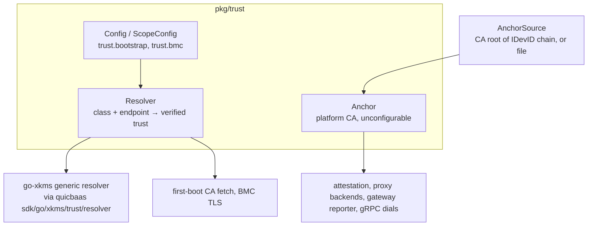

# Trust — Architecture

> **Status: NORMATIVE** · Scope: the platform trust anchor and trust resolver (`pkg/trust`) · Last verified: 2026-10-11
> Conflicts with this document are defects. Fix them here first.
> The feature folder is: [architecture.md](architecture.md) · [engineering.md](engineering.md) · [cli.md](cli.md) · [api.md](api.md) · [user.md](user.md).

---

## 1. The problem

A platform node asks two different questions when it opens a TLS connection or
admits a caller:

1. **Is this peer a platform service?** Every certificate the platform issues
   chains to the platform CA. There is exactly one correct answer, so it is a
   fact every node holds, not a setting.
2. **How do I verify a peer the platform did NOT issue — or verify before this
   node holds the platform CA at all?** A baseboard management controller
   presents a self-signed or vendor certificate; a node on first boot has no CA
   bundle yet. This is a policy, and an operator chooses it.

Conflating the two (the earlier `default` / `bmc` / `internal` class model)
made "verify a platform service" look like a choice an operator could get
wrong. It was split.

## 2. The shape chosen

| Piece | Question it answers | Configured? |
|---|---|---|
| `Anchor` | Is the peer a platform service? | **No.** Fed by an `AnchorSource` chosen by node type |
| `Resolver` | Can I trust a non-platform peer, or acquire the platform CA? | **Yes**, the `trust:` section |

### 2.1 Platform anchor

`Anchor` hands out the platform CA certificates as a `[]*x509.Certificate`,
`*x509.CertPool` or client `*tls.Config`. Its source is read on **every** call,
never cached, so a rotated CA or a node that enrolls after start-up takes
effect on the next verification, not the next restart.

| Node | `AnchorSource` |
|---|---|
| Control plane | its own CA: the root of the chain that issued its IDevID (`App.PlatformAnchor`) |
| Enrolled platformd node | the control plane's CA: the root of its IDevID issuing chain, which enrollment imports into the node's certificate store |
| gatewayd | `FileAnchorSource` over the top-level `platform-ca-file:` key — the bundle provisioning projects onto a node that runs no CA |

Fail-closed behaviour: a node that has not enrolled has no anchor and
verification fails with `ErrAnchorUnavailable`; a source that yields no CA
certificate fails with `ErrAnchorEmpty`. Nothing else is ever trusted in its
place. Non-CA certificates in a provisioned bundle are dropped — a leaf is not a
trust anchor.

### 2.2 Trust classes (the resolver)

The resolver maps a **class** and a peer **endpoint** to a verified
`*tls.Config`, `*x509.CertPool` or raw CA-bundle PEM by walking the class's
ordered **strategy chain** and returning the first success.

| Class | Used for | Allowed strategies |
|---|---|---|
| `bootstrap` | acquiring the platform CA bundle before a node holds it | `dane`, `noise`, `spki`, `embedded`, `tofu` |
| `bmc` | baseboard management controllers (Redfish, IPMI-over-TLS, vendor endpoints) | `dane`, `spki`, `ca-file`, `tofu` |

Once the bundle is acquired it *becomes* the node's anchor. Platform-issued peers
are never verified through a class.

## 3. Alternatives rejected

| Alternative | Why not |
|---|---|
| A third class (`internal`, later `platform`) configured in `trust:` | The platform CA has one answer. A configurable class lets a mis-edit silently trust something else, and config decoding ignores unknown keys so a stale `trust.internal` would vanish without error |
| A `default` class for everything unclassified | "Default trust" is the failure mode: an unknown or unconfigured class must be a typed error, never a fallback |
| Caching the anchor at start-up | A node that enrolls after boot, or a CA rotation, would need a restart |
| Reimplementing DANE / Noise / SPKI fetch locally | Owned by go-xkms; the platform consumes it through the quicbaas SDK re-export (SDK-consumption invariant) |
| `tofu` barred for `bmc` (previous rule) | It only fetched a bundle, and a BMC serves none. go-xkms v0.12.0-alpha made `tofu` pin the endpoint's SPKI on first contact and persist it, so it is allowed again |

## 4. Component boundaries

| Concern | Owner |
|---|---|
| Class constants, per-class strategy allowlists, `Config` validation, `Anchor`, `AnchorSource`, typed errors | **this repo**, `pkg/trust/` |
| Strategy dispatch, per-strategy fetch (DANE, Noise_NK, SPKI, CA file, TOFU), caching, OS-store install | **go-xkms** `pkg/trust/resolver`, reached through `quicbaas/sdk/go/xkms/trust/resolver` |
| TOFU pin persistence | platform `quicbaas.NewTOFUPinStore` over the SDK client, wired by `App.buildTOFUResolverOpts` |
| CA bundle publication (DANE TLSA, Noise server, `/api/v1/ca/bootstrap`) | [`docs/bootstrap/`](../bootstrap/) |

`pkg/trust` imports only the quicbaas SDK, never go-xkms directly.

## 5. Data flow

1. **Anchor.** A consumer calls `Anchor.CAPool(ctx)` or `TLSConfig(ctx)`; the
   anchor reads its source, filters to CA certificates, and returns a pool or a
   typed error.
2. **Resolver.** A consumer calls `Resolver.TLSConfig(ctx, class, endpoint)`.
   `Config.ToGeneric()` already projected each class into a go-xkms scope; the
   generic resolver walks the chain. Failures are wrapped into platform errors
   that carry the `Class`.
3. **Install.** `CABundlePEM` returns the bundle; `InstallToSystemTrust` writes
   it to a certificate path. The caller runs the OS refresh command.

### Consumers

| Consumer | Uses | Feature |
|---|---|---|
| attestation caller admission and collection | anchor | [`docs/attestation/`](../attestation/) |
| proxy backends with `tls.trust-class: platform`, proxy client CAs | anchor | [`docs/proxy/`](../proxy/) |
| proxy backends with `tls.trust-class: bmc` | resolver, class `bmc` | [`docs/proxy/`](../proxy/) |
| gateway control-plane reporter, secret-store session, platformd gRPC dial | anchor | [`docs/gateway/`](../gateway/) |
| BMC enrollment, restore, certificate init, standalone BMC CLI | resolver, class `bmc` | [`docs/bmc/`](../bmc/) |
| first-boot CA fetch (`platformctl bootstrap trust`, orchestrator, PXE) | resolver, class `bootstrap` | [`docs/bootstrap/`](../bootstrap/) |

## 6. Trust boundaries

- The `bootstrap` class runs **before** the node holds a CA: its strategies
  establish trust from DNSSEC (`dane`), a pre-shared static key (`noise`), a
  pinned digest (`spki`), the image (`embedded`) or first contact (`tofu`).
- `tofu` is never an implicit fallback; it must be listed. It requires a
  `TOFUPinStore` at construction.
- TLS verification is never skipped on any path in this package.
- The pin captured by `tofu` is logged as a warning ("verify this host
  manually") by the default confirm hook.

## 7. What it deliberately does not do

- Configure the platform CA. There is no `trust.platform`, `trust.internal` or
  `trust.default`.
- Publish a CA bundle (see `docs/bootstrap/`) or issue certificates (see
  `docs/ca/`).
- Expose a network API. Trust is an in-process library; see [api.md](api.md).
- Run the OS trust-store refresh command after `InstallToSystemTrust`.
